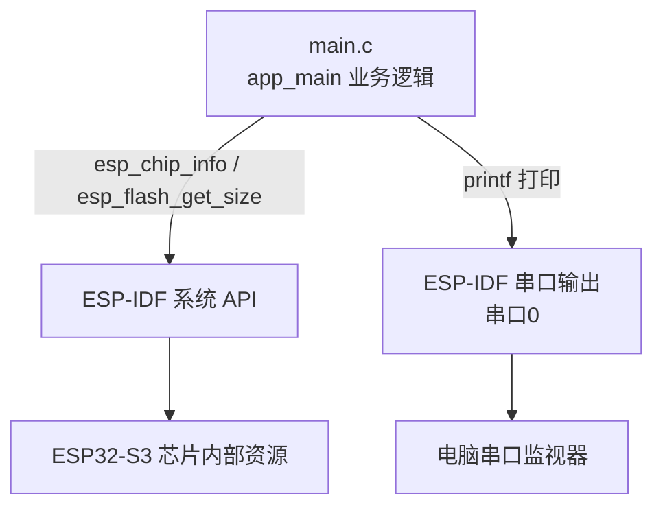
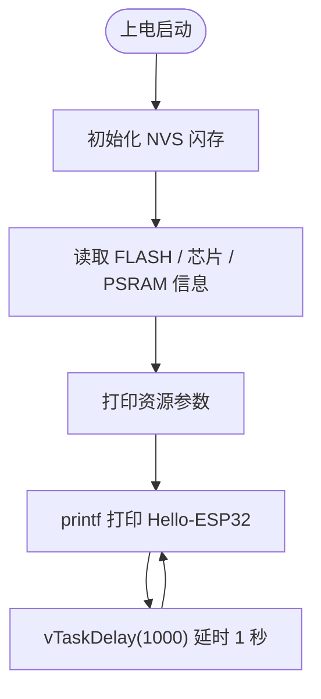

# 00 ESP32-IDF 基础工程

> 平台：正点原子 ESP32-S3 开发板 ｜ 框架：ESP-IDF ｜ 难度：★☆☆☆☆
>
> 一句话简介：搭建并跑通第一个 ESP-IDF 工程，串口打印芯片信息，并每隔 1 秒输出一次 "Hello-ESP32"。

---

## 1. 实验简介

这是学习 ESP32-S3 的**第一步**：认识一个最简单的 ESP-IDF 工程长什么样，并学会把它编译、烧录到开发板上运行。程序本身不操作任何外设，只做两件事：

1. 上电后读取并打印 ESP32-S3 的内部资源信息（CPU 内核数、FLASH 大小、PSRAM 大小）；
2. 每隔 1000ms 通过串口打印一次 `Hello-ESP32`。

学完本实验你将掌握：

- ESP-IDF 工程的入口函数 `app_main()` 的写法；
- 用 `esp_chip_info()` / `esp_flash_get_size()` / `esp_psram_get_size()` 查询芯片资源；
- 用 `nvs_flash_init()` 初始化 NVS 闪存；
- 完整的「编译 → 烧录 → 串口监视」开发流程。

## 2. 生活类比

把这个实验想象成**新员工入职第一天报到**：你还没开始干正事，先到前台登记（初始化 NVS），然后报出自己的基本信息——「我叫什么、有几个脑袋、背多大的书包」（内核数、FLASH、PSRAM），最后每隔一秒喊一声「我在岗！」（Hello-ESP32），证明自己活得好好的。以后的每个实验，都是在这声「我在岗」的基础上加真本事。

## 3. 硬件连接

本实验**不需要任何外接硬件**，也不使用板载 LED，只要一根 USB 线把开发板连到电脑即可。

| 元件 | 开发板引脚 | 说明 |
| :--- | :--- | :--- |
| 无 | — | 仅需 USB 线供电 + 串口通信 |

### 连接图


## 4. 程序架构

本实验没有驱动层，`main.c` 直接调用 ESP-IDF 提供的系统 API，是最扁平的结构，非常适合用来认识 IDF 工程：



## 5. 程序流程



## 6. 核心代码讲解

### 6.1 查询并打印芯片资源（`main.c`）

```c
esp_err_t ret;
uint32_t flash_size;
esp_chip_info_t chip_info;                  /* 定义芯片信息结构体变量 */

ret = nvs_flash_init();                     /* 初始化NVS */

if (ret == ESP_ERR_NVS_NO_FREE_PAGES || ret == ESP_ERR_NVS_NEW_VERSION_FOUND)
{
    ESP_ERROR_CHECK(nvs_flash_erase());
    ret = nvs_flash_init();
}

esp_flash_get_size(NULL, &flash_size);      /* 获取FLASH大小 */

esp_chip_info(&chip_info);
printf("内核：cup数量%d\n",chip_info.cores);                     /* 获取CPU内核数并显示 */
printf("FLASH size:%ld MB flash\n",flash_size / (1024 * 1024)); /* 获取FLASH大小并显示 */
printf("PSRAM size: %d bytes\n", esp_psram_get_size());         /* 获取PARAM大小并显示 */
```

**讲解**：

- `nvs_flash_init()` 初始化 NVS（一块保存 Wi-Fi 密码等键值配置的闪存区），是官方推荐的开场动作；若返回「没有空闲页」或「发现新版本」，就先 `nvs_flash_erase()` 擦除再重来；
- `esp_chip_info()` 把芯片型号、内核数等信息填进 `esp_chip_info_t` 结构体，`chip_info.cores` 就是 CPU 核数（ESP32-S3 为双核）；
- `esp_flash_get_size(NULL, &flash_size)` 第一个参数传 `NULL` 表示查询默认 SPI FLASH，结果单位是字节，除以 `1024*1024` 换算成 MB；
- `esp_psram_get_size()` 返回片外 PSRAM（伪静态内存）的字节数，可用来确认 PSRAM 是否被正确识别；
- `printf()` 的输出会走串口0，最终显示在电脑的串口监视器里。

### 6.2 主循环：定时打招呼

```c
while(1)
{
    printf("Hello-ESP32\r\n");
    vTaskDelay(1000);
}
```

**讲解**：`app_main()` 是 ESP-IDF 程序的入口。这里用 `while(1)` 死循环不断打印问候语，`vTaskDelay(1000)` 让当前任务「睡」1000 个 Tick（默认 1 Tick = 1ms，即约 1 秒）。睡眠期间 CPU 会交给 FreeRTOS 里的其他任务，而不是空转浪费——这是嵌入式延时的正确姿势。

## 7. 实验效果

烧录并复位后，打开串口监视器（波特率 115200），可以看到：

1. 开头打印一次芯片资源信息，例如内核数、FLASH 大小（MB）、PSRAM 大小（字节）；
2. 之后每隔约 1 秒打印一行 `Hello-ESP32`，循环往复。

## 8. 注意事项

1. 串口监视器波特率需与工程默认一致（**115200**），否则看到乱码。
2. 用 `idf.py monitor` 时按 `Ctrl + ]` 可退出监视器。
3. 打印 FLASH/PSRAM 大小的前提是芯片确实焊接并识别了对应存储器；若 PSRAM 打印为 0，检查 `menuconfig` 中 PSRAM 相关配置是否开启。

## 9. 编译与烧录

```bash
idf.py set-target esp32s3   # 首次配置目标芯片
idf.py build                # 编译
idf.py -p COMx flash monitor  # 烧录并打开串口监视器（COMx 换成你的端口号）
```

> 完整的开发环境搭建与烧录说明见 [根目录 README](../README.md)。

---

## 小结

本实验带你跑通了「建工程 → 写 `app_main` → 编译烧录 → 串口看结果」的完整闭环，并学会了用系统 API 查询芯片的「家底」。这个最小工程就是后续所有实验的模板，请确保能独立完成整个流程。

| 关键 API | 作用 |
| :--- | :--- |
| `app_main()` | ESP-IDF 程序入口 |
| `nvs_flash_init()` | 初始化 NVS 配置闪存区 |
| `esp_chip_info()` | 查询芯片型号、内核数等信息 |
| `esp_flash_get_size()` | 查询 FLASH 容量 |
| `esp_psram_get_size()` | 查询 PSRAM 容量 |
| `vTaskDelay()` | FreeRTOS 非阻塞延时 |
