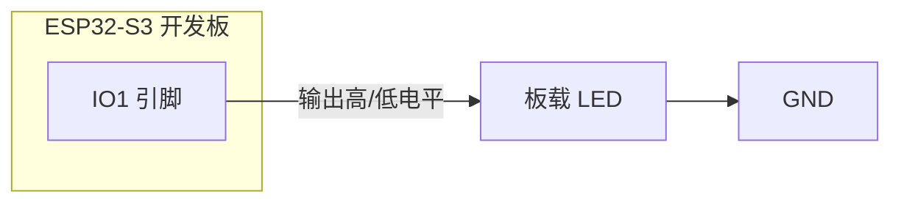
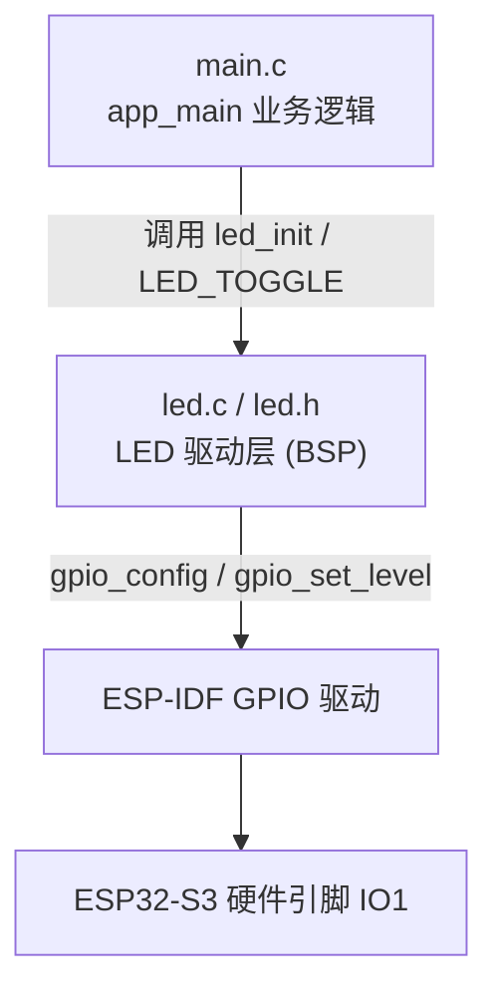
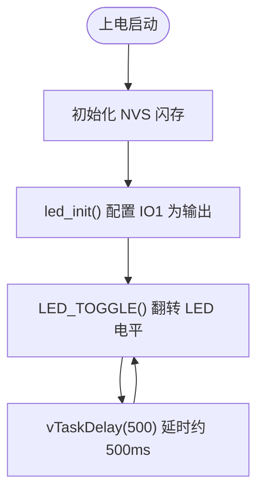

# 01 LED 灯实验

> 平台：正点原子 ESP32-S3 开发板 ｜ 框架：ESP-IDF ｜ 难度：★☆☆☆☆
>
> 一句话简介：让板载 LED 每 500ms 闪烁一次，掌握 **GPIO 输出** 这一嵌入式最基本的技能。

---

## 1. 实验简介

这是所有嵌入式实验的「Hello World」。我们把 ESP32-S3 的一个引脚（IO1）配置成**输出模式**，通过程序控制它输出高电平或低电平，从而点亮 / 熄灭 LED，并让它按固定频率闪烁。

学完本实验你将掌握：

- 用 `gpio_config()` 一次性配置一个 GPIO 引脚；
- 用 `gpio_set_level()` / `gpio_get_level()` 设置和读取引脚电平；
- 在 FreeRTOS 里用 `vTaskDelay()` 做「不堵塞 CPU」的延时。

## 2. 生活类比

把 GPIO 引脚想象成家里的**电灯开关**：

- 配置引脚为输出 = 先把开关装到墙上（决定这个引脚是「控制别人」还是「被别人控制」）；
- `gpio_set_level(pin, 1)` = 按下开关，灯亮；
- `gpio_set_level(pin, 0)` = 松开开关，灯灭；
- `vTaskDelay(500)` = 你按着开关等半秒再松开——但在这半秒里，CPU 可以去干别的事（这就是它和普通「死循环空转延时」的区别）。

## 3. 硬件连接

### 引脚分配

| 元件 | 开发板引脚 | 说明 |
| :--- | :--- | :--- |
| LED（板载） | IO1 | 高电平点亮，低电平熄灭 |

> 本实验使用开发板**板载 LED**，无需外接任何元件，一根 USB 线即可。

### 连接图



## 4. 程序架构

代码分成两层：`main.c` 负责业务逻辑（何时亮、何时灭），`components/BSP/LED` 负责底层驱动（怎么操作引脚）。这样以后换引脚只改驱动即可，业务代码不用动。



## 5. 程序流程



## 6. 核心代码讲解

### 6.1 驱动层：初始化引脚（`led.c`）

```c
void led_init(void)
{
    gpio_config_t gpio_init_struct = {0};

    gpio_init_struct.intr_type = GPIO_INTR_DISABLE;         /* 失能引脚中断 */
    gpio_init_struct.mode = GPIO_MODE_INPUT_OUTPUT;         /* 输入输出模式 */
    gpio_init_struct.pull_up_en = GPIO_PULLUP_ENABLE;       /* 使能上拉 */
    gpio_init_struct.pull_down_en = GPIO_PULLDOWN_DISABLE;  /* 失能下拉 */
    gpio_init_struct.pin_bit_mask = 1ull << LED_GPIO_PIN;   /* 要配置的引脚位掩码 */
    gpio_config(&gpio_init_struct);                         /* 一次性完成配置 */

    LED(1);                                                 /* 初始关闭 LED */
}
```

**讲解**：`gpio_config_t` 是一张「引脚配置表」，填好后交给 `gpio_config()` 一次生效。

- `mode` 决定引脚角色，这里设为 `INPUT_OUTPUT`（既能输出也能读回自身电平，方便翻转）；
- `pin_bit_mask` 用 `1ull << 引脚号` 表示要配置哪个引脚，可同时配置多个；
- `pull_up_en` 上拉电阻，让引脚在没有驱动时默认保持高电平，状态更稳定。

驱动层还用宏把「翻转」封装得很简洁（`led.h`）：

```c
#define LED_GPIO_PIN  GPIO_NUM_1
#define LED(x)        do{ x ? gpio_set_level(LED_GPIO_PIN, PIN_SET) \
                            : gpio_set_level(LED_GPIO_PIN, PIN_RESET); }while(0)
#define LED_TOGGLE()  do{ gpio_set_level(LED_GPIO_PIN, !gpio_get_level(LED_GPIO_PIN)); }while(0)
```

`LED_TOGGLE()` 的意思是：先读当前电平，再写入它的相反值——亮就变灭、灭就变亮。

### 6.2 业务层：主循环闪烁（`main.c`）

```c
void app_main(void)
{
    esp_err_t ret = nvs_flash_init();               /* 初始化 NVS */
    if (ret == ESP_ERR_NVS_NO_FREE_PAGES || ret == ESP_ERR_NVS_NEW_VERSION_FOUND)
    {
        ESP_ERROR_CHECK(nvs_flash_erase());         /* 出错则擦除后重来 */
        ret = nvs_flash_init();
    }

    led_init();                                     /* 初始化 LED */

    while (1)
    {
        LED_TOGGLE();                               /* 翻转 LED */
        vTaskDelay(500);                            /* 延时约 500ms */
    }
}
```

**讲解**：

- `app_main()` 是 ESP-IDF 程序的入口，相当于普通单片机的 `main()`；
- `nvs_flash_init()` 初始化 NVS（一块存 Wi-Fi 密码等配置的闪存区），是官方推荐的开场动作；
- `while(1)` 里不断「翻转 → 延时」，就形成了 500ms 一次的闪烁。

## 7. 实验效果

程序烧录并复位后，**板载 LED 以约 500ms 的间隔匀速闪烁**（亮半秒、灭半秒，循环往复）。

## 8. 注意事项

1. LED 配置为**纯输出模式**时，不能用 `gpio_get_level()` 读回电平；需要读回自身状态时，应配置为「输入」或「输入输出」模式（本例用的正是 `INPUT_OUTPUT`）。
2. `vTaskDelay()` 的参数单位是 **Tick（时钟节拍）**，默认 1 Tick = 1ms，所以 `vTaskDelay(500)` ≈ 500ms；若修改过 `configTICK_RATE_HZ` 需重新换算。

## 9. 编译与烧录

```bash
idf.py set-target esp32s3   # 首次配置目标芯片
idf.py build                # 编译
idf.py -p COMx flash monitor  # 烧录并打开串口监视器（COMx 换成你的端口号）
```

> 完整的开发环境搭建与烧录说明见 [根目录 README](../README.md)。

---

## 小结

本实验用一个闪烁的 LED 打通了「配置引脚 → 控制电平 → 循环延时」这条最基本的路径。GPIO 输出是驱动蜂鸣器、继电器、屏幕背光等一切「控制类」外设的基础，务必熟练掌握。

| 关键 API | 作用 |
| :--- | :--- |
| `gpio_config()` | 一次性配置引脚的模式、上下拉、中断 |
| `gpio_set_level()` | 设置引脚输出高 / 低电平 |
| `gpio_get_level()` | 读取引脚电平 |
| `vTaskDelay()` | FreeRTOS 非阻塞延时 |
