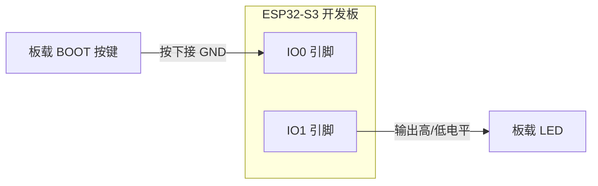
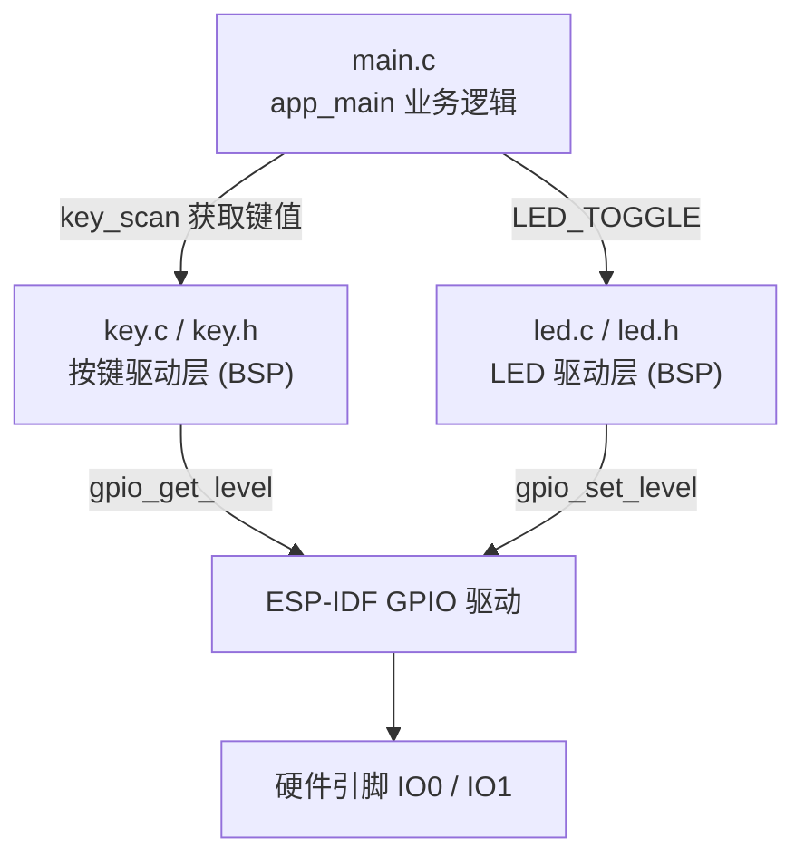
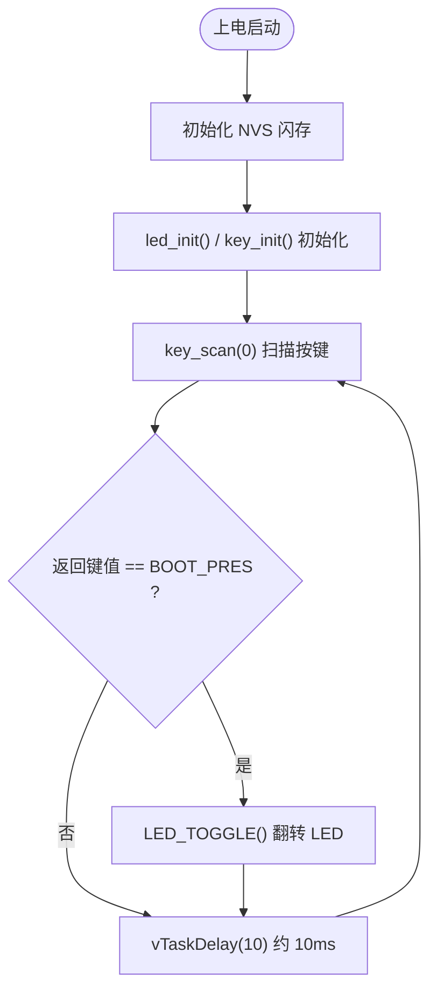

# 02 按键输入实验

> 平台：正点原子 ESP32-S3 开发板 ｜ 框架：ESP-IDF ｜ 难度：★☆☆☆☆
>
> 一句话简介：用板载 BOOT 按键控制 LED 亮灭，掌握 **GPIO 输入**、按键消抖与扫描的基本套路。

---

## 1. 实验简介

上一个实验我们让 GPIO「说话」（输出电平），这个实验让 GPIO「听话」（读取电平）。我们把 BOOT 按键所在的 IO0 配置为**输入模式**，程序不断扫描它的电平：按下时引脚被拉低，检测到后翻转 LED 状态。

学完本实验你将掌握：

- 用 `gpio_config()` 把引脚配置为输入模式并使能上拉；
- 用 `gpio_get_level()` 读取引脚电平；
- 按键**消抖**的原理与软件实现；
- 经典的「按键扫描函数」写法（支持 / 不支持连按）。

## 2. 生活类比

按键就像**门铃按钮**：平时弹簧把它顶在高电平（1），你一按就接通到低电平（0）。但机械触点按下的一瞬间会「抖动」——像门铃接触不良时发出的一串杂音，几毫秒内快速地按了又松、松了又按。如果程序太老实，会把一次按键当成好几次。解决办法很简单：发现电平变低后，**先等 10ms 再看一眼**——抖动的杂音早就停了，还按着才算真按下了。

## 3. 硬件连接

### 引脚分配

| 元件 | 开发板引脚 | 说明 |
| :--- | :--- | :--- |
| LED（板载） | IO1 | 高电平点亮，低电平熄灭 |
| BOOT 按键（板载） | IO0 | 按下接地（低电平），使能上拉 |

> 本实验全部使用**板载资源**，无需外接元件，一根 USB 线即可。

### 连接图



## 4. 程序架构

代码分三层：`main.c` 负责业务（收到键值后翻转 LED），`key.c` 负责按键扫描（含消抖），`led.c` 负责 LED 引脚操作。



## 5. 程序流程



## 6. 核心代码讲解

### 6.1 驱动层：按键初始化与扫描（`key.c`）

```c
void key_init(void)
{
    gpio_config_t gpio_init_struct;

    gpio_init_struct.intr_type = GPIO_INTR_DISABLE;         /* 失能引脚中断 */
    gpio_init_struct.mode = GPIO_MODE_INPUT;                /* 输入模式 */
    gpio_init_struct.pull_up_en = GPIO_PULLUP_ENABLE;       /* 使能上拉 */
    gpio_init_struct.pull_down_en = GPIO_PULLDOWN_DISABLE;  /* 失能下拉 */
    gpio_init_struct.pin_bit_mask = 1ull << BOOT_GPIO_PIN;  /* BOOT按键引脚 */
    gpio_config(&gpio_init_struct);                         /* 配置使能 */
}
```

**讲解**：与 LED 实验的区别在于 `mode` 设为 `GPIO_MODE_INPUT`（只读不写），并且**使能上拉**——按键没按下时，上拉电阻把 IO0 稳稳拉在高电平；按下时按键把引脚接到 GND，电平变低。这样「松开=1、按下=0」，读电平就知道按键状态。

再看带消抖的扫描函数：

```c
uint8_t key_scan(uint8_t mode)
{
    uint8_t keyval = 0;
    static uint8_t key_boot = 1;    /* 按键松开标志 */

    if(mode)
    {
        key_boot = 1;
    }

    if (key_boot && (BOOT == 0))    /* 按键松开标志为1，且有任意一个按键按下了 */
    {
        vTaskDelay(10);             /* 去抖动 */
        key_boot = 0;

        if (BOOT == 0)
        {
            keyval = BOOT_PRES;
        }
    }
    else if (BOOT == 1)
    {
        key_boot = 1;
    }

    return keyval;                  /* 返回键值 */
}
```

**讲解**：

- `BOOT` 是 `key.h` 里的宏，本质就是 `gpio_get_level(GPIO_NUM_0)`，读 IO0 电平；
- 第一次发现电平为 0 时，先 `vTaskDelay(10)` 等 10ms 让机械抖动过去，**再读一次**仍为 0 才返回键值 `BOOT_PRES`；
- `static` 变量 `key_boot` 是「已松开」标志：按下确认后置 0，必须等引脚回到高电平（松手）才重新置 1。这保证了**按住不放时只触发一次**；
- 参数 `mode` 传 1 时每次都把标志重置，即支持「连按」（按住不放会连续返回键值）。

### 6.2 业务层：按键控制 LED（`main.c`）

```c
led_init();                 /* 初始化LED */
key_init();                 /* KEY初始化 */

while(1)
{
    key = key_scan(0);      /* 获取键值 */

    switch (key)
    {
        case BOOT_PRES:     /* BOOT被按下 */
        {
            LED_TOGGLE();   /* LED状态翻转 */
            break;
        }
        default:
        {
            break;
        }
    }

    vTaskDelay(10);
}
```

**讲解**：主循环以约 10ms 的节奏反复调用 `key_scan(0)`（不支持连按模式）。只有真正检测到「BOOT 按下」这一事件时才 `LED_TOGGLE()` 翻转 LED，其余时间什么都不做。用 `switch` 判断键值，是方便以后扩展多个按键的惯用写法。

## 7. 实验效果

程序烧录并复位后：

- **每按一下板载 BOOT 按键，LED 就切换一次状态**（亮→灭、灭→亮）；
- 按住不放不会连续翻转，必须松开再按才有效（因为 `key_scan(0)` 是不连按模式）。

## 8. 注意事项

1. IO0 是 ESP32-S3 的 **BOOT/下载模式引脚**：烧录程序时若提示进入下载模式，按住 BOOT 再按复位即可；正常运行时它当普通按键用没有问题。
2. 消抖延时 10ms 是经验值，太小消抖不干净，太大响应变慢。
3. `key_scan()` 内部已经调用了 `vTaskDelay(10)` 消抖，主循环里的 `vTaskDelay(10)` 用于控制整体扫描节奏，两者配合即可，不必再额外消抖。

## 9. 编译与烧录

```bash
idf.py set-target esp32s3   # 首次配置目标芯片
idf.py build                # 编译
idf.py -p COMx flash monitor  # 烧录并打开串口监视器（COMx 换成你的端口号）
```

> 完整的开发环境搭建与烧录说明见 [根目录 README](../README.md)。

---

## 小结

本实验打通了「配置输入引脚 → 读电平 → 消抖 → 得到键值 → 控制输出」这条按键处理的标准链路。消抖和「松开标志」是按键编程的灵魂，几乎所有产品级代码都会用到类似写法，务必吃透 `key_scan()` 的每一行。

| 关键 API | 作用 |
| :--- | :--- |
| `gpio_config()` | 配置引脚为输入模式、使能上拉 |
| `gpio_get_level()` | 读取引脚电平（宏 `BOOT` 的本质） |
| `vTaskDelay()` | 消抖延时 / 控制扫描节奏 |
| `LED_TOGGLE()` | 翻转 LED 状态（BSP 驱动宏） |
