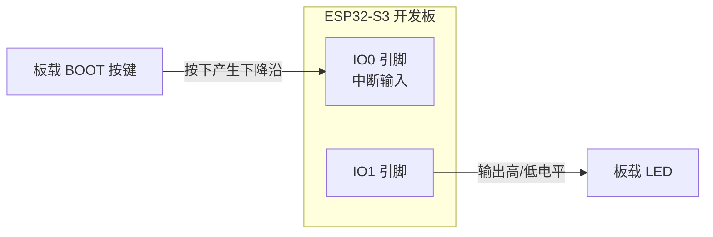
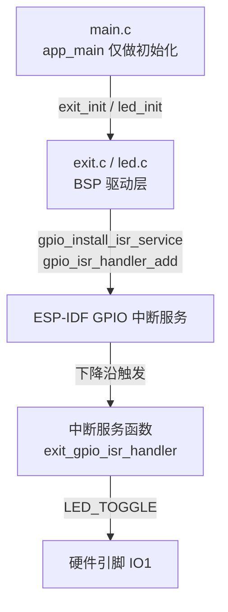
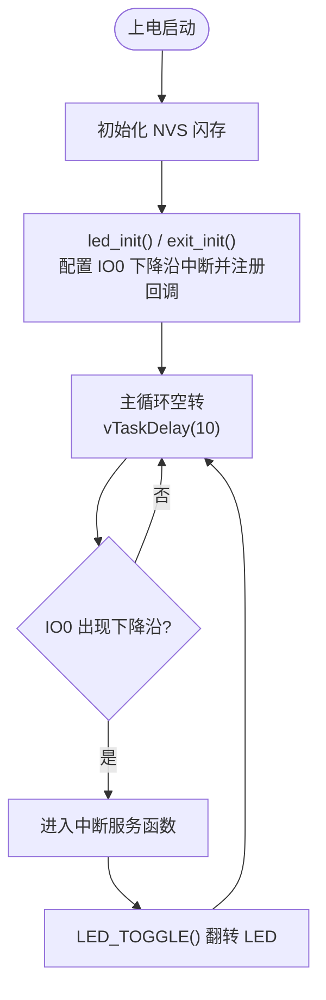

# 03 外部中断实验

> 平台：正点原子 ESP32-S3 开发板 ｜ 框架：ESP-IDF ｜ 难度：★★☆☆☆
>
> 一句话简介：BOOT 按键触发 **GPIO 下降沿中断**，在中断服务函数里翻转 LED，理解「事件驱动」编程。

---

## 1. 实验简介

按键实验里，CPU 需要不停地「巡逻」查询引脚电平（轮询），大部分时间都在做无用功。本实验改用**外部中断**：让硬件盯着 IO0，一旦电平出现下降沿（按键按下），立刻打断 CPU 去执行一小段「中断服务函数」，其余时间 CPU 该干嘛干嘛。

学完本实验你将掌握：

- 在 `gpio_config()` 中配置中断触发类型（`GPIO_INTR_NEGEDGE` 下降沿）；
- 用 `gpio_install_isr_service()` 安装 GPIO 中断服务；
- 用 `gpio_isr_handler_add()` 给指定引脚注册回调函数；
- `IRAM_ATTR` 属性的作用与中断函数的编写规矩。

## 2. 生活类比

轮询像你**每隔十秒看一眼门口**，怕错过快递；中断则像**装了门铃**——快递员一按铃（电平下降沿），铃声直接把你叫到门口（触发中断服务函数），平时你安心做自己的事。不过门铃响的那几分钟你只能干「开门收快递」这一件事，所以中断函数要**短平快**：签收完赶紧回去，别在门口跟快递员聊天（别在中断里做耗时操作）。

## 3. 硬件连接

### 引脚分配

| 元件 | 开发板引脚 | 说明 |
| :--- | :--- | :--- |
| LED（板载） | IO1 | 高电平点亮，低电平熄灭 |
| BOOT 按键（板载） | IO0 | 下降沿触发中断，使能上拉 |

> 全部使用**板载资源**，无需外接元件。

### 连接图



## 4. 程序架构

`main.c` 只做初始化，之后几乎「躺平」；真正的业务逻辑跑在**中断上下文**里的 `exit.c`。



## 5. 程序流程



## 6. 核心代码讲解

### 6.1 驱动层：配置中断并注册回调（`exit.c`）

```c
void exit_init(void)
{
    gpio_config_t gpio_init_struct;

    /* 配置BOOT引脚和外部中断 */
    gpio_init_struct.mode = GPIO_MODE_INPUT;                    /* 选择为输入模式 */
    gpio_init_struct.pull_up_en = GPIO_PULLUP_ENABLE;           /* 上拉使能 */
    gpio_init_struct.pull_down_en = GPIO_PULLDOWN_DISABLE;      /* 下拉失能 */
    gpio_init_struct.intr_type = GPIO_INTR_NEGEDGE;             /* 下降沿触发 */
    gpio_init_struct.pin_bit_mask = 1ull << BOOT_INT_GPIO_PIN;  /* 配置BOOT按键引脚 */
    gpio_config(&gpio_init_struct);                             /* 配置使能 */
    
    /* 注册中断服务 */
    gpio_install_isr_service(0);
    
    /* 设置GPIO的中断回调函数 */
    gpio_isr_handler_add(BOOT_INT_GPIO_PIN, exit_gpio_isr_handler, (void*) BOOT_INT_GPIO_PIN);
}
```

**讲解**：与按键实验相比，唯一的配置差别是 `intr_type` 从 `GPIO_INTR_DISABLE` 换成了 **`GPIO_INTR_NEGEDGE`（下降沿触发）**——即电平从高变低的那一瞬间触发中断，正好对应「按下按键」。之后分两步接入软件：

- `gpio_install_isr_service(0)`：安装 ESP-IDF 的 GPIO 中断服务（全局只装一次），参数 0 表示使用默认中断分配标志；
- `gpio_isr_handler_add(引脚, 回调函数, 参数)`：把 IO0 的中断和我们的回调函数绑定，第三个参数会在触发时原样传给回调，这里传的是引脚号本身。

### 6.2 中断服务函数：真正的业务逻辑

```c
static void IRAM_ATTR exit_gpio_isr_handler(void *arg)
{
    uint32_t gpio_num = (uint32_t) arg;
    
    if (gpio_num == BOOT_INT_GPIO_PIN)
    {
        LED_TOGGLE();
    }
}
```

**讲解**：

- `IRAM_ATTR` 把这个函数放进**内部 RAM** 执行。中断发生时若代码还在 FLASH 里，而 FLASH 正忙（比如另一个核在写数据），就可能出问题；放进 RAM 可以随叫随到、延迟更低。这是编写 ISR（中断服务函数）的标配；
- 函数通过 `arg` 判断是哪个引脚触发的中断，确认是 BOOT 引脚后执行 `LED_TOGGLE()`；
- ISR 必须**短小精悍**：这里只翻转一次电平就返回，不做打印、不加延时。

### 6.3 业务层：主函数（`main.c`）

```c
led_init();             /* 初始化LED */
exit_init();            /* 初始化按键 */

while(1) 
{
    vTaskDelay(10);
}
```

**讲解**：初始化完成后，主循环什么都不做，只是让任务周期性睡眠「交出 CPU」。LED 的翻转完全由中断在后台自动完成——这就是**事件驱动**：程序平时安静待命，事件来了才响应。

## 7. 实验效果

程序烧录并复位后，**每按一次 BOOT 按键（下降沿触发），LED 立刻翻转一次状态**（亮→灭、灭→亮）。与按键实验现象类似，但 CPU 不再轮询，响应由硬件中断完成。

## 8. 注意事项

1. **中断服务函数里禁止使用 `vTaskDelay()`、`printf()` 等耗时或阻塞调用**，只做最紧急的事；复杂处理应通过队列/信号量转交给普通任务。
2. 本实验靠下降沿触发 + ISR 极短，机械抖动的多次触发在肉眼下基本无感；若出现「按一下翻转两次」，可在硬件上加 RC 消抖电路或改用按键扫描方案。
3. `gpio_install_isr_service()` 全局只需安装一次，重复安装会返回错误。
4. IO0 同时是 BOOT/下载引脚，烧录时按住 BOOT 再复位可进入下载模式。

## 9. 编译与烧录

```bash
idf.py set-target esp32s3   # 首次配置目标芯片
idf.py build                # 编译
idf.py -p COMx flash monitor  # 烧录并打开串口监视器（COMx 换成你的端口号）
```

> 完整的开发环境搭建与烧录说明见 [根目录 README](../README.md)。

---

## 小结

本实验用同一个「按键控灯」功能，对比展示了**轮询**与**中断**两种截然不同的编程模型。中断是嵌入式实时性的基石——串口收数据、编码器计数、紧急停机，背后全是它。记住三件套：配置触发类型 → 安装 ISR 服务 → 注册回调，以及 ISR「短平快 + IRAM_ATTR」的铁律。

| 关键 API | 作用 |
| :--- | :--- |
| `gpio_config()` | 配置引脚为输入 + 下降沿中断 |
| `gpio_install_isr_service()` | 安装 GPIO 中断服务（全局一次） |
| `gpio_isr_handler_add()` | 为指定引脚注册中断回调函数 |
| `IRAM_ATTR` | 将 ISR 放入内部 RAM，降低延迟 |
| `LED_TOGGLE()` | 在中断中翻转 LED（BSP 驱动宏） |
