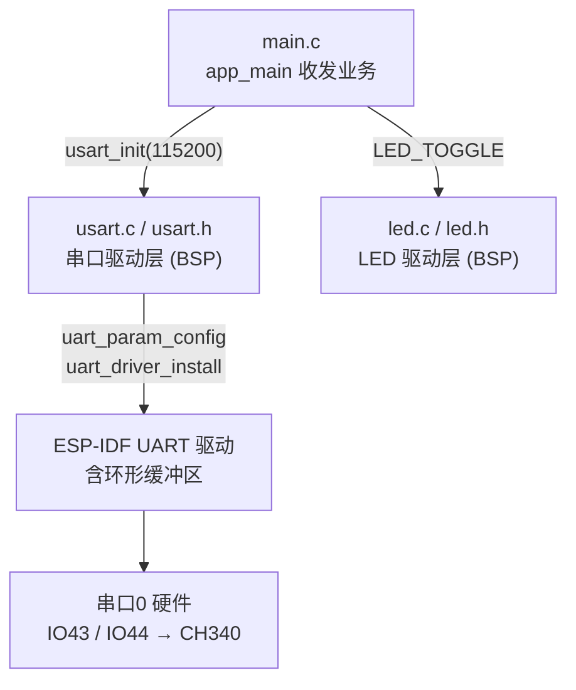
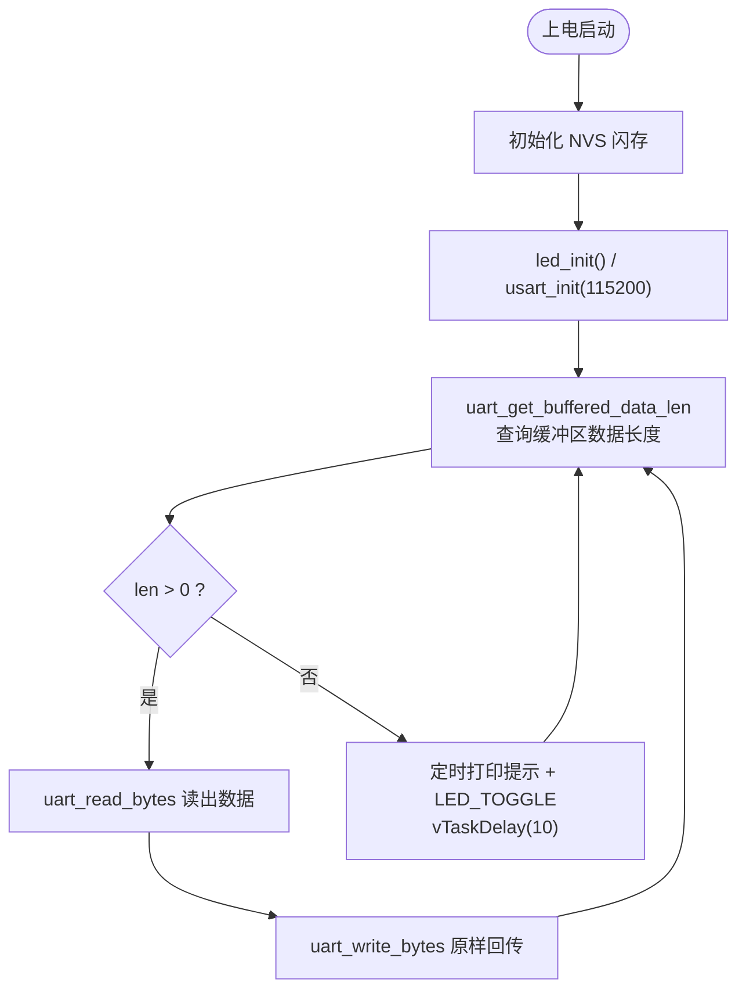

# 04 串口通信实验

> 平台：正点原子 ESP32-S3 开发板 ｜ 框架：ESP-IDF ｜ 难度：★★☆☆☆
>
> 一句话简介：通过串口0与上位机「对话」——收到什么回什么，同时 LED 闪烁提示程序运行，掌握 **UART 收发**。

---

## 1. 实验简介

串口（UART）是单片机与电脑之间最经典、最简单的通信方式，也是调试的命脉。本实验用 ESP32-S3 的**串口0**（经板载 CH340 USB 转串口芯片连到电脑）实现一个「回声机」：上位机发来一串数据（以回车换行结束），ESP32 原样回传；没有数据时，则定时打印提示信息，并让 LED 闪烁表示程序活着。

学完本实验你将掌握：

- 用 `uart_param_config()` / `uart_set_pin()` / `uart_driver_install()` 三步初始化串口；
- 用 `uart_get_buffered_data_len()` + `uart_read_bytes()` 接收数据；
- 用 `uart_write_bytes()` 发送数据；
- 理解 UART 驱动自带的**环形缓冲区**机制。

## 2. 生活类比

串口通信就像**两个人用对讲机聊天**：先约好「语速」（波特率 115200）、「一句话几个字」（8 位数据）、「怎么算说完」（1 位停止位）——这些约定就是 `uart_config_t` 里的参数，双方必须一致，否则听到的是杂音（乱码）。对讲机还有个**留言缓冲**：你没空听的时候，对方说的话先存在缓冲区里，等你有空了（调用 `uart_read_bytes`）再一条条取出来，一句也不会丢。本实验的回声机则像客服机器人：你说一句，它原样复述一句。

## 3. 硬件连接

### 引脚分配

| 元件 | 开发板引脚 | 说明 |
| :--- | :--- | :--- |
| LED（板载） | IO1 | 闪烁提示程序运行 |
| 串口0 TX | IO43（U0TX） | 接板载 CH340 的 RXD |
| 串口0 RX | IO44（U0RX） | 接板载 CH340 的 TXD |

> USB 线请接开发板的 **USB_UART** 口（走 CH340）。若使用排针 P4 引出 U0TX/U0RX，需用跳线帽把它们分别连到 RXD/TXD。

### 连接图


## 4. 程序架构

`main.c` 负责收发业务逻辑，`usart.c` 负责串口参数配置与驱动安装，`led.c` 负责 LED。



## 5. 程序流程



## 6. 核心代码讲解

### 6.1 驱动层：串口初始化三步曲（`usart.c`）

```c
void usart_init(uint32_t baudrate)
{
    uart_config_t uart_config;                          /* 串口配置句柄 */

    uart_config.baud_rate = baudrate;                   /* 波特率 */
    uart_config.data_bits = UART_DATA_8_BITS;           /* 字长为8位数据格式 */
    uart_config.parity = UART_PARITY_DISABLE;           /* 无奇偶校验位 */
    uart_config.stop_bits = UART_STOP_BITS_1;           /* 一个停止位 */
    uart_config.flow_ctrl = UART_HW_FLOWCTRL_DISABLE;   /* 无硬件控制流 */
    uart_config.source_clk = UART_SCLK_APB;             /* 配置时钟源 */
    uart_config.rx_flow_ctrl_thresh = 122;              /* 硬件控制流阈值 */
    uart_param_config(USART_UX, &uart_config);          /* 配置uart端口 */

    /* 配置uart引脚 */
    uart_set_pin(USART_UX, USART_TX_GPIO_PIN, USART_RX_GPIO_PIN, UART_PIN_NO_CHANGE, UART_PIN_NO_CHANGE);

    /* 安装串口驱动 */
    uart_driver_install(USART_UX, RX_BUF_SIZE * 2, RX_BUF_SIZE * 2, 20, NULL, 0);
}
```

**讲解**：初始化按固定套路走三步：

1. **`uart_param_config()`**：把「通信约定」写进串口——115200 波特率、8 数据位、无校验、1 停止位（即常说的 8N1），时钟源选 APB；
2. **`uart_set_pin()`**：指定 TX/RX 用哪两个引脚。`usart.h` 中定义为 `USART_UX = UART_NUM_0`、TX=IO43、RX=IO44（ESP32-S3 串口0 的默认引脚），后两个参数 `UART_PIN_NO_CHANGE` 表示 RTS/CTS 流控引脚不动；
3. **`uart_driver_install()`**：安装官方 UART 驱动，同时分配收发**环形缓冲区**（各 `RX_BUF_SIZE*2 = 2048` 字节）。装好驱动后，硬件收到的数据会自动进入缓冲区，我们随取随用，不用自己写中断。

### 6.2 业务层：回声机主循环（`main.c`）

```c
while(1)
{
    uart_get_buffered_data_len(USART_UX, (size_t*) &len);                           /* 获取环形缓冲区数据长度 */

    if (len > 0)                                                                    /* 判断数据长度 */
    {
        memset(data, 0, RX_BUF_SIZE);                                               /* 对缓冲区清零 */
        printf("\n您发送的消息为:\n");
        uart_read_bytes(USART_UX, data, len, 100);                                  /* 读数据 */
        uart_write_bytes(USART_UX, (const char*)data, strlen((const char*)data));   /* 写数据 */
    }
    else
    {
        times++;

        if (times % 5000 == 0)
        {
            printf("\n正点原子 ATK-DNESP32-S3 开发板 串口实验\n");
            printf("正点原子@ALIENTEK\n\n\n");
        }

        if (times % 200 == 0)
        {
            printf("请输入数据，以回车键结束\n");
        }

        if (times % 30 == 0)
        {
            LED_TOGGLE();
        }

        vTaskDelay(10);
    }
}
```

**讲解**：

- `uart_get_buffered_data_len()` 先问一句「接收缓冲区里攒了多少字节」，大于 0 才去读，避免无谓的阻塞等待；
- `uart_read_bytes()` 把缓冲区数据搬进本地数组 `data`，随后 `uart_write_bytes()` 按字符串长度原样发回电脑——这就是「回声」；
- 空闲分支用计数器 `times` 做「软件分频」：每约 300ms 翻转一次 LED（`times % 30`），每约 2 秒提示一次输入（`times % 200`），每约 50 秒打印一次实验标题（`times % 5000`），一个循环里干了三件不同节奏的事；
- 主循环初始化时先执行 `led_init()` 和 `usart_init(115200)`，与前面实验一致，开场同样有 NVS 初始化。

## 7. 实验效果

烧录并复位后，打开上位机（波特率 115200）：

1. **LED 以约 300ms 的间隔闪烁**，提示程序正在运行；
2. 串口周期性打印「请输入数据，以回车键结束」及实验标题信息；
3. 在上位机输入一串字符并以**回车换行**结束发送，开发板打印「您发送的消息为:」并把收到的内容**原样回传**，显示在上位机接收区。

## 8. 注意事项

1. 波特率必须两端一致：**115200**。
2. 上位机建议用 **XCOM / SSCOM**；某些串口助手会自动控制 DTR/RTS 信号，可能导致开发板反复复位。
3. 发送数据要**以回车换行结束**，否则数据会滞留在缓冲区等待，程序判断不到完整一帧。
4. USB 线要接开发板的 **USB_UART** 口（CH340），不是另一个原生 USB 口。
5. 若使用排针 P4 上的 U0TX/U0RX，需用**跳线帽**将 U0TX—RXD、U0RX—TXD 连接好。
6. 本实验复用了串口0——它同时也是 `printf` 日志输出口，所以你会看到提示信息与回传数据混在同一个窗口，属正常现象。

## 9. 编译与烧录

```bash
idf.py set-target esp32s3   # 首次配置目标芯片
idf.py build                # 编译
idf.py -p COMx flash monitor  # 烧录并打开串口监视器（COMx 换成你的端口号）
```

> 完整的开发环境搭建与烧录说明见 [根目录 README](../README.md)。

---

## 小结

本实验完成了 ESP32 与电脑之间的第一次「双向对话」，串口的「参数配置 → 引脚映射 → 驱动安装 → 缓冲收发」四步套路适用于以后所有 UART 应用（GPS、蓝牙模块、传感器等）。理解环形缓冲区「硬件自动存、软件按需取」的机制，是用好 ESP-IDF 驱动框架的关键。

| 关键 API | 作用 |
| :--- | :--- |
| `uart_param_config()` | 配置波特率、数据位、校验、停止位 |
| `uart_set_pin()` | 指定串口 TX/RX 引脚 |
| `uart_driver_install()` | 安装驱动并分配收发环形缓冲区 |
| `uart_get_buffered_data_len()` | 查询接收缓冲区中的数据量 |
| `uart_read_bytes()` | 从缓冲区读取数据 |
| `uart_write_bytes()` | 向串口发送数据 |
