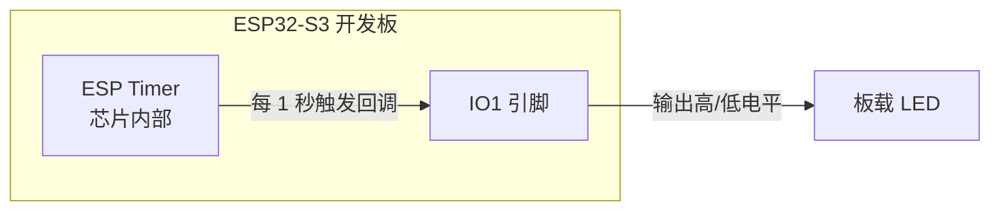
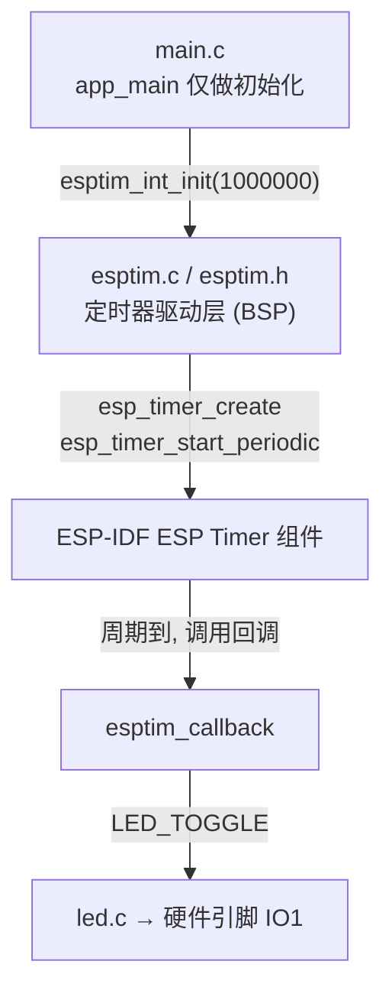
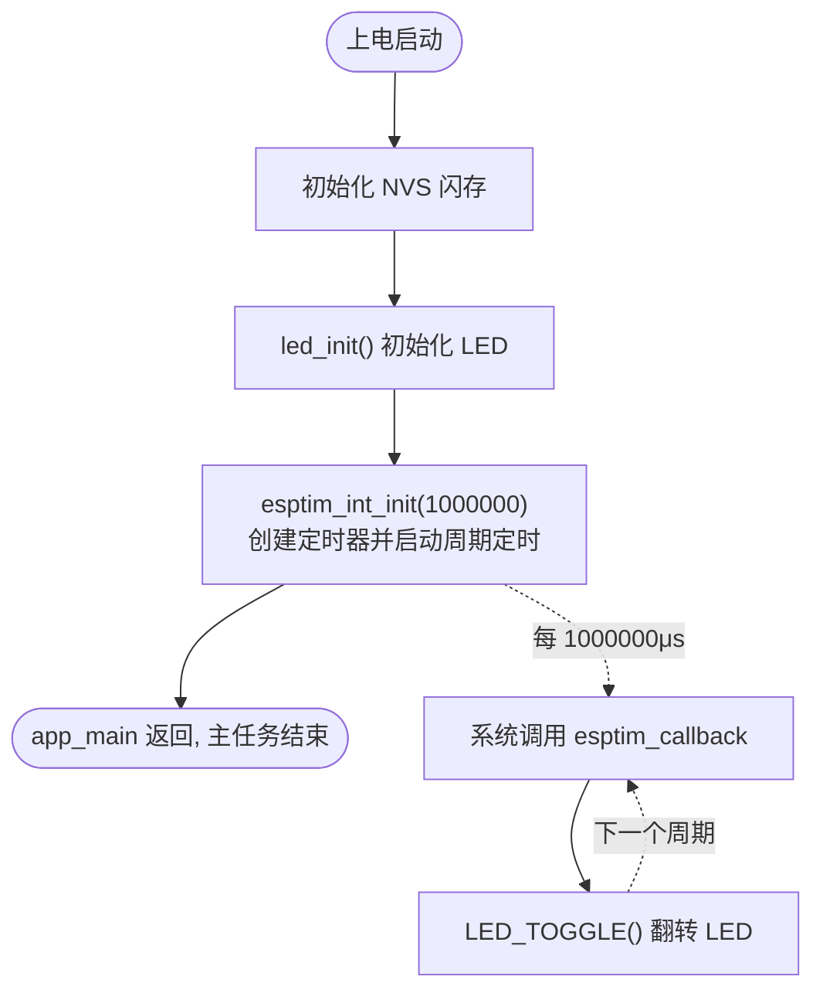

# 05 高分辨率定时器（ESP定时器）实验

> 平台：正点原子 ESP32-S3 开发板 ｜ 框架：ESP-IDF ｜ 难度：★★☆☆☆
>
> 一句话简介：创建一个周期为 1 秒的 **ESP Timer（高分辨率定时器）**，在回调函数中翻转 LED，主任务从此「躺平」。

---

## 1. 实验简介

前面的 LED 闪烁靠的是「主循环里翻转 + 延时」，CPU 被牢牢拴在循环里。本实验改用 ESP-IDF 提供的**高分辨率定时器（ESP Timer）**：注册一个周期 1 秒的定时器，时间一到系统自动调用我们的回调函数翻转 LED，`app_main` 初始化完就可以退场了。

ESP Timer 基于硬件定时器实现，分辨率达**微秒级**，且回调在系统的高优先级任务中执行，定时精度远高于 `vTaskDelay()`（后者受任务调度和 Tick 精度限制）。

学完本实验你将掌握：

- 用 `esp_timer_create_args_t` 描述定时器（回调函数 + 参数）；
- 用 `esp_timer_create()` 创建定时器句柄；
- 用 `esp_timer_start_periodic()` 启动**周期**定时（对比一次性的 `esp_timer_start_once()`）。

## 2. 生活类比

`vTaskDelay()` 式的闪烁像**自己心里默数**：数到一千就翻个身，再从头数——你被这件事绑住了，还容易数歪。ESP Timer 则像**请了个闹钟管家**：你告诉他「每 1 秒叫我一次，叫我时我就翻个身」（注册回调 + 周期启动），然后该干嘛干嘛去。管家拿着高精度手表（微秒级硬件定时器），时间一到准时执行约定动作，分毫不差。

## 3. 硬件连接

### 引脚分配

| 元件 | 开发板引脚 | 说明 |
| :--- | :--- | :--- |
| LED（板载） | IO1 | 高电平点亮，低电平熄灭 |
| ESP 定时器 | — | 芯片内部资源，无外接引脚 |

> 使用**板载 LED** 与芯片内部定时器，无需外接元件。

### 连接图



## 4. 程序架构

`main.c` 只负责初始化；定时逻辑封装在 `esptim.c`，回调由 ESP Timer 系统任务驱动，与 `app_main` 完全解耦。



## 5. 程序流程



## 6. 核心代码讲解

### 6.1 驱动层：创建并启动定时器（`esptim.c`）

```c
void esptim_int_init(uint64_t tps)
{
    esp_timer_handle_t esp_tim_handle;                      /* 定时器回调函数句柄 */

    /* 定义一个定时器结构体 */
    esp_timer_create_args_t tim_periodic_arg = {
        .callback = &esptim_callback,                       /* 设置回调函数 */
        .arg = NULL,                                        /* 不携带参数 */
    };

    esp_timer_create(&tim_periodic_arg, &esp_tim_handle);   /* 创建一个事件 */
    esp_timer_start_periodic(esp_tim_handle, tps);          /* 每周期内触发一次 */
}
```

**讲解**：使用 ESP Timer 也是三步套路：

1. 填一张「出生登记表」`esp_timer_create_args_t`：`callback` 指定时间到了要执行的函数，`arg` 是传给回调的参数（这里不需要，填 `NULL`）；
2. `esp_timer_create()` 按登记表创建定时器，返回一个**句柄** `esp_tim_handle`——之后所有操作都认这个句柄；
3. `esp_timer_start_periodic(句柄, 周期μs)` 启动周期模式，每隔 `tps` 微秒触发一次回调。若只想触发一次，用 `esp_timer_start_once()`。

注意参数单位是**微秒**：想要 1 秒的周期就传 `1000000`。

### 6.2 回调函数与主函数

```c
void esptim_callback(void *arg)
{
    LED_TOGGLE();
}
```

回调函数签名固定为 `void 函数名(void *arg)`，这里只做一件事：翻转 LED。它由系统的 ESP Timer 任务调用，**不在 `app_main` 的上下文里**，所以不要在里面做耗时或阻塞操作。

```c
void app_main(void)
{
    /* ... NVS 初始化代码同前 ... */

    led_init();                     /* 初始化LED */
    esptim_int_init(1000000);       /* 初始化高分辨率定时器，此处设置定时器周期为1秒，
                                       但该函数事宜微妙为单位进行计算，
                                       故而1秒钟换算为1000000微秒 */
}
```

**讲解**：`app_main` 里没有 `while(1)`！初始化完成后函数直接返回，主任务退出，但程序照常运行——因为闪烁已经交给定时器回调了。这体现了 FreeRTOS 多任务思想：**任务可以结束，系统不会停**。

## 7. 实验效果

程序烧录并复位后，**板载 LED 以 1 秒为周期翻转**（亮 1 秒、灭 1 秒，循环往复）。与 LED 实验现象类似，但这次翻转由微秒级定时器精确驱动，且主任务已退出，不再占用 CPU 轮询。

## 8. 注意事项

1. `esp_timer_start_periodic()` 的周期参数单位是**微秒（μs）**，别按毫秒填错数量级。
2. 回调函数运行在高优先级的 ESP Timer 任务中，**不要在里面调用阻塞 API**（如 `vTaskDelay()`）或做耗时操作，否则会拖垮系统里所有 ESP Timer。
3. ESP Timer 与 FreeRTOS 的 `xTimer`（软件定时器）是两套机制：ESP Timer 精度更高（μs 级、硬件支撑），适合对时序敏感的场合。
4. 定时器创建后如不再使用，可用 `esp_timer_stop()` 停止、`esp_timer_delete()` 删除，避免资源泄漏。

## 9. 编译与烧录

```bash
idf.py set-target esp32s3   # 首次配置目标芯片
idf.py build                # 编译
idf.py -p COMx flash monitor  # 烧录并打开串口监视器（COMx 换成你的端口号）
```

> 完整的开发环境搭建与烧录说明见 [根目录 README](../README.md)。

---

## 小结

本实验用 ESP Timer 把「按时做事」从主循环中解放出来：注册回调 → 创建句柄 → 周期启动，三行核心代码换来一个微秒级精度的后台定时服务。它是超时管理、周期性采样、协议心跳等功能的常用基础设施，务必与 FreeRTOS 软件定时器区分掌握。

| 关键 API | 作用 |
| :--- | :--- |
| `esp_timer_create_args_t` | 描述定时器的回调函数与参数 |
| `esp_timer_create()` | 创建定时器，获得句柄 |
| `esp_timer_start_periodic()` | 以指定周期（μs）循环触发回调 |
| `esp_timer_start_once()` | 延时指定时间后触发一次（对比掌握） |
| `LED_TOGGLE()` | 回调中翻转 LED（BSP 驱动宏） |
