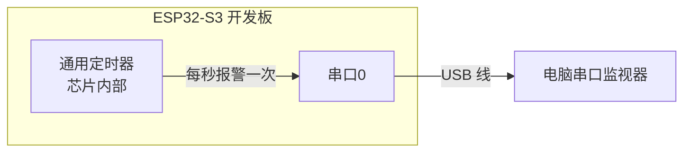
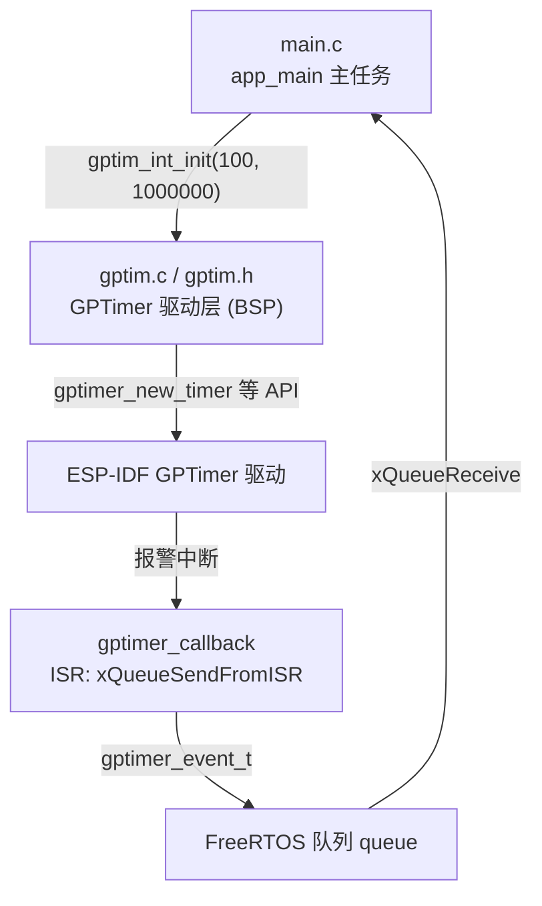
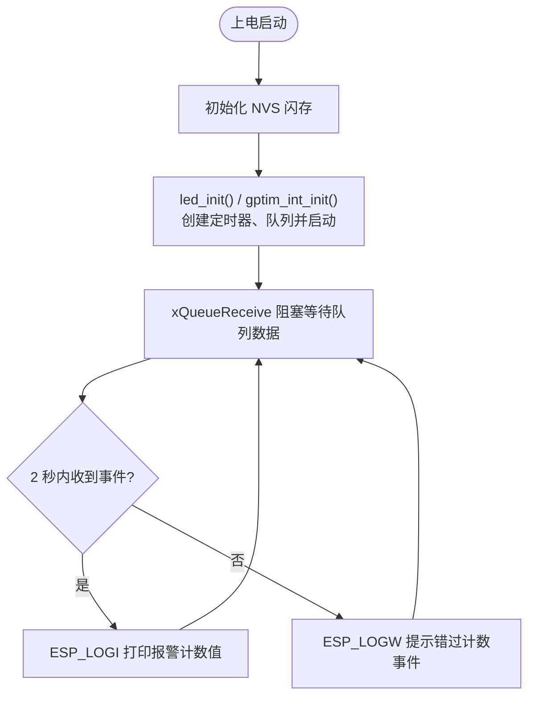

# 06 通用定时器实验

> 平台：正点原子 ESP32-S3 开发板 ｜ 框架：ESP-IDF ｜ 难度：★★★☆☆
>
> 一句话简介：配置芯片内部的**通用定时器（GPTimer）**，每 1 秒触发一次报警事件，通过队列把计数值送到主任务打印。

---

## 1. 实验简介

ESP32-S3 内部有 4 个**通用定时器（General Purpose Timer）**，它们是裸的硬件计数器：按设定的分辨率对时钟脉冲计数，计到「报警值」就触发事件。ESP Timer、PWM 等上层功能都建立在这类硬件之上，直接用 GPTimer 则能获得最底层的控制权。

本实验配置一个分辨率为 1MHz（每计数 1μs）的通用定时器，报警值 1000000（即 1 秒）。报警在**中断回调**中发生，回调把事件计数值塞进 FreeRTOS **队列**，主任务从队列取出并打印——完整演示了「硬件定时器 → 中断 → 队列 → 任务」这条经典的实时数据通路。

学完本实验你将掌握：

- 用 `gptimer_new_timer()` 创建通用定时器；
- 用 `gptimer_register_event_callbacks()` 注册报警回调；
- 用 `gptimer_set_alarm_action()` 设置报警值、`gptimer_start()` 启动计数；
- 在 ISR 中用 `xQueueSendFromISR()` 把数据转交给普通任务。

## 2. 生活类比

通用定时器像一台**计步器**：你设定「每走 1000000 步提醒我一次」（报警值），分辨率 1MHz 就是「每秒走一步」的步频。计步器自己闷头数数，数够就拉响警报（触发中断）。但警报现场（中断上下文）不适合长篇大论，所以值班员只把「当前步数」写在纸条上，扔进一个**传送带（队列）**；办公室里的文员（主任务）从传送带上取纸条，慢悠悠地登记打印。各干各的，谁也不耽误谁——这就是中断与任务解耦的经典配合。

## 3. 硬件连接

本实验使用的通用定时器是 **ESP32-S3 芯片内部资源**，不占用任何外接引脚；工程同时初始化了板载 LED（IO1）备用，主逻辑仅涉及串口打印。

| 元件 | 开发板引脚 | 说明 |
| :--- | :--- | :--- |
| 通用定时器 | — | 芯片内部资源，无外接引脚 |
| 串口0 | IO43 / IO44（板载 CH340） | 打印报警计数值 |

### 连接图



## 4. 程序架构

数据流向跨了三个上下文：中断回调（gptim.c）→ 队列 → 主任务（main.c），这是本实验最值得体会的架构。



## 5. 程序流程



## 6. 核心代码讲解

### 6.1 驱动层：创建并启动通用定时器（`gptim.c`）

```c
void gptim_int_init(uint16_t counts, uint32_t resolution)
{
    /* ... 变量定义省略 ... */

    g_tim_handle.clk_src = GPTIMER_CLK_SRC_DEFAULT;                                     /* 选择定时器时钟源 */
    g_tim_handle.direction = GPTIMER_COUNT_UP;                                          /* 递增计数模式 */         
    g_tim_handle.resolution_hz = resolution;                                            /* 计数器分辨率 */
    g_tim_callbacks.on_alarm = gptimer_callback;                                        /* 注册用户回调函数 */ 
    alarm_config.alarm_count = 1000000;                                                 /* 报警目标计数值 */
    ESP_ERROR_CHECK(gptimer_new_timer(&g_tim_handle, &g_tim));                          /* 创建新的通用定时器，并返回句柄 */

    queue = xQueueCreate(10, sizeof(gptimer_event_t));                                  /* 创建一个队列，并引入一个事件 */

    /* ... 队列创建失败检查省略 ... */

    ESP_ERROR_CHECK(gptimer_set_raw_count(g_tim, counts));                              /* 设置计数值 */
    ESP_ERROR_CHECK(gptimer_get_raw_count(g_tim, &count));                              /* 获取计数值 */

    ESP_ERROR_CHECK(gptimer_register_event_callbacks(g_tim, &g_tim_callbacks, queue));  /* 配置通用定时器回调函数 */

    ESP_ERROR_CHECK(gptimer_enable(g_tim));                                             /* 使能通用定时器 */
    ESP_ERROR_CHECK(gptimer_set_alarm_action(g_tim, &alarm_config));                    /* 配置通用定时器报警事件 */
    ESP_ERROR_CHECK(gptimer_start(g_tim));                                              /* 启动通用定时器 */
}
```

**讲解**：`main.c` 传入的参数是 `gptim_int_init(100, 1000000)`——分辨率 1000000Hz（1MHz，即**每计数一次 = 1μs**），初始计数值 100。关键步骤：

- `gptimer_new_timer()`：按配置（时钟源、递增计数、分辨率）创建定时器，返回句柄；
- `xQueueCreate(10, sizeof(gptimer_event_t))`：建一条深度 10 的队列，作为中断 → 任务的「传送带」；
- `gptimer_register_event_callbacks()`：把 `on_alarm` 回调绑定到定时器，第三个参数 `queue` 会作为 `user_data` 原样传进回调；
- `alarm_count = 1000000`：计数到 1000000 个「1μs」即 **1 秒**时触发报警；
- 最后按 `gptimer_enable()` → `gptimer_set_alarm_action()` → `gptimer_start()` 的顺序使能、装载报警、启动计数。

### 6.2 中断回调：转发事件并重约下一次报警

```c
bool IRAM_ATTR gptimer_callback(gptimer_handle_t timer, const gptimer_alarm_event_data_t *edata, void *user_data)
{
    BaseType_t high_task_awoken = pdFALSE;
    queue = (QueueHandle_t)user_data;

    /* 从事件数据中检索计数值 */
    gptimer_event_t ele = {
        .event_count = edata->count_value
    };

    /* 可选：通过操作系统队列将事件数据发送到其他任务 */
    xQueueSendFromISR(queue, &ele, &high_task_awoken);
    
    /* 重新配置报警值 */ 
    gptimer_alarm_config_t alarm_config = {
        .alarm_count = edata->alarm_value + 1000000, /* 在接下来的1秒内报警 */ 
    };
    gptimer_set_alarm_action(timer, &alarm_config);
    
    /* 返回是否需要在ISR结束时让步 */ 
    return high_task_awoken == pdTRUE;
}
```

**讲解**：

- 回调带 `IRAM_ATTR`，运行在中断上下文；`edata->count_value` 是触发瞬间的计数值；
- `xQueueSendFromISR()` 是队列发送的**中断专用版**，把计数值打包扔进队列，交给主任务慢慢处理；
- 本例未开自动重装，计数值触发报警后继续递增，所以回调里把**下次报警值设为本次 + 1000000**（再过 1 秒），手工实现「周期报警」；
- 返回值告诉系统：如果这次入队唤醒了更高优先级的任务，中断结束后立刻切换过去。

### 6.3 业务层：主任务收数据并打印（`main.c`）

```c
while (1)
{
    record = 1;

    if (xQueueReceive(queue, &g_tim_evente, 2000))
    {
        ESP_LOGI("GPTIMER_ALARM", "定时器报警, 计数值： %llu", g_tim_evente.event_count);   /* 打印通用定时器发生一次计数事件后获取到的值 */
        record--;
    }
    else
    {
        ESP_LOGW("GPTIMER_ALARM", "错过一次计数事件");
    }
}
```

**讲解**：`xQueueReceive(queue, &数据, 2000)` 最多阻塞等 2 秒：等到事件就打印计数值（`ESP_LOGI` 是 ESP-IDF 的分级日志宏，输出 INFO 级别）；定时器本应每 1 秒报一次警，2 秒还没等到说明异常，打印 `ESP_LOGW` 警告。

## 7. 实验效果

烧录并复位后，打开串口监视器（波特率 115200）：

1. 先打印一串初始化日志：「配置通用定时器」「设置计数值」「获取计数值」「使能通用定时器」等；
2. 之后**每隔约 1 秒打印一次**：`I (xxxx) GPTIMER_ALARM: 定时器报警, 计数值： N`，计数值每次递增约 1000000（1 秒 × 1μs/计数）。

## 8. 注意事项

1. GPTimer 回调运行在**中断上下文**，只能用 `FromISR` 版本的 FreeRTOS API（如 `xQueueSendFromISR`），严禁阻塞调用和 `printf` 级别的耗时操作。
2. `resolution_hz = 1000000` 表示 1 计数 = 1μs；想要不同的定时粒度，改分辨率或报警值均可：定时时长 = 报警值 ÷ 分辨率。
3. 本例未开启 `auto_reload_on_alarm` 自动重装，而是在回调中手动把报警值 +1000000，理解这一点才能看懂计数值为何持续递增。
4. ESP32-S3 共有 4 个通用定时器，用完记得 `gptimer_stop()` / `gptimer_disable()` / `gptimer_del_timer()` 释放资源。
5. 主循环中 `vQueueDelete(queue)` 写在 `while(1)` 之后，实际永远不会执行到——工程里保留它只是示意队列需要销毁，实际项目应放在合适的退出路径上。

## 9. 编译与烧录

```bash
idf.py set-target esp32s3   # 首次配置目标芯片
idf.py build                # 编译
idf.py -p COMx flash monitor  # 烧录并打开串口监视器（COMx 换成你的端口号）
```

> 完整的开发环境搭建与烧录说明见 [根目录 README](../README.md)。

---

## 小结

本实验深入到了定时功能的「最底层」：直接驾驭通用定时器硬件，并走通了「硬件报警 → ISR 回调 → 队列 → 任务打印」这条实时系统最经典的数据通路。相比 ESP Timer，GPTimer 给你裸硬件级的计数与控制能力；而「中断里只做搬运、任务里再做处理」的分工思想，将贯穿之后所有带中断的实验。

| 关键 API | 作用 |
| :--- | :--- |
| `gptimer_new_timer()` | 创建通用定时器并返回句柄 |
| `gptimer_set_raw_count()` / `gptimer_get_raw_count()` | 设置 / 读取当前计数值 |
| `gptimer_register_event_callbacks()` | 注册报警事件回调函数 |
| `gptimer_enable()` / `gptimer_start()` | 使能 / 启动定时器 |
| `gptimer_set_alarm_action()` | 设置报警目标计数值 |
| `xQueueCreate()` / `xQueueSendFromISR()` / `xQueueReceive()` | 创建队列、中断中入队、任务中出队 |
