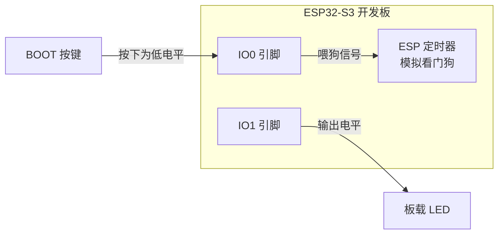
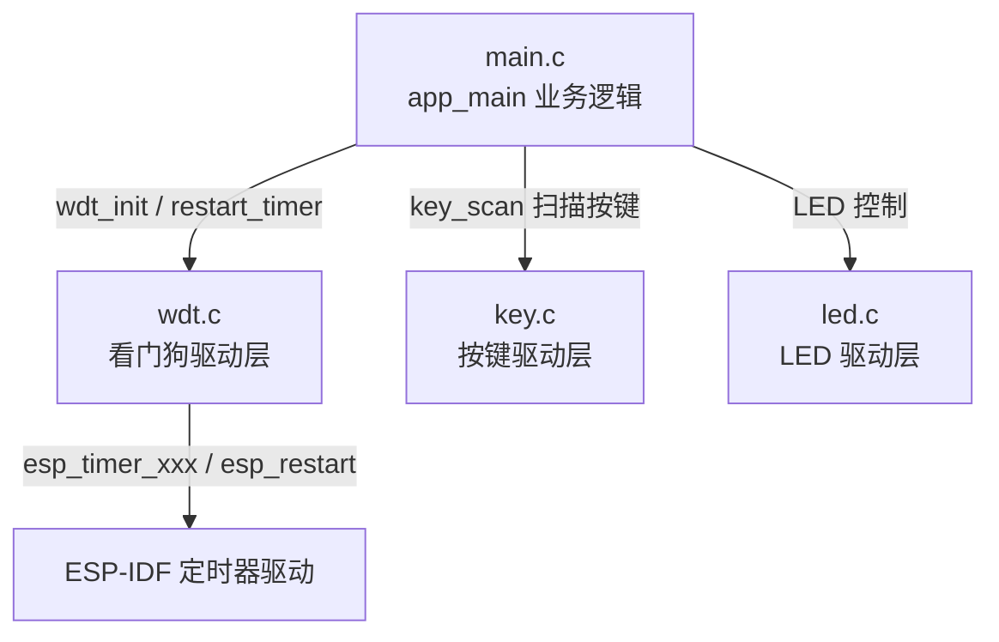
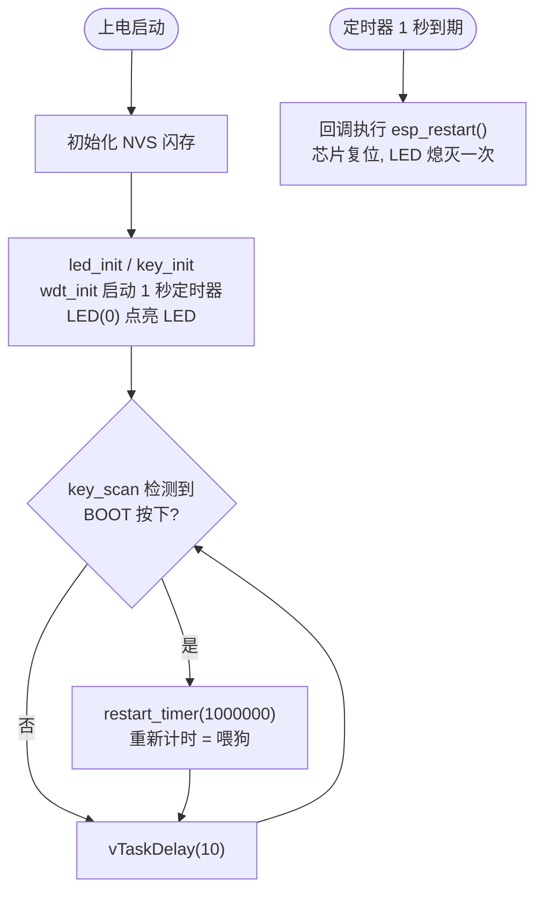

# 07 看门狗实验

> 平台：正点原子 ESP32-S3 开发板 ｜ 框架：ESP-IDF ｜ 难度：★★☆☆☆
>
> 一句话简介：用 ESP 定时器模拟一个「看门狗」，超时不喂狗就复位芯片，按下 BOOT 键喂狗则系统持续运行。

---

## 1. 实验简介

看门狗（Watchdog）是嵌入式系统的「保险丝」：程序跑飞或卡死时，它能自动把芯片复位，让系统重新跑起来。本实验用 ESP-IDF 的 **ESP 定时器（esp_timer）** 来模拟这个过程：

- 创建一个周期为 1 秒（`timeout_us = 1000000` 微秒）的定时器，超时回调里直接调用 `esp_restart()` 复位芯片；
- 主循环里检测到 BOOT 按键按下，就调用 `esp_timer_restart()` 把定时器「重新计时」——这就是**喂狗**。

学完本实验你将掌握：

- 用 `esp_timer_create()` / `esp_timer_start_periodic()` 创建并启动软件定时器；
- 用 `esp_timer_restart()` 实现「喂狗」；
- 用 `esp_restart()` 软件复位芯片；
- 理解看门狗「不喂就复位」的工作原理。

## 2. 生活类比

看门狗就像**宿舍查寝的宿管阿姨**：

- 阿姨规定：每过 1 秒你必须到门口打个卡（喂狗），证明你还「活着」；
- 你按时打卡（按下 BOOT 键）→ 阿姨把闹钟重新定 1 秒，一切照旧；
- 超过 1 秒没打卡 → 阿姨直接「掀被子」（`esp_restart()` 复位），一切从头再来；
- 于是从外面看：一直不打卡的人会被反复「掀被子」——对应 LED 因不停复位而闪烁。

## 3. 硬件连接

### 引脚分配

| 元件 | 开发板引脚 | 说明 |
| :--- | :--- | :--- |
| LED（板载） | IO1 | 指示系统是否在运行 |
| BOOT 按键（板载） | IO0 | 按下即「喂狗」，低电平有效 |

> 本实验使用板载 LED 和板载 BOOT 按键，无需外接元件，一根 USB 线即可。

### 连接图



## 4. 程序架构

代码分三层：`main.c` 负责业务（扫按键、决定何时喂狗），`components/BSP` 下的驱动负责具体操作，最底层是 ESP-IDF 的定时器与 GPIO 驱动。



## 5. 程序流程



> 只要 1 秒内没喂狗，右边这条「复位线」就会触发，程序从头再跑，LED 就会因反复复位而闪烁。

## 6. 核心代码讲解

### 6.1 驱动层：用 ESP 定时器模拟看门狗（`wdt.c`）

```c
esp_timer_handle_t esp_tim_handle;              /* 定时器句柄 */

void wdt_init(uint16_t arr, uint64_t tps)
{
    esp_timer_create_args_t tim_periodic_arg = {
    .callback = &wdt_isr_handler,               /* 设置回调函数 */
    .arg = NULL,                                /* 不携带参数 */
    };

    esp_timer_create(&tim_periodic_arg, &esp_tim_handle);   /* 创建一个定时器事件 */
    esp_timer_start_periodic(esp_tim_handle, tps);          /* 周期触发, tps 单位为微秒 */
}

void restart_timer(uint64_t timeout)
{
    esp_timer_restart(esp_tim_handle, timeout); /* 重新启动计时器, 模拟喂狗过程 */
}

void IRAM_ATTR wdt_isr_handler(void *arg)
{
    esp_restart();                              /* 若没有及时喂狗, 芯片将一直复位 */
}
```

**讲解**：

- `esp_timer_create()` 按「配置表」创建一个软件定时器，`callback` 指定超时后执行谁；
- `esp_timer_start_periodic(handle, tps)` 启动定时器，`tps = 1000000` 微秒即 1 秒；
- `esp_timer_restart()` 是**喂狗**的关键：它让定时器从头再计 1 秒，只要不断调用，回调就永远不会执行；
- 回调 `wdt_isr_handler()` 里只有一句 `esp_restart()`——「狗叫了」就复位整个芯片。

### 6.2 业务层：扫按键喂狗（`main.c`）

```c
void app_main(void)
{
    /* ... NVS 初始化代码同前 ... */

    led_init();                         /* 初始化LED */
    key_init();                         /* 初始化按键 */
    wdt_init(5000, 1000000);            /* 初始化定时器, 超时时间 1 秒 */
    LED(0);                             /* LED灯常亮 */

    while (1)
    {
        if (key_scan(0) == BOOT_PRES)   /* 如果BOOT按下则喂狗 */
        {
            restart_timer(1000000);     /* 喂狗 */
        }

        vTaskDelay(10);
    }
}
```

**讲解**：

- `wdt_init(5000, 1000000)`：第二个参数是超时时间，单位**微秒**，1000000μs = 1 秒；
- `LED(0)` 输出低电平点亮 LED（本板 LED 低电平有效）；
- `key_scan(0)` 是带消抖的按键扫描，返回 `BOOT_PRES` 表示 BOOT 键被按下（IO0 低电平），随即调用 `restart_timer()` 喂狗；
- 主循环每 10ms 扫一次，所以只要你在 1 秒内按一下 BOOT，系统就不会复位。

## 7. 实验效果

- **不按 BOOT 键**：每过 1 秒定时器到期，芯片复位一次，LED 熄灭一下又亮起——表现为 LED 因不停复位而**闪烁**；
- **按住节奏不停按 BOOT 键**（间隔小于 1 秒）：每次按键都喂狗，芯片不复位，LED **常亮**。

## 8. 注意事项

1. 超时时间的单位是**微秒（μs）**，1 秒要写 `1000000`，别按毫秒写成 `1000`，否则狗会「叫」得极快。
2. 本实验是用软件定时器**模拟**看门狗，帮助理解原理；实际工程中 ESP-IDF 还提供了硬件任务看门狗 TWDT（`esp_task_wdt_init()`），用法类似但由硬件计时，更可靠。

## 9. 编译与烧录

```bash
idf.py set-target esp32s3   # 首次配置目标芯片
idf.py build                # 编译
idf.py -p COMx flash monitor  # 烧录并打开串口监视器（COMx 换成你的端口号）
```

> 完整的开发环境搭建与烧录说明见 [根目录 README](../README.md)。

---

## 小结

本实验用「定时器 + 复位」两个动作还原了看门狗的本质：**在规定时间内必须有人来续命，否则一律推倒重来**。这是保证无人值守设备（如户外传感器）长期稳定运行的经典手段。

| 关键 API | 作用 |
| :--- | :--- |
| `esp_timer_create()` | 创建软件定时器并绑定超时回调 |
| `esp_timer_start_periodic()` | 以指定周期（微秒）启动定时器 |
| `esp_timer_restart()` | 重新开始计时，即「喂狗」 |
| `esp_restart()` | 软件复位整个芯片 |
| `key_scan()` | 带消抖的按键扫描，返回键值 |
