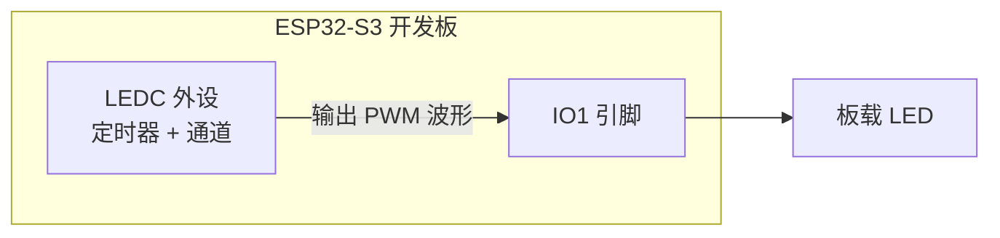
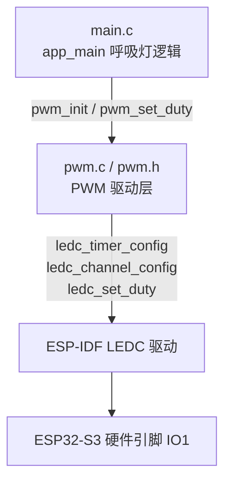
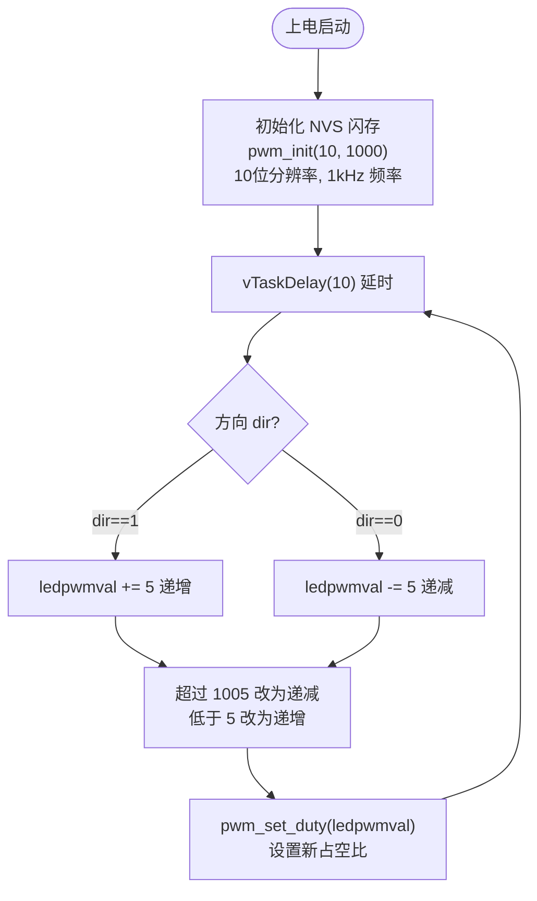

# 08-1 软件改变 PWM 占空比实验

> 平台：正点原子 ESP32-S3 开发板 ｜ 框架：ESP-IDF ｜ 难度：★★☆☆☆
>
> 一句话简介：用软件在循环里一点点修改 PWM 占空比，让板载 LED 由亮到暗、再由暗到亮，做出「呼吸灯」效果。

---

## 1. 实验简介

PWM（脉宽调制）是通过快速开关引脚、改变一个周期内「高电平所占比例（占空比）」来等效控制输出功率的技术。占空比越大，LED 越亮。

本实验使用 ESP32-S3 的 **LEDC 外设**输出 PWM 到 IO1，然后在 `while(1)` 里由**软件**每隔 10ms 把占空比加 5 或减 5，加到顶就反过来减，减到底再反过来加——LED 就呈现平滑的「呼吸」效果。

学完本实验你将掌握：

- 用 `ledc_timer_config()` 配置 PWM 的频率和分辨率；
- 用 `ledc_channel_config()` 把 PWM 绑定到某个引脚；
- 用 `ledc_set_duty()` + `ledc_update_duty()` 修改占空比；
- 理解「占空比 ↔ 亮度」的关系，以及软件循环调光的思路。

## 2. 生活类比

PWM 调光就像**用扇子扇炭火**：

- 你不可能把火调成「半旺」，只能快速地扇一下、停一下；
- 扇的时间占比大（占空比高）→ 火更旺（灯更亮）；
- 扇的时间占比小（占空比低）→ 火更弱（灯更暗）；
- 而「软件改变占空比」就是你**手动**控制节奏：先越扇越猛，再越扇越轻，循环往复——炭火便有了「呼吸感」。开关速度足够快（本例 1kHz），人眼就只感觉到亮度渐变，看不到闪烁。

## 3. 硬件连接

### 引脚分配

| 元件 | 开发板引脚 | 说明 |
| :--- | :--- | :--- |
| LED（板载） | IO1 | LEDC 通道输出 PWM 波形 |

> 本实验使用板载 LED，无需外接元件。PWM 参数：频率 1000Hz、分辨率 10 位（占空比取值 0~1023）。

### 连接图



## 4. 程序架构

代码分两层：`main.c` 负责呼吸节奏（占空比怎么变），`components/BSP/PWM` 负责把 LEDC 配置好并提供改占空比的接口。



## 5. 程序流程



## 6. 核心代码讲解

### 6.1 驱动层：配置 LEDC 输出 PWM（`pwm.c`）

```c
void pwm_init(uint8_t resolution, uint16_t freq)
{
    ledc_timer_config_t ledc_timer = {0};           /* LEDC定时器句柄 */
    ledc_channel_config_t ledc_channel = {0};       /* LEDC通道配置句柄 */

    /* 配置LEDC定时器 */
    ledc_timer.duty_resolution = resolution;        /* PWM占空比分辨率 */
    ledc_timer.freq_hz = freq;                      /* PWM信号频率 */
    ledc_timer.speed_mode = LEDC_LOW_SPEED_MODE;    /* 定时器模式 */
    ledc_timer.timer_num = LEDC_PWM_TIMER;          /* 定时器序号 */
    ledc_timer.clk_cfg = LEDC_AUTO_CLK;             /* LEDC时钟源 */
    ledc_timer_config(&ledc_timer);                 /* 配置定时器 */

    /* 配置LEDC通道 */
    ledc_channel.gpio_num = LEDC_PWM_CH0_GPIO;      /* LED控制器通道对应引脚 */
    ledc_channel.speed_mode = LEDC_LOW_SPEED_MODE;  /* 低速模式 */
    ledc_channel.channel = LEDC_PWM_CH0_CHANNEL;    /* LED控制器通道号 */
    ledc_channel.intr_type = LEDC_INTR_DISABLE;     /* LEDC失能中断 */
    ledc_channel.timer_sel = LEDC_PWM_TIMER;        /* 选择定时器 */
    ledc_channel.duty = 0;                          /* 初始占空比为0 */
    ledc_channel_config(&ledc_channel);             /* 配置LEDC通道 */
}

void pwm_set_duty(uint16_t duty)
{
    ledc_set_duty(LEDC_LOW_SPEED_MODE, LEDC_PWM_CH0_CHANNEL, duty); /* 设置占空比 */
    ledc_update_duty(LEDC_LOW_SPEED_MODE, LEDC_PWM_CH0_CHANNEL);    /* 更新占空比 */
}
```

**讲解**：LEDC 的配置分「定时器」和「通道」两步：

- **定时器**决定波形节奏：`freq_hz = 1000` 即每秒 1000 个 PWM 周期；`duty_resolution = 10` 表示占空比用 10 位数字表示，取值范围 0~1023；
- **通道**决定波形从哪出来：`gpio_num` 绑定 IO1（`LEDC_PWM_CH0_GPIO`），`timer_sel` 选用哪个定时器；
- 改占空比必须**两步走**：`ledc_set_duty()` 只是把新值写进寄存器，`ledc_update_duty()` 才让它真正生效——这是初学者最容易漏掉的一步。

引脚与参数定义在 `pwm.h`：

```c
#define LEDC_PWM_TIMER          LEDC_TIMER_1    /* 使用的LEDC定时器 */
#define LEDC_PWM_CH0_GPIO       GPIO_NUM_1      /* LED控制器通道对应GPIO */
#define LEDC_PWM_CH0_CHANNEL    LEDC_CHANNEL_1  /* LED控制器通道号 */
```

### 6.2 业务层：软件渐变出「呼吸」（`main.c`）

```c
void app_main(void)
{
    uint8_t dir = 1;
    uint16_t ledpwmval = 0;
    /* ... NVS 初始化代码同前 ... */

    pwm_init(10, 1000);     /* 初始化PWM: 10位分辨率, 1kHz */

    while(1)
    {
        vTaskDelay(10);

        if (dir == 1)
        {
            ledpwmval += 5; /* dir==1 ledpwmval递增 */
        }
        else
        {
            ledpwmval -= 5; /* dir==0 ledpwmval递减 */
        }

        if (ledpwmval > 1005)
        {
            dir = 0;        /* ledpwmval到达1005后, 方向为递减 */
        }

        if (ledpwmval < 5)
        {
            dir = 1;        /* ledpwmval递减到5后, 方向改为递增 */
        }

        pwm_set_duty(ledpwmval);    /* 设置占空比 */
    }
}
```

**讲解**：

- `dir` 是方向标志：1 表示占空比正在变大（灯变亮），0 表示变小（灯变暗）；
- 每 10ms 改一次、每次改 5，从暗到亮约需 `(1005/5) × 10ms ≈ 2` 秒，肉眼看起来就是平缓的呼吸；
- 到达上下限（1005 / 5）时翻转 `dir`，形成往复循环；
- 这就是「**软件**改变占空比」：每一步渐变都由 CPU 在循环里手动计算并写入，硬件只负责按当前占空比输出波形。

## 7. 实验效果

程序烧录后，**板载 LED 由亮到暗、再由暗到亮，循环往复**，如同呼吸一样平滑渐变（一个来回约 4 秒）。

## 8. 注意事项

1. 改占空比必须 `ledc_set_duty()` 之后再调用 `ledc_update_duty()`，只调用前者波形不会变化。
2. 占空比取值不能超过 `2^分辨率 - 1`（本例 10 位即最大 1023），且频率与分辨率相互制约：分辨率越高，可支持的频率上限越低。
3. 软件方式渐变需要 CPU 不停参与循环计算；如果希望「下达目标后硬件自动渐变」，请看下一个实验 08-2（LEDC 硬件渐变功能）。

## 9. 编译与烧录

```bash
idf.py set-target esp32s3   # 首次配置目标芯片
idf.py build                # 编译
idf.py -p COMx flash monitor  # 烧录并打开串口监视器（COMx 换成你的端口号）
```

> 完整的开发环境搭建与烧录说明见 [根目录 README](../README.md)。

---

## 小结

本实验把「LEDC 输出 PWM」和「软件循环改占空比」两件事拼在一起，做出了经典呼吸灯。PWM 不只用于调光——电机调速、舵机控制、蜂鸣器发声等，本质都是「改占空比 / 改频率」，这套 LEDC 配置流程值得背下来。

| 关键 API | 作用 |
| :--- | :--- |
| `ledc_timer_config()` | 配置 PWM 频率、分辨率、时钟源 |
| `ledc_channel_config()` | 配置 PWM 通道并绑定输出引脚 |
| `ledc_set_duty()` | 写入新的占空比值 |
| `ledc_update_duty()` | 使新占空比生效 |
| `vTaskDelay()` | 控制每步渐变的时间间隔 |
