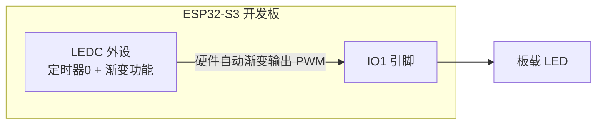
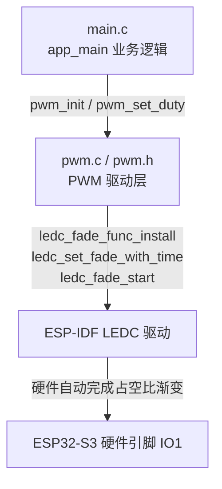
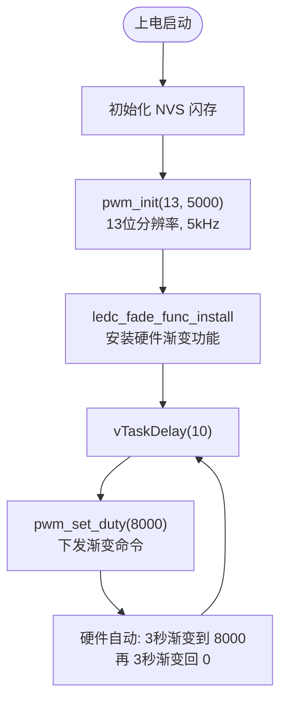

# 08-2 硬件改变 PWM 占空比实验（IDF 版本）

> 平台：正点原子 ESP32-S3 开发板 ｜ 框架：ESP-IDF ｜ 难度：★★☆☆☆
>
> 一句话简介：使用 LEDC 外设自带的**硬件渐变（Fade）功能**，让占空比由硬件自动平滑变化，CPU 只管「下命令」，照样做出呼吸灯。

---

## 1. 实验简介

上一个实验（08-1）里，呼吸灯的每一步渐变都要 CPU 在循环里手动计算占空比。本实验换成 LEDC 的**硬件渐变功能**：只要告诉它「目标占空比」和「渐变时长」，硬件就会自动、平滑地把占空比从当前值过渡到目标值，期间 CPU 可以去做任何别的事。

本实验配置 PWM：分辨率 13 位（占空比 0~8191）、频率 5kHz，输出到 IO1；然后让硬件用 3 秒渐变到目标占空比 8000（最亮），再用 3 秒渐变回 0（最暗），循环形成呼吸灯。

学完本实验你将掌握：

- 用 `ledc_fade_func_install()` 安装硬件渐变功能；
- 用 `ledc_set_fade_with_time()` 指定「目标占空比 + 渐变时长」；
- 用 `ledc_fade_start()` 启动渐变；
- 理解软件调光与硬件调光的区别与适用场景。

## 2. 生活类比

软件调光和硬件调光的区别，就像**手动挡和自动挡汽车**：

- 08-1 软件调光 = 手动挡：每一脚油门（每次改占空比）都要你亲自踩，CPU 一刻不能闲；
- 08-2 硬件调光 = 自动挡 + 定速巡航：你只需说一句「3 秒内匀速加速到 100」（目标占空比 + 渐变时长），车子（LEDC 硬件）自己完成整个过程；
- `LEDC_FADE_NO_WAIT` 就是「说完你就不用管了」——不用在旁边盯着它加速完。

## 3. 硬件连接

### 引脚分配

| 元件 | 开发板引脚 | 说明 |
| :--- | :--- | :--- |
| LED（板载） | IO1 | LEDC 通道 0 输出 PWM 波形 |

> 本实验使用板载 LED，无需外接元件。PWM 参数：频率 5000Hz、分辨率 13 位（占空比取值 0~8191）、渐变目标 8000、渐变时长 3000ms。

### 连接图



## 4. 程序架构

依旧是两层结构，但驱动层里多了「渐变功能」的安装与调用，业务层则简单到几乎不用参与渐变过程。



## 5. 程序流程



## 6. 核心代码讲解

### 6.1 驱动层：安装渐变功能（`pwm.c`）

定时器与通道的配置和 08-1 基本一致（`ledc_timer_config()` + `ledc_channel_config()`），关键区别是初始化最后多了一句：

```c
    ledc_channel.duty = 0;                          /* 占空比值 */
    ledc_channel_config(&ledc_channel);             /* 配置LEDC通道 */

    ledc_fade_func_install(0);                      /* 使能渐变（该函数不可或缺） */
}
```

**讲解**：`ledc_fade_func_install(0)` 安装 LEDC 的渐变驱动（参数 0 表示不使能渐变中断）。**不调用它，后面所有 fade 函数都无法工作**。

### 6.2 驱动层：硬件渐变设置占空比（`pwm.c`）

```c
void pwm_set_duty(uint16_t duty)
{
    /* 设置占空比以及渐变时长 */
    ledc_set_fade_with_time(LEDC_PWM_MODE, LEDC_PWM_CH0_CHANNEL, duty, LEDC_PWM_FADE_TIME);
    ledc_fade_start(LEDC_PWM_MODE, LEDC_PWM_CH0_CHANNEL, LEDC_FADE_NO_WAIT);  /* 开始渐变 */

    /* 设置占空比以及渐变时长 */
    ledc_set_fade_with_time(LEDC_PWM_MODE, LEDC_PWM_CH0_CHANNEL, 0, LEDC_PWM_FADE_TIME);
    ledc_fade_start(LEDC_PWM_MODE, LEDC_PWM_CH0_CHANNEL, LEDC_FADE_NO_WAIT);  /* 开始渐变 */
}
```

**讲解**：

- `ledc_set_fade_with_time(模式, 通道, 目标占空比, 时长ms)`：告诉硬件「用多长时间渐变到什么占空比」，这里 `LEDC_PWM_FADE_TIME = 3000`，即 3 秒；
- `ledc_fade_start(..., LEDC_FADE_NO_WAIT)`：启动渐变且不阻塞等待——函数立即返回，渐变过程完全由硬件接管；
- 两次调用分别设置了「渐变到最亮 8000」和「渐变回最暗 0」，硬件按序执行，一亮一暗就是一次呼吸。

相关参数定义在 `pwm.h`：

```c
#define LEDC_PWM_TIMER          LEDC_TIMER_0        /* 使用定时器0 */
#define LEDC_PWM_MODE           LEDC_LOW_SPEED_MODE /* 模式设定必须使用LEDC低速模式 */
#define LEDC_PWM_CH0_GPIO       GPIO_NUM_1          /* LED控制器通道对应GPIO */
#define LEDC_PWM_CH0_CHANNEL    LEDC_CHANNEL_0      /* LED控制器通道号 */
#define LEDC_PWM_DUTY           8000                /* 渐变的变大最终目标占空比 */
#define LEDC_PWM_FADE_TIME      3000                /* 变化时长 */
```

### 6.3 业务层：主循环（`main.c`）

```c
void app_main(void)
{
    /* ... NVS 初始化代码同前 ... */

    pwm_init(13, 5000);                 /* 初始化PWM: 13位分辨率, 5kHz */

    while(1)
    {
        vTaskDelay(10);
        pwm_set_duty(LEDC_PWM_DUTY);    /* 设置占空比 */
    }
}
```

**讲解**：业务层没有任何渐变计算——对比 08-1 里的 `dir`、`ledpwmval += 5`，这里只是反复把目标占空比 8000 交给硬件，「怎么变、变多快」全由 LEDC 硬件完成。这正是硬件调光的优势：**代码更少、CPU 更闲、波形更平滑**。

## 7. 实验效果

程序烧录后，**板载 LED 用约 3 秒渐亮到最亮，再用约 3 秒渐暗到熄灭**，如此循环形成呼吸灯。整个渐变过程由硬件完成，亮度过渡比软件方式更加平滑。

## 8. 注意事项

1. 使用渐变功能前必须先调用 `ledc_fade_func_install()`，否则 fade 相关 API 会返回错误。
2. ESP32-S3 的 LEDC 只有低速模式，`speed_mode` 必须填 `LEDC_LOW_SPEED_MODE`。
3. 渐变目标占空比不能超出分辨率上限：本例 13 位最大 8191，目标 8000 合法；若分辨率设为 10 位（最大 1023），8000 就会溢出。
4. `LEDC_FADE_NO_WAIT` 表示启动后立即返回；若想等渐变完成再继续，可用 `LEDC_FADE_WAIT_DONE`。

## 9. 编译与烧录

```bash
idf.py set-target esp32s3   # 首次配置目标芯片
idf.py build                # 编译
idf.py -p COMx flash monitor  # 烧录并打开串口监视器（COMx 换成你的端口号）
```

> 完整的开发环境搭建与烧录说明见 [根目录 README](../README.md)。

---

## 小结

同样是呼吸灯，08-1 靠 CPU「勤快地」一步步改占空比，本实验则把渐变任务整个外包给 LEDC 硬件。理解这两种方式后你就知道：对平滑度要求高、又不想占用 CPU 的调光场景，优先选硬件渐变。

| 关键 API | 作用 |
| :--- | :--- |
| `ledc_timer_config()` | 配置 PWM 频率、分辨率、时钟源 |
| `ledc_channel_config()` | 配置 PWM 通道并绑定输出引脚 |
| `ledc_fade_func_install()` | 安装硬件渐变功能（必须） |
| `ledc_set_fade_with_time()` | 设定目标占空比与渐变时长 |
| `ledc_fade_start()` | 启动渐变，可选是否等待完成 |
