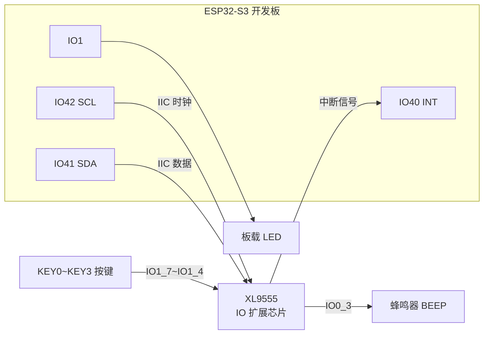
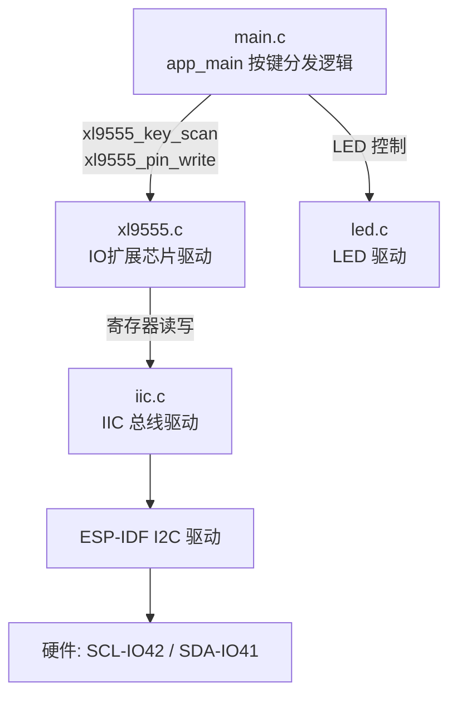
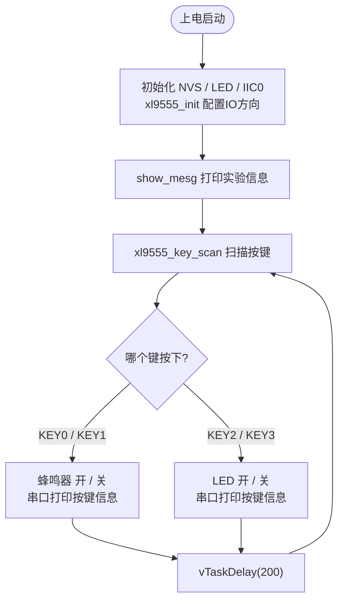

# 09 IO 扩展实验

> 平台：正点原子 ESP32-S3 开发板 ｜ 框架：ESP-IDF ｜ 难度：★★★☆☆
>
> 一句话简介：通过 IIC 总线驱动 XL9555（16 位 IO 扩展芯片），用挂在它身上的 4 个按键控制蜂鸣器和 LED，体会「两根线扩展 16 个 IO」的魅力。

---

## 1. 实验简介

单片机的引脚永远不够用。XL9555 是一颗 **16 位 IO 扩展芯片**：主控只需占用 2 根 IIC 线（SCL/SDA），就能通过它读写 16 个扩展 IO——相当于给单片机外接了一个「插线板」。

在正点原子 ESP32-S3 开发板上，KEY0~KEY3 四个按键和蜂鸣器 BEEP 都接在 XL9555 上。本实验通过 IIC 读取按键状态、控制蜂鸣器开关，同时把操作信息打印到串口。

学完本实验你将掌握：

- 用 ESP-IDF I2C 驱动初始化 IIC 总线（`iic_init()`）；
- 读写 XL9555 的输入 / 输出 / 方向配置寄存器；
- 通过扩展 IO 读按键（`xl9555_key_scan()`）、控蜂鸣器（`xl9555_pin_write()`）；
- 理解 IIC「一主多从、按地址访问」的总线思想。

## 2. 生活类比

XL9555 就像宿舍楼里的**传达室大爷**：

- 楼里 16 间宿舍（16 个扩展 IO）的事，你不用一间间跑——只要到传达室（IIC 总线）喊一声大爷的「工号」（设备地址 0x20）；
- 想让某间宿舍开灯 = 告诉大爷「3 号房合闸」（`xl9555_pin_write(BEEP_IO, 0)` 开蜂鸣器）；
- 想知道谁在按门铃 = 问大爷「现在哪些房有人按键」（`xl9555_key_scan()` 读按键）；
- 大爷还会主动按铃提醒你「楼里有动静」（INT 中断引脚接 IO40），你再去问详情。

## 3. 硬件连接

### 引脚分配

| 元件 | 开发板引脚 | 说明 |
| :--- | :--- | :--- |
| LED（板载） | IO1 | ESP32-S3 直接驱动 |
| KEY0 | XL9555 IO1_7 | 按下开蜂鸣器 |
| KEY1 | XL9555 IO1_6 | 按下关蜂鸣器 |
| KEY2 | XL9555 IO1_5 | 按下开 LED |
| KEY3 | XL9555 IO1_4 | 按下关 LED |
| BEEP 蜂鸣器 | XL9555 IO0_3 | 低电平响 |
| XL9555_INT | IO40 | XL9555 中断输出 |
| IIC_SCL | IO42 | XL9555 时钟线 |
| IIC_SDA | IO41 | XL9555 数据线 |

> 以上连接均为开发板**板载固定连线**，无需自己接线，一根 USB 线即可。

### 连接图



## 4. 程序架构

代码自底向上分四层：IIC 总线驱动 → XL9555 芯片驱动 → LED 驱动 → 业务逻辑。XL9555 驱动把「寄存器读写」封装成了好用的 `xl9555_pin_read/write`。



## 5. 程序流程



## 6. 核心代码讲解

### 6.1 驱动层：初始化 XL9555（`xl9555.c`）

```c
void xl9555_init(i2c_obj_t self)
{
    /* ... 配置 XL9555_INT 引脚(IO40)为上拉输入 ... */

    /* 上电先读取一次清除中断标志 */
    xl9555_read_byte(r_data, 2);

    xl9555_ioconfig(0xF003);            /* 配置IO方向 */
    xl9555_pin_write(BEEP_IO, 1);       /* 关闭蜂鸣器 */
    xl9555_pin_write(SPK_EN_IO, 1);
}
```

**讲解**：

- XL9555 内部有 8 个寄存器（输入 0/1、输出 0/1、极性反转 0/1、方向配置 0/1），IIC 通信时先写「寄存器地址」再读写数据；
- `xl9555_ioconfig(0xF003)` 写方向配置寄存器：**1 = 输入、0 = 输出**。`0xF003` 即 IO1_7~IO1_4（四个按键）和 IO0_1、IO0_0 设为输入，其余（含蜂鸣器 IO0_3）设为输出；
- 器件地址为 `XL9555_ADDR = 0x20`，同一条 IIC 总线上可以挂多个不同地址的从机。

### 6.2 驱动层：读写单个扩展 IO（`xl9555.c`）

```c
uint16_t xl9555_pin_write(uint16_t pin, int val)
{
    uint8_t w_data[2];

    xl9555_read_byte(w_data, 2);        /* 先读回当前16位IO状态 */

    if (pin <= GBC_KEY_IO)
    {
        if (val) w_data[0] |= (uint8_t)(0xFF & pin);          /* 低8位: 置1 */
        else     w_data[0] &= ~(uint8_t)(0xFF & pin);         /* 低8位: 清0 */
    }
    else
    {
        if (val) w_data[1] |= (uint8_t)(0xFF & (pin >> 8));   /* 高8位: 置1 */
        else     w_data[1] &= ~(uint8_t)(0xFF & (pin >> 8));  /* 高8位: 清0 */
    }

    xl9555_write_byte(XL9555_OUTPUT_PORT0_REG, w_data, 2);    /* 写回输出寄存器 */
    return temp;
}
```

**讲解**：因为 XL9555 只能**按字节整组写**输出寄存器，想改其中 1 位就得「读回 → 改位 → 写回」。`pin` 参数是位掩码，比如 `BEEP_IO = 0x0008` 表示 IO0_3。读引脚更简单：`xl9555_pin_read(pin)` 读输入寄存器后按位与即可。

### 6.3 业务层：按键分发（`main.c`）

```c
    led_init();                         /* 初始化LED */
    i2c0_master = iic_init(I2C_NUM_0);  /* 初始化IIC0 */
    xl9555_init(i2c0_master);           /* 初始化XL9555 */
    show_mesg();                        /* 显示实验信息 */

    while(1)
    {
        key = xl9555_key_scan(0);

        switch (key)
        {
            case KEY0_PRES:
            {
                printf("KEY0 has been pressed \n");
                xl9555_pin_write(BEEP_IO, 0);     /* 蜂鸣器开(低电平响) */
                break;
            }
            case KEY1_PRES:
            {
                printf("KEY1 has been pressed \n");
                xl9555_pin_write(BEEP_IO, 1);     /* 蜂鸣器关 */
                break;
            }
            case KEY2_PRES:
            {
                printf("KEY2 has been pressed \n");
                LED(0);                           /* LED开 */
                break;
            }
            case KEY3_PRES:
            {
                printf("KEY3 has been pressed \n");
                LED(1);                           /* LED关 */
                break;
            }
            default: break;
        }

        vTaskDelay(200);
    }
```

**讲解**：

- `xl9555_key_scan(0)` 通过 IIC 读四个按键引脚的电平，带 10ms 消抖，返回 `KEY0_PRES`~`KEY3_PRES` 键值，参数 0 表示不支持连按；
- 蜂鸣器和 LED 都是**低电平有效**：写 0 开、写 1 关；
- LED 接在 ESP32-S3 自己的 IO1 上，用普通 GPIO 控制；按键和蜂鸣器走 XL9555——一次实验同时用了「直连 IO」和「扩展 IO」两种方式，对比着看非常直观。

## 7. 实验效果

烧录后打开串口助手（波特率 115200），可看到实验提示信息；按键操作对应：

| 按键 | 现象 | 串口打印 |
| :--- | :--- | :--- |
| KEY0 | 蜂鸣器响 | KEY0 has been pressed |
| KEY1 | 蜂鸣器停 | KEY1 has been pressed |
| KEY2 | LED 亮 | KEY2 has been pressed |
| KEY3 | LED 灭 | KEY3 has been pressed |

## 8. 注意事项

1. 串口波特率为 **115200**，建议使用 XCOM 或 SSCOM 串口助手。
2. USB 线要接开发板的 **UART 口**（不是 USB 口），并在串口助手里选对 COM 端口。
3. IIC 总线的 SCL/SDA 必须有上拉电阻（开发板已板载），飞线外接 XL9555 时别忘记这一点。
4. `xl9555_ioconfig()` 的方向值记法：**1 为输入、0 为输出**，与直觉相反，容易写错。

## 9. 编译与烧录

```bash
idf.py set-target esp32s3   # 首次配置目标芯片
idf.py build                # 编译
idf.py -p COMx flash monitor  # 烧录并打开串口监视器（COMx 换成你的端口号）
```

> 完整的开发环境搭建与烧录说明见 [根目录 README](../README.md)。

---

## 小结

本实验用一个 XL9555 打通了「IIC 总线 → 寄存器读写 → 扩展 IO 输入输出」的完整链路。以后遇到引脚不够用的项目，IO 扩展芯片就是最便宜的解决方案；而 IIC 这套「按地址找从机、先写寄存器地址再读写数据」的套路，也是下一个 EEPROM 实验的基础。

| 关键 API | 作用 |
| :--- | :--- |
| `iic_init()` | 初始化 IIC 总线，返回控制块 |
| `xl9555_init()` | 配置 XL9555 IO 方向并清中断 |
| `xl9555_ioconfig()` | 写方向配置寄存器（1 输入 / 0 输出） |
| `xl9555_pin_write()` | 控制某个扩展 IO 输出电平 |
| `xl9555_pin_read()` | 读取某个扩展 IO 电平 |
| `xl9555_key_scan()` | 扫描接在 XL9555 上的按键，返回键值 |
