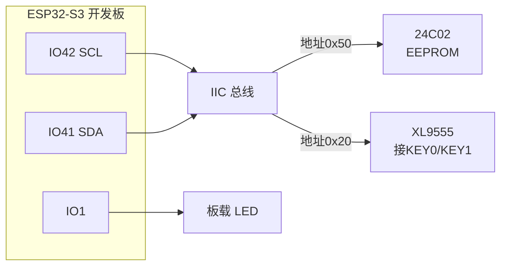
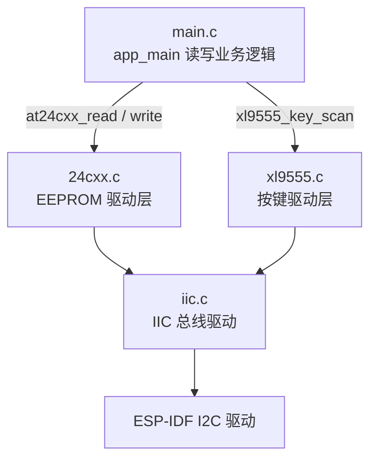
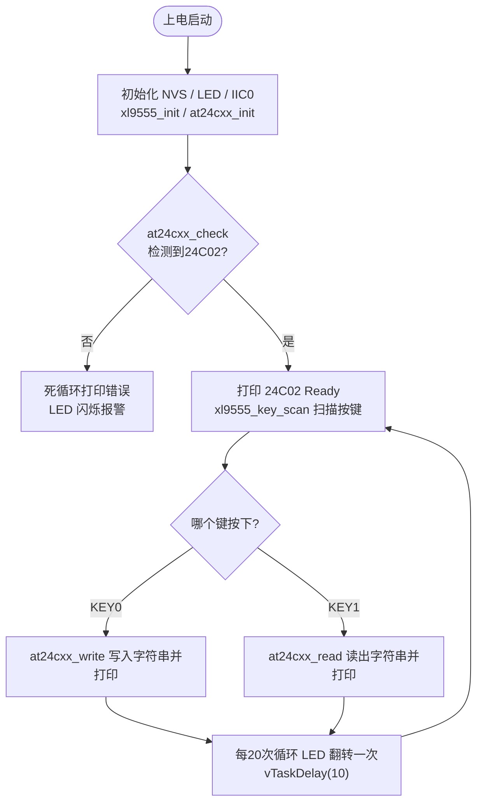

# 10 EEPROM 实验

> 平台：正点原子 ESP32-S3 开发板 ｜ 框架：ESP-IDF ｜ 难度：★★★☆☆
>
> 一句话简介：用 IIC 驱动 24C02（EEPROM 存储芯片），按键写入字符串、断电重上电再读出来，掌握掉电不丢失数据的存储方法。

---

## 1. 实验简介

EEPROM 是一种**掉电不丢数据**的小容量存储器。开发板上的 24C02 容量为 2KB（256 字节 × 8 页寻址内的 256 个地址），挂在 IIC 总线上（与 XL9555 共用 SCL/SDA）。

本实验：按 KEY0 把字符串 `"ESP32-S3 EEPROM"` 写入 24C02 的 0 号地址开始的空间；按 KEY1 把它读回来并打印到串口。即使写完数据后**断电再上电**，读出来的内容依然不变——这就是 EEPROM 的意义。

学完本实验你将掌握：

- 检测 EEPROM 是否在位（`at24cxx_check()`）；
- 按字节读写 24C02（`at24cxx_read_one_byte()` / `at24cxx_write_one_byte()`）；
- 连续读写一段数据（`at24cxx_read()` / `at24cxx_write()`）；
- 理解 IIC 从机地址 + 存储地址的两级寻址方式。

## 2. 生活类比

24C02 就像一个**带编号抽屉的储物柜**：

- 柜子有 256 个抽屉（地址 0~255），每个抽屉只能放一张小纸条（1 字节）；
- 存东西（写）= 报出柜号（IIC 器件地址 0x50）+ 抽屉号（存储地址）+ 放入纸条（数据）；
- 取东西（读）= 先报柜号和抽屉号「定位」，再换个方向说「我要取」（重发起始信号 + 读命令）；
- 和普通内存（RAM）的区别：储物柜**下了班（断电）东西还在**，RAM 则是白板上写字，一断电全没了。

## 3. 硬件连接

### 引脚分配

| 元件 | 开发板引脚 | 说明 |
| :--- | :--- | :--- |
| LED（板载） | IO1 | 闪烁表示程序在运行 |
| KEY0 | XL9555 IO1_7 | 按下写数据到 24C02 |
| KEY1 | XL9555 IO1_6 | 按下从 24C02 读数据 |
| 24C02 IIC_SCL | IO42 | IIC 时钟线（与 XL9555 共用） |
| 24C02 IIC_SDA | IO41 | IIC 数据线（与 XL9555 共用） |

> 以上均为开发板板载固定连线，无需自己接线，一根 USB 线即可。

### 连接图



## 4. 程序架构

24C02 与 XL9555 挂在同一条 IIC0 总线上（地址不同），驱动层各自封装，业务层只关心「写字符串 / 读字符串」。



## 5. 程序流程



## 6. 核心代码讲解

### 6.1 驱动层：检测 24C02 是否在位（`24cxx.c`）

```c
uint8_t at24cxx_check(void)
{
    uint8_t temp;
    uint16_t addr = EE_TYPE;                /* 24C02 时为 255, 即末地址 */

    temp = at24cxx_read_one_byte(addr);     /* 避免每次开机都写AT24CXX */

    if (temp == 0X55)                       /* 读取数据正常 */
    {
        return 0;
    }
    else                                    /* 排除第一次初始化的情况 */
    {
        at24cxx_write_one_byte(addr, 0X55); /* 先写入数据 */
        temp = at24cxx_read_one_byte(255);  /* 再读取数据 */

        if (temp == 0X55)
        {
            return 0;
        }
    }

    return 1;
}
```

**讲解**：检测思路很朴素——往芯片**最后一个地址（255）**写一个特征值 `0x55`，再读回来，一致就说明芯片通信正常。先直接读一次是为了避免每次开机都写 EEPROM（EEPROM 的擦写次数有限，典型值 100 万次，能省则省）。

### 6.2 驱动层：写一个字节（`24cxx.c`）

```c
void at24cxx_write_one_byte(uint16_t addr, uint8_t data)
{
    i2c_cmd_handle_t cmd = i2c_cmd_link_create();
    i2c_master_start(cmd);

    if(EE_TYPE > AT24C16)
    {
        /* 大容量型号: 2字节地址 */
    }
    else
    {
        i2c_master_write_byte(cmd, 0XA0 + ((addr/256) << 1), ACK_CHECK_EN); /* 发送器件地址0XA0,写数据 */
    }

    i2c_master_write_byte(cmd, addr % 256, ACK_CHECK_EN);   /* 发送低地址 */
    i2c_master_write_byte(cmd, data, ACK_CHECK_EN);         /* 发送数据 */
    i2c_master_stop(cmd);
    i2c_master_cmd_begin(at24cxx_master.port, cmd, 1000);
    i2c_cmd_link_delete(cmd);
    vTaskDelay(10);
}
```

**讲解**：这是 ESP-IDF 经典的 **I2C 命令链表**用法——把「起始 → 器件地址 → 存储地址 → 数据 → 停止」像串珠子一样链接起来，最后 `i2c_master_cmd_begin()` 一次性发出。注意这里有**两级地址**：

- `0xA0`：24C02 的 IIC 器件地址（决定「找哪颗芯片」）；
- `addr % 256`：片内存储地址（决定「找哪个抽屉」）。

读字节函数结构类似，只是发完存储地址后**重发一次起始信号**，再发读命令（`0xA1`）把数据读回。写完的 `vTaskDelay(10)` 是给 EEPROM 留的内部写入时间。

### 6.3 业务层：按键触发读写（`main.c`）

```c
const uint8_t g_text_buf[] = {"ESP32-S3 EEPROM"};   /* 要写入到24c02的字符串数组 */
#define TEXT_SIZE   sizeof(g_text_buf)              /* TEXT字符串长度 */

    while(1)
    {
        key = xl9555_key_scan(0);

        switch (key)
        {
            case KEY0_PRES:
            {
                at24cxx_write(0, (uint8_t *)g_text_buf, TEXT_SIZE);
                printf("The data written is:%s\n", g_text_buf);
                break;
            }
            case KEY1_PRES:
            {
                at24cxx_read(0, datatemp, TEXT_SIZE);
                printf("The data read is:%s\n", datatemp);
                break;
            }
            default: break;
        }

        i++;

        if (i == 20)
        {
            LED_TOGGLE();               /* LED闪烁 */
            i = 0;
        }

        vTaskDelay(10);
    }
```

**讲解**：

- `at24cxx_write(0, buf, len)` 从 0 号地址开始逐字节写入整个字符串（内部循环调用单字节写函数）；
- `at24cxx_read()` 同理逐字节读回；
- 主循环每 10ms 跑一次，每 20 次（约 200ms）翻转一次 LED——LED 匀速闪烁说明程序活着；
- 开机时若 `at24cxx_check()` 失败，程序会卡在一个「打印错误 + LED 快闪」的死循环里提醒你检查硬件。

## 7. 实验效果

烧录后串口（115200）先打印实验信息，检测通过则显示 `24C02 Ready!`：

| 操作 | 现象 |
| :--- | :--- |
| 按 KEY0 | 串口打印 `The data written is:ESP32-S3 EEPROM` |
| 按 KEY1 | 串口打印 `The data read is:ESP32-S3 EEPROM` |
| 写完 KEY0 后断电再上电，按 KEY1 | 依然能读出同样的字符串（掉电不丢失） |

同时 LED 约 200ms 翻转一次，提示程序正在运行；若检测不到 24C02，LED 快速闪烁且串口反复打印 `24C02 check failed, please check!`。

## 8. 注意事项

1. 串口波特率为 **115200**，建议使用 XCOM 或 SSCOM 串口助手。
2. USB 线要接开发板的 **UART 口**，并在串口助手里选对 COM 端口。
3. 24C02 只有 256 个可用地址（0~255），写入长度别越界；末尾地址 255 已被 `at24cxx_check()` 用作检测特征值，业务数据请避开。
4. EEPROM 每字节写入需要约 5ms 内部编程时间，驱动里用 `vTaskDelay(10)` 等待，不要随意删掉，否则连续写会丢数据。
5. 先按 KEY0 写入，再按 KEY1 读取；没写过就读，打印的是芯片里的旧数据或乱码，属正常现象。

## 9. 编译与烧录

```bash
idf.py set-target esp32s3   # 首次配置目标芯片
idf.py build                # 编译
idf.py -p COMx flash monitor  # 烧录并打开串口监视器（COMx 换成你的端口号）
```

> 完整的开发环境搭建与烧录说明见 [根目录 README](../README.md)。

---

## 小结

本实验完成了 IIC 总线的第二次实战：同一根总线上，上一实验按地址 0x20 找 XL9555，这次按地址 0x50 找 24C02——「一主多从」的概念落到实处。掌握「器件地址 + 存储地址」两级寻址和命令链表的写法后，任何 IIC 接口的存储芯片（24C04、24C64……）都是同一套路。

| 关键 API | 作用 |
| :--- | :--- |
| `at24cxx_init()` | 绑定 IIC 控制块，初始化 EEPROM |
| `at24cxx_check()` | 向末地址写 0x55 再读回，检测芯片在位 |
| `at24cxx_write_one_byte()` | 向指定存储地址写入一个字节 |
| `at24cxx_read_one_byte()` | 从指定存储地址读出一个字节 |
| `at24cxx_write()` / `at24cxx_read()` | 连续写入 / 读出一段数据 |
| `i2c_cmd_link_create()` 系列 | 组装并发送 IIC 命令链表 |
