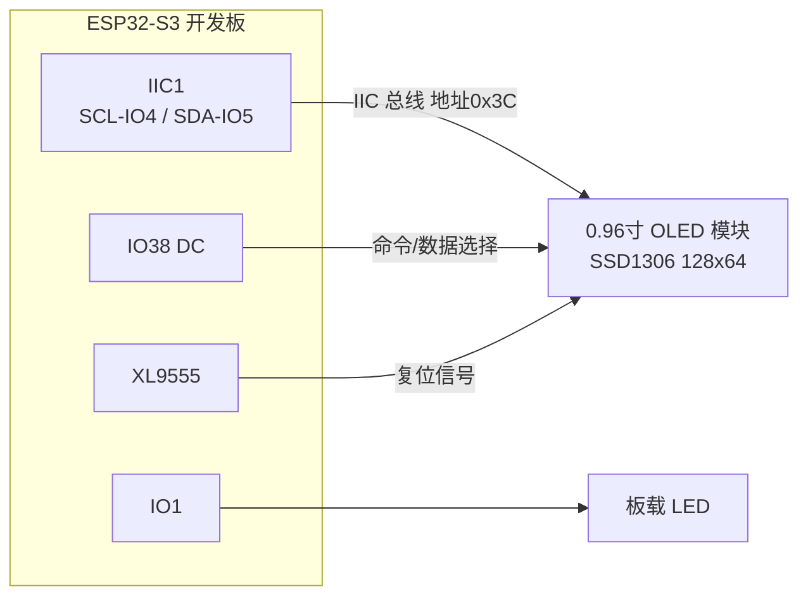
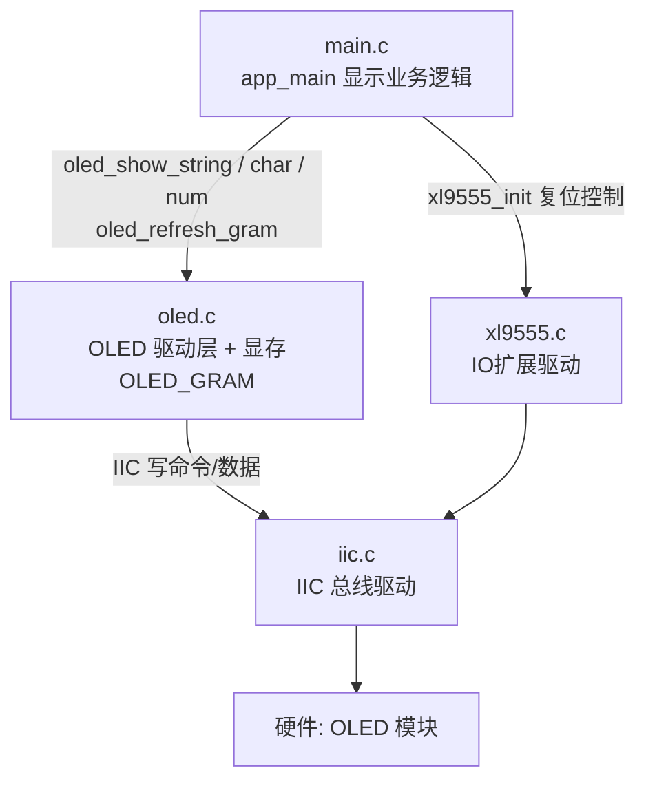
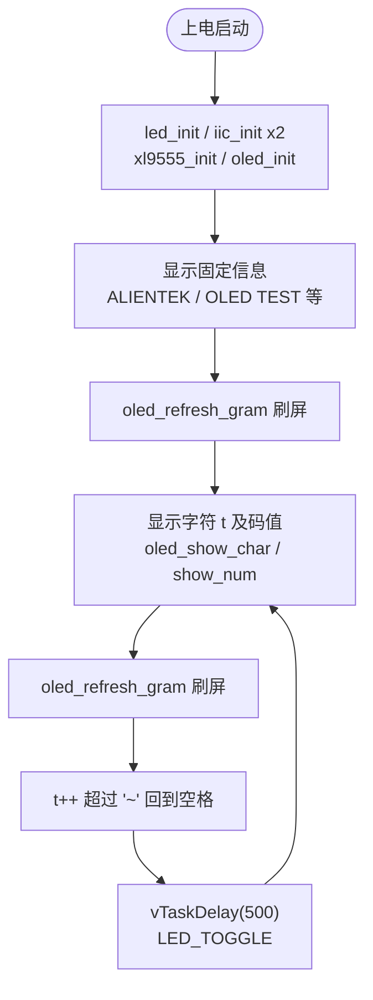

# 11 OLED 实验

> 平台：正点原子 ESP32-S3 开发板 ｜ 框架：ESP-IDF ｜ 难度：★★★☆☆
>
> 一句话简介：驱动正点原子 0.96 寸 OLED 显示屏（128×64），循环显示 ASCII 字符及其码值，掌握「显存 + 刷屏」这套显示屏通用套路。

---

## 1. 实验简介

OLED（有机发光二极管屏）是自发光显示屏，无需背光、对比度高。本实验使用正点原子 **0.96 寸 OLED 模块**（SSD1306 主控，128×64 像素），插在开发板左下角的 OLED/CAMERA 接口上，通过 **IIC1 总线**（SCL-IO4、SDA-IO5）驱动，复位脚由 XL9555 扩展 IO 控制。

程序先在屏幕上显示几行固定信息，然后从空格（ASCII 32）到波浪号（ASCII 126）逐个循环显示字符和它的码值，每 500ms 换一个；LED 同步闪烁提示程序在运行。

学完本实验你将掌握：

- 初始化 OLED（复位 + 写初始化命令序列）；
- 用「本地显存 OLED_GRAM + 一次性刷屏」的方式绘图；
- 在指定坐标显示字符、数字、字符串；
- 理解 OLED 显存的「页」组织方式（8 页 × 128 列）。

## 2. 生活类比

OLED 显示就像**在稿纸上打草稿再誊抄**：

- 屏幕自己不会「记」你要画什么，你每次直接往屏上画一个点，既慢又容易看到涂改痕迹；
- 所以驱动先在内存里准备一张**草稿纸（显存 OLED_GRAM，128×64 位）**，想显示什么先改草稿，改完调用 `oled_refresh_gram()` **一次性誊抄**到屏幕上；
- 屏幕被分成 8 页、每页 128 列，就像稿纸画了 8 行格子——誊抄时一行一行（一页一页）地抄；
- 好处：草稿随便改不闪屏，誊抄一气呵成画面干净。

## 3. 硬件连接

### 引脚分配

| 元件 | 开发板引脚 | 说明 |
| :--- | :--- | :--- |
| LED（板载） | IO1 | 闪烁提示程序运行 |
| OLED_SCL | IO4 | IIC1 时钟线 |
| OLED_SDA | IO5 | IIC1 数据线 |
| OLED_DC | IO38 | 命令 / 数据选择 |
| OLED_D2 | IO6 | 接口方式检测输入 |
| OLED 复位 | XL9555 OV_RESET | 由 IO 扩展芯片控制复位 |

> OLED 模块插在开发板**左下角的 OLED/CAMERA 接口**上（接口比 OLED 插针多 2 个，屏幕向外、靠左对齐插入），无需杜邦线。

### 连接图



## 4. 程序架构

OLED 驱动内部维护一块 128×64 位的显存，所有绘图 API 都只改显存，最后由刷屏函数统一送到屏幕。



## 5. 程序流程



## 6. 核心代码讲解

### 6.1 驱动层：刷屏函数（`oled.c`）

```c
void oled_refresh_gram(void)
{
    uint8_t i, n;

    for (i = 0; i < 8; i++)
    {
        oled_write_Byte(0xb0 + i, OLED_CMD);     /* 设置页地址（0~7） */
        oled_write_Byte(0x00, OLED_CMD);         /* 设置显示位置—列低地址 */
        oled_write_Byte(0x10, OLED_CMD);         /* 设置显示位置—列高地址 */

        for (n = 0; n < 128; n++)
        {
            oled_write_Byte(OLED_GRAM[n][i], OLED_DATA);
        }
    }
}
```

**讲解**：SSD1306 的显存按「页」组织：128 列 × 8 页，每页 8 个像素点竖着打包成 1 字节。刷屏就是外层循环 8 页（`0xb0 + i` 是设置页地址的命令）、内层循环把本地显存 `OLED_GRAM` 的 128 个字节逐页写进屏幕。`OLED_CMD`（0x00）/`OLED_DATA`（0x40）区分本次写的是命令还是数据。

### 6.2 驱动层：初始化（`oled.c`）

```c
void oled_init(i2c_obj_t self)
{
    /* 配置 OLED_DC(IO38) 为输出、OLED_D2(IO6) 为输入 ... */

    OLED_DC(0);

    /* 配置复位引脚电平 */
    xl9555_pin_write(OV_RESET_IO, 1);

    /* 复位OLED */
    OLED_RST(0);
    /* ... 延时后拉高复位, 再写入一串初始化命令 ... */
}
```

**讲解**：复位脚不在 ESP32-S3 上，而是挂在 XL9555 的 `OV_RESET_IO`（摄像头/OLED 共用复位），所以初始化顺序是：先 `xl9555_init()`，再 `oled_init()` 里通过 `OLED_RST(x)` 宏做硬复位，最后写 SSD1306 的初始化命令序列（关显示、设时钟、设分辨率、开显示等）。

### 6.3 业务层：循环显示 ASCII 码（`main.c`）

```c
void app_main(void)
{
    uint8_t t = 0;

    led_init();                             /* 初始化LED */
    i2c0_master = iic_init(I2C_NUM_0);      /* 初始化IIC0 */
    i2c1_master = iic_init(I2C_NUM_1);      /* 初始化IIC1 */
    xl9555_init(i2c0_master);               /* 初始化XL9555 */
    oled_init(i2c1_master);                 /* 初始化OLED */

    oled_show_string(0, 0, "ALIENTEK", 24);
    oled_show_string(0, 24, "0.96' OLED TEST", 16);
    oled_show_string(0, 40, "ATOM 2023/8/26", 12);
    oled_show_string(0, 52, "ASCII:", 12);
    oled_show_string(64, 52, "CODE:", 12);
    oled_refresh_gram();                    /* 更新显示到OLED */

    t = ' ';
    while(1)
    {
        oled_show_char(36, 52, t, 12, 1);   /* 显示ASCII字符 */
        oled_show_num(94, 52, t, 3, 12);    /* 显示ASCII字符的码值 */
        oled_refresh_gram();                /* 更新显示到OLED */
        t++;

        if (t > '~')
        {
            t = ' ';
        }

        vTaskDelay(500);
        LED_TOGGLE();                       /* LED闪烁 */
    }
}
```

**讲解**：

- `oled_show_string(x, y, str, size)`：在坐标 (x, y) 显示字符串，`size` 是字体高度（支持 12/16/24），字模取自 `oledfont.h`；
- `oled_show_char(x, y, chr, size, mode)`：显示单个字符，`mode` 为 1 表示叠加显示（不清底）；
- `oled_show_num(x, y, num, len, size)`：显示 `len` 位数字，这里用来显示字符的 ASCII 码值；
- 所有 show 函数都只改显存，**必须调用 `oled_refresh_gram()` 才会真正显示到屏上**；
- `t` 从空格（32）自增到 `~`（126）再回到空格，500ms 换一个，正好遍历所有可打印 ASCII 字符。

## 7. 实验效果

把 OLED 模块插入开发板左下角的 OLED/CAMERA 接口，下载程序并复位后：

- 屏幕上依次显示 `ALIENTEK`（24 号大字体）、`0.96' OLED TEST`、日期等固定信息；
- 最下面一行 `ASCII:` 后每 500ms 换一个字符，`CODE:` 后同步显示该字符的 ASCII 码值（32~126 循环）；
- 板载 LED 每 500ms 翻转一次，提示程序正在运行。

## 8. 注意事项

1. 需**自备正点原子 0.96 寸 OLED 模块**才能做本实验。
2. OLED/CAMERA 接口比 OLED 模块的插针**多 2 个**，插入时屏幕向外、**靠左对齐**，切勿插错位。
3. 模块的接口方式由背面的 BS0、BS1 电阻配置决定（正点原子模块默认 BS0、BS1 都接 VCC）；本工程按实际代码使用 **IIC 方式**驱动（器件地址 0x3C）。
4. 绘图后忘记调用 `oled_refresh_gram()` 是最常见的「屏幕不显示」原因——记住：改显存和刷屏是两步。
5. 坐标 (x, y) 范围是 x：0~127、y：0~63，越界部分不会显示。

## 9. 编译与烧录

```bash
idf.py set-target esp32s3   # 首次配置目标芯片
idf.py build                # 编译
idf.py -p COMx flash monitor  # 烧录并打开串口监视器（COMx 换成你的端口号）
```

> 完整的开发环境搭建与烧录说明见 [根目录 README](../README.md)。

---

## 小结

本实验完成了第一个「显示类」外设：IIC 发命令 / 发数据、显存绘图、整屏刷新——这三件事几乎适用于所有点阵屏（OLED、LCD、TFT）。后面更复杂的 GUI 实验，底层依然是今天这套「改显存 + 刷屏」的骨架。

| 关键 API | 作用 |
| :--- | :--- |
| `oled_init()` | 硬复位 OLED 并写入初始化命令序列 |
| `oled_clear()` | 清空显存（清屏） |
| `oled_show_char()` | 在指定坐标显示一个字符 |
| `oled_show_string()` | 在指定坐标显示字符串 |
| `oled_show_num()` | 在指定坐标显示数字 |
| `oled_refresh_gram()` | 把显存内容整屏刷新到 OLED |
