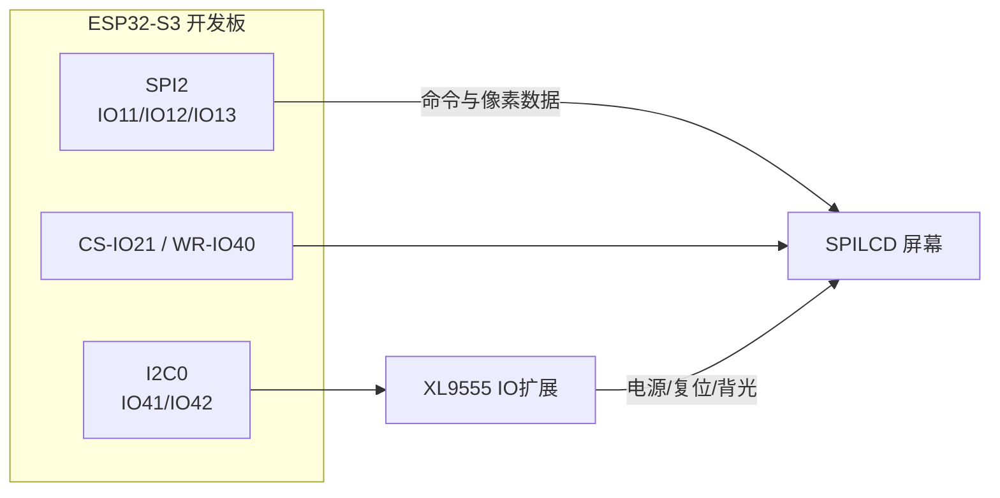
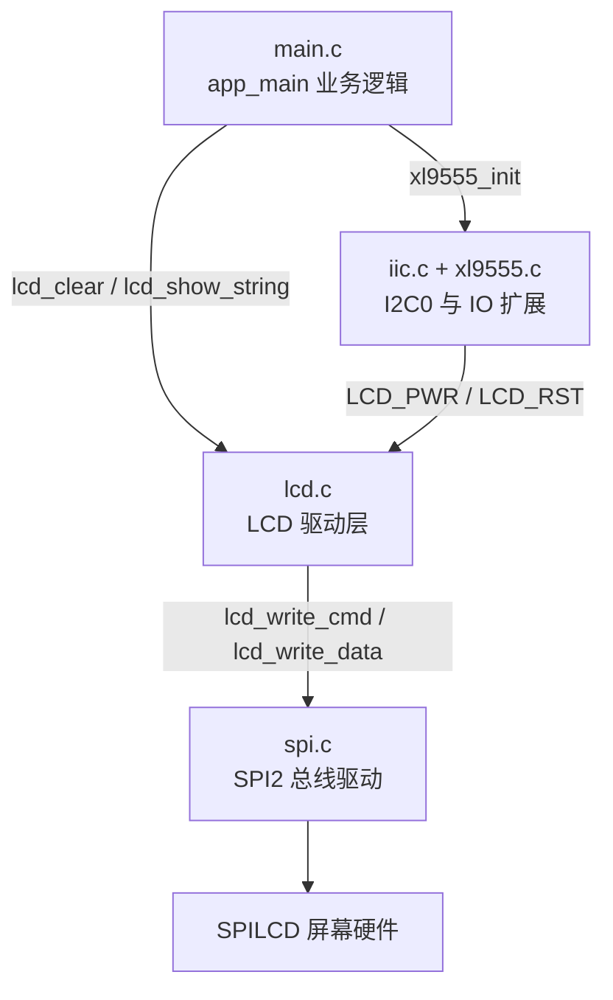
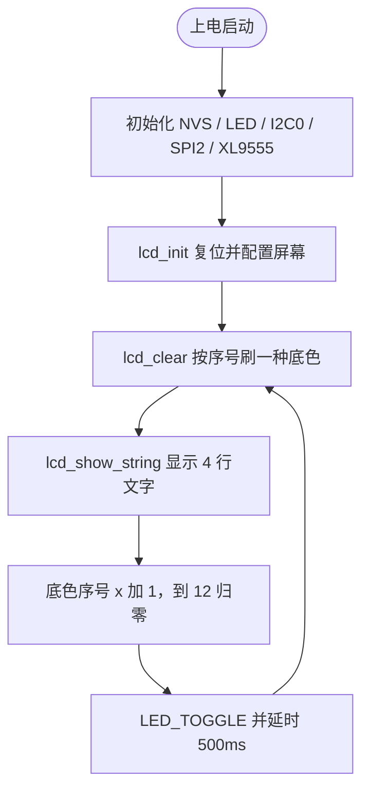

# 12 SPILCD 实验

> 平台：正点原子 ESP32-S3 开发板 ｜ 框架：ESP-IDF ｜ 难度：★★★☆☆
>
> 一句话简介：点亮正点原子 1.3/2.4 寸彩色 SPILCD 屏幕，循环切换 12 种底色并显示文字，掌握 **SPI 驱动 LCD** 的基本方法。

---

## 1. 实验简介

SPILCD 就是「用 SPI 总线通信的 LCD 液晶显示屏」（也叫 MCU 屏）。本实验把正点原子 1.3/2.4 寸 SPILCD 模块插到开发板的 LCD 座上，通过 SPI2 总线向屏幕发送初始化命令和像素数据，让屏幕显示 "ESP32 / SPILCD TEST" 等文字，并且每 500ms 换一次背景色（白、黑、蓝、红、绿……共 12 种）。

学完本实验你将掌握：

- ESP-IDF 的 SPI 总线初始化（`spi_bus_initialize()`）与设备挂载（`spi_bus_add_device()`）；
- LCD 的初始化流程：硬件复位 → 发送寄存器配置命令表 → 开显示；
- 用 `lcd_clear()` 清屏、`lcd_show_string()` 显示不同字号的文字。

## 2. 生活类比

把 SPILCD 想象成一台**老式传真机**：

- SPI 总线 = 传真机的电话线，一条线按约定的「节奏」把数据一位一位传过去；
- `lcd_init()` 发送的命令表 = 开机前先给对方发一页「设置说明」：用什么纸、什么字号、扫描方向；
- `lcd_clear(RED)` = 把整张纸先刷成红色底；
- `lcd_show_string()` = 用打印头在指定坐标一行行「打印」文字，坐标 (x, y) 就是纸上的位置。

## 3. 硬件连接

### 引脚分配

| 元件 | 开发板引脚 | 说明 |
| :--- | :--- | :--- |
| LED（板载） | IO1 | 闪烁指示程序运行 |
| SPILCD 模块 SPI | IO11 / IO12 / IO13 | SPI2 的 MOSI / CLK / MISO |
| SPILCD 片选 CS | IO21 | 低电平选中屏幕 |
| SPILCD 写信号 WR | IO40 | 屏幕写控制引脚 |
| XL9555（I2C0） | SDA-IO41 / SCL-IO42 | IO 扩展芯片，控制屏幕电源、复位、背光 |

> SPILCD 模块直接插在开发板的 LCD 插座上即可，注意排针方向，无需飞线。

### 连接图



## 4. 程序架构

代码分三层：`main.c` 负责「显示什么」，LCD 驱动负责「怎么画」，SPI/I2C/XL9555 负责「怎么传数据」。



## 5. 程序流程



## 6. 核心代码讲解

### 6.1 初始化：把屏幕「叫醒」（`main.c`）

```c
led_init();                         /* 初始化LED */
i2c0_master = iic_init(I2C_NUM_0);  /* 初始化IIC0 */
spi2_init();                        /* 初始化SPI2 */
xl9555_init(i2c0_master);           /* IO扩展芯片初始化 */
lcd_init();                         /* 初始化LCD */
```

**讲解**：这五行的顺序不能乱——屏幕的**电源和复位脚挂在 XL9555 扩展芯片上**，而 XL9555 又靠 I2C0 通信，所以必须先初始化 I2C 和 XL9555，最后才能 `lcd_init()`。

### 6.2 LCD 驱动：挂载 SPI 设备并复位（`lcd.c`）

```c
spi_device_interface_config_t devcfg = {
    .clock_speed_hz = 60 * 1000 * 1000,     /* SPI时钟 60MHz */
    .mode = 0,                              /* SPI模式0 */
    .spics_io_num = lcd_self.cs,            /* 片选引脚 IO21 */
    .queue_size = 7,                        /* 事务队列尺寸 */
};
ret = spi_bus_add_device(SPI2_HOST, &devcfg, &MY_LCD_Handle);  /* 挂到SPI2总线 */

lcd_hard_reset();                           /* LCD硬件复位 */
```

**讲解**：`spi_bus_add_device()` 把屏幕注册成 SPI2 总线上的一个「设备」，之后所有读写都通过句柄 `MY_LCD_Handle` 进行。60MHz 的 SPI 时钟让刷屏速度足够快。`lcd_hard_reset()` 通过 XL9555 拉低再拉高复位脚，让屏幕回到已知的初始状态。

复位后，驱动会按屏幕型号（1.3 寸 ST7789 / 2.4 寸 ILI9341）逐条发送初始化命令表：

```c
while (ili_init_cmds[cmd].databytes != 0xff)
{
    lcd_write_cmd(ili_init_cmds[cmd].cmd);                              /* 发命令 */
    lcd_write_data(ili_init_cmds[cmd].data, ili_init_cmds[cmd].databytes & 0x1F); /* 发参数 */
    cmd++;
}
```

每条命令如 `0x11`（退出睡眠）、`0x3A`（像素格式 RGB565）、`0x29`（开显示），这就是「传真机的设置说明页」。

### 6.3 业务层：循环换底色 + 显示文字（`main.c`）

```c
while (1)
{
    switch (x)
    {
        case 0: lcd_clear(WHITE); break;
        case 1: lcd_clear(BLACK); break;
        case 2: lcd_clear(BLUE);  break;
        /* ...共12种颜色... */
        case 11: lcd_clear(BROWN); break;
    }

    lcd_show_string(10, 40, 240, 32, 32, "ESP32", RED);
    lcd_show_string(10, 80, 240, 24, 24, "SPILCD TEST", RED);
    lcd_show_string(10, 110, 240, 16, 16, "ATOM@ALIENTEK", RED);
    lcd_show_string(10, 150, 240, 12, 12, "ATOM@ALIENTEK", RED);
    x++;

    if (x == 12)
    {
        x = 0;
    }

    LED_TOGGLE();
    vTaskDelay(500);
}
```

**讲解**：

- `lcd_clear(颜色)` 把整屏刷成一种底色，颜色宏（如 `RED`）是 16 位 RGB565 值；
- `lcd_show_string(x, y, w, h, size, str, color)` 在坐标 (x, y) 处以 `size` 号字（12/16/24/32）显示字符串，所以同一段文字用 4 种字号各显示一遍；
- 每轮 `x` 加 1、到 12 归零，于是底色按 500ms 一次的节奏不停轮换。

## 7. 实验效果

烧录复位后，SPILCD 屏幕显示 "ESP32"、"SPILCD TEST"、"ATOM@ALIENTEK" 等文字（4 种字号），**背景色每 500ms 切换一次**，12 种颜色循环往复；板载 LED 同步闪烁，指示程序正在运行。

## 8. 注意事项

1. 屏幕为**插接式模块**，务必断电后再插拔，并确认方向正确，避免压坏排针。
2. 1.3 寸与 2.4 寸屏幕的初始化命令表不同，由 `lcd.c` 里的宏 `SPI_LCD_TYPE` 区分（1 = 2.4 寸，0 = 1.3 寸）；如果屏幕花屏或不亮，先确认该宏与实际屏幕一致，改完重新编译烧录。
3. `lcd_clear()` 是全屏刷新，数据量较大；局部更新时请改用 `lcd_fill()`，速度快得多。

## 9. 编译与烧录

```bash
idf.py set-target esp32s3   # 首次配置目标芯片
idf.py build                # 编译
idf.py -p COMx flash monitor  # 烧录并打开串口监视器（COMx 换成你的端口号）
```

> 完整的开发环境搭建与烧录说明见 [根目录 README](../README.md)。

---

## 小结

本实验打通了「SPI 总线 → LCD 驱动 → 画点/清屏/显示文字」这条彩色屏的完整链路，是后面 RTC、ADC、传感器等所有「带屏显示」实验的地基。

| 关键 API | 作用 |
| :--- | :--- |
| `spi_bus_initialize()` / `spi_bus_add_device()` | 初始化 SPI2 总线并挂载 LCD 设备 |
| `lcd_init()` | 复位屏幕并发送初始化命令表 |
| `lcd_clear()` | 以指定颜色清整屏 |
| `lcd_show_string()` | 在指定坐标显示指定字号的字符串 |
| `xl9555_pin_write()` | 通过 IO 扩展芯片控制屏幕电源/复位 |
