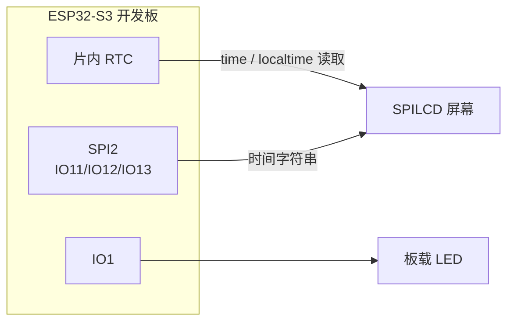
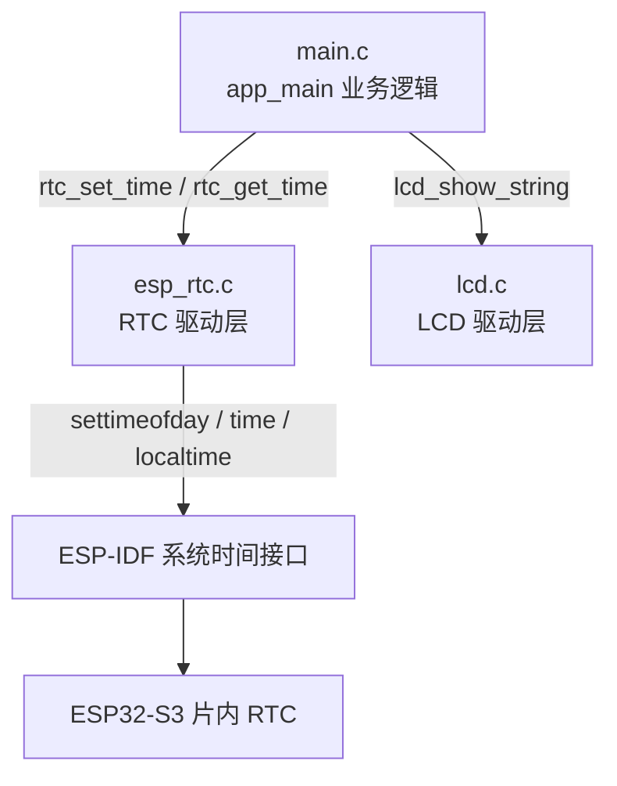
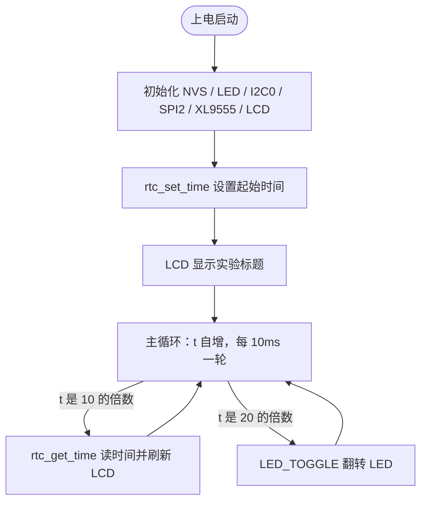

# 13 RTC 实验

> 平台：正点原子 ESP32-S3 开发板 ｜ 框架：ESP-IDF ｜ 难度：★★☆☆☆
>
> 一句话简介：用 ESP32-S3 **片内 RTC** 记录时间，并在 SPILCD 屏幕上实时显示年月日、时分秒和星期。

---

## 1. 实验简介

RTC（Real Time Clock，实时时钟）是芯片内部一个「永不停歇的秒表」：你告诉它现在是几点，它就自己按秒往下数，即使主程序在忙别的也不受影响。ESP32-S3 片内自带 RTC，本实验通过 ESP-IDF 的系统时间接口（`settimeofday()` / `time()` / `localtime()`）设置和读取时间，并每 100ms 把最新时间刷新到 LCD 上。

学完本实验你将掌握：

- 用 `settimeofday()` 设置系统时间（RTC 计时起点）；
- 用 `time()` + `localtime()` 读出当前的年月日时分秒；
- 用 `sprintf()` 把数字拼成字符串再交给 `lcd_show_string()` 显示。

## 2. 生活类比

把 RTC 想象成你**新买的一块机械手表**：

- `rtc_set_time()` = 对表：拧动表冠，把手表调到「2023 年 8 月 26 日 0 点整」；
- 手表机芯 = RTC 硬件，对完表后它自己「滴答滴答」走，不用你每秒去拨；
- `rtc_get_time()` = 抬手腕看一眼表：随时读出现在几点几分；
- LCD 刷新 = 你把看到的时间抄到墙上的白板（屏幕）上，每 100ms 抄一次，别人看白板就知道时间了。

> 注意：ESP32-S3 的 RTC 掉电后时间会丢失（不像手表有电池），所以每次上电都要重新「对表」。想断电也保持时间，可以外接 DS18B20/DS3231 之类的专用 RTC 芯片，或用 Wi-Fi 联网校时（SNTP）。

## 3. 硬件连接

### 引脚分配

| 元件 | 开发板引脚 | 说明 |
| :--- | :--- | :--- |
| LED（板载） | IO1 | 闪烁指示程序运行 |
| RTC | 芯片内部 | 无需外部引脚 |
| SPILCD 模块 SPI | IO11 / IO12 / IO13 | SPI2 的 MOSI / CLK / MISO |
| SPILCD 片选 CS / WR | IO21 / IO40 | 屏幕控制引脚 |
| XL9555（I2C0） | SDA-IO41 / SCL-IO42 | 控制屏幕电源、复位、背光 |

> SPILCD 模块插在开发板 LCD 座上即可；RTC 在芯片内部，不占任何引脚。

### 连接图



## 4. 程序架构



## 5. 程序流程



## 6. 核心代码讲解

### 6.1 驱动层：设置时间（`esp_rtc.c`）

```c
void rtc_set_time(int year,int mon,int mday,int hour,int min,int sec)
{
    struct tm datetime;
    datetime.tm_year = year - 1900;     /* tm_year 从1900年起算 */
    datetime.tm_mon = mon - 1;          /* tm_mon 从0起算 */
    datetime.tm_mday = mday;
    datetime.tm_hour = hour;
    datetime.tm_min = min;
    datetime.tm_sec = sec;
    datetime.tm_isdst = -1;
    /* 获取1970.1.1以来的总秒数 */
    time_t second = mktime(&datetime);
    struct timeval val = { .tv_sec = second, .tv_usec = 0 };
    settimeofday(&val, NULL);           /* 设置当前时间 */
}
```

**讲解**：这是 C 语言标准的时间「三件套」：

- `struct tm` 是人类习惯的「年月日时分秒」结构，注意 `tm_year` 要减 1900、`tm_mon` 要减 1（历史遗留约定）；
- `mktime()` 把它换算成从 **1970 年 1 月 1 日 0 点**（Unix 纪元）到现在的总秒数；
- `settimeofday()` 把这个秒数写入系统时钟，RTC 硬件就从这一刻开始自己数秒。

### 6.2 驱动层：读取时间（`esp_rtc.c`）

```c
void rtc_get_time(void)
{
    struct tm *datetime;
    time_t second;
    time(&second);                          /* 返回自1970.1.1经过的秒数 */
    datetime = localtime(&second);          /* 秒数换算回年月日时分秒 */

    calendar.hour = datetime->tm_hour;      /* 时 */
    calendar.min = datetime->tm_min;        /* 分 */
    calendar.sec = datetime->tm_sec;        /* 秒 */
    calendar.year = datetime->tm_year + 1900; /* 年 */
    calendar.month = datetime->tm_mon + 1;    /* 月 */
    calendar.date = datetime->tm_mday;        /* 日 */
    calendar.week = rtc_get_week(calendar.year, calendar.month, calendar.date); /* 周 */
}
```

**讲解**：读时间是设置的逆过程——`time()` 拿到总秒数，`localtime()` 换算回 `struct tm`。结果存进全局结构体 `calendar`，业务层直接取用。星期几系统没有现成接口，驱动用**基姆拉尔森公式**（`rtc_get_week()`）根据年月日算出来。

### 6.3 业务层：定时刷新显示（`main.c`）

```c
rtc_set_time(2023,8,26,00,00,00);   /* 设置RTC时间 */

while (1)
{
    t++;

    if ((t % 10) == 0)              /* 每100ms更新一次显示数据 */
    {
        rtc_get_time();
        sprintf((char *)tbuf, "Time:%02d:%02d:%02d", calendar.hour, calendar.min, calendar.sec);
        lcd_show_string(10, 130, 210, 16, 16, (char *)tbuf, BLUE);
        sprintf((char *)tbuf, "Date:%04d-%02d-%02d", calendar.year, calendar.month, calendar.date);
        lcd_show_string(10, 150, 210, 16, 16, (char *)tbuf, BLUE);
        sprintf((char *)tbuf, "Week:%s", weekdays[calendar.week - 1]);
        lcd_show_string(10, 170, 210, 16, 16, (char *)tbuf, BLUE);
    }

    if ((t % 20) == 0)
    {
        LED_TOGGLE();               /* 每200ms,翻转一次LED */
    }

    vTaskDelay(10);
}
```

**讲解**：

- 主循环每轮延时 10ms，`t % 10 == 0` 即每 100ms 刷新一次时间显示，`t % 20 == 0` 即每 200ms 翻转一次 LED——用一个计数器同时产生两种节拍；
- `sprintf()` 里的 `%02d` 表示不足两位补 0（比如 `08:05:09`），这是电子钟显示的经典技巧；
- `weekdays[]` 数组把数字星期映射成 "Sunday"、"Monday" 等英文单词。

## 7. 实验效果

烧录复位后，LCD 上方显示 "ESP32 / RTC Test / ATOM@ALIENTEK" 标题，下方三行实时刷新：

- `Time:00:00:xx`（时:分:秒，每秒走动）
- `Date:2023-08-26`（年-月-日）
- `Week:Saturday`（星期）

同时串口每 100ms 打印一次时间和日期，板载 LED 以约 200ms 间隔闪烁。

## 8. 注意事项

1. 时间起点是代码里写死的 `rtc_set_time(2023,8,26,00,00,00)`，想显示真实时间可改成当前时间，或后续实验用 Wi-Fi SNTP 自动校时。
2. ESP32-S3 片内 RTC **断电即失**：USB 一拔时间就归零重来，属正常现象。
3. `struct tm` 的年份从 1900 起算、月份从 0 起算，设置和读取时都要 ±对应偏移，弄错会差一个月/若干年。

## 9. 编译与烧录

```bash
idf.py set-target esp32s3   # 首次配置目标芯片
idf.py build                # 编译
idf.py -p COMx flash monitor  # 烧录并打开串口监视器（COMx 换成你的端口号）
```

> 完整的开发环境搭建与烧录说明见 [根目录 README](../README.md)。

---

## 小结

本实验用「设置 → 自动走时 → 读取 → 显示」四步玩转了 ESP32-S3 片内 RTC，并复习了 LCD 显示与定时器节拍技巧。RTC 是日志打时间戳、定时任务、低功耗唤醒等功能的基础。

| 关键 API | 作用 |
| :--- | :--- |
| `settimeofday()` | 设置系统时间（RTC 计时起点） |
| `time()` | 获取自 1970-1-1 以来的总秒数 |
| `localtime()` | 把总秒数换算成年月日时分秒 |
| `mktime()` | 把年月日时分秒换算成总秒数 |
| `sprintf()` | 把数字格式化成字符串用于显示 |
