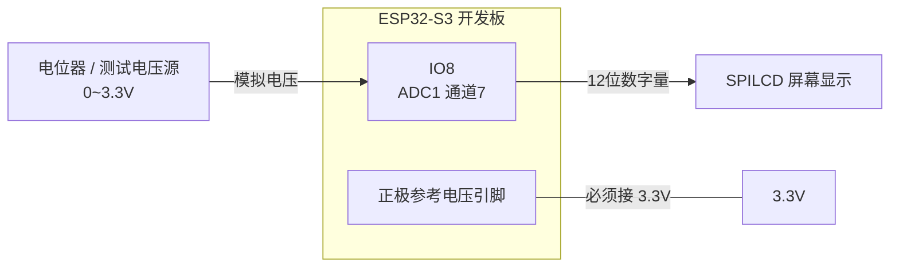
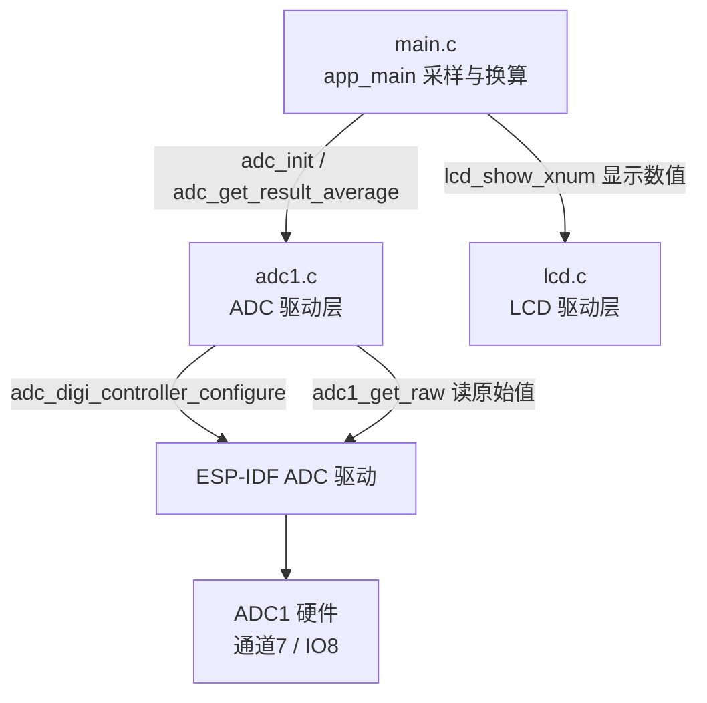
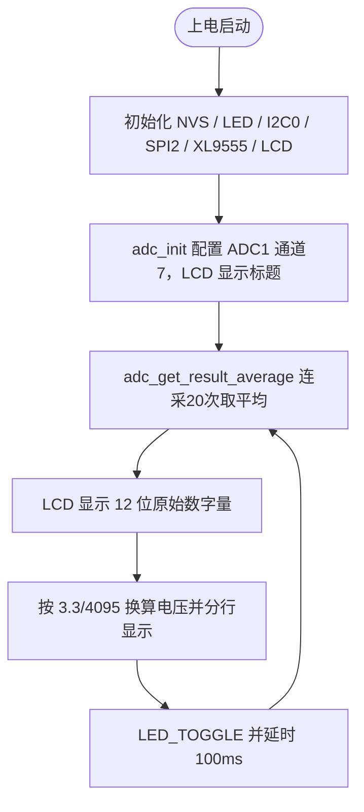

# 14 ADC 实验

> 平台：正点原子 ESP32-S3 开发板 ｜ 框架：ESP-IDF ｜ 难度：★★☆☆☆
>
> 一句话简介：用 ESP32-S3 **内部 ADC** 采集 IO8 上的电压，在 LCD 上同时显示 12 位数字量和换算后的实际电压值。

---

## 1. 实验简介

ADC（Analog to Digital Converter，模数转换器）负责把「连续的电压」变成「离散的数字」。ESP32-S3 内部集成了 2 个 ADC 单元，本实验使用 **ADC1 的通道 7（对应引脚 IO8）**，以 12 位精度（0~4095）采集电压，连续采 20 次取平均滤掉毛刺，再按 `电压 = 数字量 × 3.3 / 4095` 换算成实际电压，显示在 SPILCD 屏幕上。

学完本实验你将掌握：

- ADC 通道、衰减系数（atten）、位宽这三个关键概念；
- 用 `adc1_get_raw()` 读取一次采样结果；
- 均值滤波的写法，以及「数字量 → 电压」的换算公式。

## 2. 生活类比

把 ADC 想象成一把**只有 4096 个刻度的尺子**：

- 电压是你要量的「长度」，0V 对应刻度 0，3.3V 对应刻度 4095；
- `adc1_get_raw()` = 拿尺子量一次，读出一个刻度数（比如 2048）；
- 均值滤波（连量 20 次取平均）= 手抖量不准，多量几次取平均更靠谱；
- 换算公式 = 把刻度数换算回厘米：`2048 × 3.3 / 4095 ≈ 1.65V`，正好是「半格」。

## 3. 硬件连接

### 引脚分配

| 元件 | 开发板引脚 | 说明 |
| :--- | :--- | :--- |
| LED（板载） | IO1 | 闪烁指示程序运行 |
| ADC 采集输入 | IO8 | ADC1 通道 7，输入 0~3.3V 电压 |
| SPILCD 模块 SPI | IO11 / IO12 / IO13 | SPI2 的 MOSI / CLK / MISO |
| SPILCD 片选 CS / WR | IO21 / IO40 | 屏幕控制引脚 |
| XL9555（I2C0） | SDA-IO41 / SCL-IO42 | 控制屏幕电源、复位、背光 |

> 实验时可把 IO8 接到开发板上的电位器分压输出，或直接用杜邦线接 3.3V / GND 观察两个极端值。

### 连接图



## 4. 程序架构



## 5. 程序流程



## 6. 核心代码讲解

### 6.1 驱动层：初始化 ADC（`adc1.c`）

```c
void adc_init(void)
{
    adc_digi_pattern_config_t adc1_digi_pattern_config;         /* ADC1配置句柄 */
    adc_digi_configuration_t adc1_init_config;                  /* ADC1初始化句柄 */

    adc1_digi_pattern_config.atten = ADC_ATTEN_DB_11;           /* 配置ADC衰减程度 */
    adc1_digi_pattern_config.channel = ADC_ADCX_CHY;            /* 配置ADC通道: ADC1_CHANNEL_7 */
    adc1_digi_pattern_config.unit = ADC_UNIT_1;                 /* 配置ADC单元: ADC1 */
    adc1_digi_pattern_config.bit_width = ADC_BITWIDTH_12;       /* 配置ADC位宽: 12位 */
    adc1_init_config.adc_pattern = &adc1_digi_pattern_config;   /* 配置将要使用的每个ADC参数 */
    adc_digi_controller_configure(&adc1_init_config);           /* 配置ADC1 */
}
```

**讲解**：四个字段是 ADC 的「身份证」：

- `unit` 选 ADC1（ADC2 与 Wi-Fi 冲突，一般不用）；
- `channel` 选通道 7，即 IO8 引脚（头文件里 `#define ADC_ADCX_CHY ADC1_CHANNEL_7`）；
- `bit_width = 12` 表示结果范围 0~4095；
- `atten = ADC_ATTEN_DB_11` 是**衰减 11dB**，把可测范围拉到接近 0~3.3V（不衰减时只能测约 0~1.1V）。

### 6.2 驱动层：均值滤波（`adc1.c`）

```c
uint32_t adc_get_result_average(uint32_t ch, uint32_t times)
{
    uint32_t temp_val = 0;
    uint8_t t;

    for (t = 0; t < times; t++)     /* 获取times次数据 */
    {
        temp_val += adc1_get_raw(ch);
        vTaskDelay(5);
    }

    return temp_val / times;        /* 返回平均值 */
}
```

**讲解**：`adc1_get_raw()` 是 ESP-IDF 提供的「读一次原始值」接口，返回 0~4095 的数字量。单次采样容易受噪声干扰，所以连续采 `times` 次求平均——这就是最常用、最好懂的**均值滤波**。

### 6.3 业务层：换算电压并分行显示（`main.c`）

```c
while(1)
{
    adcdata = adc_get_result_average(ADC_ADCX_CHY, 20);
    lcd_show_xnum(114, 110, adcdata, 5, 16, 0, BLUE);       /* 显示ADC采样后的原始值 */

    voltage = (float)adcdata * (3.3 / 4095);                /* 获取带小数的实际电压值 */
    adcdata = voltage;                                      /* 取整数部分 */
    lcd_show_xnum(114, 130, adcdata, 1, 16, 0, BLUE);       /* 显示电压值的整数部分 */

    voltage -= adcdata;                                     /* 去掉整数部分，留下小数 */
    voltage *= 1000;                                        /* 小数部分乘以1000 */
    lcd_show_xnum(130, 130, voltage, 3, 16, 0x80, BLUE);    /* 显示小数部分 */

    LED_TOGGLE();                                           /* LED翻转函数 */
    vTaskDelay(100);
}
```

**讲解**：

- 换算公式 `电压 = 数字量 × (3.3 / 4095)`：满量程 4095 对应 3.3V；
- 屏幕函数不方便直接打印浮点数，所以拆成「整数位」和「小数×1000」两次显示，第三个参数 `0x80` 让 `lcd_show_xnum` 在数字前带上小数点；
- 每 100ms 刷新一次，同时翻转 LED 提示程序在跑。

## 7. 实验效果

烧录复位后，LCD 显示两行数据并每 100ms 刷新：

- `ADC1_CH7_VAL: xxxxx`——12 位原始数字量（0~4095）；
- `ADC1_CH7_VOL: x.xxxV`——换算后的实际电压。

把 IO8 接 GND 显示约 0V，接 3.3V 显示约 3.1~3.3V（受衰减档量程上限影响），中间电压线性变化；板载 LED 持续闪烁。

## 8. 注意事项

1. **使用 ADC 前，须把开发板的正极参考电压引脚（Vref+）接到 3.3V**，否则采样结果不准确。
2. 施加到采集引脚（IO8）的电压必须在 **0~3.3V** 之间；超过 3.3V（尤其是负电压或 5V）容易**烧坏芯片**！
3. 衰减系数决定量程：`ADC_ATTEN_DB_11` ≈ 0~3.3V；若想测小信号提高精度，可换更小的衰减档。

## 9. 编译与烧录

```bash
idf.py set-target esp32s3   # 首次配置目标芯片
idf.py build                # 编译
idf.py -p COMx flash monitor  # 烧录并打开串口监视器（COMx 换成你的端口号）
```

> 完整的开发环境搭建与烧录说明见 [根目录 README](../README.md)。

---

## 小结

本实验完成了「模拟电压 → 12 位数字量 → 实际电压」的完整采集链路，并实践了均值滤波这一嵌入式常用技巧。ADC 是读取光敏电阻、电位器、电池电压等一切模拟传感器的基础。

| 关键 API | 作用 |
| :--- | :--- |
| `adc_digi_controller_configure()` | 配置 ADC 单元、通道、位宽、衰减 |
| `adc1_get_raw()` | 读取 ADC1 某通道的一次原始采样值 |
| `adc_get_result_average()` | 驱动封装：多次采样取平均（均值滤波） |
| `lcd_show_xnum()` | 在 LCD 指定坐标显示数字 |
