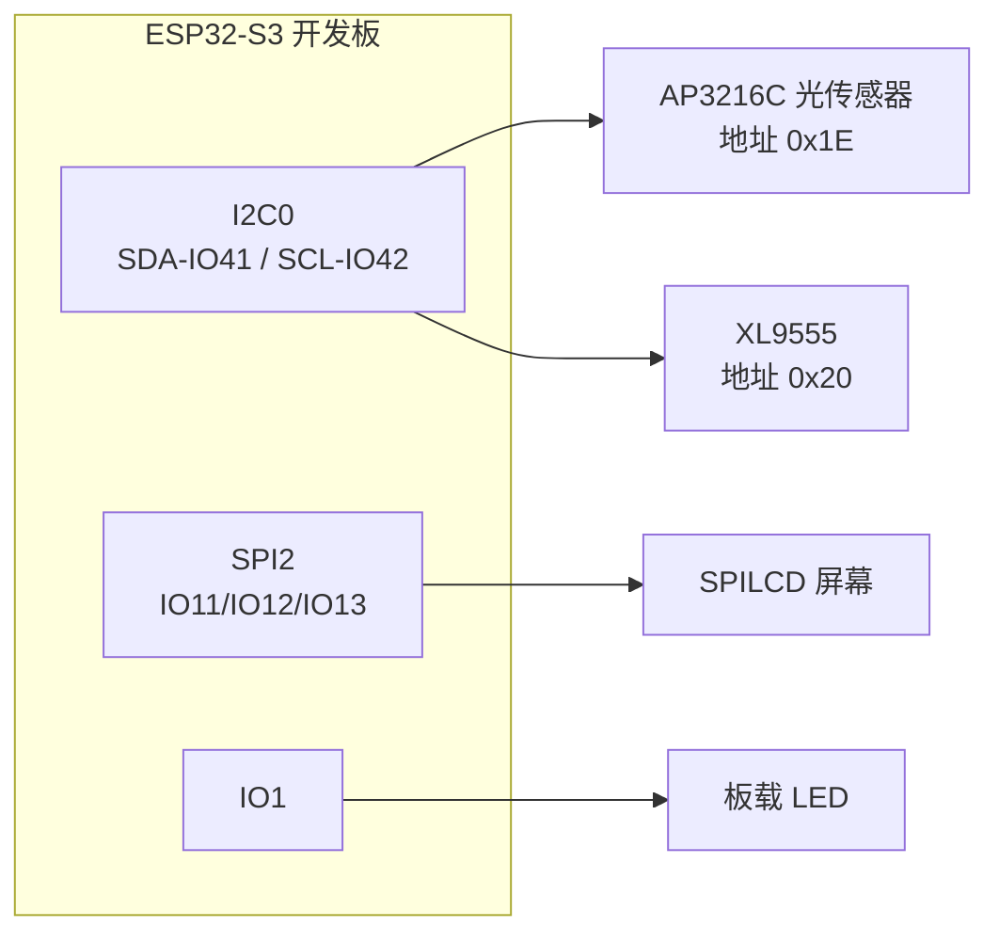
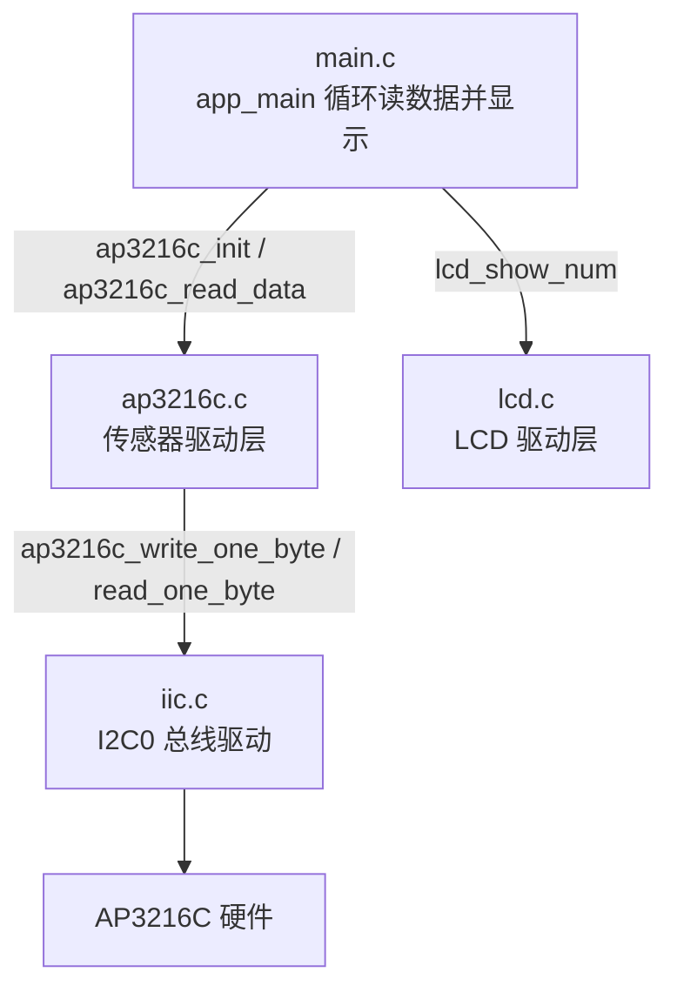
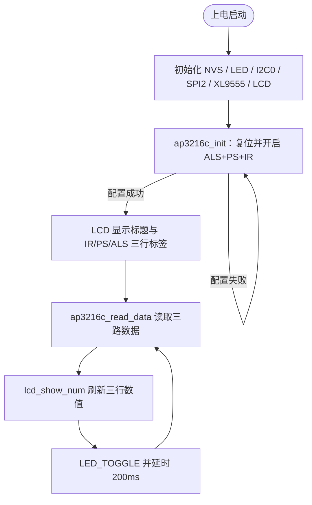

# 15 AP3216C 光环境传感器实验

> 平台：正点原子 ESP32-S3 开发板 ｜ 框架：ESP-IDF ｜ 难度：★★★☆☆
>
> 一句话简介：通过 I2C 读取光环境传感器 **AP3216C** 的环境光（ALS）、接近（PS）、红外（IR）三路数据，并显示在 LCD 上。

---

## 1. 实验简介

AP3216C 是一颗「三合一」光传感器：**ALS** 测环境光亮度（手机自动调屏幕亮度就靠它）、**PS** 测有没有物体靠近（接电话时屏幕自动熄灭就靠它）、**IR** 测红外光强度。它通过 I2C 总线通信，器件地址为 `0x1E`。本实验每 200ms 读一次三路数据并刷新到 SPILCD 屏幕上。

学完本实验你将掌握：

- I2C 传感器的通用套路：复位 → 写配置寄存器 → 读数据寄存器；
- 用 `i2c_transfer()` 对指定器件地址做「先写寄存器号、再读数据」的组合传输；
- 把多个字节按位拼成 16 位传感器数据的技巧。

## 2. 生活类比

把 AP3216C 想象成一位**站在门口的保安**，同时干三件事：

- **ALS（环境光）** = 保安抬头看天：现在是大晴天还是阴天？——决定大厅灯要不要开；
- **PS（接近）** = 保安盯着门口：有没有人凑近了？——有人靠近就打招呼（手机贴脸熄屏）；
- **IR（红外）** = 保安戴着一副「只看红外线」的眼镜：热源发出的红外光有多强？
- I2C 总线 = 你和保安之间的对讲机：先喊一声「报告 0x0A 号登记本的内容」（写寄存器号），保安再把数据念给你听（读数据）。

## 3. 硬件连接

### 引脚分配

| 元件 | 开发板引脚 | 说明 |
| :--- | :--- | :--- |
| LED（板载） | IO1 | 闪烁指示程序运行 |
| AP3216C SDA | IO41 | I2C0 数据线（与 XL9555 共用总线） |
| AP3216C SCL | IO42 | I2C0 时钟线 |
| SPILCD 模块 SPI | IO11 / IO12 / IO13 | SPI2 的 MOSI / CLK / MISO |
| SPILCD 片选 CS / WR | IO21 / IO40 | 屏幕控制引脚 |

> AP3216C 与 XL9555 共用 I2C0 总线（地址不同：AP3216C 为 0x1E，XL9555 为 0x20），一根总线挂多个设备正是 I2C 的优点。

### 连接图



## 4. 程序架构



## 5. 程序流程



## 6. 核心代码讲解

### 6.1 驱动层：初始化传感器（`ap3216c.c`）

```c
uint8_t ap3216c_comfig(void)
{
    uint8_t temp;

    ap3216c_write_one_byte(0x00, 0X04); /* 复位AP3216C */
    vTaskDelay(50);                     /* AP3216C复位至少10ms */
    ap3216c_write_one_byte(0x00, 0X03); /* 开启ALS、PS+IR */
    ap3216c_read_one_byte(&temp, 0X00); /* 读取刚刚写进去的0X03 */

    if (temp == 0X03)
    {
        ESP_LOGE("ap3216c", "AP3216C success!!!");
        return 0;                       /* AP3216C正常 */
    }
    else
    {
        ESP_LOGE("ap3216c", "AP3216C fail!!!");
        return 1;                       /* AP3216C失败 */
    }
}
```

**讲解**：所有操作都围绕 **0x00 模式寄存器**：先写 `0x04` 复位，再写 `0x03` 同时开启 ALS 和 PS+IR。写完立刻**读回来核对**——如果读到的就是 `0x03`，说明芯片在线且配置成功；否则 `ap3216c_init()` 里的 `while` 循环会每 500ms 重试一次，同时串口打印 `ap3216c init fail!!!`。

### 6.2 驱动层：I2C 读写一个寄存器（`ap3216c.c`）

```c
static esp_err_t ap3216c_read_one_byte(uint8_t* data, uint8_t reg)
{
    uint8_t reg_buf[1];
    reg_buf[0] = reg;

    i2c_buf_t buf[2] = {
        {.len = 1, .buf = reg_buf},     /* 第1段：要读的寄存器号 */
        {.len = 1, .buf = data},        /* 第2段：读回的数据 */
    };

    i2c_transfer(&ap3216c_master, AP3216C_ADDR, 2, buf,
                 I2C_FLAG_WRITE | I2C_FLAG_READ | I2C_FLAG_STOP);
    return ESP_OK;
}
```

**讲解**：I2C 读寄存器的标准动作是「**先写后读**」：第一段把寄存器号写给芯片，第二段芯片把该寄存器的值返回。`i2c_transfer()` 把这两段打包成一次带起始/停止位的完整传输，`AP3216C_ADDR` 是器件地址 `0x1E`。

### 6.3 驱动层：一次读齐三路数据（`ap3216c.c`）

```c
void ap3216c_read_data(uint16_t *ir, uint16_t *ps, uint16_t *als)
{
    uint8_t buf[6] = {0};
    uint8_t i;

    for (i = 0; i < 6; i++)
    {
        ap3216c_read_one_byte(&buf[i], 0X0A + i);     /* 循环读取0x0A~0x0F */
    }

    if (buf[0] & 0X80)
    {
        *ir = 0;                                      /* IR_OF位为1,则数据无效 */
    }
    else
    {
        *ir = ((uint16_t)buf[1] << 2) | (buf[0] & 0X03);   /* IR：10位 */
    }

    *als = ((uint16_t)buf[3] << 8) | buf[2];                /* ALS：16位 */

    if (buf[4] & 0x40)
    {
        *ps = 0;                                      /* PS_OF位为1,则数据无效 */
    }
    else
    {
        *ps = ((uint16_t)(buf[5] & 0X3F) << 4) | (buf[4] & 0X0F); /* PS：10位 */
    }
}
```

**讲解**：数据寄存器 `0x0A~0x0F` 连续 6 个字节，依次是 IR、ALS、PS 的低/高字节。三路数据的位数不同（ALS 16 位，IR/PS 10 位），所以要按各自的有效位掩码拼接；`IR_OF`/`PS_OF` 溢出标志为 1 时数据无效，直接置 0。

### 6.4 业务层：循环刷新显示（`main.c`）

```c
while(1)
{
    ap3216c_read_data(&ir, &ps, &als);              /* 读取数据  */
    lcd_show_num(10 + 40, 150, ir, 5, 16, BLUE);    /* 显示IR数据 */
    lcd_show_num(10 + 40, 170, ps, 5, 16, BLUE);    /* 显示PS数据 */
    lcd_show_num(10 + 40, 190, als, 5, 16, BLUE);   /* 显示ALS数据  */

    LED_TOGGLE();                                   /* 提示系统正在运行 */
    vTaskDelay(200);
}
```

**讲解**：每 200ms 读一次、刷一次。这个间隔不是随便定的——手册要求同时开启 ALS 和 PS+IR 时，两次读取间隔必须**大于 112.5ms**，200ms 留足了余量。

## 7. 实验效果

烧录复位后，LCD 显示 "ESP32 / AP3216C TEST / ATOM@ALIENTEK" 标题和 `IR / PS / ALS` 三行数据：

- 用手或纸片**遮挡传感器上方**，ALS 值明显变小；
- 用手指**靠近传感器**，PS 值变大；
- 用红外遥控器对着传感器按键，IR 值跳变。

串口（波特率 115200）在初始化阶段打印 `AP3216C success!!!`；若接线错误则反复打印 `ap3216c init fail!!!`。板载 LED 持续闪烁。

## 8. 注意事项

1. 串口监视器波特率为 **115200**，建议使用 XCOM 或 SSCOM 等调试助手；用 `idf.py monitor` 也可以。
2. 开发板 USB 线要接在 **UART 口**（烧录/打印共用），并在调试助手里选对 COM 端口号。
3. AP3216C 与 XL9555 共用 I2C0 总线，若初始化一直失败，检查传感器模块是否插紧、总线是否被其他程序占用。
4. 两次完整读取的间隔必须大于 112.5ms，读取过快会拿到无效数据。

## 9. 编译与烧录

```bash
idf.py set-target esp32s3   # 首次配置目标芯片
idf.py build                # 编译
idf.py -p COMx flash monitor  # 烧录并打开串口监视器（COMx 换成你的端口号）
```

> 完整的开发环境搭建与烧录说明见 [根目录 README](../README.md)。

---

## 小结

本实验完整走了一遍 I2C 传感器的使用流程：复位配置 → 回读校验 → 连续读寄存器 → 按位拼数据。AP3216C 的三路数据可直接用于自动背光调节、接近检测等实际项目。

| 关键 API | 作用 |
| :--- | :--- |
| `iic_init()` | 初始化 I2C0 总线（SDA-IO41 / SCL-IO42） |
| `i2c_transfer()` | 向指定器件地址发起 I2C 组合传输 |
| `ap3216c_comfig()` | 复位并开启 ALS+PS+IR，回读校验 |
| `ap3216c_read_data()` | 连续读取 0x0A~0x0F 并拼出三路数据 |
| `lcd_show_num()` | 在 LCD 指定坐标显示数字 |
