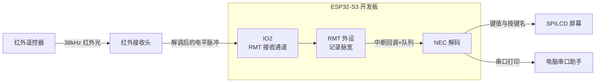
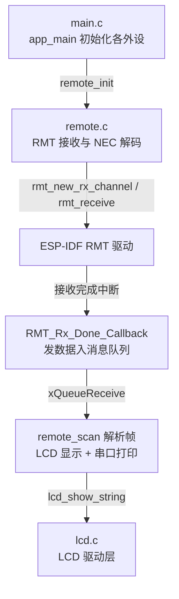
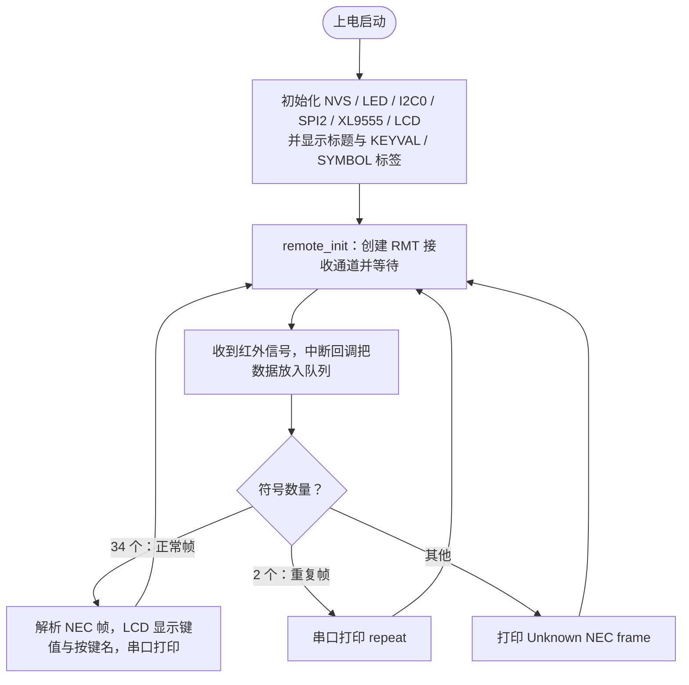

# 16 RMT 红外接收实验

> 平台：正点原子 ESP32-S3 开发板 ｜ 框架：ESP-IDF ｜ 难度：★★★☆☆
>
> 一句话简介：用 ESP32-S3 的 **RMT 外设**接收红外遥控信号，按 **NEC 协议**解码出键值，在 LCD 和串口上显示。

---

## 1. 实验简介

家里的电视、空调遥控器发出的就是红外信号。RMT（Remote Control Transceiver）是 ESP32-S3 内置的「脉冲收发器」，天生适合干这活：它能精确记录引脚上每个电平持续了多少微秒，不用 CPU 死等。本实验让 RMT 接收通道监听 IO2 上的红外接收头，收到一帧信号后通过**中断回调 + 消息队列**交给解码函数，按 NEC 协议还原出按键命令，LCD 显示键值和按键名称（如 POWER、VOL+），串口同步打印。

学完本实验你将掌握：

- RMT 接收通道的创建与配置（`rmt_new_rx_channel()`）；
- 「中断回调 → 消息队列 → 任务解析」这一 ESP-IDF 经典事件处理套路；
- NEC 红外协议的帧结构与解码方法。

## 2. 生活类比

把红外遥控想象成**用手电筒打摩斯密码**：

- 遥控器按键 = 发报员按约定的「长短闪」规律闪手电筒（NEC 协议：先闪一个 9ms 长 + 4.5ms 短的「开头暗号」，再用长短闪表示 0 和 1）；
- 红外接收头 = 对岸的光敏侦察兵，把闪光变成 IO2 上的电平变化；
- RMT = 一台**自动录像机**：把每一段电平「亮多久、灭多久」精确记在小本本上（64 个符号），不用侦察兵亲自盯着；
- `remote_scan()` = 译电员：对照密码本（NEC 时序表）把长短闪翻译回「你按的是 POWER 键」。

## 3. 硬件连接

### 引脚分配

| 元件 | 开发板引脚 | 说明 |
| :--- | :--- | :--- |
| LED（板载） | IO1 | 指示程序运行 |
| 红外接收头 | IO2 | RMT 接收通道输入 |
| 按键 BOOT（板载） | IO0 | 板载按键，本例程未使用 |
| 串口 0 | USB 转 UART | 打印解码结果，波特率 115200 |
| SPILCD 模块 | LCD 座 | 显示键值与按键名（SPI2 + XL9555） |

> 红外接收头为板载器件，输出脚已连到 IO2，无需外接；遥控器使用配套的 NEC 协议红外遥控器。

### 连接图



## 4. 程序架构



## 5. 程序流程



## 6. 核心代码讲解

### 6.1 创建 RMT 接收通道（`remote.c`）

```c
rmt_rx_channel_config_t rx_channel_cfg = {
    .clk_src = RMT_CLK_SRC_DEFAULT,             /* 设置RMT时钟源 */
    .resolution_hz = RMT_RESOLUTION_HZ,         /* 1MHz, 1 tick = 1us */
    .mem_block_symbols = 64,                    /* 通道一次可存储的符号数 */
    .gpio_num = RMT_IN_GPIO_PIN,                /* 接收引脚 IO2 */
};
ESP_ERROR_CHECK(rmt_new_rx_channel(&rx_channel_cfg, &rx_channel));   /* 创建接收通道 */

receive_queue = xQueueCreate(1, sizeof(rmt_rx_done_event_data_t));   /* 消息队列 */

rmt_rx_event_callbacks_t cbs = {
    .on_recv_done = RMT_Rx_Done_Callback,       /* 接收完成回调 */
};
ESP_ERROR_CHECK(rmt_rx_register_event_callbacks(rx_channel, &cbs, receive_queue));
```

**讲解**：

- `resolution_hz = 1MHz` 表示 RMT 用 1us 为单位记录脉宽，NEC 协议的 560us、9000us 等时序刚好能量出来；
- 一帧标准 NEC 有 34 个符号（1 引导码 + 32 数据位 + 1 结束位），所以 `mem_block_symbols = 64` 足够；
- 回调函数运行在**中断上下文**，只做一件事：把数据塞进消息队列（见 6.3），真正的解析放在任务里慢慢做——这是 ESP-IDF 的标准事件处理套路。

### 6.2 接收与解析主循环（`remote.c`）

```c
rmt_receive_config_t receive_config = {
    .signal_range_min_ns = 1250,        /* 小于560us的毛刺视为噪声丢弃 */
    .signal_range_max_ns = 12000000,    /* 大于NEC最长时序才认为一帧结束 */
};

ESP_ERROR_CHECK(rmt_enable(rx_channel));                                        /* 使能通道 */
ESP_ERROR_CHECK(rmt_receive(rx_channel, raw_symbols, sizeof(raw_symbols), &receive_config)); /* 准备接收 */

while (1)
{
    if (xQueueReceive(receive_queue, &rx_data, pdMS_TO_TICKS(1000)) == pdPASS)
    {
        remote_scan(rx_data.received_symbols, rx_data.num_symbols);  /* 解析并打印 */
        ESP_ERROR_CHECK(rmt_receive(rx_channel, raw_symbols, sizeof(raw_symbols), &receive_config)); /* 重新接收 */
    }
}
```

**讲解**：`rmt_receive()` 是「一次性挂单」——收满一帧就触发回调，所以每次解析完必须**重新调用**才能接收下一帧。`signal_range_min/max_ns` 是一对「滤网」：太短的脉冲当噪声扔掉，太长的静默才认定帧结束。

### 6.3 中断回调：只投递、不干活（`remote.c`）

```c
bool RMT_Rx_Done_Callback(rmt_channel_handle_t channel, const rmt_rx_done_event_data_t *edata, void *user_data)
{
    BaseType_t high_task_wakeup = pdFALSE;

    QueueHandle_t receive_queue = (QueueHandle_t)user_data;
    xQueueSendFromISR(receive_queue, edata, &high_task_wakeup); /* 数据经队列发给解析任务 */

    return high_task_wakeup == pdTRUE;
}
```

**讲解**：注意用的是 `xQueueSendFromISR`（ISR 专用版本），中断里做的事越少越好。

### 6.4 NEC 解码：对照时序表逐位还原（`remote.c` / `remote.h`）

```c
/* NEC 协议时序（单位us）：引导码 9000+4500，逻辑0=560+560，逻辑1=560+1690 */
#define NEC_LEADING_CODE_DURATION_0     9000
#define NEC_LEADING_CODE_DURATION_1     4500
#define NEC_PAYLOAD_ZERO_DURATION_1     560
#define NEC_PAYLOAD_ONE_DURATION_1      1690

rmt_data = (s_nec_code_command >> 8);   /* 取命令高字节作为键值 */

switch (rmt_data)
{
    case 0xBA: str = "POWER"; break;
    case 0xF6: str = "VOL+";  break;
    /* ...数字键0~9、方向键等... */
}
lcd_fill(86, 110, 176, 150, WHITE);
printf("KEYVAL = %d, Command=%04X\n", rmt_data, s_nec_code_command);
lcd_show_string(86, 110, 200, 16, 16, (char *)tbuf, BLUE);   /* 显示键值 */
lcd_show_string(86, 130, 200, 16, 16, str, BLUE);            /* 显示按键名 */
```

**讲解**：`remote_scan()` 先看符号数——34 个是正常帧，2 个是长按时的重复帧。正常帧先校验引导码（9ms + 4.5ms），再逐位比对：低电平都是 560us，**高电平 560us 是 0、1690us 是 1**，从低位到高位拼出 16 位地址和 16 位命令。键值取命令的高字节，对照 switch 表翻译成按键名。

## 7. 实验效果

烧录复位后，LCD 显示 "ESP32 / REMOTE TEST" 标题和 `KEYVAL:` `SYMBOL:` 两行标签，随后等待红外触发。用配套遥控器对准接收头按键：

- LCD 的 KEYVAL 行显示十进制键值，SYMBOL 行显示按键含义（如 `POWER`、`VOL+`、数字 `1`）；
- 串口打印形如 `KEYVAL = 186, Command=BA45`（十进制键值 + 十六进制命令，具体值取决于遥控器按键）；
- 长按同一个键，串口连续打印 `repeat` 重复帧信息。

## 8. 注意事项

1. 串口打印波特率为 **115200**，建议用 XCOM/SSCOM 调试助手，或 `idf.py monitor`；USB 线接开发板 UART 口并选对 COM 号。
2. 本例程**仅支持 MCU 屏（SPILCD），不支持 RGB 屏**，请勿混用屏幕型号。
3. 遥控器必须是 NEC 协议（配套遥控器即是）；其他协议的红外信号会打印 `Unknown NEC frame`。
4. `remote_init()` 内部含 `while(1)` 主循环，调用后不会返回，其后的代码不会执行——本实验的循环逻辑都写在驱动里，属于刻意为之。

## 9. 编译与烧录

```bash
idf.py set-target esp32s3   # 首次配置目标芯片
idf.py build                # 编译
idf.py -p COMx flash monitor  # 烧录并打开串口监视器（COMx 换成你的端口号）
```

> 完整的开发环境搭建与烧录说明见 [根目录 README](../README.md)。

---

## 小结

本实验用 RMT 外设 + 消息队列完成了「红外脉冲捕获 → NEC 协议解码 → 键值显示」的完整链路，是理解「中断下半部处理」和时序类协议的绝佳案例。下一个实验我们将反过来，学习用 RMT **发送**红外信号。

| 关键 API | 作用 |
| :--- | :--- |
| `rmt_new_rx_channel()` | 创建 RMT 接收通道并绑定 GPIO |
| `rmt_rx_register_event_callbacks()` | 注册「接收完成」中断回调 |
| `rmt_enable()` / `rmt_receive()` | 使能通道并挂起一次接收 |
| `xQueueSendFromISR()` / `xQueueReceive()` | 中断与任务之间安全传递数据 |
| `rmt_new_ir_nec_encoder()` | 创建 NEC 编码器（定义符号时序） |
