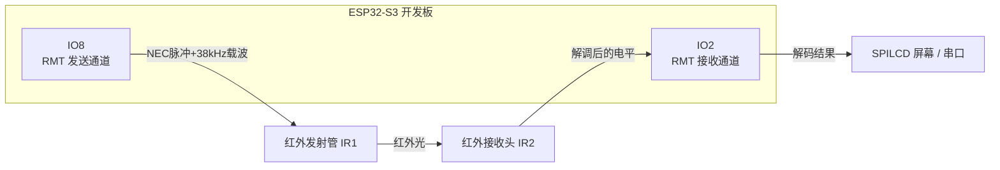
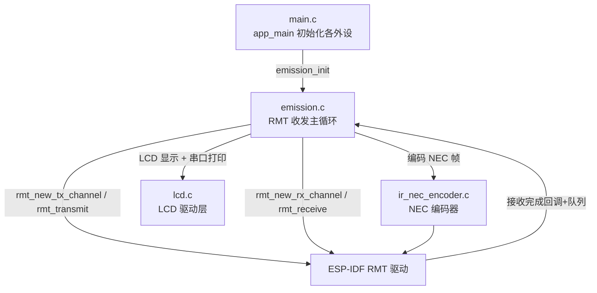
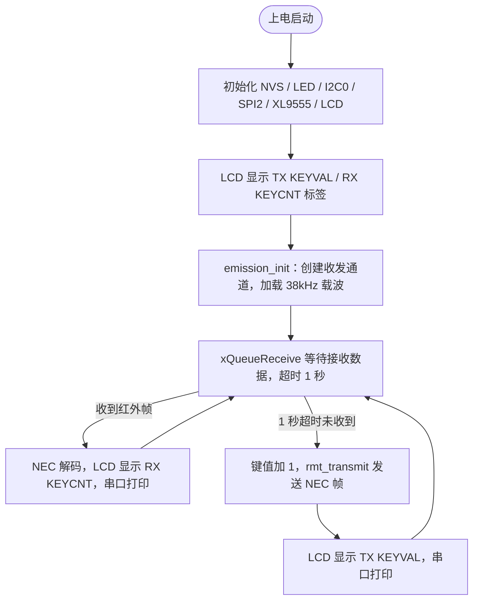

# 17 RMT 红外发送实验

> 平台：正点原子 ESP32-S3 开发板 ｜ 框架：ESP-IDF ｜ 难度：★★★★☆
>
> 一句话简介：用 RMT 外设按 **NEC 协议发送**红外信号，再由板载接收头自己收下并解码，完成一次「自发自收」的红外通信闭环。

---

## 1. 实验简介

上一个实验我们用 RMT **接收**了遥控器的红外信号，本实验反过来：让 ESP32-S3 自己当「遥控器」。RMT 发送通道把 NEC 帧编码成精确的脉冲序列，再调制到 **38kHz 载波**上，从 IO8 经红外发射管（IR1）发出去；板载红外接收头（IR2，接 IO2）收到后，由 RMT 接收通道解码，把结果同时显示在 LCD 和串口上。程序每秒自动发送一次递增的键值，收到则立即显示。

学完本实验你将掌握：

- RMT 发送通道的创建（`rmt_new_tx_channel()`）与载波调制（`rmt_apply_carrier()`）；
- 用 NEC 编码器 + `rmt_transmit()` 发送一帧红外数据；
- 发送与接收双通道协同工作的完整闭环。

## 2. 生活类比

想象两个人**用对讲机对话，但其中一个人在自己屋里**：

- 发送方 = 你按下对讲机说「1 号指令」——但语音要先「加密」成 NEC 协议的长短音（编码器），再乘上 38kHz 的「载波音调」（载波调制），对方收音机才认；
- 红外发射管 IR1 = 你嘴边的扬声器；红外接收头 IR2 = 屋另一头的对讲机；
- 接收方 = 对讲机把长短音翻译回「1 号指令」，写在 LCD 这块「留言板」上；
- 有意思的是：两个人其实是**同一块开发板**——它左手发、右手收，自己验证自己的信号格式对不对，这是调试红外协议的常用方法。

## 3. 硬件连接

### 引脚分配

| 元件 | 开发板引脚 | 说明 |
| :--- | :--- | :--- |
| LED（板载） | IO1 | 指示程序运行 |
| 红外发送 | IO8 | RMT 发送通道；**P3 端口 AIN 与 RMT 需用跳线帽相连**，接通发射管 IR1 |
| 红外接收 | IO2 | RMT 接收通道，接收头 IR2 |
| 按键 BOOT（板载） | IO0 | 板载按键，本例程未使用 |
| 串口 0 | USB 转 UART | 打印收发信息，波特率 115200 |
| SPILCD 模块 | LCD 座 | 显示发送键值与接收键值 |

> 务必检查 **P3 端口的跳线帽**：把 AIN 与 RMT 短接，IO8 的发送信号才能到达红外发射管 IR1，否则只发不出光。

### 连接图



## 4. 程序架构



## 5. 程序流程



## 6. 核心代码讲解

### 6.1 创建发送通道并加载载波（`emission.c`）

```c
rmt_tx_channel_config_t tx_channel_cfg = {
    .clk_src = RMT_CLK_SRC_DEFAULT,         /* RMT发送通道时钟源 */
    .resolution_hz = RMT_RESOLUTION_HZ,     /* 1MHz, 1 tick = 1us */
    .mem_block_symbols = 64,                /* 通道一次可存储的符号数 */
    .trans_queue_depth = 4,                 /* 后台挂起的事务数 */
    .gpio_num = RMT_TX_PIN,                 /* 发送引脚 IO8 */
};
ESP_ERROR_CHECK(rmt_new_tx_channel(&tx_channel_cfg, &tx_channel));

rmt_carrier_config_t carrier_cfg = {
    .frequency_hz = 38000,                  /* 载波频率 38kHz */
    .duty_cycle = 0.33,                     /* 载波占空比 */
};
ESP_ERROR_CHECK(rmt_apply_carrier(tx_channel, &carrier_cfg));   /* 应用载波调制 */
```

**讲解**：发送通道比接收通道多一个 `trans_queue_depth`（可排队的事务数）。**载波调制是红外的关键**：接收头只认 38kHz 闪烁的光，`rmt_apply_carrier()` 让 RMT 在输出「高电平」期间自动叠加 38kHz、占空比 33% 的方波——这一步由硬件完成，代码里不用自己产生方波。

### 6.2 NEC 编码器：把命令拼成脉冲（`ir_nec_encoder.c`）

```c
typedef struct {
    uint16_t address;   /* NEC 地址码 */
    uint16_t command;   /* NEC 命令码 */
} ir_nec_scan_code_t;

/* 编码状态机：引导码 -> 地址 -> 命令 -> 结束码 */
case 0: copy_encoder->encode(..., &nec_encoder->nec_leading_symbol, ...);  /* 9ms+4.5ms引导码 */
case 1: bytes_encoder->encode(..., &scan_code->address, ...);              /* 16位地址 */
case 2: bytes_encoder->encode(..., &scan_code->command, ...);              /* 16位命令 */
case 3: copy_encoder->encode(..., &nec_encoder->nec_ending_symbol, ...);   /* 结束位 */
```

**讲解**：`rmt_new_ir_nec_encoder()` 创建的编码器内部是一台四步「流水线」：先发引导码，再依次把地址、命令的每个 bit 翻译成 NEC 时序（0 = 560us+560us，1 = 560us+1690us），最后补结束位。业务层只管给它一个 `ir_nec_scan_code_t` 结构体。

### 6.3 收发主循环：超时发送、来帧接收（`emission.c`）

```c
while (1)
{
    if (xQueueReceive(receive_queue, &rx_data, pdMS_TO_TICKS(1000)) == pdPASS)
    {
        example_parse_nec_frame(rx_data.received_symbols, rx_data.num_symbols); /* 解析并打印 */
        ESP_ERROR_CHECK(rmt_receive(rx_channel, raw_symbols, sizeof(raw_symbols), &receive_config));
    }
    else    /* 1秒超时，发送下一帧 */
    {
        t++;
        if (t == 0) t = 1;              /* 防止键值回绕到0 */

        const ir_nec_scan_code_t scan_code = { .command = t };

        printf("TX KEYVAL = %d\n", scan_code.command);
        lcd_show_string(116, 110, 200, 16, 16, (char *)tbuf, BLUE);          /* 显示发送键值 */
        ESP_ERROR_CHECK(rmt_transmit(tx_channel, nec_encoder, &scan_code,
                                     sizeof(scan_code), &transmit_config));  /* 发送NEC帧 */
    }
}
```

**讲解**：这里用了一个巧妙的设计——`xQueueReceive` 的 1 秒超时**兼作发送定时器**：

- 1 秒内收到了红外帧 → 走解码分支，LCD 的 RX KEYCNT 行显示收到的命令值；
- 1 秒内什么都没收到 → 走 else 分支，键值 `t` 加 1 并发送一帧。

正常工作时「发送 → 自收 → 解码」在几十毫秒内完成，所以循环基本一直在收自己发的帧；LCD 上 TX 和 RX 两行数字应当一致，这正是通信成功的标志。

### 6.4 接收分支：解码并显示（`emission.c`）

```c
case 34:        /* 正常NEC数据帧 */
{
    if (nec_parse_frame(rmt_nec_symbols))
    {
        lcd_fill(116, 130, 176, 150, WHITE);
        sprintf((char *)tbuf, "%d", s_nec_code_command);
        printf("RX KEYCNT = %d\n", s_nec_code_command);
        lcd_show_string(116, 130, 200, 16, 16, (char *)tbuf, BLUE);
    }
    break;
}
```

**讲解**：解码逻辑与实验 16 相同——34 个符号是正常帧，2 个是重复帧，其余按未知帧打印。解码成功后把命令值写到 LCD 的 RX KEYCNT 行并打印到串口。

## 7. 实验效果

烧录复位后，LCD 显示 "ESP32 / REMOTE TEST" 标题和 `TX KEYVAL:` `RX KEYCNT:` 两行。程序立即开始红外发送：

- 每秒发送一个递增的键值（1、2、3……），TX KEYVAL 行显示当前发送值；
- 红外发射管 IR1 发出的信号被接收头 IR2 收到并解码，RX KEYCNT 行显示收到的命令值，与 TX 行基本同步；
- 串口交替打印 `TX KEYVAL = x` 与 `RX KEYCNT = x`；
- 手机摄像头对准 IR1 可看到淡紫色光点（摄像头能看见红外线），肉眼则看不见。

## 8. 注意事项

1. **P3 端口的 AIN 与 RMT 必须用跳线帽短接**，否则发送信号到不了红外发射管，只能看到 TX 增加而 RX 不动。
2. 串口打印波特率为 **115200**，建议用 XCOM/SSCOM 调试助手；USB 线接开发板 UART 口并选对 COM 号。
3. 本例程**仅支持 MCU 屏（SPILCD），不支持 RGB 屏**。
4. 发送与接收共用一套 NEC 时序宏，若要驱动其他协议的设备（如某品牌空调），需按对方时序修改编码器参数。

## 9. 编译与烧录

```bash
idf.py set-target esp32s3   # 首次配置目标芯片
idf.py build                # 编译
idf.py -p COMx flash monitor  # 烧录并打开串口监视器（COMx 换成你的端口号）
```

> 完整的开发环境搭建与烧录说明见 [根目录 README](../README.md)。

---

## 小结

本实验把实验 16 的「收」升级成「发 + 收」闭环：RMT 发送通道负责编码和 38kHz 载波调制，接收通道负责自收自检。掌握了这套流程，你就可以用 ESP32-S3 遥控电视、空调等一切 NEC 协议的红外家电。

| 关键 API | 作用 |
| :--- | :--- |
| `rmt_new_tx_channel()` | 创建 RMT 发送通道并绑定 GPIO |
| `rmt_apply_carrier()` | 为发送通道加载 38kHz 红外载波 |
| `rmt_new_ir_nec_encoder()` | 创建 NEC 协议编码器 |
| `rmt_transmit()` | 通过发送通道发出一帧编码数据 |
| `rmt_receive()` / `xQueueReceive()` | 挂起接收并等待回调投递的数据 |
