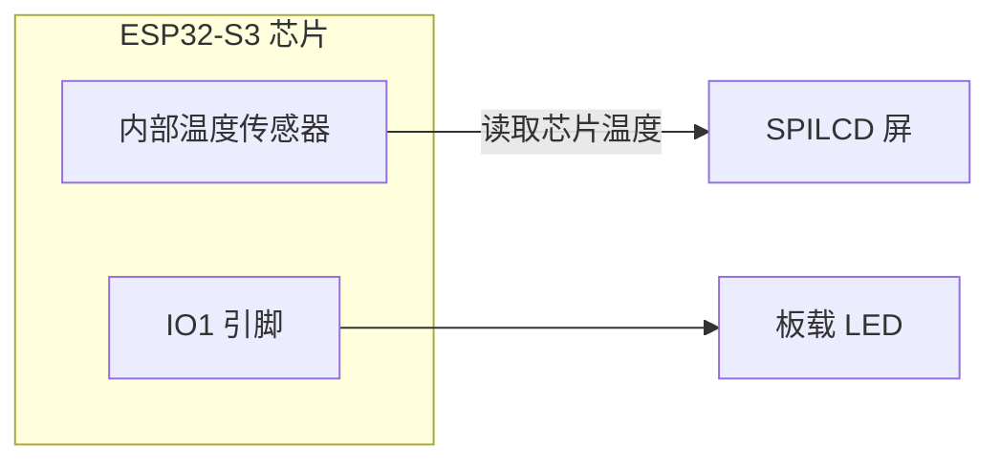
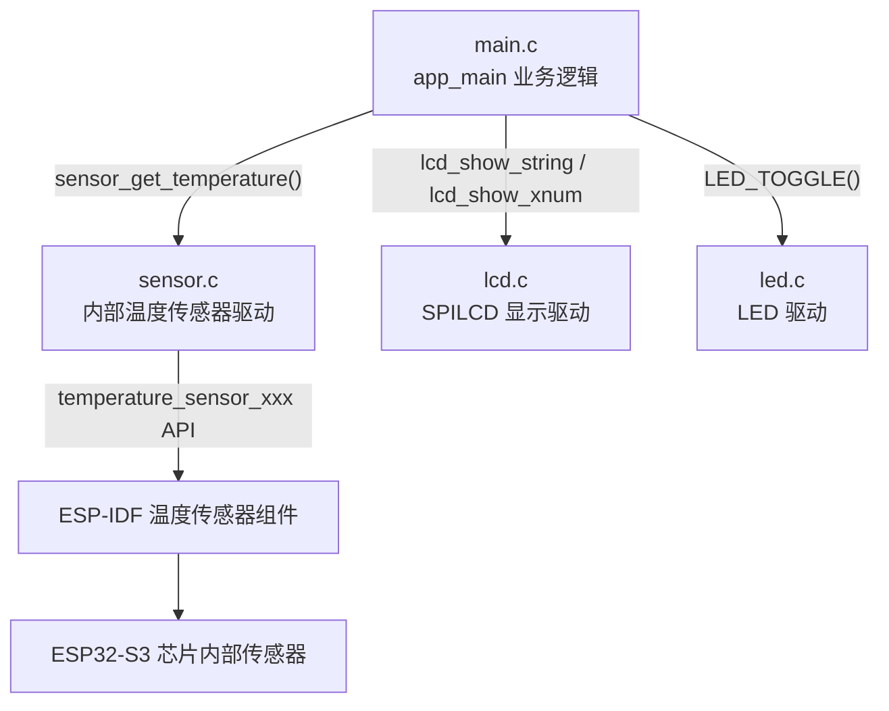
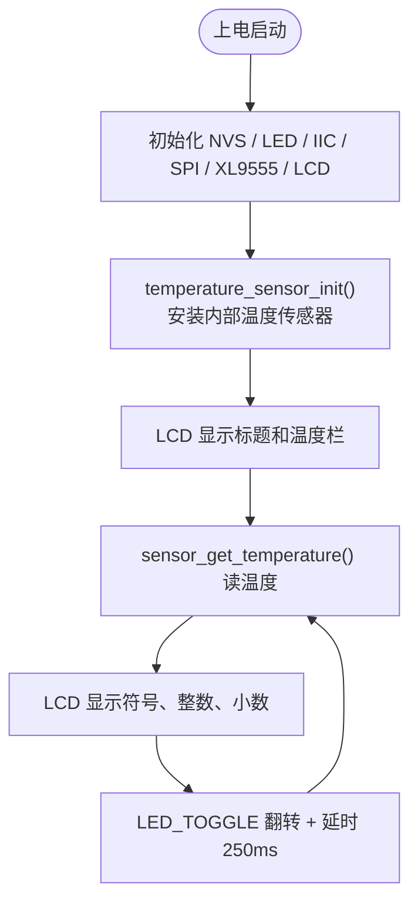

# 18 内部温度传感器实验

> 平台：正点原子 ESP32-S3 开发板 ｜ 框架：ESP-IDF ｜ 难度：★★☆☆☆
>
> 一句话简介：不用任何外接传感器，直接读取 ESP32-S3 **芯片内部温度传感器**的数据，并把温度值实时显示在 SPILCD 上。

---

## 1. 实验简介

ESP32-S3 芯片内部集成了一个温度传感器，可以测量芯片自身的温度。它在出厂时已经过校准，虽然精度不如专业温度传感器，但用来做「芯片温度监控」完全够用。

本实验通过 ESP-IDF 官方的 `temperature_sensor` 驱动组件，完成「安装 → 使能 → 读温度 → 关闭」的完整流程，并把结果（含符号、整数、小数）显示在 SPILCD 上。

学完本实验你将掌握：

- 用 `temperature_sensor_install()` 安装内部温度传感器驱动；
- 用 `temperature_sensor_get_celsius()` 读取摄氏温度值；
- 用完后及时 `temperature_sensor_disable()` 省电的好习惯。

## 2. 生活类比

把内部温度传感器想象成芯片自带的**「体温计」**：

- 人体感觉不舒服时会拿体温计夹在腋下测一下——芯片也一样，工作久了会发热，用内部传感器就能随时「量体温」；
- `temperature_sensor_enable()` = 把体温计甩一甩、夹到腋下（开始测量）；
- `temperature_sensor_get_celsius()` = 读取度数；
- `temperature_sensor_disable()` = 测完把体温计收起来——一直夹着既没意义又费电。

## 3. 硬件连接

### 引脚分配

| 元件 | 开发板引脚 | 说明 |
| :--- | :--- | :--- |
| LED（板载） | IO1 | 程序运行指示灯 |
| SPILCD 模块 | SPI2 + XL9555 | 显示温度信息 |
| 内部温度传感器 | 芯片内部 | 无需外接，不占引脚 |

> 内部温度传感器在芯片内部，**不需要接任何外部元件**，插上 SPILCD 屏即可。

### 连接图



## 4. 程序架构

代码分三层：`main.c` 负责业务（读温度、刷屏），`components/BSP/SENSOR` 封装内部温度传感器驱动，LCD/LED 等 BSP 驱动负责显示与指示。



## 5. 程序流程



## 6. 核心代码讲解

### 6.1 驱动层：安装并读取温度（`sensor.c`）

```c
void temperature_sensor_init(void)
{
    temperature_sensor_config_t temp_sensor;

    temp_sensor.range_min = SENSOR_RANGE_MIN;   /* 要测试温度的最小值(20) */
    temp_sensor.range_max = SENSOR_RANGE_MAX;   /* 要测试温度的最大值(50) */

    rev_flag |= temperature_sensor_install(&temp_sensor, &temp_handle);
    ESP_ERROR_CHECK(rev_flag);
}

short sensor_get_temperature(void)
{
    float temp;

    temperature_sensor_enable(temp_handle);                 /* 启用温度传感器 */
    temperature_sensor_get_celsius(temp_handle, &temp);     /* 读取摄氏温度 */
    temperature_sensor_disable(temp_handle);                /* 用完禁用，节约功耗 */

    return temp;
}
```

**讲解**：

- ESP-IDF 采用「句柄」式驱动：先填一张配置表（测温范围），`temperature_sensor_install()` 安装成功后拿到句柄 `temp_handle`；
- 读温度前必须 `enable`，读完立刻 `disable`——传感器一直开着会白白耗电，还会自己发热影响测量；
- `temperature_sensor_get_celsius()` 直接输出浮点摄氏温度，出厂校准过，无需自己换算。

### 6.2 业务层：分段显示温度（`main.c`）

```c
while(1)
{
    temp = sensor_get_temperature();                    /* 得到温度值 */

    if (temp < 0)
    {
        temp = -temp;
        lcd_show_string(30 + 10 * 8, 120, 16, 16, 16, "-", BLUE);   /* 显示符号 */
    }
    else
    {
        lcd_show_string(30 + 10 * 8, 120, 16, 16, 16, " ", BLUE);   /* 无符号 */
    }
    lcd_show_xnum(30 + 11 * 8, 120, temp, 2, 16, 0, BLUE);              /* 整数部分 */
    lcd_show_xnum(30 + 14 * 8, 120, temp * 100 % 100, 2, 16, 0x80, BLUE);/* 小数部分 */

    LED_TOGGLE();                                       /* LED闪烁,提示程序运行 */
    vTaskDelay(250);
}
```

**讲解**：

- 温度被拆成「符号 + 整数 + 小数」三段，分别在固定的屏幕坐标刷新，避免整行重绘造成闪烁；
- `temp * 100 % 100` 是取两位小数的常用技巧：如 36.78 → 3678 % 100 = 78；
- `lcd_show_xnum()` 最后一个参数 `0x80` 表示显示前导数字，配合固定宽度让数值刷新更整齐。

## 7. 实验效果

程序烧录并复位后，SPILCD 上显示实验标题和 `TEMPERATE: xx.xxC` 一行，**温度值每 250ms 刷新一次**（芯片温度通常在 30°C 上下浮动，用手指按住芯片附近可看到温度缓慢上升）；板载 LED 同步闪烁，表示程序在正常运行。

## 8. 注意事项

1. 内部温度传感器测的是**芯片自身温度**，会比环境温度高几度，这是正常现象；
2. 传感器必须在 `enable` 之后才能读取，且读完记得 `disable`，否则会增加功耗；
3. 配置表中的 `range_min` / `range_max` 只是告诉驱动大致的测温区间以便校准，超出该范围也能读数，只是精度可能下降。

## 9. 编译与烧录

```bash
idf.py set-target esp32s3   # 首次配置目标芯片
idf.py build                # 编译
idf.py -p COMx flash monitor  # 烧录并打开串口监视器（COMx 换成你的端口号）
```

> 完整的开发环境搭建与烧录说明见 [根目录 README](../README.md)。

---

## 小结

本实验展示了 ESP32-S3「自带体温计」的用法：安装驱动 → 使能 → 读摄氏温度 → 禁用，四步完成一次测量。掌握句柄式驱动的使用套路后，学习其他 ESP-IDF 外设驱动（ADC、DAC、触摸等）都会轻松很多。

| 关键 API | 作用 |
| :--- | :--- |
| `temperature_sensor_install()` | 按配置表安装内部温度传感器，返回句柄 |
| `temperature_sensor_enable()` | 使能传感器，准备测量 |
| `temperature_sensor_get_celsius()` | 读取摄氏温度值（浮点） |
| `temperature_sensor_disable()` | 禁用传感器，节约功耗 |
| `lcd_show_xnum()` | 在 LCD 指定位置显示数字 |
