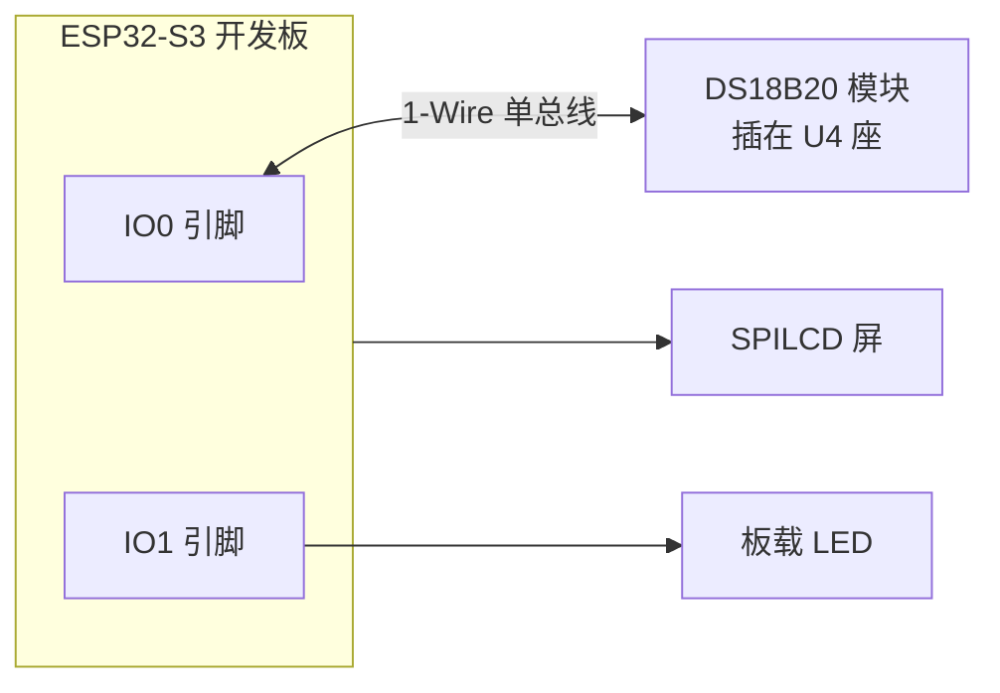
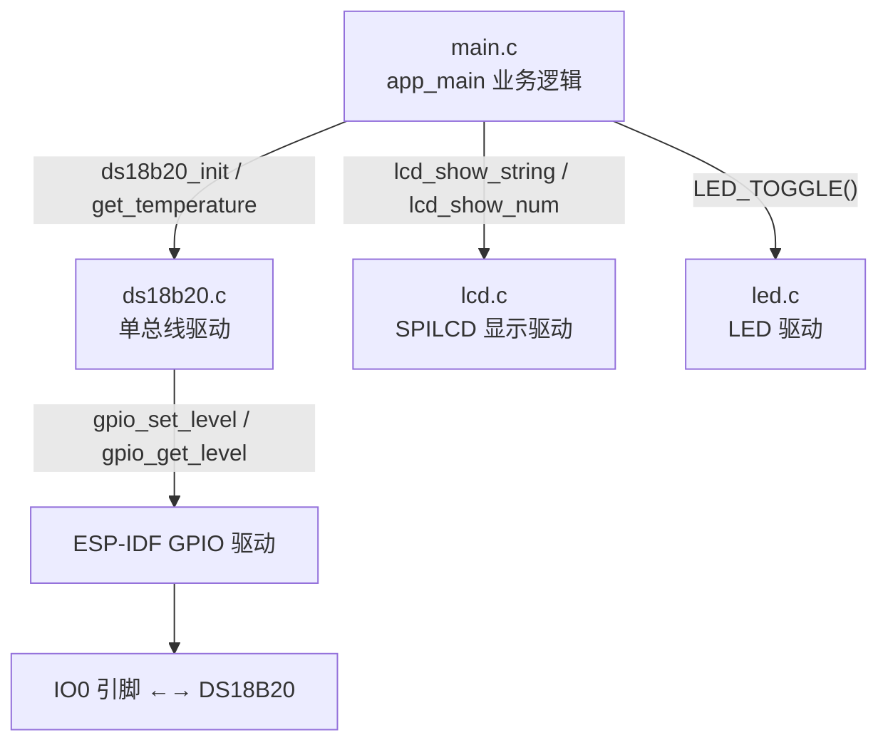
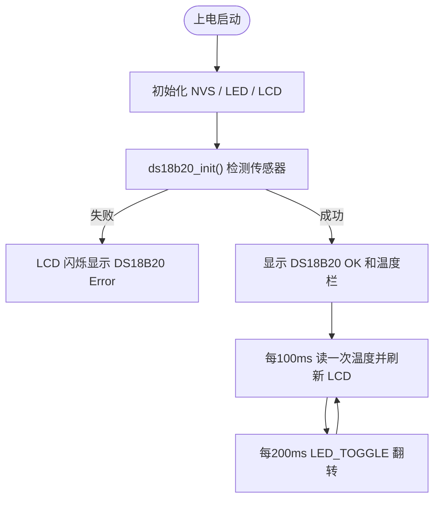

# 19 DS18B20 数字温度传感器实验

> 平台：正点原子 ESP32-S3 开发板 ｜ 框架：ESP-IDF ｜ 难度：★★☆☆☆
>
> 一句话简介：用一根数据线（1-Wire 单总线）驱动 DS18B20 数字温度传感器，实时把环境温度显示在 SPILCD 上。

---

## 1. 实验简介

DS18B20 是一款非常经典的**数字**温度传感器：它输出的不是模拟电压，而是直接可用的数字温度值，测量范围 -55°C ~ +125°C，精度可达 0.0625°C。它最大的特点是使用 **1-Wire（单总线）协议**——只靠一根数据线 DQ 就能完成供电和双向通信。

本实验先检测 DS18B20 是否存在，然后每隔约 100ms 读取一次温度并显示在 LCD 上。

学完本实验你将掌握：

- 单总线协议的复位、读写位/字节时序；
- 用 GPIO 开漏模式 + 上拉实现单总线；
- DS18B20 的「跳过 ROM → 启动转换 → 读暂存器」标准操作流程。

## 2. 生活类比

单总线通信就像**「一根绳上的暗号」**：

- 主机（ESP32）猛地把绳子拉低 750μs 再松开——相当于「喊一声：有人在吗？」（复位脉冲）；
- DS18B20 听到后把绳子拉低一小段作为回应——「我在！」（存在脉冲）；
- 之后所有对话都通过「拉低多久」来区分：短拉低代表 1，长拉低代表 0；
- 整个过程只有一根绳子（一根线），双方轮流说话，谁也不能同时抢——这就是单总线的精髓。

## 3. 硬件连接

### 引脚分配

| 元件 | 开发板引脚 | 说明 |
| :--- | :--- | :--- |
| LED（板载） | IO1 | 程序运行指示灯 |
| SPILCD 模块 | SPI2 + XL9555 | 显示温度信息 |
| DS18B20（DQ） | IO0 | 单总线数据脚，插在 U4 座 |

### 连接图



## 4. 程序架构

`main.c` 负责业务（检测、读取、刷屏），`components/BSP/DS18B20` 用 GPIO 模拟单总线时序，LCD/LED 驱动负责显示与指示。



## 5. 程序流程



## 6. 核心代码讲解

### 6.1 驱动层：单总线复位与存在检测（`ds18b20.c`）

```c
void ds18b20_reset(void)
{
    DS18B20_DQ_OUT(0);      /* 拉低DQ,复位 */
    esp_rom_delay_us(750);  /* 拉低至少750μs */
    DS18B20_DQ_OUT(1);      /* DQ=1，释放复位 */
    esp_rom_delay_us(15);   /* 主机拉高10~35us */
}

uint8_t ds18b20_init(void)
{
    gpio_config_t gpio_init_struct;

    gpio_init_struct.mode = GPIO_MODE_INPUT_OUTPUT_OD;  /* 开漏模式的输入和输出 */
    gpio_init_struct.pull_up_en = GPIO_PULLUP_ENABLE;   /* 使能上拉 */
    gpio_init_struct.pin_bit_mask = 1ull << DS18B20_DQ_GPIO_PIN;
    gpio_config(&gpio_init_struct);                     /* 配置DS18B20引脚 */

    ds18b20_reset();
    return ds18b20_check();     /* 0:存在  1:不存在 */
}
```

**讲解**：

- 引脚配置为**开漏 + 上拉**（`INPUT_OUTPUT_OD`）：主机只能「拉低」，松手后靠上拉电阻回到高电平，这样主机和 DS18B20 才能共用一根线而不打架；
- 复位时序：主机拉低 ≥750μs 再释放，DS18B20 若存在会回拉低约 200μs，`ds18b20_check()` 就是靠检测这个「存在脉冲」判断传感器在不在。

### 6.2 驱动层：读温度（`ds18b20.c`）

```c
short ds18b20_get_temperature(void)
{
    ds18b20_start();            /* 0xCC跳过ROM + 0x44启动温度转换 */
    ds18b20_reset();
    ds18b20_check();
    ds18b20_write_byte(0xcc);   /* skip rom */
    ds18b20_write_byte(0xbe);   /* 读暂存器命令 */
    TL = ds18b20_read_byte();   /* LSB 低字节 */
    TH = ds18b20_read_byte();   /* MSB 高字节 */

    temp = TH;
    temp <<= 8;
    temp += TL;                 /* 拼成16位原始值 */

    temp = (double)temp * 0.625; /* 分辨率0.625: 原始值放大10倍返回 */
    return temp;
}
```

**讲解**：

- DS18B20 的标准流程是两步命令：先发 `0x44` 让它开始测温，再发 `0xBE` 把结果读回来；`0xCC` 表示跳过 ROM 匹配（总线上只挂一个传感器时可以偷懒）；
- 读回的两个字节拼成 16 位补码，乘以分辨率 0.625 得到「放大 10 倍」的温度值（如返回 256 表示 25.6°C），所以 main 里用 `temperature / 10` 和 `% 10` 分开显示整数和小数。

### 6.3 业务层：检测与定时刷新（`main.c`）

```c
err = ds18b20_init();

if (err != 0)
{
    while (1)
    {
        lcd_show_string(30, 110, 200, 16, 16, "DS18B20 Error", RED);
        vTaskDelay(200);
        lcd_fill(30, 110, 239, 130 + 16, WHITE);   /* 擦掉再显示 → 闪烁报警 */
        vTaskDelay(200);
    }
}

while (1)
{
    if (t % 10 == 0)                                  /* 每100ms读取一次 */
    {
        temperature = ds18b20_get_temperature();
        lcd_show_num(30 + 40 + 8, 130, temperature / 10, 2, 16, BLUE);  /* 整数部分 */
        lcd_show_num(30 + 40 + 32, 130, temperature % 10, 1, 16, BLUE); /* 小数部分 */
    }
    vTaskDelay(10);
    t++;
    if (t == 20) { t = 0; LED_TOGGLE(); }             /* 每200ms翻转LED */
}
```

**讲解**：检测失败时程序停在 while(1) 里让 "DS18B20 Error" 闪烁报警，方便一眼发现没插好传感器；正常时用计数器 `t` 把 10ms 的基础节拍分频出「100ms 读温度、200ms 闪 LED」两个节奏。

## 7. 实验效果

上电后 LCD 先显示 `DS18B20 OK`，随后 `Temp: xx.x °C` 每 100ms 刷新一次，用手捏住 DS18B20 能看到温度明显上升；板载 LED 以约 200ms 间隔闪烁。若未检测到传感器，LCD 会闪烁显示 `DS18B20 Error`。

## 8. 注意事项

1. DS18B20 需**自备**，插在开发板 **U4 位置**：按丝印方向，**平面朝内、曲面朝外、靠左插**，插反可能烧毁传感器；
2. DS18B20 是单总线（1-Wire）协议，对时序要求严格，驱动里的微秒延时（`esp_rom_delay_us`）不要随意删改；
3. 返回的温度值是实际温度的 10 倍，显示时记得除以 10。

## 9. 编译与烧录

```bash
idf.py set-target esp32s3   # 首次配置目标芯片
idf.py build                # 编译
idf.py -p COMx flash monitor  # 烧录并打开串口监视器（COMx 换成你的端口号）
```

> 完整的开发环境搭建与烧录说明见 [根目录 README](../README.md)。

---

## 小结

本实验用 GPIO 软件模拟了 1-Wire 单总线协议：复位/存在脉冲、读写位时序、命令流程一步不少。单总线是「用最少的线做通信」的经典范例，理解它之后再学 I2C、SPI 等多线协议，会对其设计取舍有更深的体会。

| 关键 API | 作用 |
| :--- | :--- |
| `gpio_config()` | 配置 DQ 引脚为开漏输出 + 上拉 |
| `esp_rom_delay_us()` | 微秒级精确延时，用于模拟总线时序 |
| `ds18b20_init()` / `ds18b20_check()` | 初始化并检测 DS18B20 是否存在 |
| `ds18b20_get_temperature()` | 启动转换并读回温度（放大10倍） |
| `lcd_show_num()` | 在 LCD 指定位置显示数字 |
