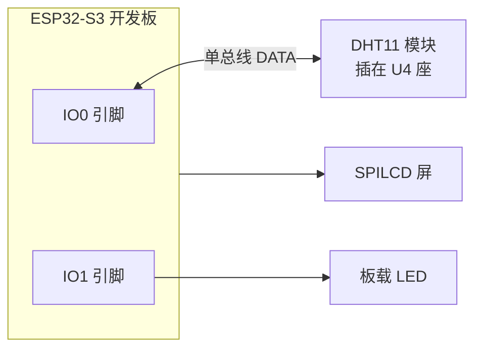
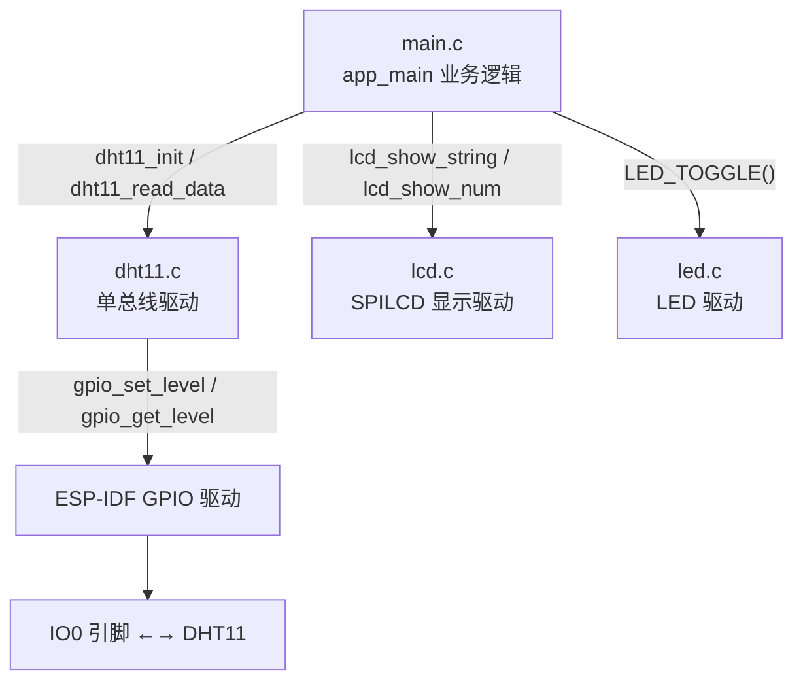
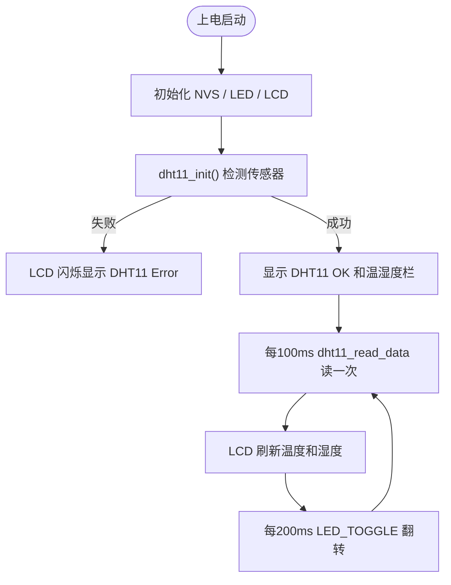

# 20 DHT11 数字温湿度传感器实验（IDF 版本）

> 平台：正点原子 ESP32-S3 开发板 ｜ 框架：ESP-IDF ｜ 难度：★★☆☆☆
>
> 一句话简介：用单总线时序驱动 DHT11 数字温湿度传感器，实时把温度和湿度显示在 SPILCD 上。

---

## 1. 实验简介

DHT11 是一款常见的**数字式温湿度一体**传感器，能同时测温度（0~50°C）和湿度（20%~95%RH），价格低廉、使用方便。它同样采用**单总线**通信——只用一根数据线 DQ，靠精确的电平高低时间传递 0 和 1。

本实验先检测 DHT11 是否存在，然后每隔约 100ms 读取一次温湿度并显示在 LCD 上。

学完本实验你将掌握：

- 用 GPIO 模拟 DHT11 单总线时序（复位、应答、读位）；
- DHT11 一次输出 40 位数据的组织方式；
- 用校验和验证数据是否有效。

## 2. 生活类比

DHT11 通信就像**「按门铃问天气」**：

- 主机先长按门铃至少 18ms（复位信号）：「DHT11，报一下温湿度！」；
- DHT11 拉低再拉高各约 80μs 作为应答：「收到，我这就报」；
- 然后它一口气念出 40 位数据，每一位都用「高电平持续多久」表示：高电平短（约 26μs）是 0，高电平长（约 70μs）是 1；
- 最后 8 位是「校验码」，主机把前 4 个数加起来对一对，一致才说明没听错——就像核对快递单号一样。

## 3. 硬件连接

### 引脚分配

| 元件 | 开发板引脚 | 说明 |
| :--- | :--- | :--- |
| LED（板载） | IO1 | 程序运行指示灯 |
| SPILCD 模块 | SPI2 + XL9555 | 显示温湿度信息 |
| DHT11（DATA） | IO0 | 单总线数据脚，插在 U4 座 |

### 连接图



## 4. 程序架构

`main.c` 负责业务（检测、读取、刷屏），`components/BSP/DHT11` 用 GPIO 模拟单总线时序，LCD/LED 驱动负责显示与指示。



## 5. 程序流程



## 6. 核心代码讲解

### 6.1 驱动层：复位与读位（`dht11.c`）

```c
void dht11_reset(void)
{
    DHT11_DQ_OUT(0);        /* 拉低DQ */
    vTaskDelay(25);         /* 拉低至少18ms */
    DHT11_DQ_OUT(1);        /* DQ=1 释放总线 */
    esp_rom_delay_us(30);   /* 主机拉高10~35us */
}

uint8_t dht11_read_bit(void)
{
    uint8_t retry = 0;

    while (DHT11_DQ_IN && retry < 100) { retry++; esp_rom_delay_us(1); } /* 等待变低 */
    retry = 0;
    while (!DHT11_DQ_IN && retry < 100) { retry++; esp_rom_delay_us(1); }/* 等待变高 */

    esp_rom_delay_us(40);   /* 等待40us后采样 */

    if (DHT11_DQ_IN) return 1;   /* 40us后仍是高电平 → 该位为1 */
    else             return 0;   /* 已回到低电平 → 该位为0 */
}
```

**讲解**：

- 每一位都以一段低电平开始，随后拉高：**高电平短就是 0，高电平长就是 1**。驱动的巧思是「等到高电平出现后固定延时 40μs 再采样」——0 的高电平约 26μs 已结束，1 的高电平约 70μs 还没结束，一次采样就能区分；
- 微秒延时用 `esp_rom_delay_us()`（忙等，精度高），毫秒级用 `vTaskDelay()`（让出 CPU），两者配合使用。

### 6.2 驱动层：读一次完整数据（`dht11.c`）

```c
uint8_t dht11_read_data(uint8_t *temp, uint8_t *humi)
{
    uint8_t buf[5];

    dht11_reset();

    if (dht11_check() == 0)                 /* 收到应答 */
    {
        for (i = 0; i < 5; i++)             /* 读取40位数据 */
        {
            buf[i] = dht11_read_byte();
        }

        if ((buf[0] + buf[1] + buf[2] + buf[3]) == buf[4])  /* 校验和 */
        {
            *humi = buf[0];                 /* 湿度整数 */
            *temp = buf[2];                 /* 温度整数 */
        }
    }
    else
    {
        return 1;                           /* 无应答，读取失败 */
    }
    return 0;
}
```

**讲解**：

- DHT11 一次吐出 5 个字节：湿度整数、湿度小数、温度整数、温度小数、校验和；
- 校验规则很简单——前 4 字节之和的低 8 位应等于第 5 字节，相等才采用数据，能有效过滤通信错误；
- DHT11 精度为整数级，所以本实验只用了 `buf[0]`（湿度）和 `buf[2]`（温度）两个整数。

### 6.3 业务层：检测与定时刷新（`main.c`）

```c
err = dht11_init();

if (err != 0)
{
    while (1)
    {
        lcd_show_string(30, 110, 200, 16, 16, "DHT11 Error", RED);
        vTaskDelay(200);
        lcd_fill(30, 110, 239, 130 + 16, WHITE);   /* 擦掉再显示 → 闪烁报警 */
        vTaskDelay(200);
    }
}

while (1)
{
    if (t % 10 == 0)                                    /* 每100ms读取一次 */
    {
        dht11_read_data(&temperature, &humidity);       /* 读取温湿度值 */
        lcd_show_num(30 + 40, 130, temperature, 2, 16, BLUE);  /* 显示温度 */
        lcd_show_num(30 + 40, 150, humidity, 2, 16, BLUE);     /* 显示湿度 */
    }
    vTaskDelay(10);
    t++;
    if (t == 20) { t = 0; LED_TOGGLE(); }               /* 每200ms翻转LED */
}
```

**讲解**：检测失败时停在 while(1) 里闪烁显示 "DHT11 Error" 报警；正常时用计数器 `t` 把 10ms 基础节拍分频成「100ms 读数据、200ms 闪 LED」。

## 7. 实验效果

上电后 LCD 先显示 `DHT11 OK`，随后 `Temp: xx C`、`Humi: xx %` 两行每 100ms 刷新一次，对着传感器哈气可以看到湿度明显上升；板载 LED 以约 200ms 间隔闪烁。若未检测到传感器，LCD 会闪烁显示 `DHT11 Error`。

## 8. 注意事项

1. DHT11 需**自备**，插在开发板 **U4 位置**：按丝印方向，**网面朝外**插入；
2. DHT11 是单总线时序，采样时间敏感，驱动中的 `esp_rom_delay_us()` 延时要保持原样；
3. DHT11 数据更新较慢（内部约 1 秒才重新测一次），100ms 读一次可能读到相同值，属正常现象；
4. 温湿度均为整数精度，小数字节一般为 0，不必在意。

## 9. 编译与烧录

```bash
idf.py set-target esp32s3   # 首次配置目标芯片
idf.py build                # 编译
idf.py -p COMx flash monitor  # 烧录并打开串口监视器（COMx 换成你的端口号）
```

> 完整的开发环境搭建与烧录说明见 [根目录 README](../README.md)。

---

## 小结

本实验用 GPIO 软件模拟了 DHT11 的单总线时序：长按复位、等待应答、按高电平宽度逐位读出 40 位数据并用校验和把关。DHT11 是入门「一根线通信」和「时序驱动」的好教材，掌握它就能举一反三理解其他单总线器件。

| 关键 API | 作用 |
| :--- | :--- |
| `gpio_config()` | 配置 DQ 引脚为开漏输出 + 上拉 |
| `esp_rom_delay_us()` / `vTaskDelay()` | 微秒忙等延时 / 毫秒非阻塞延时 |
| `dht11_init()` / `dht11_check()` | 初始化并检测 DHT11 是否应答 |
| `dht11_read_data()` | 读取一次温湿度（含校验和验证） |
| `lcd_show_num()` | 在 LCD 指定位置显示数字 |
