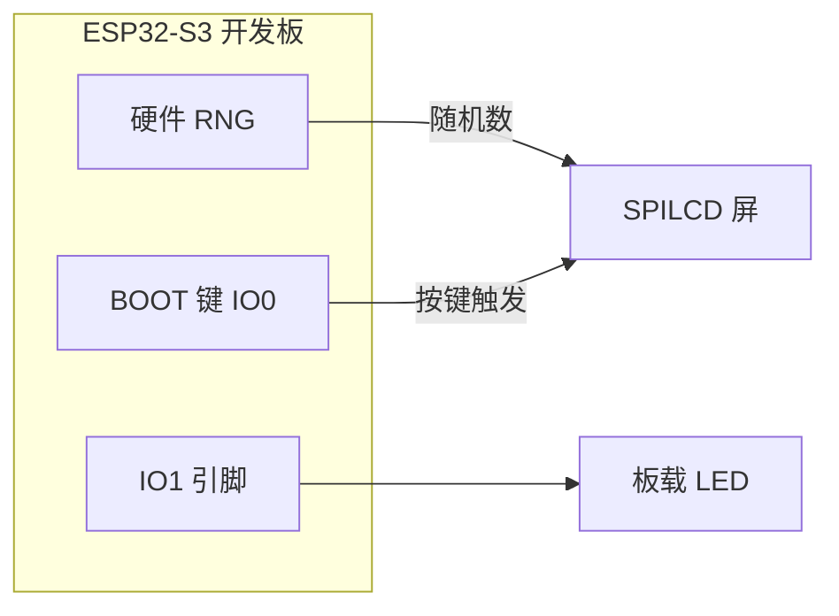
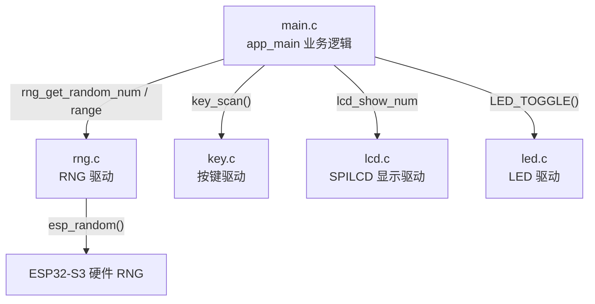
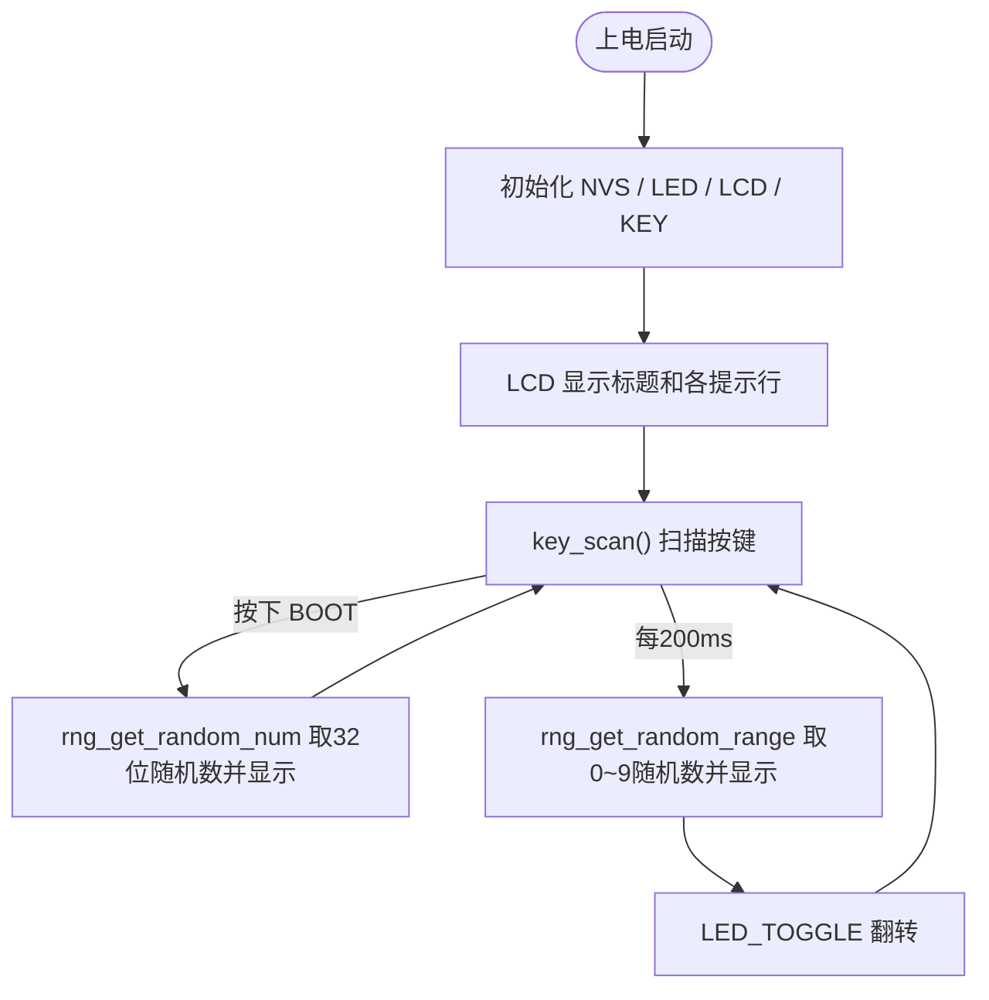

# 21 RNG 实验（硬件随机数发生器）

> 平台：正点原子 ESP32-S3 开发板 ｜ 框架：ESP-IDF ｜ 难度：★☆☆☆☆
>
> 一句话简介：调用 ESP32-S3 的**硬件随机数发生器（RNG）**产生真随机数，按 BOOT 键取一个 32 位随机数，程序还会自动刷新 0~9 的随机数，全部显示在 SPILCD 上。

---

## 1. 实验简介

很多场合（加密、抽奖、游戏、通信密钥）都需要**随机数**。软件用算法生成的叫「伪随机数」，可以被预测；而 ESP32-S3 内部有一个**硬件随机数发生器（RNG）**，它采集芯片内部射频噪声等物理信号来产生**真随机数**，质量和安全性都更高。

ESP-IDF 已经把 RNG 封装成极简的 `esp_random()`，本实验在此基础上再封装出「取一个 32 位随机数」和「取某区间随机数」两个函数，配合按键和 LCD 演示。

学完本实验你将掌握：

- 用 `esp_random()` 获取硬件真随机数；
- 用取模运算把随机数限制到指定区间；
- `key_scan()` 按键扫描与 LCD 数字显示的配合。

## 2. 生活类比

软件伪随机数像**「背好的随机数表」**：看似杂乱，其实只要知道起点就能推算出后面每一个数；硬件真随机数则像**「摇骰子」**——每次结果都来自真实的物理噪声，无法预测。

`rng_get_random_range(0, 9)` 相当于「摇一个 10 面骰子」：先摇出一个巨大的随机数（`esp_random()`），再 `% 10` 把它压缩到 0~9，就像把大骰子的点数折算成小骰子。

## 3. 硬件连接

### 引脚分配

| 元件 | 开发板引脚 | 说明 |
| :--- | :--- | :--- |
| LED（板载） | IO1 | 程序运行指示灯 |
| 按键 BOOT | IO0 | 按下获取一次 32 位随机数 |
| SPILCD 模块 | SPI2 + XL9555 | 显示随机数 |
| RNG | 芯片内部 | 无需外接，不占引脚 |

> RNG 在芯片内部，无需外接元件；BOOT 键也是板载按键。

### 连接图



## 4. 程序架构

`main.c` 负责业务（按键、定时刷新），`components/BSP/RNG` 封装硬件随机数，KEY/LCD/LED 驱动负责输入输出。



## 5. 程序流程



## 6. 核心代码讲解

### 6.1 驱动层：硬件随机数封装（`rng.c`）

```c
uint32_t rng_get_random_num(void)
{
    uint32_t randomnum;
    randomnum = esp_random();   /* 调用ESP-IDF接口读硬件RNG */
    return randomnum;
}

int rng_get_random_range(int min, int max)
{
    uint32_t randomnum;
    randomnum = esp_random();
    return randomnum % (max - min + 1) + min;   /* 压缩到 [min, max] */
}
```

**讲解**：

- `esp_random()` 是 ESP-IDF 提供的硬件随机数接口，直接返回一个 32 位真随机数；
- 区间映射公式 `random % (max - min + 1) + min` 是通用技巧：`(max-min+1)` 决定区间宽度，取模落到 `0 ~ 宽度-1`，再加 `min` 平移到目标区间。例如 `(0,9)` 就是 `% 10 + 0`。

### 6.2 业务层：按键与自动刷新（`main.c`）

```c
while(1)
{
    key = key_scan(0);

    if (key == BOOT)                                /* 按下BOOT */
    {
        random = rng_get_random_num();              /* 取32位随机数 */
        lcd_show_num(30 + 8 * 11, 150, random, 10, 16, BLUE);
    }

    if ((t % 20) == 0)                              /* 每200ms */
    {
        LED_TOGGLE();
        random = rng_get_random_range(0, 9);        /* 取[0,9]随机数 */
        lcd_show_num(30 + 8 * 16, 180, random, 1, 16, BLUE);
    }

    vTaskDelay(10);
    t++;
}
```

**讲解**：

- `key_scan(0)` 返回当前按下的键值，等于 `BOOT` 时读取一个完整 32 位随机数并用 `lcd_show_num` 以 10 位宽度显示；
- 下半段用计数器 `t % 20` 每 200ms 刷新一个 0~9 的随机数，同时翻转 LED，形成「数字不停跳动 + LED 闪烁」的效果；
- `lcd_show_num(x, y, num, len, size, color)` 的 `len` 是显示位数，32 位随机数用 10 位、单个数字用 1 位。

## 7. 实验效果

程序烧录并复位后，LCD 显示标题和提示行：

- **每 200ms**，`Random Num[0-9]:` 后面的数字自动跳动刷新，板载 LED 同步闪烁；
- **每次按下 BOOT 键**，`Random Num:` 后面刷新出一个 10 位的 32 位随机数。

## 8. 注意事项

1. 本实验无特殊注意事项，插好 SPILCD、接上 USB 即可运行；
2. `esp_random()` 在 ESP32-S3 上是硬件真随机数，无需自己设种子（这点和 C 语言的 `rand()`/`srand()` 不同）；
3. 用取模映射区间时，若区间宽度不能整除 2^32，理论上会有极轻微的分布不均，一般应用可忽略。

## 9. 编译与烧录

```bash
idf.py set-target esp32s3   # 首次配置目标芯片
idf.py build                # 编译
idf.py -p COMx flash monitor  # 烧录并打开串口监视器（COMx 换成你的端口号）
```

> 完整的开发环境搭建与烧录说明见 [根目录 README](../README.md)。

---

## 小结

本实验用最少的代码打通了「硬件 RNG → 区间映射 → 按键/定时触发 → LCD 显示」这条链路。真随机数是加密和安全应用的基石，`esp_random()` 一行就能拿到高质量随机数，非常实用。

| 关键 API | 作用 |
| :--- | :--- |
| `esp_random()` | 读取 ESP32-S3 硬件真随机数（32位） |
| `rng_get_random_num()` | 取一个完整随机数 |
| `rng_get_random_range(min,max)` | 取 [min,max] 区间内的随机数 |
| `key_scan()` | 扫描按键，返回键值 |
| `lcd_show_num()` | 在 LCD 指定位置显示数字 |
