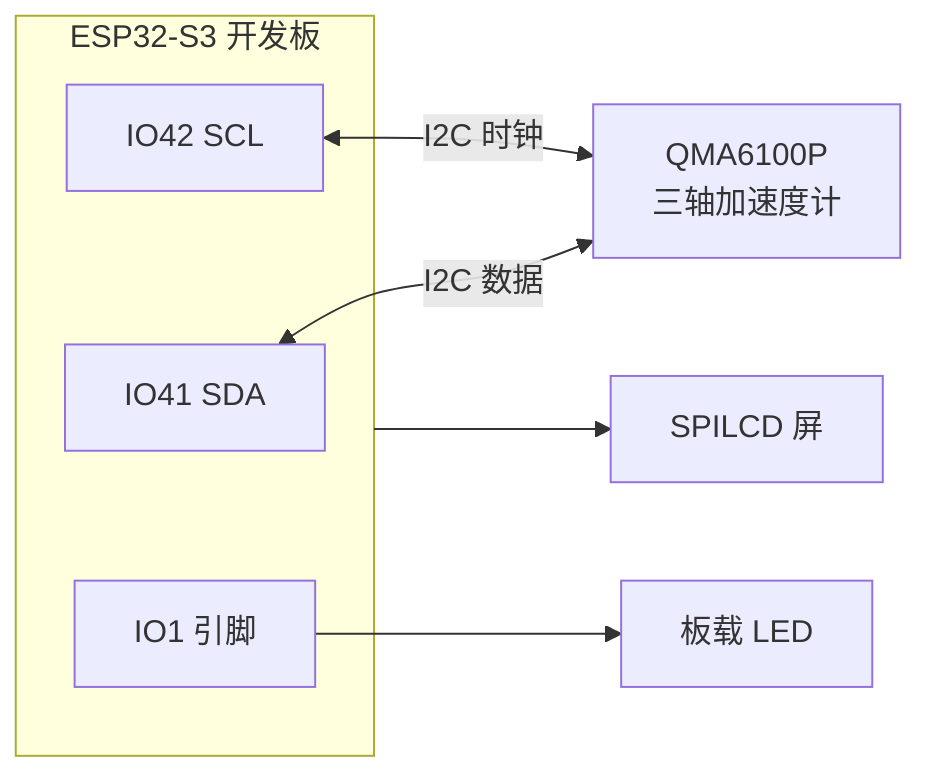
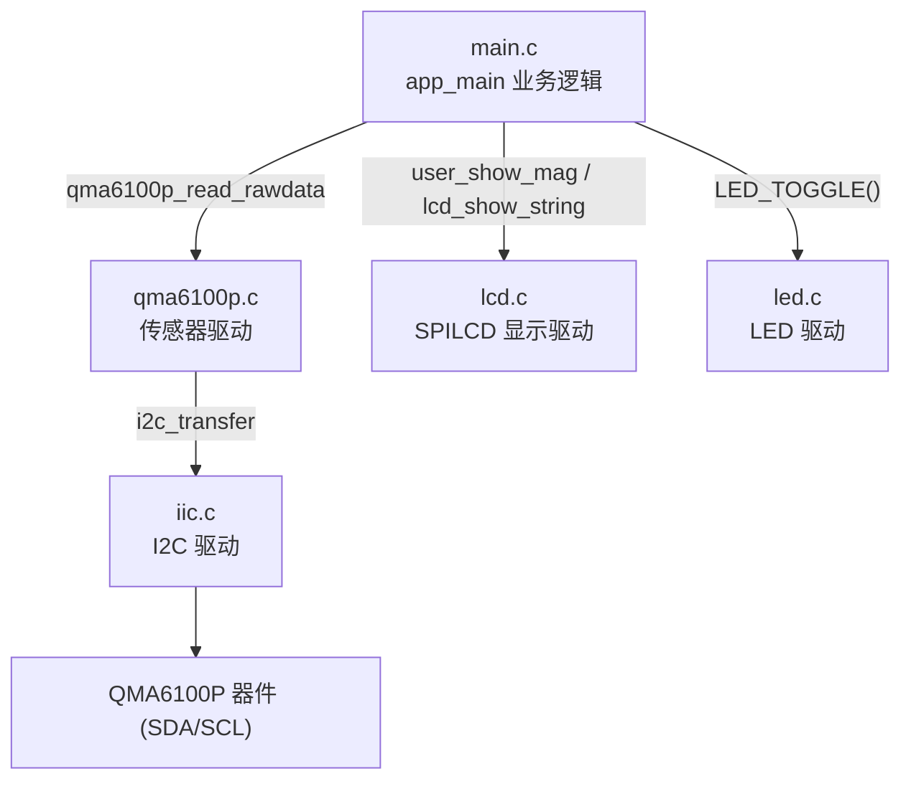
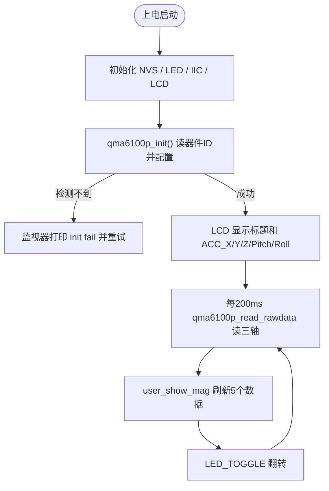

# 22 QMA6100P 三轴加速度计传感器实验

> 平台：正点原子 ESP32-S3 开发板 ｜ 框架：ESP-IDF ｜ 难度：★★★☆☆
>
> 一句话简介：通过 I2C 读取 QMA6100P 三轴加速度计的原始数据，并计算出俯仰角、翻滚角与加速度，实时显示在 SPILCD 上。

---

## 1. 实验简介

QMA6100P 是一款**三轴加速度传感器**，能测量 X、Y、Z 三个方向的加速度（本质上是测量重力在各轴上的分量）。有了三轴数据，就能算出物体在空间中的**姿态**——俯仰角（Pitch，前后倾斜）和翻滚角（Roll，左右倾斜）。手机横竖屏自动旋转、计步器、平衡小车都靠它。

本实验通过 I2C 总线读取 QMA6100P，先检测器件 ID，再在主循环里持续读取三轴原始数据并换算成姿态角，显示在 LCD 上。

学完本实验你将掌握：

- 用 I2C 读写传感器寄存器（读器件 ID、配置初始化序列）；
- 从原始数据换算物理加速度（g）；
- 用 `atan2f` / `asinf` 等数学函数计算 Pitch / Roll 姿态角。

## 2. 生活类比

三轴加速度计就像内耳里的**「平衡器官」**：

- 你闭上眼睛也能感觉到头是歪向左边还是仰向后方，靠的就是平衡器官感知重力方向；
- QMA6100P 的三个轴 X/Y/Z 就是三个方向的「重力探针」，静止时它们测到的其实是重力加速度 g 在各方向的分量；
- 把板子往前倾斜，X 轴分量变大，程序用 `atan2f` 反推「倾了多少度」，这就是 Pitch；往左右倾斜则由 Roll 表示——和你转头的「点头/歪头」动作一一对应。

## 3. 硬件连接

### 引脚分配

| 元件 | 开发板引脚 | 说明 |
| :--- | :--- | :--- |
| LED（板载） | IO1 | 程序运行指示灯 |
| SPILCD 模块 | SPI2 + XL9555 | 显示三轴数据 |
| QMA6100P SDA | IO41 | I2C 数据线 |
| QMA6100P SCL(CLK) | IO42 | I2C 时钟线 |
| QMA6100P INT | XL9555 P01 | 中断输出（经 IO 扩展芯片） |

> QMA6100P 已集成在开发板上，通过 I2C（IO41/IO42）与主控相连。

### 连接图



## 4. 程序架构

`main.c` 负责业务（检测、读取、刷屏），`components/BSP/QMA6100P` 封装寄存器读写与姿态解算，底层通过 IIC 驱动与器件通信。



## 5. 程序流程



## 6. 核心代码讲解

### 6.1 驱动层：初始化与器件检测（`qma6100p.c`）

```c
void qma6100p_init(i2c_obj_t self)
{
    if (self.init_flag == ESP_FAIL)
    {
        iic_init(I2C_NUM_0);        /* 初始化IIC */
    }
    qma6100p_i2c_master = self;

    while (qma6100p_comfig())       /* 检测不到qma6100p就一直重试 */
    {
        ESP_LOGE("qma6100p", "qma6100p init fail!!!");
        vTaskDelay(500);
    }
}
```

`qma6100p_comfig()` 里会读取器件 ID 并按手册「6.3 Initial sequence」写入一长串寄存器，最后判断 ID 是否为 `0x90`：

```c
qma6100p_register_read(QMA6100P_REG_CHIP_ID, id_data, 1);   /* 读器件ID，正常为0x90 */
/* ...一系列初始化寄存器写入(复位、量程8G、带宽等)... */
qma6100p_register_write_byte(QMA6100P_REG_RANGE, QMA6100P_RANGE_8G);
qma6100p_register_write_byte(QMA6100P_REG_BW_ODR, QMA6100P_BW_100);
if (id_data[0] == 0x90) return 0;   /* ID正确 → 器件正常 */
else                    return 1;   /* ID不对 → 检测失败 */
```

**讲解**：读器件 ID 是判断 I2C 器件是否在线的通用手段；初始化序列中的复位、量程、带宽等配置必须按手册顺序写入，否则传感器不工作。

### 6.2 驱动层：读三轴并解算姿态（`qma6100p.c`）

```c
void qma6100p_read_rawdata(qma6100p_rawdata_t *rawdata)
{
    qma6100p_register_read(QMA6100P_REG_XOUTL, xyz_data, 6);   /* 一次读6字节 */

    raw_data[0] = (short)((xyz_data[1] << 8) | xyz_data[0]);   /* X轴原始值 */
    raw_data[1] = (short)((xyz_data[3] << 8) | xyz_data[2]);   /* Y轴原始值 */
    raw_data[2] = (short)((xyz_data[5] << 8) | xyz_data[4]);   /* Z轴原始值 */

    rawdata->acc_x = (float)((raw_data[0] >> 2) * M_G) / 1024; /* 换算成g (M_G=9.8) */
    rawdata->acc_y = (float)((raw_data[1] >> 2) * M_G) / 1024;
    rawdata->acc_z = (float)((raw_data[2] >> 2) * M_G) / 1024;

    rawdata->pitch = -atan2f(rawdata->acc_x, rawdata->acc_z) * RAD_TO_DEG; /* 俯仰角 */
    rawdata->roll  = asinf(accl_data[1] / acc_normal) * RAD_TO_DEG;        /* 翻滚角 */
}
```

**讲解**：

- 六个字节分别是 X/Y/Z 的低、高字节，拼成 16 位有符号原始值；
- `>> 2` 去掉低 2 位无效位，再乘重力常数 `M_G`（9.80665）除以量程系数，得到以 g 为单位的加速度；
- 姿态角用三角函数反推：`atan2f(acc_x, acc_z)` 求 Pitch、`asinf` 求 Roll，结果乘 `RAD_TO_DEG`（180/π）把弧度转成角度。

### 6.3 业务层：格式化显示（`main.c`）

```c
void user_show_mag(uint16_t x, uint16_t y, char *title, float val)
{
    char buf[20];
    sprintf(buf, "%s%3.1f", title, val);                  /* 拼成 "ACC_X : 1.2" */
    lcd_fill(x + 30, y + 16, x + 160, y + 16, WHITE);     /* 清除上次数据 */
    lcd_show_string(x, y, 160, 16, 16, buf, BLUE);        /* 显示字符串 */
}

/* 主循环每200ms刷新一次 */
qma6100p_read_rawdata(&xyz_rawdata);
user_show_mag(30, 110, "ACC_X :", xyz_rawdata.acc_x);
user_show_mag(30, 130, "ACC_Y :", xyz_rawdata.acc_y);
user_show_mag(30, 150, "ACC_Z :", xyz_rawdata.acc_z);
user_show_mag(30, 170, "Pitch :", xyz_rawdata.pitch);
user_show_mag(30, 190, "Roll  :", xyz_rawdata.roll);
```

**讲解**：`user_show_mag` 是一个「标题 + 数值」的通用显示函数，用 `sprintf` 把浮点数格式化成保留一位小数的字符串，先擦除旧值再写入，避免数字残留重叠。

## 7. 实验效果

上电后先检测 QMA6100P，检测不到时串口监视器会打印 `qma6100p init fail!!!` 并不断重试；检测成功后 LCD 显示标题，主循环**每 200ms 刷新一次** ACC_X/Y/Z 三轴加速度、Pitch、Roll 五个数据。倾斜开发板可以看到 Pitch/Roll 角度和对应轴加速度实时变化；板载 LED 每 200ms 闪烁一次。

## 8. 注意事项

1. QMA6100P 已板载，无需外接；上电检测失败时会卡在重试循环，检查是否使用了配套核心板；
2. 静止水平放置时 Z 轴约等于 1g（9.8），X/Y 接近 0，这是重力作用，属正常现象；
3. 姿态角由加速度反推，只适用于**静态或缓慢运动**场景；剧烈晃动时重力与运动加速度混在一起，角度会不准（需陀螺仪融合，超出本实验范围）。

## 9. 编译与烧录

```bash
idf.py set-target esp32s3   # 首次配置目标芯片
idf.py build                # 编译
idf.py -p COMx flash monitor  # 烧录并打开串口监视器（COMx 换成你的端口号）
```

> 完整的开发环境搭建与烧录说明见 [根目录 README](../README.md)。

---

## 小结

本实验完整走了一遍 I2C 传感器的使用流程：读 ID 检测 → 按手册配置 → 连续读寄存器 → 数据换算与姿态解算 → LCD 显示。三轴加速度计是姿态感知、运动检测类项目的基础，理解「原始值 → g → 角度」的换算链条是关键。

| 关键 API | 作用 |
| :--- | :--- |
| `qma6100p_register_read/write_byte()` | 通过 I2C 读写器件寄存器 |
| `qma6100p_init()` / `qma6100p_comfig()` | 检测器件 ID 并完成初始化配置 |
| `qma6100p_read_rawdata()` | 读三轴原始值并解算加速度、Pitch、Roll |
| `atan2f()` / `asinf()` | 由加速度分量反算姿态角 |
| `sprintf()` | 把数值格式化成字符串用于显示 |
