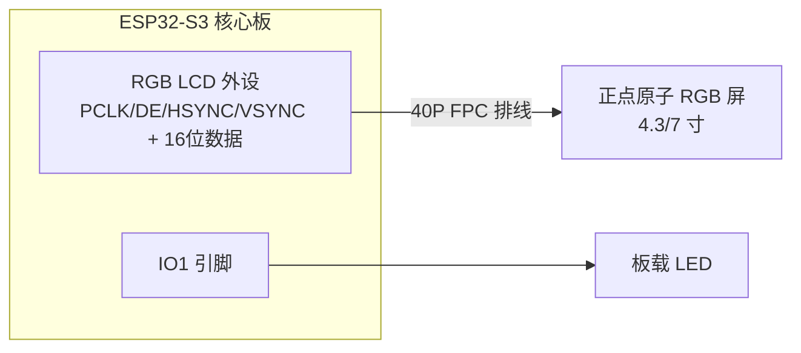
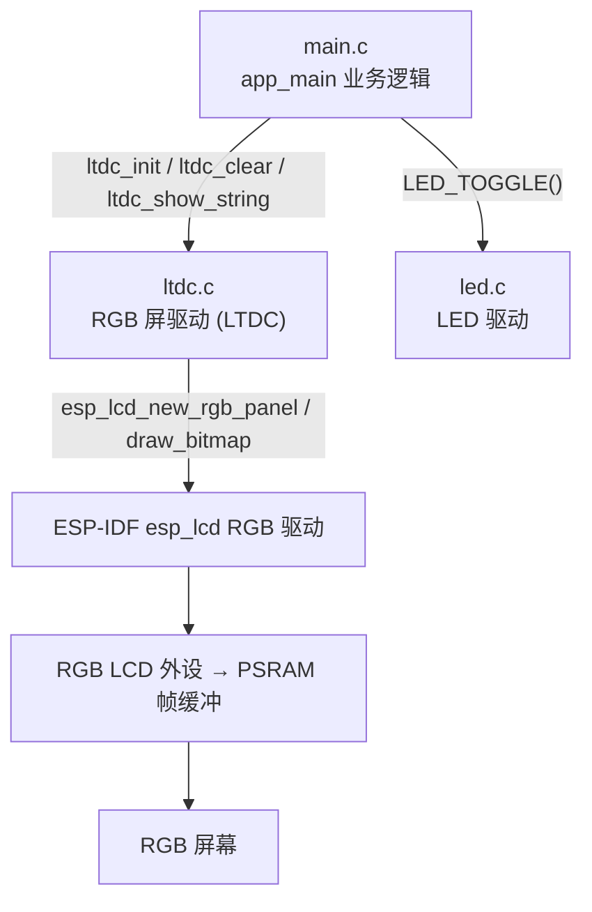
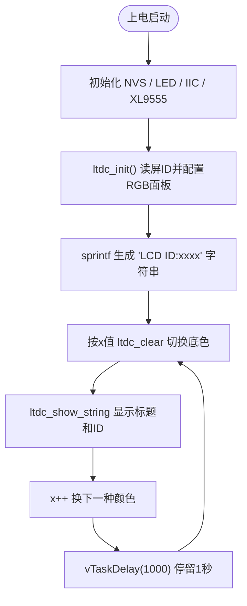

# 23 LTDC LCD（RGB 屏）实验

> 平台：正点原子 ESP32-S3 开发板 ｜ 框架：ESP-IDF ｜ 难度：★★★☆☆
>
> 一句话简介：用 ESP32-S3 的 **RGB LCD 外设**驱动正点原子 4.3/7 寸 RGB 屏，循环切换底色并显示屏幕 ID 等信息。

---

## 1. 实验简介

之前实验用的 SPILCD 通过 SPI 传输像素，速度慢、刷屏时 CPU 负担重。而 ESP32-S3 内置了 **RGB LCD 接口外设**（很多平台叫 LTDC），它像显卡一样：把一整屏像素存在 PSRAM 的**帧缓冲区**里，硬件按行场同步时序自动、持续地把数据「推」给屏幕，CPU 几乎不参与刷新。

本实验用 ESP-IDF 的 `esp_lcd` RGB 面板驱动初始化屏幕：自动识别屏的 ID（分辨率），然后循环用不同颜色清屏、叠加显示文字，实现「底色不停切换 + 显示 LCD ID」的效果。

学完本实验你将掌握：

- 用 `esp_lcd_new_rgb_panel()` 创建 RGB 屏并配置行场时序；
- RGB 屏的帧缓冲、DE/HSYNC/VSYNC/PCLK 等信号概念；
- 用 `esp_lcd_panel_draw_bitmap()` 往屏幕刷图（清屏、显示字符）。

## 2. 生活类比

SPI 屏像**「传真机」**：主机一笔一笔把像素发过去，发完这一屏才能歇着；RGB 屏则像**「电视台直播」**：

- 帧缓冲区（PSRAM 里的一整屏画面）= 电视台的节目源；
- RGB 外设 = 发射机，按固定的行场同步节奏（HSYNC/VSYNC/PCLK）源源不断地把画面「广播」给屏幕；
- 屏幕 = 电视机，自己按节奏接收并显示，画面就一直是「直播」状态；
- 我们要改画面时，只需改「节目源」（帧缓冲），发射机会自动播出去——所以 CPU 只在改内容时才干活。

## 3. 硬件连接

### 引脚分配

| 元件 | 开发板引脚 | 说明 |
| :--- | :--- | :--- |
| LED（板载） | IO1 | 程序运行指示灯 |
| RGBLCD 模块 | 核心板 40P FPC 座 | 4.3/7 寸 RGB 屏，排线连接 |
| RGB 数据/同步信号 | PCLK=IO5、DE=IO4、R/G/B 共16根数据线 | 由 RGB 外设统一驱动 |

> RGB 屏通过核心板上的 **40P FPC 排线座**连接，插上即用；数据线较多，驱动内部已统一定义。

### 连接图



## 4. 程序架构

`main.c` 负责业务（切换底色、显示文字），`components/BSP/RGBLCD/ltdc.c` 封装 RGB 屏的初始化、清屏、字符串显示，底层调用 ESP-IDF 的 `esp_lcd` RGB 面板驱动。



## 5. 程序流程



## 6. 核心代码讲解

### 6.1 驱动层：识别屏幕 ID（`ltdc.c`）

```c
uint16_t ltdc_panelid_read(void)
{
    /* 把 RGB 的 R7/G7/B7 三根线配成输入+上拉 */
    gpio_config(&gpio_init_struct);

    idx  = (uint8_t)gpio_get_level(GPIO_LCD_R7);        /* 读取M0 */
    idx |= (uint8_t)gpio_get_level(GPIO_LCD_G7) << 1;   /* 读取M1 */
    idx |= (uint8_t)gpio_get_level(GPIO_LCD_B7) << 2;   /* 读取M2 */

    switch (idx)
    {
        case 0 : return 0X4342;   /* 4.3寸, 480*272 */
        case 4 : return 0X4384;   /* 4.3寸, 800*480 */
        default: return 0;        /* 非法 */
    }
}
```

**讲解**：不同型号的屏在 R7/G7/B7 三根线上的电平组合不同，驱动借此「读出」屏幕 ID，从而自动匹配对应的分辨率和时序参数，一份代码适配多种屏。

### 6.2 驱动层：创建并初始化 RGB 面板（`ltdc.c`）

```c
esp_lcd_rgb_panel_config_t panel_config = {
    .data_width = 16,                    /* 16位 RGB565 数据 */
    .clk_src = LCD_CLK_SRC_PLL160M,      /* 像素时钟源 */
    .pclk_gpio_num = GPIO_LCD_PCLK,      /* PCLK 信号引脚 */
    .de_gpio_num = GPIO_LCD_DE,          /* DE 信号引脚 */
    .data_gpio_nums = { /* R/G/B 共16根数据线 */ },
    .timings = {                         /* 行场时序参数 */
        .pclk_hz = ltdcdev.pclk_hz,      /* 像素时钟频率 */
        .h_res = ltdcdev.pwidth,         /* 水平分辨率 */
        .v_res = ltdcdev.pheight,        /* 垂直分辨率 */
        /* hsync/vsync 前后廊、脉宽 ... */
    },
    .flags.fb_in_psram = true,           /* 帧缓冲放在PSRAM */
};

esp_lcd_new_rgb_panel(&panel_config, &panel_handle);        /* 创建RGB面板 */
ESP_ERROR_CHECK(esp_lcd_panel_reset(panel_handle));         /* 复位 */
ESP_ERROR_CHECK(esp_lcd_panel_init(panel_handle));          /* 初始化 */
ltdc_clear(WHITE);                                          /* 清白屏 */
LCD_BL(1);                                                  /* 打开背光 */
```

**讲解**：

- `esp_lcd_rgb_panel_config_t` 是一张「屏幕规格表」：数据位宽、各信号引脚、行场时序（分辨率、前后廊、同步脉宽、像素时钟）都填进去，`esp_lcd_new_rgb_panel()` 据此创建面板句柄；
- `.flags.fb_in_psram = true` 很关键——整屏帧缓冲很大（800×480×2 ≈ 750KB），必须放在外挂 PSRAM 里；
- 创建后依次 `reset → init → 清屏 → 开背光`，屏幕就点亮了。

### 6.3 驱动层：清屏（往帧缓冲刷图）（`ltdc.c`）

```c
void ltdc_clear(uint16_t color)
{
    uint16_t *buffer = heap_caps_malloc(ltdcdev.width * sizeof(uint16_t),
                                        MALLOC_CAP_INTERNAL | MALLOC_CAP_8BIT);
    for (uint16_t i = 0; i < ltdcdev.width; i++) buffer[i] = color; /* 填满一行 */

    for (uint16_t y = 0; y < ltdcdev.height; y++)   /* 逐行刷到屏幕 */
    {
        taskENTER_CRITICAL(&my_spinlock);           /* 关中断保护 */
        esp_lcd_panel_draw_bitmap(panel_handle, 0, y, ltdcdev.width, y + 1, buffer);
        taskEXIT_CRITICAL(&my_spinlock);            /* 恢复中断 */
    }
    heap_caps_free(buffer);
}
```

**讲解**：`esp_lcd_panel_draw_bitmap()` 是往屏幕画内容的核心 API，参数是「起始 x,y → 结束 x,y + 像素数据」。清屏就是把一行填成纯色，再逐行刷满整屏；刷图过程用临界区关中断保护，避免被任务调度打断造成画面撕裂。

### 6.4 业务层：循环切换底色（`main.c`）

```c
sprintf((char *)lcd_id, "LCD ID:%04X", ltdcdev.id);   /* 生成ID字符串 */

while (1)
{
    switch (x)                        /* x=0~7 依次切换8种底色 */
    {
        case 0: ltdc_clear(WHITE);   break;
        case 1: ltdc_clear(BLACK);   break;
        /* ... BLUE/RED/MAGENTA/GREEN/CYAN/YELLOW ... */
    }
    ltdc_show_string(10, 40, 240, 32, 32, "ESP32S3", RED);
    ltdc_show_string(10, 80, 240, 24, 24, "LTDC TEST", RED);
    ltdc_show_string(10, 130, 240, 16, 16, (char *)lcd_id, RED); /* 显示ID */

    x++;
    if (x == 8) x = 0;
    vTaskDelay(1000);                 /* 每种颜色停留1秒 */
}
```

**讲解**：主循环用 `x` 在 8 种颜色间轮换，每轮先 `ltdc_clear` 换底色，再叠加显示标题和 `LCD ID`，停留 1 秒后进入下一轮，形成「底色不停切换」的动态效果。

## 7. 实验效果

程序烧录并复位后，RGB 屏点亮，**每隔 1 秒切换一次底色**（白→黑→蓝→红→品红→绿→青→黄循环），屏上始终显示 `ESP32S3`、`LTDC TEST`、`ATOM@ALIENTEK` 以及识别出的 `LCD ID:xxxx`；板载 LED 同步闪烁，表示程序在运行。

## 8. 注意事项

1. 本实验仅支持 **0X4342、0X7084、0X4384** 三种型号的 RGB 屏，其他屏可能无法正确识别或显示异常；
2. RGB 屏必须通过核心板的 **40P FPC 排线**正确插入，排线要插到位、方向正确，否则不亮或花屏；
3. 帧缓冲放在 PSRAM，务必确认工程已使能 PSRAM（`menuconfig` 中相关选项），否则会因内存不足创建面板失败；
4. RGB 屏刷新由硬件持续进行，占用的引脚较多，注意不要和其他外设引脚冲突。

## 9. 编译与烧录

```bash
idf.py set-target esp32s3   # 首次配置目标芯片
idf.py build                # 编译
idf.py -p COMx flash monitor  # 烧录并打开串口监视器（COMx 换成你的端口号）
```

> 完整的开发环境搭建与烧录说明见 [根目录 README](../README.md)。

---

## 小结

本实验用 ESP32-S3 的 RGB LCD 外设驱动了大尺寸 RGB 屏，理解了「帧缓冲 + 行场同步 + 硬件持续刷新」这套显卡式工作原理。相比 SPI 屏，RGB 屏刷新快、可全屏流畅显示，是做 UI 界面、图像显示类项目的首选方案。

| 关键 API | 作用 |
| :--- | :--- |
| `esp_lcd_new_rgb_panel()` | 按配置创建 RGB LCD 面板句柄 |
| `esp_lcd_panel_reset/init()` | 复位并初始化面板 |
| `esp_lcd_panel_draw_bitmap()` | 向屏幕指定区域刷入像素数据（清屏/显示的基础） |
| `ltdc_panelid_read()` | 通过 R7/G7/B7 识别屏幕 ID |
| `ltdc_clear()` / `ltdc_show_string()` | 清屏 / 显示字符串 |
