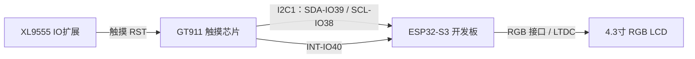
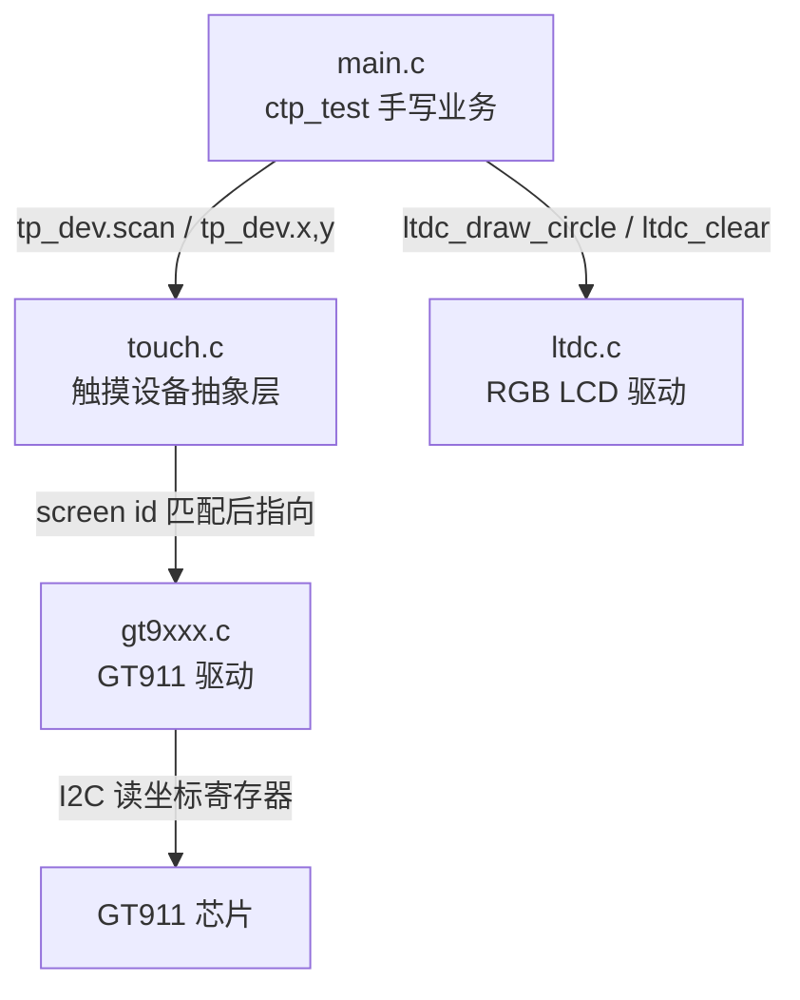
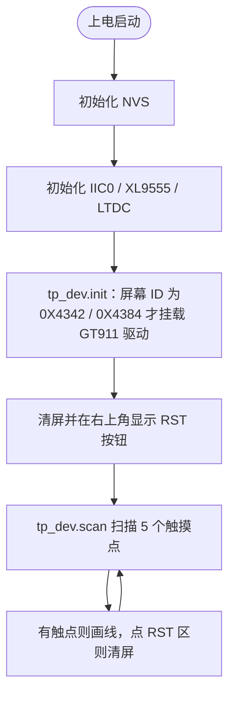

# 24 触摸屏实验

> 平台：正点原子 ESP32-S3 开发板 ｜ 框架：ESP-IDF ｜ 难度：★★★☆☆
>
> 一句话简介：驱动 4.3 寸电容触摸屏（GT911），开机直接进入**手写测试程序**，五指同时画线、右上角一键清屏。

---

## 1. 实验简介

电容触摸屏就是手机屏幕用的那种技术：屏幕表面有一层感应网格，手指靠近时改变局部电容，触摸芯片（本实验为 **GT911**，属于 GT9XXX 系列）算出触点坐标，再通过 **I2C** 告诉 ESP32-S3。

本实验在 23 章 RGB LCD 实验的基础上加入触摸功能，实现一个手写板：

- 支持 **5 点触摸**，每根手指一种颜色；
- 电容屏出厂已对准，**不需要校准**（电阻屏才需要）；
- 触摸右上角「RST」区域即可清屏重画。

学完本实验你将掌握：

- 用 I2C 读取 GT911 触摸芯片的坐标寄存器；
- 用 `tp_dev.scan()` 扫描触摸点并判断按下 / 松开；
- 把触摸坐标转换成屏幕上的画笔轨迹（Bresenham 画线算法）。

## 2. 生活类比

把电容触摸屏想象成手机的**手写备忘录**：

- GT911 芯片 = 屏幕背后的「速记员」，随时记录你手指按在哪几个位置；
- `tp_dev.scan()` = 你每隔几毫秒问速记员一句「现在手指在哪？」；
- 画线 = 程序把「上一个点」和「这一个点」用直线连起来，手指连续移动就成了一条笔迹；
- 手指抬起后再按下 = 新的一笔，和上一笔断开（所以代码里松手时把 `lastpos` 置为 0xFFFF）。

## 3. 硬件连接

### 引脚分配

| 元件 | 开发板引脚 | 说明 |
| :--- | :--- | :--- |
| 触摸屏 IIC_SDA | IO39 | GT911 数据线（I2C1） |
| 触摸屏 IIC_SCL | IO38 | GT911 时钟线（I2C1） |
| 触摸屏 INT | IO40 | GT911 中断 / 复位时序引脚 |
| 触摸屏 RST | XL9555 扩展 IO | 通过 IO 扩展芯片控制复位 |
| RGB LCD | 专用 RGB 接口 | 正点原子 4.3 寸 RGBLCD 模块 |
| LED（板载） | IO1 | 扫描时闪烁，表示程序在跑 |

> 电容触摸屏集成在正点原子 4.3 寸 RGBLCD 模块背面，插上屏幕即接好触摸引脚，无需额外连线。

### 连接图



## 4. 程序架构

代码分三层：`main.c` 负责手写测试业务，`touch.c` 负责判断屏幕型号并挂载对应驱动，`gt9xxx.c` 负责与 GT911 芯片通信；画点、画线则调用 LTDC（RGB LCD）驱动。



## 5. 程序流程



## 6. 核心代码讲解

### 6.1 触摸初始化：按屏幕 ID 挂驱动（`touch.c`）

```c
uint8_t tp_init(void)
{
    tp_dev.touchtype = 0;                                   /* 默认设置(电阻屏 & 竖屏) */
    tp_dev.touchtype |= ltdcdev.dir & 0X01;                 /* 根据LCD判定是横屏还是竖屏 */

    if (ltdcdev.id == 0X4342 || ltdcdev.id == 0X4384)       /* 电容触摸屏,4.3寸屏 */
    {
        gt9xxx_init();
        tp_dev.scan = gt9xxx_scan;                          /* 扫描函数指向GT触摸屏扫描 */
        tp_dev.touchtype |= 0X80;                           /* 电容屏 */
        return 0;
    }

    return 1;
}
```

**讲解**：`ltdc_init()` 时会读出屏幕 ID（`ltdcdev.id`）。只有 0X4342 和 0X4384 这两种 4.3 寸 RGB 屏带电容触摸，此时才调用 `gt9xxx_init()` 复位并配置 GT911，并把函数指针 `tp_dev.scan` 指向 `gt9xxx_scan`。GT911 的坐标数据存放在 `0X8150` 开始的寄存器里，一次 I2C 读操作即可拿到多个触点。

### 6.2 手写测试主循环（`main.c`）

```c
while (1)
{
    tp_dev.scan(0);                                         /* 扫描触摸点 */

    for (t = 0; t < 5; t++)                                 /* 最多查 5 个触点 */
    {
        if ((tp_dev.sta) & (1 << t))                        /* 第 t 点按下？ */
        {
            if (tp_dev.x[t] < ltdcdev.width && tp_dev.y[t] < 480)
            {
                if (lastpos[t][0] == 0XFFFF)                /* 刚按下，记录起点 */
                {
                    lastpos[t][0] = tp_dev.x[t];
                    lastpos[t][1] = tp_dev.y[t];
                }

                /* 上次位置 → 本次位置，画一条粗线 */
                lcd_draw_bline(lastpos[t][0], lastpos[t][1],
                               tp_dev.x[t], tp_dev.y[t], 2, POINT_COLOR_TBL[t]);
                lastpos[t][0] = tp_dev.x[t];
                lastpos[t][1] = tp_dev.y[t];

                if (tp_dev.x[t] > (ltdcdev.width - 24) && tp_dev.y[t] < 20)
                {
                    load_draw_dialog();                     /* 点到右上角 RST，清屏 */
                }
            }
        }
        else
        {
            lastpos[t][0] = 0xFFFF;                         /* 松手，下次是新的一笔 */
        }
    }

    vTaskDelay(5);
    i++;
    if (i % 20 == 0) LED_TOGGLE();                          /* LED 心跳指示 */
}
```

**讲解**：

- `tp_dev.sta` 是触点状态位图，`sta & (1 << t)` 判断第 t 个触点是否按下，坐标存在 `tp_dev.x[t]`、`tp_dev.y[t]`；
- 每个触点固定一种颜色（`POINT_COLOR_TBL`：红、绿、蓝、黄、品红、青），五指同画互不干扰；
- `lcd_draw_bline()` 用 **Bresenham 画线算法**在两点间插值，每个点调用 `ltdc_draw_circle()` 画一个小圆，连起来就是粗线条——手指快速滑动也不会断线；
- 松手时把 `lastpos` 置为 `0xFFFF`，保证下一笔从新起点开始。

## 7. 实验效果

烧录复位后，屏幕被清成白色、右上角显示蓝色「RST」。用手指在屏幕上滑动即可**手写画图**；最多支持 5 指同时书写，每指颜色不同；点一下右上角「RST」区域，屏幕清空重新开始；板载 LED 快速闪烁表示扫描循环在正常运行。

## 8. 注意事项

1. 本实验**仅支持屏幕 ID 为 0X4342 和 0X4384** 的正点原子 4.3 寸 RGB 屏，其他屏幕没有电容触摸或不匹配。
2. 电容触摸屏出厂已和屏幕贴合对准，**不需要校准**；若触摸无反应，先检查屏幕排线是否插紧。
3. GT911 走 I2C1（SDA-IO39 / SCL-IO38），INT 为 IO40，复位由 XL9555 扩展 IO 完成，引脚已在 `gt9xxx.h` 中写死，接线时勿改动。

## 9. 编译与烧录

```bash
idf.py set-target esp32s3   # 首次配置目标芯片
idf.py build                # 编译
idf.py -p COMx flash monitor  # 烧录并打开串口监视器（COMx 换成你的端口号）
```

> 完整的开发环境搭建与烧录说明见 [根目录 README](../README.md)。

---

## 小结

本实验把「I2C 读触摸芯片 → 解析 5 个触点 → 在 RGB 屏上画线」串成了一条完整链路，这是做平板类交互产品（点按、滑动、多指手势）的基础。掌握了 `tp_dev.scan()` 的用法后，你可以把画线换成按钮、菜单等任意触摸交互。

| 关键 API | 作用 |
| :--- | :--- |
| `gt9xxx_init()` | 复位并配置 GT911 触摸芯片 |
| `tp_dev.scan()` | 扫描触摸点，更新坐标与状态 |
| `tp_dev.sta / x[] / y[]` | 触点状态位图与各点坐标 |
| `ltdc_draw_circle()` | 在 RGB 屏上画圆点（画线的基本单元） |
| `ltdc_clear()` | 全屏填充颜色（清屏） |
