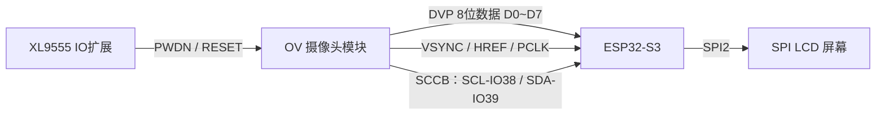
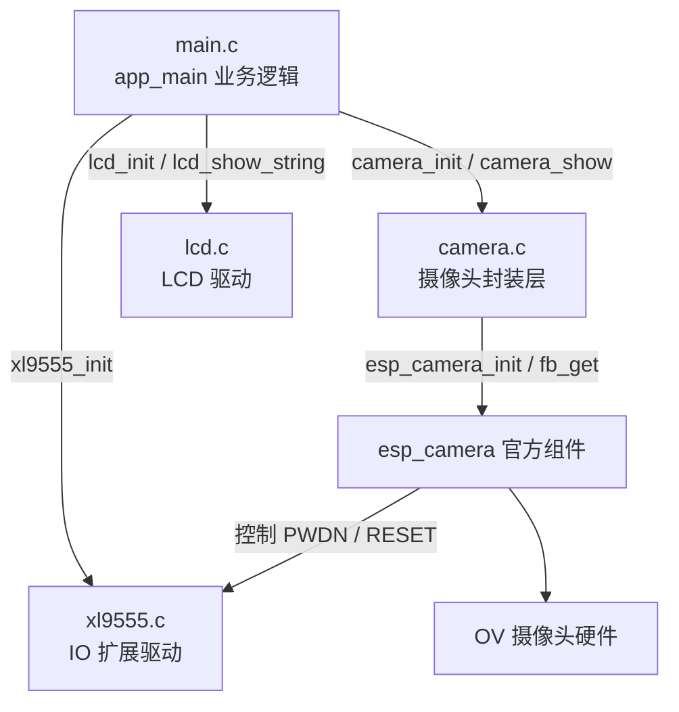
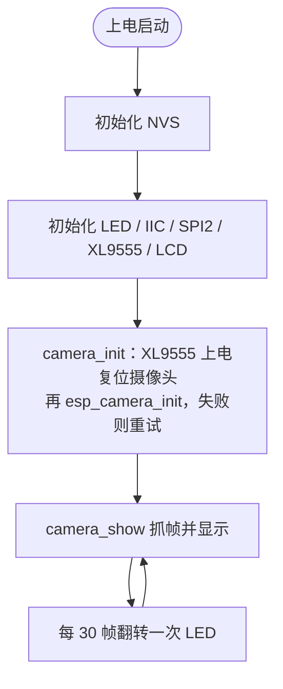

# 25_1 摄像头实验

> 平台：正点原子 ESP32-S3 开发板 ｜ 框架：ESP-IDF ｜ 难度：★★★★☆
>
> 一句话简介：驱动 OV 系列摄像头采集画面，并实时显示到 SPI LCD 屏幕上，做出一个简易「电子取景器」。

---

## 1. 实验简介

本实验用 ESP32-S3 的 **摄像头接口（DVP 并口）** 驱动 OV2640 / OV3660 / OV5640 等摄像头模块，把镜头拍到的画面以 RGB565 格式输出到 SPI LCD 上，形成实时预览。

摄像头数据量大、引脚多，是整个工程里硬件连接最复杂的一个实验。学完你将掌握：

- 用官方 `esp_camera` 组件配置并初始化摄像头；
- 通过 XL9555 IO 扩展芯片控制摄像头的 PWDN（电源关闭）和 RESET（复位）；
- 用 `esp_camera_fb_get()` 抓取一帧图像，再写到 LCD 显示。

## 2. 生活类比

摄像头就像人的**眼睛 + 视觉神经**：

- 镜头和感光芯片（OV sensor）= 眼球，负责把光线变成电信号；
- PWDN / RESET = 「闭眼休息」和「重新睁眼」，由 XL9555 这个「神经开关」控制；
- DVP 并口 8 根数据线（D0~D7）= 视觉神经，一次并行传 8 位像素数据，速度快；
- `esp_camera_fb_get()` = 「眨一下眼拍张照」，把当前画面暂存到内存（帧缓冲）；
- LCD 显示 = 把这张照片冲洗出来给你看，循环拍摄就形成了实时视频。

## 3. 硬件连接

### 引脚分配

| 模块 | 信号 | 引脚 |
| :--- | :--- | :--- |
| LED（板载） | LED | IO1 |
| XL9555 | INT / SDA / CLK | IO0 / IO41 / IO42 |
| CAMERA（DVP 数据） | OV_D0~D3 | IO4 / IO5 / IO6 / IO7 |
| CAMERA（DVP 数据） | OV_D4~D7 | IO15 / IO16 / IO17 / IO18 |
| CAMERA（同步信号） | VSYNC / HREF / PCLK | IO47 / IO48 / IO45 |
| CAMERA（SCCB 配置） | OV_SCL / OV_SDA | IO38 / IO39 |
| CAMERA（电源 / 复位） | OV_PWDN / OV_RESET | XL9555 扩展 IO4 / IO5 |
| LCD | SPI LCD 模块 | SPI2 |

> 摄像头通过专用排线座接入，PWDN 和 RESET 不占用 ESP32-S3 原生引脚，而是接在 XL9555 扩展芯片上。

### 连接图



## 4. 程序架构

`main.c` 是业务入口，依次初始化各外设；`camera.c` 封装了 `esp_camera` 官方组件，对上提供 `camera_init()` 和 `camera_show()` 两个简单接口。



## 5. 程序流程



## 6. 核心代码讲解

### 6.1 摄像头配置结构体（`camera.c`）

```c
static camera_config_t camera_config = {
    /* 引脚配置 */
    .pin_pwdn = CAM_PIN_PWDN,        /* GPIO_NUM_NC，表示由 XL9555 控制 */
    .pin_reset = CAM_PIN_RESET,
    .pin_xclk = CAM_PIN_XCLK,
    .pin_sccb_sda = CAM_PIN_SIOD,    /* IO39 */
    .pin_sccb_scl = CAM_PIN_SIOC,    /* IO38 */
    .pin_d7 = CAM_PIN_D7,            /* IO18 ... 依次到 D0=IO4 */
    .pin_d0 = CAM_PIN_D0,
    .pin_vsync = CAM_PIN_VSYNC,      /* IO47 */
    .pin_href = CAM_PIN_HREF,        /* IO48 */
    .pin_pclk = CAM_PIN_PCLK,        /* IO45 */
    /* 图像配置 */
    .xclk_freq_hz = 24000000,        /* 摄像头时钟 24MHz */
    .fb_location = CAMERA_FB_IN_PSRAM,/* 帧缓冲放在 PSRAM，容量大 */
    .pixel_format = PIXFORMAT_RGB565,/* 输出 RGB565 */
    .frame_size = FRAMESIZE_QVGA,    /* 分辨率 QVGA 320x240 */
    .fb_count = 2,                   /* 双缓冲 */
    .grab_mode = CAMERA_GRAB_WHEN_EMPTY,
};
```

**讲解**：这是官方 `esp_camera` 组件要求的「摄像头档案表」。注意 `pin_pwdn`、`pin_reset` 都被定义成 `GPIO_NUM_NC`（Not Connected），因为这两个信号接在 XL9555 上，需要在代码里手动通过扩展芯片控制（见下）。`fb_location = CAMERA_FB_IN_PSRAM` 很关键——一帧 QVGA RGB565 就要 320×240×2 ≈ 150KB，只有 PSRAM 装得下。

### 6.2 通过 XL9555 复位并初始化（`camera.c`）

```c
uint8_t camera_init(void)
{
    if (CAM_PIN_PWDN == GPIO_NUM_NC)  CAM_PWDN(0);   /* 扩展IO拉低，开启摄像头电源 */

    if (CAM_PIN_RESET == GPIO_NUM_NC)
    {
        CAM_RST(0);                   /* 复位摄像头 */
        vTaskDelay(20);
        CAM_RST(1);
        vTaskDelay(20);
    }

    esp_err_t err = esp_camera_init(&camera_config);  /* 官方组件初始化 */
    if (err != ESP_OK) return 1;

    sensor_t *s = esp_camera_sensor_get();
    if (s->id.PID == OV3660_PID)                      /* 按传感器型号微调画面 */
    {
        s->set_vflip(s, 1);
        s->set_brightness(s, 1);
        s->set_saturation(s, -2);
    }
    else if (s->id.PID == OV5640_PID)
    {
        s->set_vflip(s, 1);
    }
    return err;
}
```

**讲解**：`CAM_PWDN(x)` / `CAM_RST(x)` 是宏，内部调用 `xl9555_pin_write()` 操作扩展 IO4/IO5。先给摄像头上电、复位，再调 `esp_camera_init()` 让组件自动识别传感器型号（PID）。不同型号的默认画面方向不同，所以针对 OV3660/OV5640 做了翻转和亮度校正。

### 6.3 抓帧并显示（`camera.c`）

```c
void camera_show(uint16_t x, uint16_t y)
{
    fb = esp_camera_fb_get();                        /* 抓取一帧图像 */

    if (x + fb->width > lcd_self.width || y + fb->height > lcd_self.height)
    {
        printf("显示区域大小屏幕区域！！！\r\n");
        goto err;
    }

    lcd_set_window(x, y, x + fb->width - 1, y + fb->height - 1);

    for (j = 0; j < fb->width * fb->height; j++)     /* 把帧数据搬到 lcd_buf */
    {
        lcd_buf[2 * j]     = fb->buf[2 * i];
        lcd_buf[2 * j + 1] = fb->buf[2 * i + 1];
        i++;
    }

    for (j = 0; j < (fb->width * fb->height * 2 / LCD_BUF_SIZE); j++)
    {
        lcd_write_data(&lcd_buf[j * LCD_BUF_SIZE], LCD_BUF_SIZE);  /* 分块写入 LCD */
    }
err:
    esp_camera_fb_return(fb);                        /* 归还帧缓冲 */
    i = 0;
    fb = NULL;
}
```

**讲解**：`esp_camera_fb_get()` 拿到一帧后要**成对**调用 `esp_camera_fb_return()` 归还，否则缓冲很快耗尽。由于 LCD 一次能写入的数据有限（`LCD_BUF_SIZE`），整帧要分成多块用 `lcd_write_data()` 写入，配合 `lcd_set_window()` 指定显示区域。

## 7. 实验效果

烧录复位后，屏幕先显示 "ESP32 / CAMERA TEST / ATOM@ALIENTEK"，摄像头初始化成功后清屏，LCD 上出现**摄像头实时画面**（QVGA 分辨率）。移动摄像头前的物体，屏幕画面同步变化；板载 LED 每采集约 30 帧闪烁一次，表示程序在持续取帧。

## 8. 注意事项

1. 帧缓冲必须放在 **PSRAM**（`CAMERA_FB_IN_PSRAM`），否则内存不够；确认 `sdkconfig` 已开启 PSRAM。
2. `esp_camera_fb_get()` 与 `esp_camera_fb_return()` 必须**成对使用**，只取不还会导致后续取帧失败。
3. PWDN / RESET 由 XL9555 控制，因此必须**先 `xl9555_init()` 再 `camera_init()`**，顺序不能颠倒。
4. 摄像头排线较脆弱，插拔时注意方向和卡扣，接触不良会导致 `camera_init()` 反复失败（屏幕显示 "CAMERA Fail!"）。

## 9. 编译与烧录

```bash
idf.py set-target esp32s3   # 首次配置目标芯片
idf.py build                # 编译
idf.py -p COMx flash monitor  # 烧录并打开串口监视器（COMx 换成你的端口号）
```

> 完整的开发环境搭建与烧录说明见 [根目录 README](../README.md)。

---

## 小结

本实验打通了「配置摄像头 → 抓帧 → 显示到 LCD」这条视频采集链路，是后续照相机、视频播放器等实验的基础。核心是官方 `esp_camera` 组件，只要填好引脚和图像参数，采集本身并不复杂，难点在于引脚多、帧缓冲大、以及 XL9555 电源 / 复位的时序配合。

| 关键 API | 作用 |
| :--- | :--- |
| `esp_camera_init()` | 按配置初始化摄像头 |
| `esp_camera_sensor_get()` | 获取传感器对象，用于微调画面 |
| `esp_camera_fb_get()` | 抓取一帧图像到帧缓冲 |
| `esp_camera_fb_return()` | 归还帧缓冲 |
| `xl9555_pin_write()` | 通过 IO 扩展控制 PWDN / RESET |
| `lcd_write_data()` | 把图像数据写入 LCD 显示 |
