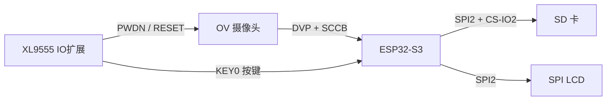
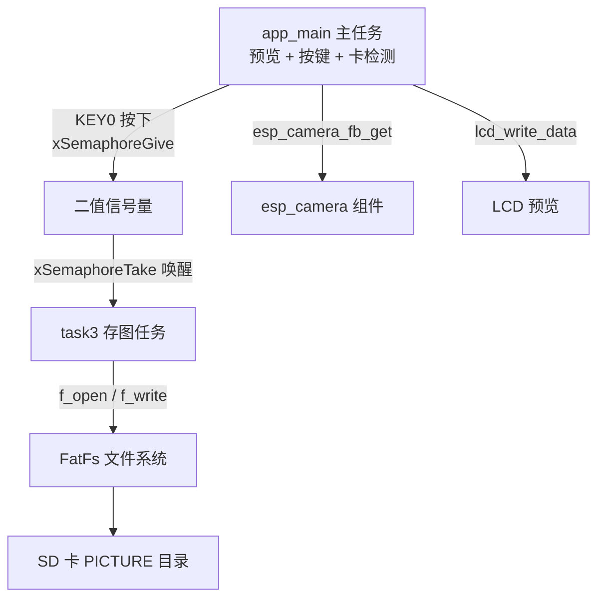
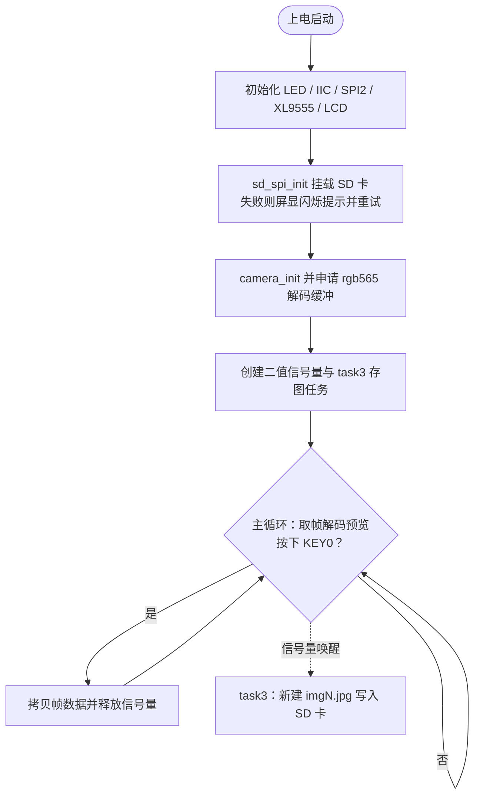

# 25_2 照相机实验

> 平台：正点原子 ESP32-S3 开发板 ｜ 框架：ESP-IDF ｜ 难度：★★★★☆
>
> 一句话简介：在摄像头预览的基础上加上「快门」和「存储卡」——按 KEY0 把当前画面拍照保存到 SD 卡，做成一台真正的数码照相机。

---

## 1. 实验简介

本实验是 25_1 摄像头实验的升级版：屏幕上实时预览摄像头画面（取景），按下 KEY0（快门）时，把当前这一帧 JPEG 图像写入 SD 卡的 `PICTURE` 目录，文件自动按 `img1.jpg、img2.jpg…` 编号。

除了摄像头和 LCD，还引入了三个新角色：

- **SD 卡 + FatFs 文件系统**：照片存哪里；
- **FreeRTOS 任务 + 二值信号量**：预览和存图分开跑，互不阻塞；
- **SD 卡热插拔检测**：卡在才能拍，卡拔出后自动禁拍、插回自动恢复。

学完本实验你将掌握：

- 用 `esp_camera_fb_get()` 取帧、判断按键、释放信号量的完整「快门」流程；
- 用 FatFs 的 `f_open / f_write / f_close` 把数据写成 SD 卡文件；
- 用二值信号量实现「一个任务等另一个任务通知」的经典协作模式。

## 2. 生活类比

这就是一台**数码相机**的工作方式：

- 屏幕实时预览 = 取景器；
- KEY0 = 快门按钮，按一下「咔嚓」；
- 二值信号量 = 前台 photographer 喊了一声「拍好了！」，后台负责冲印的助手（task3）才动手把照片放进相册（SD 卡）；
- SD 卡检测 = 相机提示「未插入存储卡」时快门按不动——本实验一样，卡不在位时 KEY0 无效；
- 文件自动编号 = 相册里的照片按 img1、img2 顺序排列，不会覆盖旧照片。

## 3. 硬件连接

### 引脚分配

| 模块 | 信号 | 引脚 |
| :--- | :--- | :--- |
| LED（板载） | LED | IO1 |
| 按键 | KEY0 | XL9555 扩展 IO1_7 |
| XL9555 | INT / SDA / CLK | IO0 / IO41 / IO42 |
| CAMERA（DVP 数据） | OV_D0~D3 | IO4 / IO5 / IO6 / IO7 |
| CAMERA（DVP 数据） | OV_D4~D7 | IO15 / IO16 / IO17 / IO18 |
| CAMERA（同步信号） | VSYNC / HREF / PCLK | IO47 / IO48 / IO45 |
| CAMERA（SCCB 配置） | OV_SCL / OV_SDA | IO38 / IO39 |
| CAMERA（电源 / 复位） | OV_PWDN / OV_RESET | XL9555 扩展 IO4 / IO5 |
| SD 卡 | CS（SPI2 总线） | IO2 |
| LCD | SPI LCD 模块 | SPI2 |

> 摄像头引脚与 25_1 完全相同；SD 卡与 LCD 共用 SPI2 总线，靠各自的片选区分。

### 连接图



## 4. 程序架构

程序分成两个 FreeRTOS 任务：`app_main` 主任务负责预览、按键和 SD 卡状态检测；`task3` 专门负责把照片写入 SD 卡。两者通过**二值信号量**衔接：主任务按下快门后释放信号量，task3 被唤醒去写文件。



## 5. 程序流程



## 6. 核心代码讲解

### 6.1 快门逻辑：主循环里的 KEY0（`main.c`）

```c
while (1)
{
    key = xl9555_key_scan(0);                      /* 扫描按键（挂在XL9555上） */
    camera_fb_t *pic = esp_camera_fb_get();        /* 抓取一帧 */

    if (pic)
    {
        mjpegdraw(pic->buf, pic->len, (uint8_t *)rgb565, NULL);  /* JPEG解码成RGB565 */
        lcd_set_window(0, 0, 0 + pic->width - 1, 0 + pic->height - 1);

        if (key == KEY0_PRES)
        {
            /* lcd_buf存储摄像头整一帧数据 */
            for (j = 0; j < pic->width * pic->height; j++)
            {
                lcd_buf[2 * j]     = pic->buf[2 * i];
                lcd_buf[2 * j + 1] = pic->buf[2 * i + 1];
                i++;
            }

            xSemaphoreGive(BinarySemaphore);       /* 释放二值信号量，通知task3存图 */
        }

        /* 处理SD卡释放挂载：卡在位则查状态，卡拔出则尝试重新挂载 */
        if (sd_check_en == 1)
        {
            if (sdmmc_get_status(card) != ESP_OK) sd_check_en = 0;
        }
        else
        {
            if (sd_spi_init() == ESP_OK)
            {
                if (sdmmc_get_status(card) == ESP_OK) sd_check_en = 1;
            }
        }
        ...
        esp_camera_fb_return(pic);                 /* 归还帧缓冲 */
    }
}
```

**讲解**：

- `xl9555_key_scan()` 扫描接在 XL9555 扩展 IO 上的 KEY0，返回 `KEY0_PRES` 表示按下；
- `mjpegdraw()` 来自 `decoder_ijg` 解码组件，把摄像头输出的 JPEG 帧解码成 RGB565 供 LCD 显示；
- 按下快门时把整帧数据拷进 `lcd_buf`，然后 `xSemaphoreGive()`「发令」，真正的写卡动作交给 task3，主循环不会被慢速的 SD 写操作卡住；
- `sd_check_en` 是热插拔标志：用 `sdmmc_get_status()` 查询卡状态，拔出后置 0（禁拍），重新插入后调用 `sd_spi_init()` 再挂载并恢复为 1。

### 6.2 存图任务：task3 写文件（`main.c`）

```c
void task3(void *pvParameters)
{
    char file_name[30];
    uint32_t pictureNumber = 0;
    ...
    res = exfuns_init();                                  /* 为fatfs相关变量申请内存 */
    pictureNumber = pic_get_tnum("0:/PICTURE");           /* 得到总有效文件数 */
    pictureNumber = pictureNumber + 1;                    /* 新照片从下一个编号开始 */

    while (1)
    {
        xSemaphoreTake(BinarySemaphore, portMAX_DELAY);   /* 等快门信号，永久阻塞 */

        if (sd_check_en == 1)                             /* SD卡挂载了，才能拍照 */
        {
            sprintf(file_name, "0:/PICTURE/img%ld.jpg", pictureNumber);
            fftemp = (FIL *)malloc(sizeof(FIL));
            res = f_open(fftemp, file_name, FA_WRITE | FA_CREATE_NEW);  /* 新建文件 */

            f_write(fftemp, (const void *)lcd_buf, sizeof(lcd_buf), &writelen); /* 写入照片 */

            if (writelen != sizeof(lcd_buf))
            {
                ESP_LOGE(TAG, "img Write err");
            }
            else
            {
                ESP_LOGI(TAG, "write buff len %d byte", writelen);
                pictureNumber++;                          /* 编号自增 */
            }

            f_close(fftemp);
            free(fftemp);
        }
    }
}
```

**讲解**：

- `xSemaphoreTake(BinarySemaphore, portMAX_DELAY)` 让 task3 平时完全休眠，只有快门按下才被唤醒——这是信号量最典型的用法；
- 开机先用 `pic_get_tnum()` 遍历 `0:/PICTURE` 目录数出已有图片数，新照片从下一个编号开始，避免覆盖旧照片；
- `f_open()` 带 `FA_WRITE | FA_CREATE_NEW` 标志表示「新建一个只写文件」，文件已存在则失败；
- 写之前再次检查 `sd_check_en`，卡被拔出时直接放弃这次拍照。

### 6.3 创建任务与信号量（`main.c`）

```c
BinarySemaphore = xSemaphoreCreateBinary();       /* 创建二值信号量 */

xTaskCreatePinnedToCore((TaskFunction_t )task3,   /* 任务函数 */
                        (const char*    )"task3", /* 任务名称 */
                        (uint16_t       )TASK3_STK_SIZE,   /* 堆栈 5*1024 */
                        (void*          )NULL,
                        (UBaseType_t    )TASK3_PRIO,       /* 优先级 4 */
                        (TaskHandle_t*  )&Task3Task_Handler,
                        (BaseType_t     ) 0);              /* 绑定到内核0 */
```

**讲解**：`xTaskCreatePinnedToCore()` 与 `xTaskCreate()` 的区别是多了最后一个参数，可以把任务固定在某个 CPU 内核上运行，这里把存图任务绑到内核 0，避免和预览抢同一个核。

## 7. 实验效果

烧录复位后：

1. 程序先自动检测 SD 卡——没插卡时屏幕反复闪烁 "SD Card Failed!"，无法进入拍照模式；
2. 插好卡后屏幕显示摄像头**实时预览画面**；
3. 按下 **KEY0**，当前画面被保存到 SD 卡 `PICTURE` 目录下，文件名依次为 `img1.jpg、img2.jpg…`，串口打印写入的字节数；
4. 运行中**拔出 SD 卡**，再按 KEY0 无效；重新插入后自动恢复挂载，可继续拍照。

## 8. 注意事项

1. SD 卡需为 **FAT 格式**，且根目录下要有 `PICTURE` 文件夹（`FA_CREATE_NEW` 只建文件不建目录）。
2. 摄像头引脚与 25_1 相同，PWDN / RESET 由 XL9555 控制，务必先初始化 XL9555。
3. `esp_camera_fb_get()` / `esp_camera_fb_return()` 必须成对调用，帧缓冲在 PSRAM。
4. task3 中 `FIL` 结构体用 `malloc` 申请、用完 `free`，因为 FatFs 的 `FIL` 较大，放任务栈里容易溢出。

## 9. 编译与烧录

```bash
idf.py set-target esp32s3   # 首次配置目标芯片
idf.py build                # 编译
idf.py -p COMx flash monitor  # 烧录并打开串口监视器（COMx 换成你的端口号）
```

> 完整的开发环境搭建与烧录说明见 [根目录 README](../README.md)。

---

## 小结

本实验把摄像头、LCD、SD 卡、按键、FreeRTOS 任务和信号量组合成一个完整的「数码相机」应用，是综合运用前面所有知识的一次实战。理解「主任务负责实时预览、专职任务负责慢速存储、信号量负责两者握手」这个模式，以后做多任务产品时会反复用到。

| 关键 API | 作用 |
| :--- | :--- |
| `esp_camera_fb_get()` / `esp_camera_fb_return()` | 抓取 / 归还一帧图像 |
| `mjpegdraw()` | 将 JPEG 帧解码为 RGB565 |
| `xl9555_key_scan()` | 扫描接在 IO 扩展芯片上的按键 |
| `xSemaphoreCreateBinary()` / `Give` / `Take` | 二值信号量：任务间「快门」通知 |
| `xTaskCreatePinnedToCore()` | 创建绑定内核的任务 |
| `f_open()` / `f_write()` / `f_close()` | FatFs 文件写入三步曲 |
| `sdmmc_get_status()` | 查询 SD 卡状态（热插拔检测） |
