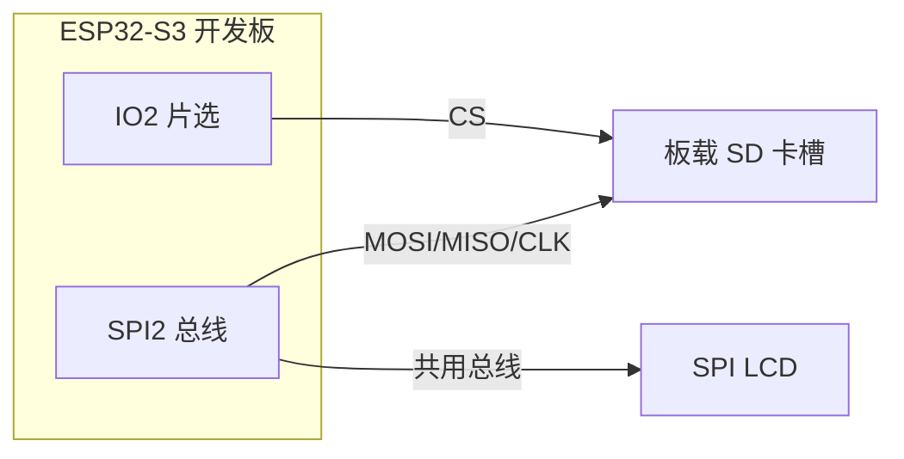
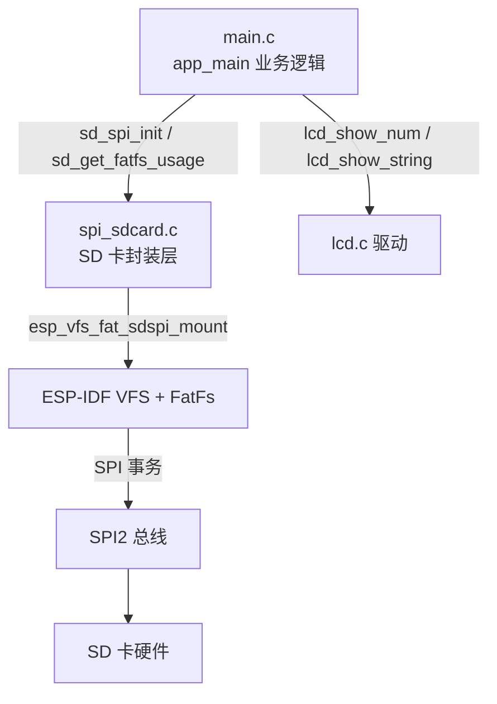
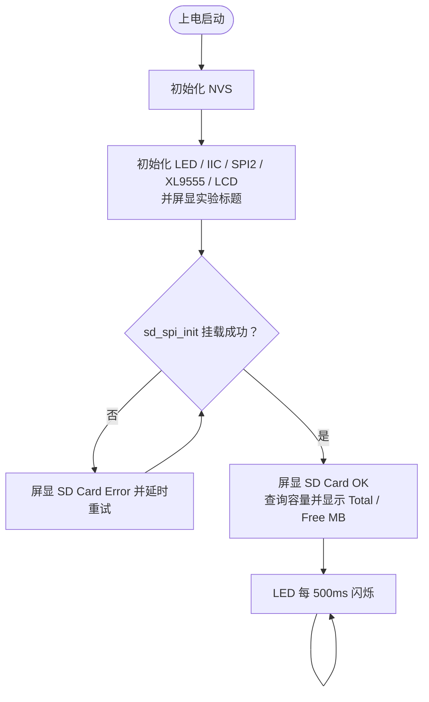

# 26 SD 卡实验

> 平台：正点原子 ESP32-S3 开发板 ｜ 框架：ESP-IDF ｜ 难度：★★☆☆☆
>
> 一句话简介：初始化板载 SD 卡并挂载 FatFs 文件系统，在串口和 LCD 上读出 SD 卡的**总容量与剩余容量**。

---

## 1. 实验简介

SD 卡是最常见的大容量存储介质。本实验通过 ESP-IDF 的 **SD 主机驱动框架 + FatFs 文件系统**，把插入卡槽的 SD 卡挂载成一个可以直接读写的「U 盘」，然后用 FatFs 的 `f_getfree()` 查询容量信息，显示在 LCD 和串口上。

> 说明：本实验的 SD 卡走 **SPI 模式（SDSPI）**，挂在 SPI2 总线上，片选为 IO2。SPI 模式接线简单，是学习 SD 卡最快的入门方式。

学完本实验你将掌握：

- 用 `sd_spi_init()` 把 SD 卡添加为 SPI 总线设备并挂载文件系统；
- 用 `f_getfree()` 获取 FAT 文件系统的总空间和剩余空间；
- 挂载失败时的检测与重试逻辑。

## 2. 生活类比

SD 卡挂载就像给电脑**插 U 盘**：

- `sd_spi_init()` = 把 U 盘插进 USB 口，系统「叮咚」一声识别出新盘符（挂载点 `0:`）；
- 挂载成功 = 电脑上出现「可移动磁盘 (E:)」，可以双击打开；
- `f_getfree()` = 右键点磁盘选「属性」，弹出窗口告诉你「总容量 XX GB，可用 XX GB」；
- 挂载失败反复重试 = U 盘没插好，电脑一直弹「无法识别的设备」，你拔出来重插直到识别为止。

## 3. 硬件连接

### 引脚分配

| 元件 | 开发板引脚 | 说明 |
| :--- | :--- | :--- |
| LED（板载） | IO1 | 挂载成功后每 500ms 闪烁 |
| 按键 BOOT | IO0 | 板载按键 |
| SD 卡 CS | IO2 | SPI 模式片选 |
| SD 卡 MOSI / MISO / CLK | IO11 / IO13 / IO12 | 与 LCD 共用 SPI2 总线 |
| LCD | SPI LCD 模块 | SPI2，显示容量信息 |

> 使用开发板**板载 SD 卡槽**，把 SD 卡按方向正确插入即可，无需外接杜邦线。

### 连接图



## 4. 程序架构

`main.c` 负责业务逻辑，`spi_sdcard.c` 封装了 SD 卡的 SPI 初始化与容量查询，底层是 ESP-IDF 的 `esp_vfs_fat` 组件和 FatFs。



## 5. 程序流程



## 6. 核心代码讲解

### 6.1 SD 卡初始化与挂载（`spi_sdcard.c`）

```c
esp_err_t sd_spi_init(void)
{
    if (MY_SD_Handle != NULL)                       /* 若已挂载，先移除再重挂 */
    {
        spi_bus_remove_device(MY_SD_Handle);
        if (mount_ret == ESP_OK)
            esp_vfs_fat_sdcard_unmount(mount_point, card);
    }

    /* SPI 设备配置：SD 卡时钟 20~25MHz，SPI 模式 0 */
    spi_device_interface_config_t devcfg = {
        .clock_speed_hz = 20 * 1000 * 1000,
        .mode = 0,
        .spics_io_num = SD_NUM_CS,                  /* 片选 IO2 */
        .queue_size = 7,
    };
    ret = spi_bus_add_device(SPI2_HOST, &devcfg, &MY_SD_Handle);

    /* 文件系统挂载配置 */
    esp_vfs_fat_sdmmc_mount_config_t mount_config = {
        .format_if_mount_failed = false,            /* 挂载失败不自动格式化 */
        .max_files = 5,                             /* 最多同时打开 5 个文件 */
        .allocation_unit_size = 4 * 1024
    };

    /* SD 主机配置：使用 SPI 协议，挂在 SPI2 */
    sdmmc_host_t host = {0};
    host.flags = SDMMC_HOST_FLAG_SPI | SDMMC_HOST_FLAG_DEINIT_ARG;
    host.slot = SPI2_HOST;
    host.max_freq_khz = SDMMC_FREQ_DEFAULT;
    ...

    /* 挂载：把 SD 卡挂到 "0:" 目录 */
    mount_ret = esp_vfs_fat_sdspi_mount(mount_point, &host, &slot_config, &mount_config, &card);
    ret |= mount_ret;
    return ret;
}
```

**讲解**：整个初始化分三步——① `spi_bus_add_device()` 把 SD 卡作为设备加到 SPI2 总线；② 填好主机配置 `sdmmc_host_t`（这里关键是 `SDMMC_HOST_FLAG_SPI` 表示走 SPI 协议）；③ `esp_vfs_fat_sdspi_mount()` 一次性完成「识别卡 → 挂载 FatFs → 绑定到路径 `0:`」，成功后就能像操作普通文件一样读写 SD 卡。

### 6.2 查询容量（`spi_sdcard.c`）

```c
void sd_get_fatfs_usage(size_t *out_total_bytes, size_t *out_free_bytes)
{
    FATFS *fs;
    size_t free_clusters;
    int res = f_getfree("0:", (size_t *)&free_clusters, &fs);   /* 查询空闲簇 */
    assert(res == FR_OK);

    size_t total_sectors = (fs->n_fatent - 2) * fs->csize;     /* 总扇区数 */
    size_t free_sectors  = free_clusters * fs->csize;          /* 空闲扇区数 */

    size_t sd_total_KB = (total_sectors / 1024) * fs->ssize;   /* 换算成 KB */
    size_t sd_free_KB  = (free_sectors  / 1024) * fs->ssize;

    if (out_total_bytes != NULL) *out_total_bytes = sd_total_KB;
    if (out_free_bytes  != NULL) *out_free_bytes  = sd_free_KB;
}
```

**讲解**：`f_getfree()` 是 FatFs 的核心函数，返回空闲簇数和文件系统对象 `fs`。FAT 文件系统以「簇（cluster）」为单位管理空间，`fs->csize` 是每簇扇区数、`fs->ssize` 是每扇区字节数，两者相乘即可把簇 / 扇区换算成字节数。

### 6.3 业务层：显示与重试（`main.c`）

```c
while (sd_spi_init())                               /* 检测不到SD卡 */
{
    lcd_show_string(30, 110, 200, 16, 16, "SD Card Error!", RED);
    vTaskDelay(500);
    lcd_show_string(30, 130, 200, 16, 16, "Please Check! ", RED);
    vTaskDelay(500);
}

lcd_show_string(30, 110, 200, 16, 16, "SD Card OK!", RED);
lcd_show_string(30, 130, 200, 16, 16, "Total:      MB", RED);
lcd_show_string(30, 150, 200, 16, 16, "Free :      MB", RED);
sd_get_fatfs_usage(&bytes_total, &bytes_free);      /* 查询容量 */

lcd_show_num(80, 130, (int)bytes_total / 1024, 5, 16, BLUE);  /* KB→MB 显示 */
lcd_show_num(80, 150, (int)bytes_free  / 1024, 5, 16, BLUE);
```

**讲解**：`sd_spi_init()` 返回非 0 表示挂载失败，`while` 里就反复提示 "SD Card Error!" 直到插好卡为止。挂载成功后查询容量，`bytes_total / 1024` 把 KB 换算成 MB 显示在屏幕上。

## 7. 实验效果

烧录复位后，若 SD 卡未插入，LCD 反复闪烁 "SD Card Error! / Please Check!"；把 SD 卡正确插入板载卡槽后，屏幕显示 "SD Card OK!"，并在下方显示 **Total（总容量）** 和 **Free（剩余容量）**，单位 MB。串口终端（波特率 115200）也会打印相关信息，板载 LED 每 500ms 闪烁一次表示程序正常运行。

## 8. 注意事项

1. 串口监视器波特率设为 **115200**，推荐使用 **XCOM** 串口助手。
2. 若用外部 USB 转 TTL 查看串口：**IO4 接串口模块的 RXD、IO5 接 TXD**，再连到电脑。
3. SD 卡必须**正确插入板载卡槽**（注意缺口方向），接触不良会导致挂载失败。
4. `format_if_mount_failed = false`，即挂载失败**不会自动格式化**；SD 卡需为 FAT32 / FAT16 格式，否则无法识别。
5. SD 卡与 LCD 共用 SPI2 总线，靠片选（SD 为 IO2）区分，接线时不要接错。

## 9. 编译与烧录

```bash
idf.py set-target esp32s3   # 首次配置目标芯片
idf.py build                # 编译
idf.py -p COMx flash monitor  # 烧录并打开串口监视器（COMx 换成你的端口号）
```

> 完整的开发环境搭建与烧录说明见 [根目录 README](../README.md)。

---

## 小结

本实验打通了「初始化 SPI → 挂载 SD 卡 → 查询容量 → 显示结果」这条存储链路，是后续照相机存图、汉字字库更新等实验的存储基础。核心是 ESP-IDF 的 `esp_vfs_fat_sdspi_mount()`——它把 SD 卡变成一个可以用标准文件 API 访问的目录，非常省心。

| 关键 API | 作用 |
| :--- | :--- |
| `spi_bus_add_device()` | 把 SD 卡作为设备加入 SPI2 总线 |
| `esp_vfs_fat_sdspi_mount()` | 挂载 SD 卡并绑定 FatFs 到路径 `0:` |
| `f_getfree()` | 查询 FAT 文件系统空闲簇 / 总空间 |
| `sd_get_fatfs_usage()` | 封装：换算出总容量与剩余容量 |
| `esp_vfs_fat_sdcard_unmount()` | 取消挂载（重新初始化时用） |
