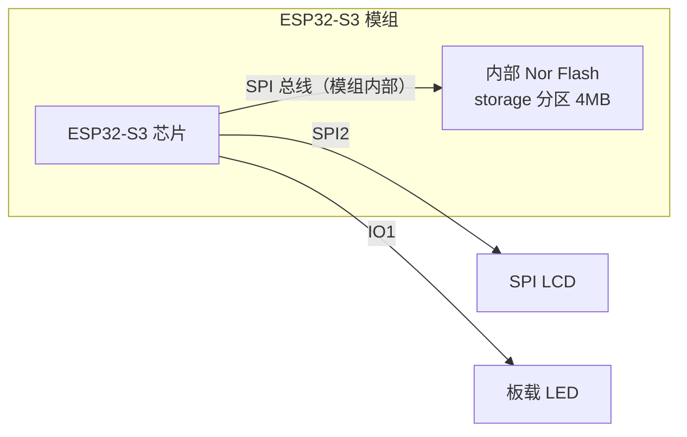
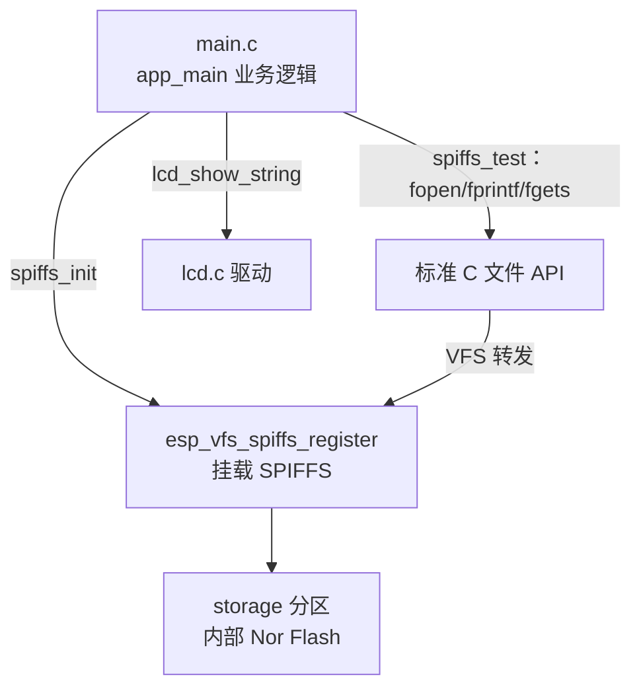
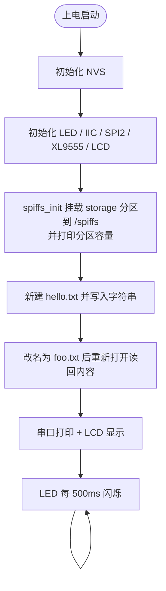

# 27 SPIFFS 实验

> 平台：正点原子 ESP32-S3 开发板 ｜ 框架：ESP-IDF ｜ 难度：★★☆☆☆
>
> 一句话简介：把 ESP32-S3 **内部 Nor Flash** 的一块分区挂载成 SPIFFS 文件系统，用标准 C 文件接口完成新建、写入、改名、读取一整套操作。

---

## 1. 实验简介

不插 SD 卡，ESP32-S3 芯片内部的 Nor Flash（本工程为 16MB）也能存文件！只要在**分区表**里划一块地（本实验是名为 `storage` 的 4MB SPIFFS 分区），用 `esp_vfs_spiffs_register()` 挂载之后，就能用 `fopen / fprintf / fgets` 这些和电脑上完全一样的 C 语言文件函数来读写它。

本实验的完整动作：在 `/spiffs/hello.txt` 写入字符串 → 改名为 `foo.txt` → 读回内容 → 显示到 LCD 和串口。

学完本实验你将掌握：

- ESP-IDF 分区表中 SPIFFS 分区的作用；
- 用 `esp_vfs_spiffs_register()` 挂载 SPIFFS 文件系统；
- 挂载后用标准 C 文件 API（VFS）读写掉电不丢失的数据。

## 2. 生活类比

把内部 Flash 想象成手机的**内置存储**，SD 卡则是**外置存储卡**：

- 分区表 = 房子的户型图，提前划定「这间房做卧室（app 分区）、那间做储物间（storage 分区）」；
- `esp_vfs_spiffs_register()` = 给储物间装上门牌和货架（挂载文件系统），之后才能往里放东西；
- `/spiffs/hello.txt` = 货架上的一个盒子，路径就是盒子上的标签；
- SPIFFS 的特点 = 储物间是「一层平铺」的，**只能放盒子不能搭隔间**（没有真正的目录），但胜在抗震耐用（自带磨损均衡，适合频繁小量读写）。

## 3. 硬件连接

### 引脚分配

| 元件 | 开发板引脚 | 说明 |
| :--- | :--- | :--- |
| SPIFFS | 芯片内部 Flash | 无需外接任何硬件 |
| LCD | SPI LCD 模块 | SPI2，显示读取到的文件内容 |
| LED（板载） | IO1 | 每 500ms 闪烁 |

> 本实验的主角是**芯片内部的 Nor Flash**，一根 USB 线即可，无任何外接元件；LCD 仅用于展示结果。

### 连接图



## 4. 程序架构

`main.c` 里的 `spiffs_init()` 负责挂载分区，`spiffs_test()` 负责文件读写演示，底层由 ESP-IDF 的 VFS（虚拟文件系统）把标准 C 文件函数「翻译」到 SPIFFS 上。



## 5. 程序流程



## 6. 核心代码讲解

### 6.1 挂载 SPIFFS 分区（`main.c`）

```c
esp_err_t spiffs_init(char *partition_label, char *mount_point, size_t max_files)
{
    /* 配置spiffs文件系统各个参数 */
    esp_vfs_spiffs_conf_t conf = {
        .base_path = mount_point,             /* 挂载路径前缀 "/spiffs" */
        .partition_label = partition_label,   /* 分区表里的分区名 "storage" */
        .max_files = max_files,               /* 最多同时打开 5 个文件 */
        .format_if_mount_failed = true,       /* 挂载失败则自动格式化 */
    };

    /* 使用上面定义的设置来初始化和挂载SPIFFS文件系统 */
    esp_err_t ret_val = esp_vfs_spiffs_register(&conf);
    ...
    /* 打印SPIFFS存储信息 */
    size_t total = 0, used = 0;
    ret_val = esp_spiffs_info(conf.partition_label, &total, &used);
    ESP_LOGI(TAG, "Partition size: total: %d, used: %d", total, used);
    return ret_val;
}
```

**讲解**：`esp_vfs_spiffs_conf_t` 是「挂载申请表」，四个字段各司其职：

- `partition_label = "storage"` 对应分区表 `partitions-16MiB.csv` 里的这一行——名字必须完全一致，否则报 `ESP_ERR_NOT_FOUND`：

```csv
storage,  data,     spiffs,      0xc00000,   0x400000, ,
```

- `base_path = "/spiffs"`：挂载后所有以 `/spiffs/` 开头的路径都落到这块分区；
- `format_if_mount_failed = true`：第一次使用（分区还是空白）时自动格式化，非常省心；
- 挂载成功后 `esp_spiffs_info()` 可以查到分区总大小和已用大小。

### 6.2 文件读写演示（`main.c`）

```c
void spiffs_test(void)
{
    /* 建立一个名为/spiffs/hello.txt的只写文件 */
    FILE* f = fopen("/spiffs/hello.txt", "w");
    if (f == NULL) { ESP_LOGE(TAG, "Failed to open file for writing"); return; }

    fprintf(f, WRITE_DATA);          /* 写入 "ALIENTEK ESP32-S3" */
    fclose(f);

    /* 重命名之前检查目标文件是否存在 */
    struct stat st;
    if (stat("/spiffs/foo.txt", &st) == 0)
    {
        unlink("/spiffs/foo.txt");   /* 存在则先删除，否则改名会失败 */
    }

    /* 重命名创建的文件 */
    if (rename("/spiffs/hello.txt", "/spiffs/foo.txt") != 0)
    {
        ESP_LOGE(TAG, "Rename failed");
        return;
    }

    /* 打开重命名的文件并读取 */
    f = fopen("/spiffs/foo.txt", "r");
    char line[64];
    fgets(line, sizeof(line), f);
    fclose(f);

    ESP_LOGI(TAG, "Read from file: '%s'", line);
    lcd_show_string(90, 110, 200, 16, 16, line, RED);   /* 显示到LCD */
}
```

**讲解**：这段代码就是教科书式的 C 语言文件操作四部曲——`fopen` 打开、`fprintf/fgets` 读写、`fclose` 关闭，外加 `stat/unlink/rename` 做文件管理。特别之处只有一点：这些标准函数经过 ESP-IDF 的 **VFS 层**转发，实际读写的是芯片内部 Flash，而且**掉电不丢失**。注意 `rename` 前先 `unlink` 掉同名旧文件，因为目标文件已存在时改名会失败（每次复位程序都会重新跑一遍写入流程）。

## 7. 实验效果

烧录复位后，LCD 显示 "ESP32 / SPIFFS TEST / ATOM@ALIENTEK"。串口依次打印：

```
I (xxx) spiffs: Partition size: total: xxxxx, used: xxxxx
I (xxx) spiffs: Opening file
I (xxx) spiffs: File written
I (xxx) spiffs: Renaming file
I (xxx) spiffs: Reading file
I (xxx) spiffs: Read from file: 'ALIENTEK ESP32-S3'
```

同时 LCD 的 "Read file:" 后面显示出刚读回的字符串 `ALIENTEK ESP32-S3`，板载 LED 每 500ms 闪烁。断电重启后文件内容依然保存在 Flash 里。

## 8. 注意事项

1. SPIFFS 是**平坦文件系统，不支持目录**，`/spiffs/a/b.txt` 这种多级路径是无效的（`/spiffs` 只是挂载前缀）。
2. SPIFFS 自带磨损均衡，适合存放小文件、频繁少量读写的场景；存大文件请考虑 FAT 分区或 SD 卡。
3. 分区名（`storage`）必须与分区表 CSV 中的名称一致，且分区类型 subtype 为 `spiffs`。
4. 写入 Flash 比写 RAM 慢得多，不要在高频循环里反复写文件。
5. `format_if_mount_failed = true` 时，分区数据损坏会被自动格式化清空，重要数据请自行做好备份策略。

## 9. 编译与烧录

```bash
idf.py set-target esp32s3   # 首次配置目标芯片
idf.py build                # 编译
idf.py -p COMx flash monitor  # 烧录并打开串口监视器（COMx 换成你的端口号）
```

> 完整的开发环境搭建与烧录说明见 [根目录 README](../README.md)。

---

## 小结

本实验用不到 100 行代码演示了「内部 Flash 当硬盘用」的完整流程：挂载分区 → 标准 C 接口读写 → 掉电数据保留。有了 SPIFFS，保存配置文件、日志、网页素材等都不再需要外挂存储芯片，这是 ESP32 相比传统单片机的一大便利。

| 关键 API | 作用 |
| :--- | :--- |
| `esp_vfs_spiffs_register()` | 挂载 SPIFFS 分区到指定路径 |
| `esp_spiffs_info()` | 查询分区总大小与已用大小 |
| `esp_vfs_spiffs_unregister()` | 卸载 SPIFFS 文件系统 |
| `fopen()` / `fprintf()` / `fgets()` / `fclose()` | 标准 C 文件读写 |
| `stat()` / `unlink()` / `rename()` | 查询、删除、重命名文件 |
