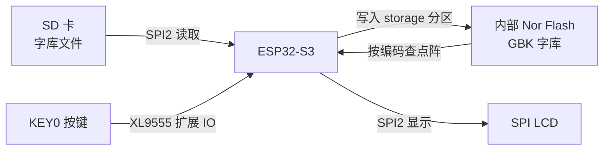
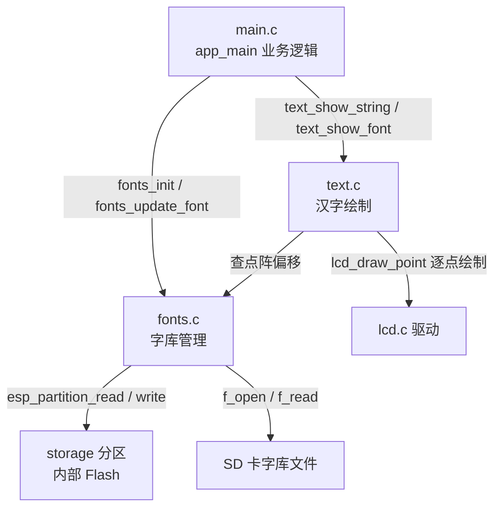
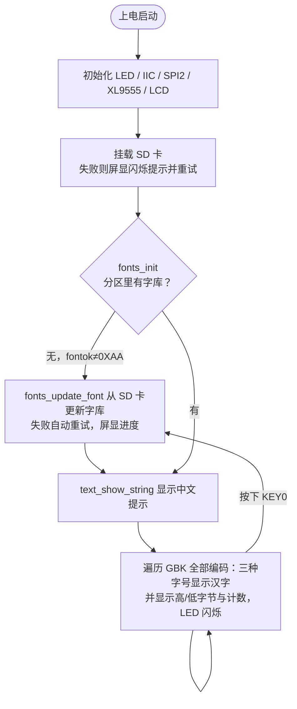

# 28 汉字显示实验

> 平台：正点原子 ESP32-S3 开发板 ｜ 框架：ESP-IDF ｜ 难度：★★★☆☆
>
> 一句话简介：搞懂**汉字是怎么显示出来的**——把 GBK 字库从 SD 卡烧进内部 Flash 分区，然后按编码查字库、逐点显示汉字，并遍历展示整个 GBK 字符集。

---

## 1. 实验简介

LCD 驱动本身只认识「点」，并不认识「字」。英文字母数量少，可以做成字模数组编在程序里；而汉字有几万个，字库数据高达几 MB，必须存放在外部存储中，显示时**按编码去字库里查点阵数据**。

本实验的完整链路：

1. 上电检查内部 Flash 的 `storage` 分区里有没有字库（看标志位 `fontok` 是否为 0XAA）；
2. 没有就从 **SD 卡**（`0:/SYSTEM/FONT/` 下的 UNIGBK.BIN、GBK12.FON、GBK16.FON、GBK24.FON）把字库更新到分区里；
3. 字库就绪后，用 `text_show_string()` 在 LCD 显示汉字；
4. 主循环遍历**全部 GBK 编码**（高字节 0x81~0xFE、低字节 0x40~0xFE，跳过 0x7F），轮流显示每个汉字在 12 / 16 / 24 三种字号下的样子；
5. 按 KEY0 可强制重新更新字库。

学完本实验你将掌握：

- 汉字显示的原理：GBK 编码 → 字库偏移 → 点阵数据 → 逐点绘制；
- 用 `esp_partition_read/write/erase` 直接读写 Flash 分区；
- 用 FatFs 从 SD 卡读取字库文件。

## 2. 生活类比

显示汉字就像**查字典**：

- GBK 编码 = 每个汉字的「拼音索引」，两个字节定位唯一一个汉字；
- 字库文件 = 字典正文，按编码顺序把每个字的「点阵笔画」排好存放；
- `text_show_font()` = 查字典的动作：拿编码算出这个字在字典第几页（Flash 偏移地址），把那一页的点阵抄出来，照着描到屏幕上；
- 字库更新 = 家里字典丢了，先去书店（SD 卡）买一本放回书架（storage 分区），以后随时可查；
- KEY0 强制更新 = 觉得字典破损了，主动再去买本新的。

## 3. 硬件连接

### 引脚分配

| 元件 | 开发板引脚 | 说明 |
| :--- | :--- | :--- |
| LED（板载） | IO1 | 遍历字符时闪烁 |
| KEY0 | XL9555 扩展 IO1_7 | 按下强制更新字库 |
| XL9555 | IIC_SCL-IO42 / IIC_SDA-IO41 | IO 扩展芯片，接按键 |
| SD 卡 | SPI2 总线 | 存放字库文件（FAT 格式） |
| LCD | SPI LCD 模块 | SPI2，显示汉字 |
| 字库存储 | 内部 Flash `storage` 分区 | 4MB，掉电不丢 |

### 连接图



## 4. 程序架构

`main.c` 负责业务流程；`fonts.c` 负责字库的「仓库管理」——检查、从 SD 卡搬运、读写 Flash 分区；`text.c` 负责「查字 + 画字」，对外提供 `text_show_string()` 和 `text_show_font()`。



## 5. 程序流程



## 6. 核心代码讲解

### 6.1 字库检查与更新（`main.c`）

```c
while (fonts_init())                                /* 检测字库 */
{
UPD:
    lcd_clear(WHITE);                               /* 清屏 */
    lcd_show_string(30, 30, 200, 16, 16, "ESP32-S3", RED);

    key = fonts_update_font(30, 50, 16, (uint8_t *)"0:", RED);  /* 更新字库 */

    while (key)                                     /* 更新失败 */
    {
        lcd_show_string(30, 50, 200, 16, 16, "Font Update Failed!", RED);
        vTaskDelay(200);
        lcd_fill(20, 50, 200 + 20, 90 + 16, WHITE);
        vTaskDelay(200);
    }

    lcd_show_string(30, 50, 200, 16, 16, "Font Update Success!   ", RED);
    vTaskDelay(1500);
    lcd_clear(WHITE);
}
```

**讲解**：`fonts_init()` 内部用 `esp_partition_find_first()` 找到名为 `storage` 的分区，读出字库信息头 `ftinfo`，检查标志 `fontok` 是否为 **0XAA**——是则说明字库已烧录，直接返回 0；否则进入 `fonts_update_font()`，从 SD 卡 `0:/SYSTEM/FONT/` 目录依次读取 **UNIGBK.BIN（Unicode↔GBK 对照表）、GBK12 / GBK16 / GBK24（三种字号的点阵字库）**，边读边擦写进 Flash 分区，屏幕上还会显示更新进度。`UPD:` 是循环里的一个标签，后面按 KEY0 会 `goto` 回这里强制更新。

### 6.2 显示汉字字符串（`main.c`）

```c
text_show_string(30, 30, 200, 16, "正点原子ESP32-S3开发板", 16, 0, RED);
text_show_string(30, 50, 200, 16, "GBK字库测试程序", 16, 0, RED);
text_show_string(30, 90, 200, 16, "KEY0: 更新字库", 16, 0, RED);

text_show_string(30, 180, 200, 24, "对应汉字为:", 24, 0, BLUE);
text_show_string(30, 204, 200, 16, "对应汉字为:", 16, 0, BLUE);
text_show_string(30, 220, 200, 12, "对应汉字为:", 12, 0, BLUE);
```

**讲解**：`text_show_string()` 与普通的 `lcd_show_string()` 用法几乎一样，多了对汉字的识别：它逐个扫描字符串字节，**遇到双字节 GBK 编码（高字节 ≥ 0x81）就去字库查点阵**，遇到单字节 ASCII 则用内置英文字模。同一句「对应汉字为:」用 24 / 16 / 12 三种字号显示，验证三套字库都工作正常。

### 6.3 遍历 GBK 字符集（`main.c`）

```c
while (1)
{
    fontcnt = 0;

    for (i = 0x81; i < 0xFF; i++)                   /* GBK汉字高字节范围0x81~0xFE */
    {
        fontx[0] = i;
        lcd_show_num(118, 110, i, 3, 16, BLUE);     /* 显示汉字高字节 */

        for (j = 0x40; j < 0xFE; j++)               /* GBK汉字低字节范围0x40~0x7E、0x80~0xFE */
        {
            if (j == 0x7F) continue;                /* 0x7F 是空档，跳过 */

            fontcnt++;
            lcd_show_num(118, 130, j, 3, 16, BLUE); /* 显示汉字低字节 */
            lcd_show_num(118, 150, fontcnt, 5, 16, BLUE); /* 汉字计数显示 */
            fontx[1] = j;

            text_show_font(30 + 132, 180, fontx, 24, 0, BLUE);  /* 三种字号显示该汉字 */
            text_show_font(30 + 144, 204, fontx, 16, 0, BLUE);
            text_show_font(30 + 108, 220, fontx, 12, 0, BLUE);

            t = 200;
            while ((t--) != 0)                      /* 延时，同时扫描按键 */
            {
                vTaskDelay(1);
                key = xl9555_key_scan(0);
                if (key == KEY0_PRES)
                {
                    goto UPD;                       /* 跳转到UPD位置，强制更新字库 */
                }
            }
            LED_TOGGLE();
        }
    }
}
```

**讲解**：这段代码把 GBK 汉字区**从头到尾翻了一遍**——外层循环高字节 0x81~0xFE，内层循环低字节 0x40~0xFE（跳过 0x7F），组成两字节编码 `fontx[2]` 交给 `text_show_font()` 单独显示一个汉字。每个字停留约 200ms，期间持续扫描 KEY0，按下就 `goto UPD` 重新更新字库。看完整个字符集约有两万多字，相当于把字典逐页翻了一遍，直观验证字库的完整性。

### 6.4 Flash 分区读写（`fonts.c`，节选）

```c
storage_partition = esp_partition_find_first(ESP_PARTITION_TYPE_DATA,
                                             ESP_PARTITION_SUBTYPE_ANY, "storage");
...
err = esp_partition_read(storage_partition, offset, buffer, length);   /* 分区读取 */
err = esp_partition_write(storage_partition, offset, buffer, length);  /* 分区写入 */
err = esp_partition_erase_range(storage_partition, offset, SECTOR_SIZE); /* 分区擦除 */
```

**讲解**：字库不是通过文件系统、而是用 `esp_partition_xxx` 系列函数**按裸偏移地址**直接读写分区的——因为字库本质就是一大坨按编码排序的点阵数据，「编码 → 偏移地址」可以直接算出来，比文件系统更快更省内存。注意 Flash 写入前必须先擦除（按 4KB 扇区），这是 Nor Flash 的物理特性。

## 7. 实验效果

烧录复位后：

1. 若 `storage` 分区没有字库，屏幕提示更新，自动从 SD 卡把 4 个字库文件烧入分区，并显示更新进度，完成后提示 "Font Update Success!"；
2. 字库就绪后，LCD 用中文显示「正点原子ESP32-S3开发板 / GBK字库测试程序 / KEY0: 更新字库」等信息；
3. 下方开始**自动遍历 GBK 字符集**：实时显示当前汉字的高字节、低字节、累计计数，并用 24 / 16 / 12 三种字号显示对应汉字，LED 随遍历闪烁；
4. 任意时刻按下 **KEY0**，程序跳回更新流程，强制重新从 SD 卡更新字库。

## 8. 注意事项

1. SD 卡必须为 **FAT 格式**，且字库文件放在 `SYSTEM/FONT/` 目录下（UNIGBK.BIN、GBK12.FON、GBK16.FON、GBK24.FON），缺一个都会更新失败。
2. 首次更新字库要搬运几 MB 数据到 Flash，**耗时较长**（屏幕有进度提示），期间不要断电。
3. 字库写在 `storage` 分区，**掉电不丢失**；只要分区没被擦除，下次上电 `fonts_init()` 直接通过，不用重新更新。
4. 源代码文件为 **GBK 编码**，用 VSCode 等编辑器打开若显示乱码，请切换文件编码为 GBK；字符串常量也必须是 GBK 编码才能正确查库显示。
5. KEY0 接在 XL9555 扩展 IO1_7 上，必须先 `xl9555_init()` 才能扫描按键。

## 9. 编译与烧录

```bash
idf.py set-target esp32s3   # 首次配置目标芯片
idf.py build                # 编译
idf.py -p COMx flash monitor  # 烧录并打开串口监视器（COMx 换成你的端口号）
```

> 完整的开发环境搭建与烧录说明见 [根目录 README](../README.md)。

---

## 小结

本实验揭示了汉字显示的本质：**编码是索引、字库是正文、显示是查字典后逐点描画**。这套「外存字库 + 编码查表」的方案同样适用于日文、韩文乃至 emoji，做任何需要显示非 ASCII 文字的界面时都用得上。

| 关键 API | 作用 |
| :--- | :--- |
| `fonts_init()` | 检查 storage 分区中字库是否有效 |
| `fonts_update_font()` | 从 SD 卡把字库文件烧入 Flash 分区 |
| `text_show_string()` | 在 LCD 显示含汉字的字符串 |
| `text_show_font()` | 按 GBK 编码显示单个汉字 |
| `esp_partition_find_first()` | 按名称查找 Flash 分区 |
| `esp_partition_read/write/erase_range()` | 裸读写 / 擦除分区数据 |
| `xl9555_key_scan()` | 扫描接在 IO 扩展芯片上的按键 |
