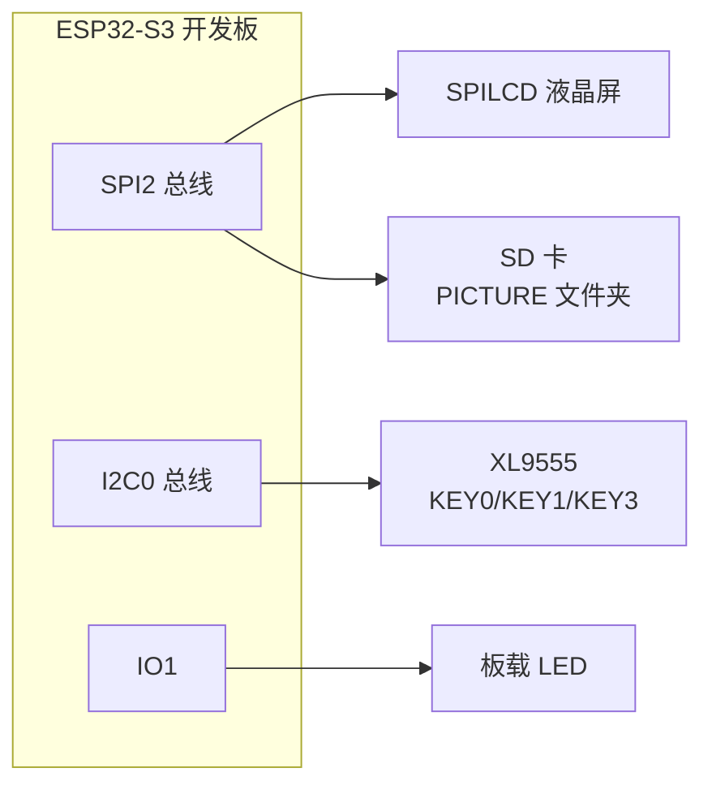
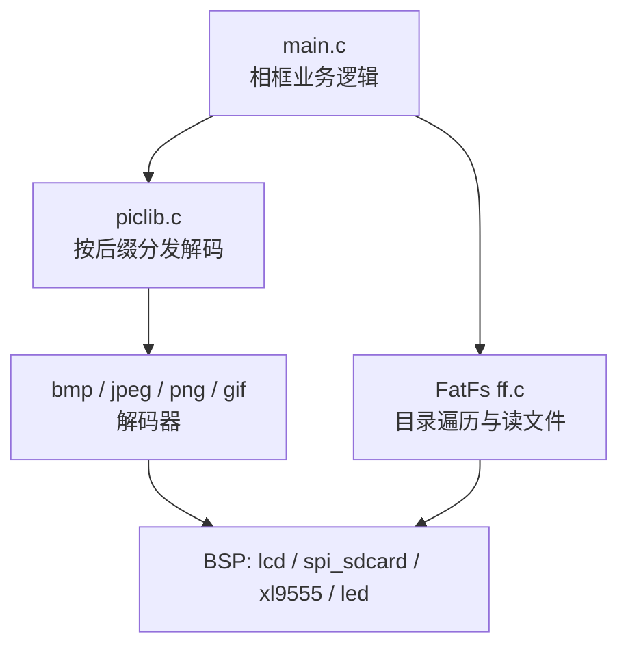
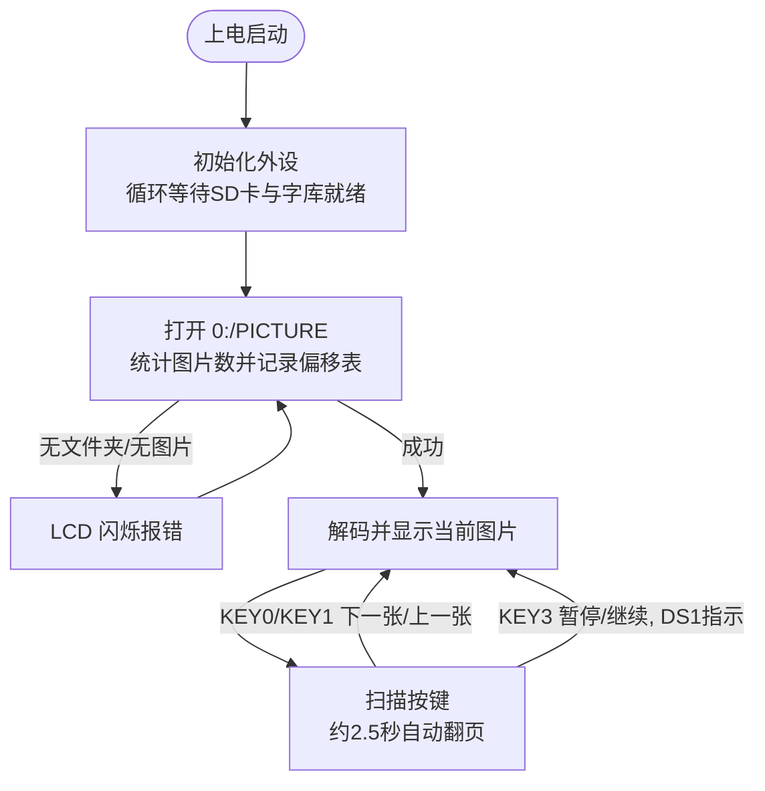

# 29 图片显示实验（数码相框）

> 平台：正点原子 ESP32-S3 开发板 ｜ 框架：ESP-IDF ｜ 难度：★★★☆☆
>
> 一句话简介：从 SD 卡读取 PICTURE 文件夹里的图片，解码后显示到 LCD 上，用按键翻页，做一个简易**数码相框**。

---

## 1. 实验简介

本实验把前面学过的 SD 卡（FatFs 文件系统）、SPI LCD、图片解码库全部串起来：开机后先检测 SD 卡和字库，然后在 SD 卡根目录查找 `PICTURE` 文件夹，把里面的图片（支持 **bmp / jpg / jpeg / png / gif** 五种格式）一张张解码显示到 LCD 上，默认约 2.5 秒自动切换下一张。

学完本实验你将掌握：

- 用 FatFs 的 `f_opendir()` / `f_readdir()` 遍历文件夹、统计图片数量；
- 用 `piclib_ai_load_picfile()` 按文件后缀自动选择解码器（BMP/JPEG/PNG/GIF）；
- 通过 XL9555 扩展按键实现「上一张 / 下一张 / 暂停」。

## 2. 生活类比

这个实验就像一台**电子相册**：

- SD 卡 = 相册里的存储卡，`PICTURE` 文件夹 = 「我的照片」这一册；
- 程序开机先「数一遍有多少张照片」（`pic_get_tnum`），并给每张照片记一个页码（offset 表）；
- 显示图片 = 翻到某一页把照片摊开给你看（解码 + 刷屏）；
- KEY0/KEY1 = 手动翻页，KEY3 = 「先别翻，让我仔细看看」（暂停，DS1 常亮提示）。

## 3. 硬件连接

### 引脚分配

| 元件 | 开发板引脚 | 说明 |
| :--- | :--- | :--- |
| LED（板载） | IO1 | 闪烁指示程序运行 |
| KEY0（经 XL9555） | IO1_7 | 下一张图片 |
| KEY1（经 XL9555） | IO1_6 | 上一张图片 |
| KEY3（经 XL9555） | IO1_4 | 暂停 / 继续 |
| XL9555 IIC_SCL | IO42 | IO 扩展芯片时钟线 |
| XL9555 IIC_SDA | IO41 | IO 扩展芯片数据线 |
| SPILCD（1.3/2.4 寸） | SPI2 总线 | 显示图片 |
| SD 卡 | SPI2 总线 | 存放 PICTURE 文件夹 |
| 串口 | IO4（TX）/ IO5（RX） | IO4 接串口转 TTL 的 RXD，IO5 接 TXD |

### 连接图



## 4. 程序架构

代码分三层：`main.c` 负责相框业务逻辑；`APP/` 下的 piclib + 各格式解码器负责「把图片变成像素」；`components/BSP` 负责 LCD、SD 卡、XL9555 等底层驱动。



## 5. 程序流程



## 6. 核心代码讲解

### 6.1 统计图片数量（`main.c`）

```c
uint16_t pic_get_tnum(char *path)
{
    uint8_t res;
    uint16_t rval = 0;
    FF_DIR tdir;                                    /* 临时目录 */
    FILINFO *tfileinfo;                             /* 临时文件信息 */
    tfileinfo = (FILINFO *)malloc(sizeof(FILINFO)); /* 申请内存 */
    res = f_opendir(&tdir, (const TCHAR *)path);    /* 开目录 */

    if (res == FR_OK && tfileinfo)
    {
        while (1)                                   /* 查询总的文件数 */
        {
            res = f_readdir(&tdir, tfileinfo);      /* 读取目录下的一个文件 */
            if (res != FR_OK || tfileinfo->fname[0] == 0)break; /* 读完了,退出 */
            res = exfuns_file_type(tfileinfo->fname);
            if ((res & 0X0F) != 0X00)               /* 是不是图片文件 */
            {
                rval++;                             /* 有效文件数加1 */
            }
        }
    }
    free(tfileinfo);
    return rval;
}
```

**讲解**：`f_opendir()` 打开文件夹、`f_readdir()` 逐个取出文件信息，读到空文件名代表目录结束。`exfuns_file_type()` 根据后缀返回文件类型，低 4 位非 0 就是图片。之后主程序再遍历一次，把每张图片在目录中的偏移 `picdir.dptr` 记进 `picoffsettbl[]` 表——这样「翻到第 N 张」时用 `atk_dir_sdi()` 直接把目录指针定位到该偏移，不必从头重新扫描。

### 6.2 显示图片 + 按键控制（`main.c`）

```c
strcpy((char *)pname, "0:/PICTURE/");                                   /* 构建路径(目录) */
strcat((char *)pname, (const char *)picfileinfo->fname);                /* 将文件名接在后面 */
lcd_clear(BLACK);
piclib_ai_load_picfile(pname, 0, 0, lcd_self.width, lcd_self.height);   /* 显示图片 */
text_show_string(2, 2, lcd_self.width, 16, (char *)pname, 16, 0, RED);  /* 显示图片名称 */

while (1)
{
    key = xl9555_key_scan(0);   /* 扫描按键 */
    if (t > 250)key = 1;        /* 模拟一次按键KEY0, 自动翻页 */
    if ((t % 20) == 0) LED_TOGGLE();    /* LED闪烁,表示程序正在运行 */

    if (key == KEY1_PRES)       /* 上一张 */
    {
        if (curindex) curindex--;
        else curindex = totpicnum - 1;
        break;
    }
    else if (key == KEY0_PRES)  /* 下一张 */
    {
        curindex++;
        if (curindex >= totpicnum) curindex = 0;   /* 到末尾时,自动从头开始 */
        break;
    }
    else if (key == KEY3_PRES)
    {
        pause = !pause;
        LED(pause);             /* 暂停的时候,DS1亮 */
    }
    if (pause == 0)t++;         /* 只有非暂停状态才累计时间 */
    vTaskDelay(10);
}
```

**讲解**：`break` 跳出内层按键循环后，外层循环会用新的 `curindex` 重新定位目录并显示下一张。`t` 每 10ms 加一次，超过 250 次（约 2.5 秒）就模拟一次 KEY0，实现自动轮播；暂停时 `t` 不再累加，画面就停住了。

### 6.3 按格式分发解码（`piclib.c`）

```c
uint8_t piclib_ai_load_picfile(char *filename, uint16_t x, uint16_t y, uint16_t width, uint16_t height)
{
    uint8_t res = 0;
    uint8_t temp;
    ...
    temp = exfuns_file_type(filename);   /* 得到文件的类型 */

    switch (temp)
    {
        case T_BMP:  res = bmp_decode(filename, width, height);          break; /* 解码BMP */
        case T_JPG:
        case T_JPEG: res = jpeg_decode(filename, width, height);         break; /* 解码JPG/JPEG */
        case T_GIF:  res = gif_decode(filename, x, y, width, height);     break; /* 解码gif */
        case T_PNG:  res = png_decode(filename, width, height);           break; /* 解码PNG */
        default:     res = PIC_FORMAT_ERR;                               break; /* 非图片格式 */
    }
    return res;
}
```

**讲解**：这就是「ai（自动识别）」的含义——根据后缀名选择对应的解码器，解码结果直接写进 LCD 显存。JPEG 用的是 TJpgDec 库，PNG 用的是 pngle 库，都是专为小内存 MCU 设计的轻量解码器。

## 7. 实验效果

1. 上电后 LCD 先显示实验信息，随后进入图片浏览：自动逐张显示 `PICTURE` 文件夹内的图片，左上角红字显示当前图片路径；
2. 按 **KEY0** 切到下一张、**KEY1** 切到上一张、**KEY3** 暂停/继续（暂停时 DS1 常亮）；
3. LED 周期性闪烁表示程序运行；SD 卡没插好或没有 PICTURE 文件夹/图片时，LCD 红字闪烁报错。

## 8. 注意事项

1. 串口通讯波特率为 **115200**，建议使用 **XCOM 串口调试助手**（其他串口软件可能控制 DTR/RST 导致 MCU 复位、程序不运行）。
2. USB 转串口连接方式：**IO4 接串口转 TTL 模块的 RXD、IO5 接 TXD**，再连电脑。
3. SD 卡必须正确插入板载卡槽，且根目录下要有 `PICTURE` 文件夹（FAT32/FAT16/exFAT 格式），图片文件建议不要太大，否则解码慢、占内存。
4. 字库文件首次运行会自动从 SD 卡更新到 Flash，请保证 SD 卡里有正点原子提供的字库文件。

## 9. 编译与烧录

```bash
idf.py set-target esp32s3
idf.py build
idf.py -p COMx flash monitor  # COMx 换成你的端口号
```

> 完整的开发环境搭建与烧录说明见 [根目录 README](../README.md)。

---

## 小结

本实验完成了一个「读卡 → 解码 → 刷屏 → 按键交互」的完整数码相框，是文件系统、图片解码、LCD 驱动三大知识点的综合演练。核心思路是：先遍历目录建立图片偏移表，再靠偏移表随机翻页，避免每次都从头扫描目录。

| 关键 API | 作用 |
| :--- | :--- |
| `f_opendir()` / `f_readdir()` | 打开文件夹 / 逐个读取文件信息 |
| `exfuns_file_type()` | 按后缀判断文件类型（是否图片） |
| `atk_dir_sdi()` | 把目录指针定位到指定偏移，实现随机翻页 |
| `piclib_ai_load_picfile()` | 自动识别格式并解码显示图片 |
| `xl9555_key_scan()` | 扫描接在 IO 扩展芯片上的按键 |
