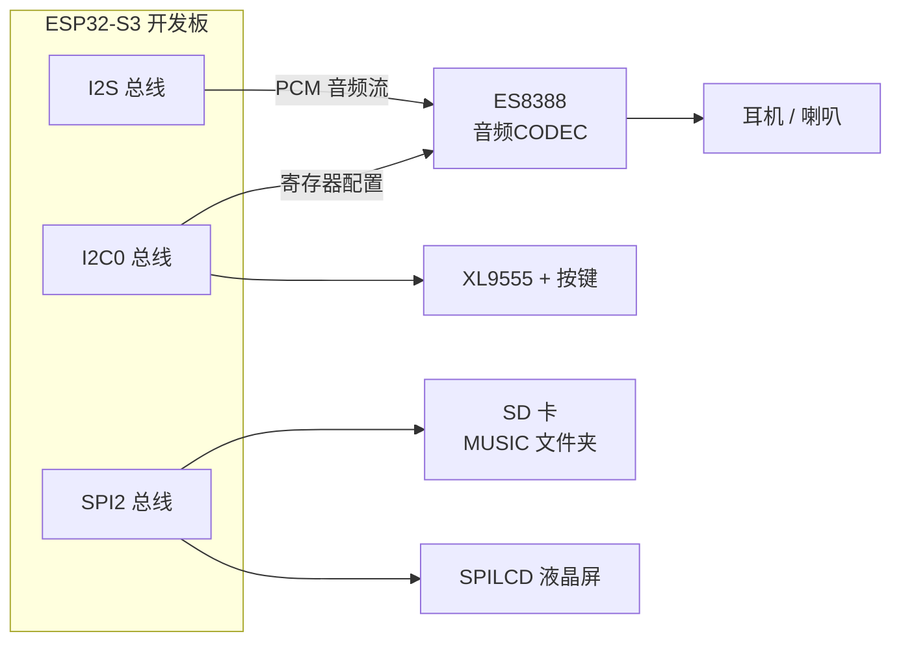
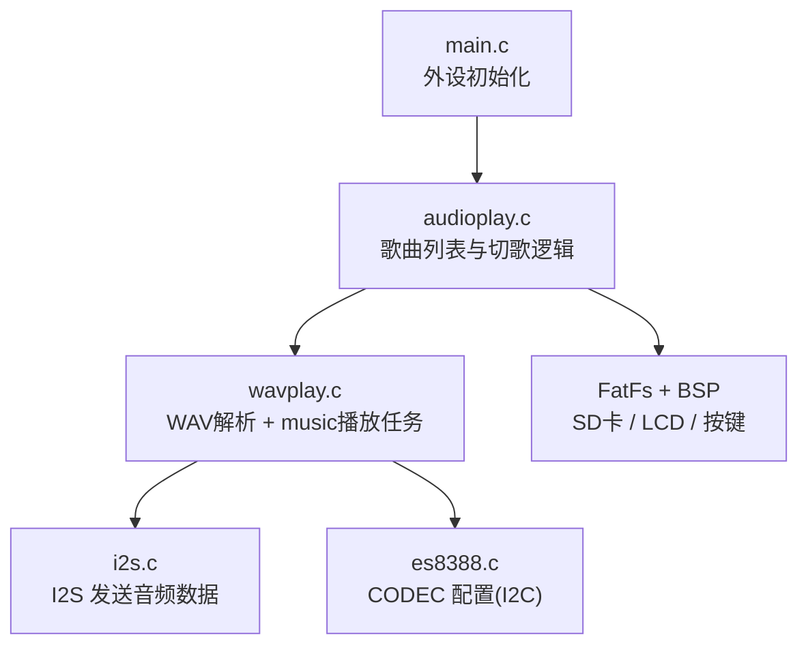
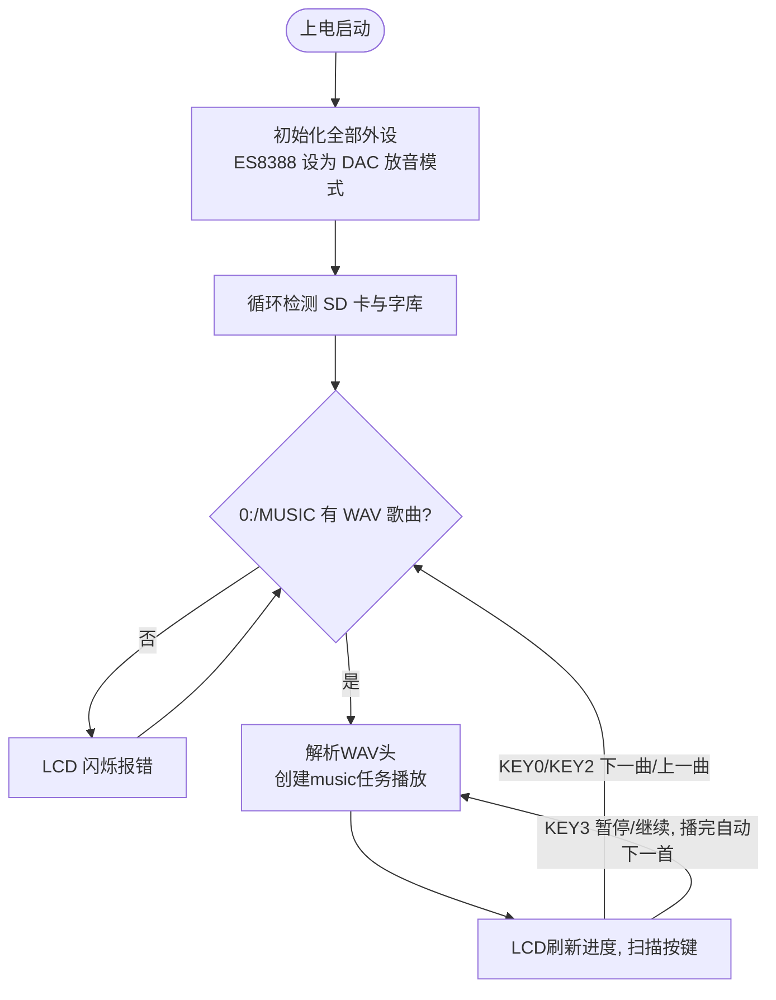

# 30 音乐播放器实验

> 平台：正点原子 ESP32-S3 开发板 ｜ 框架：ESP-IDF ｜ 难度：★★★★☆
>
> 一句话简介：用 **ES8388 音频编解码芯片 + I2S 总线**播放 SD 卡 MUSIC 文件夹里的 WAV 歌曲，LCD 显示歌名和进度，按键切歌，做一台简易 MP3。

---

## 1. 实验简介

ESP32-S3 自己不能直接「发声」，它输出的只是数字信号。本实验通过 **I2S 数字音频总线**把 WAV 文件的 PCM 数据源源不断地送给 **ES8388**（一颗音频 CODEC 芯片），由它做数模转换（DAC）后驱动耳机和喇叭，就听到了音乐。

学完本实验你将掌握：

- ES8388 的初始化：I2C 配置寄存器，选择 DAC 输出、设置耳机/喇叭音量；
- I2S 的初始化与采样率/位宽动态切换（16bit / 24bit）；
- WAV 文件头解析（采样率、声道数、数据区位置）与「读文件 → 写 I2S」的播放任务。

## 2. 生活类比

把整套系统想象成一家**唱片店**：

- SD 卡 MUSIC 文件夹 = 唱片架，WAV 文件 = 一张张唱片；
- `wav_decode_init()` = 播放前先看唱片封底（解析文件头：多快、几声道、数据从哪开始）；
- music 任务 = 唱机：不停地从唱片上读一段 groove（`f_read`），交给……
- I2S 总线 = 传送带，把数字音频流送到……
- ES8388 = 功放师，把数字信号变成模拟声音推给耳机/喇叭。

## 3. 硬件连接

### 引脚分配

| 元件 | 开发板引脚 | 说明 |
| :--- | :--- | :--- |
| LED（板载） | IO1 | 闪烁指示程序运行 |
| KEY0（经 XL9555） | IO1_7 | 下一曲 |
| KEY1（经 XL9555） | IO1_6 | 未使用 |
| KEY2（经 XL9555） | IO1_5 | 上一曲 |
| KEY3（经 XL9555） | IO1_4 | 暂停 / 继续 |
| XL9555 IIC_SCL | IO42 | IO 扩展芯片时钟线 |
| XL9555 IIC_SDA | IO41 | IO 扩展芯片数据线 |
| ES8388 | I2C0 + I2S 总线 | 音频编解码芯片（板载） |
| SPILCD（1.3/2.4 寸） | SPI2 总线 | 显示歌名、进度 |
| SD 卡 | SPI2 总线 | 存放 MUSIC 文件夹 |

### 连接图



## 4. 程序架构



## 5. 程序流程



## 6. 核心代码讲解

### 6.1 配置 ES8388 与 I2S（`main.c`）

```c
es8388_init(i2c0_master);       /* ES8388初始化 */
es8388_adda_cfg(1, 0);          /* 打开DAC关闭ADC */
es8388_input_cfg(0);
es8388_output_cfg(1, 1);        /* DAC选择通道1输出 */
es8388_hpvol_set(20);           /* 设置耳机音量 */
es8388_spkvol_set(20);          /* 设置喇叭音量 */
xl9555_pin_write(SPK_EN_IO, 0); /* 开喇叭 */
i2s_init();                     /* I2S初始化 */
```

**讲解**：ES8388 内部既有 ADC（录音用）又有 DAC（放音用），播放音乐只需 DAC，所以 `es8388_adda_cfg(1, 0)` 开 DAC 关 ADC。音量、输出通道都通过 I2C 写寄存器完成；喇叭使能脚挂在 XL9555 上，写 0 打开功放。

### 6.2 播放任务：读文件 → 写 I2S（`wavplay.c`）

```c
void music(void *pvParameters)
{
    ...
    while(1)
    {
        if ((g_audiodev.status & 0x0F) == 0x03)
        {
            f_lseek(g_audiodev.file, n ? res : wavctrl.datastart);  /* 跳过文件头 */

            for (uint16_t readTimes = 0; readTimes < (wavctrl.datasize / WAV_TX_BUFSIZE); readTimes++)
            {
                if ((g_audiodev.status & 0x0F) == 0x00)             /* 暂停播放 */
                {
                    res = f_tell(g_audiodev.file);                  /* 记录暂停位置 */
                    n = 1;
                    break;
                }
                ...
                f_read(g_audiodev.file, g_audiodev.tbuf, WAV_TX_BUFSIZE, (UINT*)&nr); /* 读文件 */
                i2s_table_size = i2s_table_size + i2s_tx_write(g_audiodev.tbuf, WAV_TX_BUFSIZE);
                vTaskDelay(1);
            }
        }
        else
        {
            vTaskDelay(10);
        }
    }
}
```

**讲解**：这是整个播放器的心脏，运行在一个独立的 FreeRTOS 任务里：

- `wavctrl.datastart` 是 WAV 文件 **data 块**的起始位置（前面全是文件头），`f_lseek()` 先跳过它；
- 每次 `f_read()` 读一块 PCM 数据，立刻用 `i2s_tx_write()` 送进 I2S 发送缓冲区——I2S 会按设定的采样率匀速「吐」给 ES8388，天然控制了播放速度；
- 暂停时用 `f_tell()` 记住文件位置，恢复时再 `f_lseek()` 跳回去，实现无缝续播。

### 6.3 按歌曲参数动态配置采样率（`wavplay.c`）

```c
if (wavctrl.bps == 16)
{
    es8388_sai_cfg(0, 3);       /* 飞利浦标准,16位数据长度 */
    i2s_set_samplerate_bits_sample(wavctrl.samplerate, I2S_BITS_PER_SAMPLE_16BIT);
}
else if (wavctrl.bps == 24)
{
    es8388_sai_cfg(0, 0);       /* 飞利浦标准,24位数据长度 */
    i2s_set_samplerate_bits_sample(wavctrl.samplerate, I2S_BITS_PER_SAMPLE_24BIT);
}
```

**讲解**：不同 WAV 的采样率（44.1kHz、48kHz…）和位宽（16/24bit）不一样，必须**每换一首歌就重新配置** ES8388 和 I2S，否则声音会变调或有噪声。参数都来自 `wav_decode_init()` 对文件头的解析。

## 7. 实验效果

1. 上电初始化后，自动循环播放 SD 卡 `MUSIC` 文件夹里的 WAV 歌曲；
2. LCD 显示**歌名、当前播放时间 / 总时间、歌曲总数与当前编号**；
3. **KEY0** 下一曲、**KEY2** 上一曲、**KEY3** 暂停/继续；播完一首自动播下一首；
4. LED 闪烁指示程序运行，耳机/喇叭可听到声音。

## 8. 注意事项

1. 串口通讯波特率为 **115200**，建议使用 **XCOM 串口调试助手**（其他串口软件可能控制 DTR/RST 导致复位）。
2. SD 卡需正确插入板载卡槽，并**手动在根目录创建 `MUSIC` 文件夹**，把歌曲拷进去；本实验**仅支持 WAV 格式**（未压缩 PCM），MP3 需要解码芯片方案，代码中仅预留了分支。
3. WAV 的采样率/位宽要常见规格（如 44.1kHz/16bit），过于冷门的参数可能导致播放异常。
4. 首次运行会自动从 SD 卡更新字库，请保证 SD 卡里有配套字库文件。

## 9. 编译与烧录

```bash
idf.py set-target esp32s3
idf.py build
idf.py -p COMx flash monitor  # COMx 换成你的端口号
```

> 完整的开发环境搭建与烧录说明见 [根目录 README](../README.md)。

---

## 小结

本实验打通了「SD 卡文件 → FatFs 读取 → I2S 发送 → ES8388 数模转换 → 耳机/喇叭」这条完整的数字音频链路。WAV 因为没有压缩，只需「解析文件头 + 搬运 PCM 数据」即可播放，是理解音频播放原理的最佳入门格式；掌握了这套框架，后面的录音和视频播放实验都是在它基础上做加法。

| 关键 API | 作用 |
| :--- | :--- |
| `es8388_init()` / `es8388_adda_cfg()` | 初始化 CODEC / 开关 DAC、ADC |
| `es8388_hpvol_set()` / `es8388_spkvol_set()` | 设置耳机 / 喇叭音量 |
| `i2s_init()` / `i2s_tx_write()` | 初始化 I2S / 发送一帧音频数据 |
| `i2s_set_samplerate_bits_sample()` | 按歌曲动态设置采样率与位宽 |
| `wav_decode_init()` | 解析 WAV 文件头（采样率、声道、data 位置） |
| `f_read()` / `f_lseek()` / `f_tell()` | 读文件 / 定位 / 记录播放位置 |
| `audio_play_song()` | 按文件类型分发播放并处理切歌按键 |
