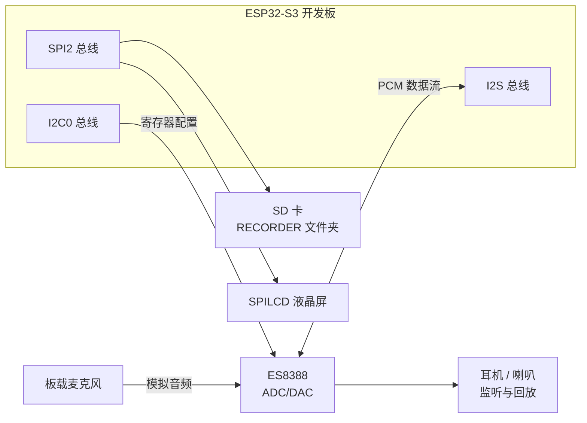
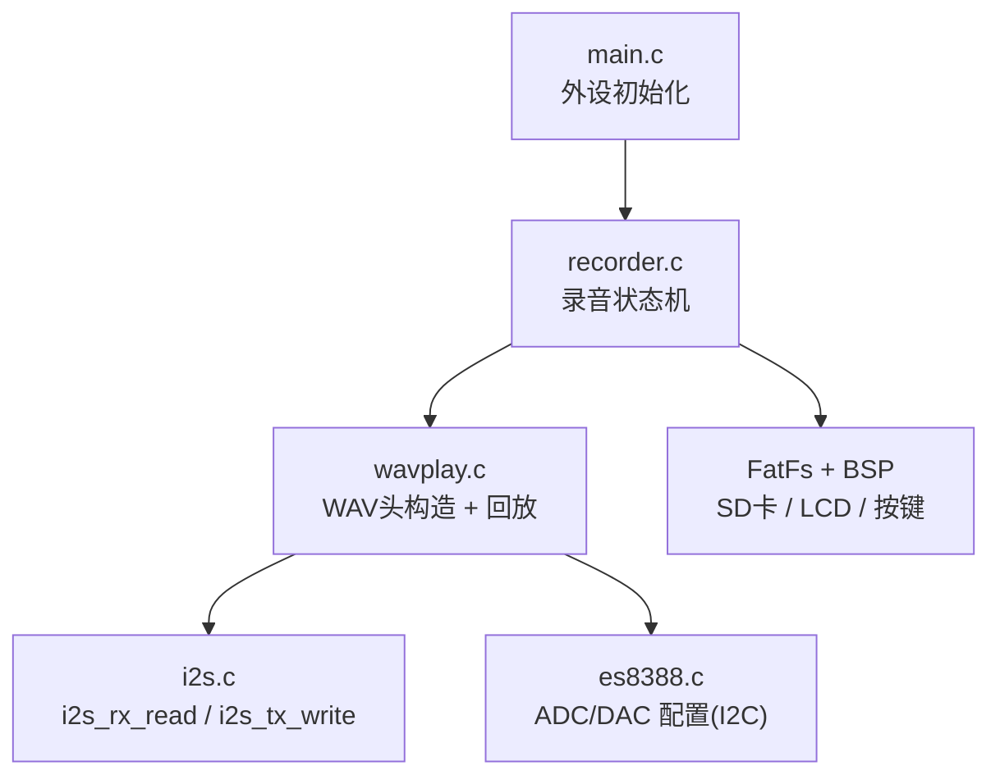
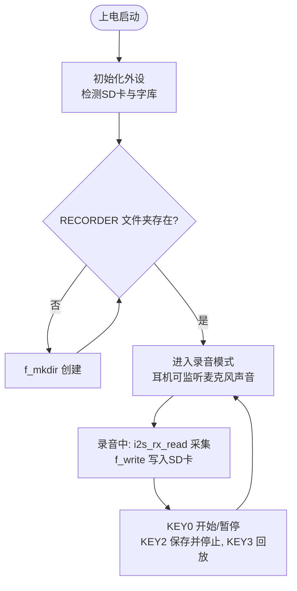

# 31 录音机实验

> 平台：正点原子 ESP32-S3 开发板 ｜ 框架：ESP-IDF ｜ 难度：★★★★☆
>
> 一句话简介：用 **ES8388 的 ADC + I2S 接收**把麦克风采集的声音录成 **WAV 文件**存进 SD 卡，还能立刻回放，做一台简易录音机。

---

## 1. 实验简介

上一个实验是「放音」（DAC 输出），本实验反过来：声音从**麦克风（咪头）**进入 ES8388，由它做模数转换（ADC），数字化后的音频流通过 **I2S 接收**进入 ESP32-S3，程序给它加上 WAV 文件头，写进 SD 卡 `RECORDER` 文件夹——一个标准 WAV 录音文件就诞生了。

学完本实验你将掌握：

- ES8388 录音模式配置：打开 ADC、选择麦克风输入；
- I2S 接收数据：`i2s_rx_read()` 读取一帧帧 PCM 音频；
- WAV 文件头的构造与「先占位、录完回填」的写文件技巧；
- 用一个状态机（`g_rec_sta`）管理 录音 / 暂停 / 保存 / 回放。

## 2. 生活类比

把录音过程想象成**用录音笔录磁带**：

- 麦克风 = 你的耳朵，把声波收集起来；
- ES8388 ADC = 翻译官，把模拟声波翻译成数字（PCM 采样值）；
- I2S 接收 = 传送带，把数字音频一批批运进 ESP32-S3；
- `f_write()` 写 SD 卡 = 把声音刻录到磁带上；
- WAV 文件头 = 磁带盒上的标签（录了多长、什么采样率），**录音开始时先贴一张空白标签，录完再回来把数字填上**——这就是代码里「先写头、保存时 `f_lseek` 回到文件开头重写头」的原因。

## 3. 硬件连接

### 引脚分配

| 元件 | 开发板引脚 | 说明 |
| :--- | :--- | :--- |
| LED（板载） | IO1 | 闪烁=运行中，长亮=录音中 |
| KEY0（经 XL9555） | IO1_7 | 开始 / 暂停录音 |
| KEY1（经 XL9555） | IO1_6 | 未使用 |
| KEY2（经 XL9555） | IO1_5 | 保存并停止录音 |
| KEY3（经 XL9555） | IO1_4 | 播放最近一次录音 |
| XL9555 IIC_SCL | IO42 | IO 扩展芯片时钟线 |
| XL9555 IIC_SDA | IO41 | IO 扩展芯片数据线 |
| ES8388 + 板载麦克风 | I2C0 + I2S 总线 | 音频采集与回放 |
| SPILCD（1.3/2.4 寸） | SPI2 总线 | 显示状态与文件名 |
| SD 卡 | SPI2 总线 | 存放 RECORDER 文件夹 |

### 连接图



## 4. 程序架构



## 5. 程序流程



## 6. 核心代码讲解

### 6.1 自动创建录音文件夹（`recorder.c`）

```c
while (f_opendir(&recdir, "0:/RECORDER"))   /* 打开录音文件夹 */
{
    lcd_show_string(30, 230, 240, 16, 16, "RECORDER folder error!", RED);
    vTaskDelay(200);
    lcd_fill(30, 230, 240, 246, WHITE);     /* 清除显示 */
    vTaskDelay(200);
    f_mkdir("0:/RECORDER");                 /* 创建该目录 */
}
```

**讲解**：`f_opendir()` 返回非 0 说明文件夹打不开，就用 `f_mkdir()` 创建；如果 SD 卡有问题创建也会失败，于是循环闪烁报错——和音乐实验「必须手动建 MUSIC 文件夹」不同，这里程序会**自动建好 RECORDER 文件夹**。

### 6.2 录音数据链路：I2S 采集 → 写入文件（`recorder.c`）

```c
if ((g_rec_sta & 0x80) == 0x80)             /* 正在录音 */
{
    if ((g_rec_sta & 0x01) == 0x00)         /* 且没有暂停 */
    {
        bytes_read = i2s_rx_read((uint8_t *)pdatabuf, 1024 * 10);
        res = f_write(f_rec, pdatabuf, bytes_read, (UINT*)&bw);  /* 写入文件 */
        g_wav_size += bytes_read;           /* WAV数据大小增加 */
    }
}
```

**讲解**：这就是录音的核心两行——`i2s_rx_read()` 从 I2S 接收缓冲区读出一批 PCM 数据（ES8388 ADC 实时采集麦克风），`f_write()` 原样写进 SD 卡文件，并累计 `g_wav_size` 统计已录字节数（后面用来算录音时长、回填文件头）。`g_rec_sta` 的 bit7 表示「录音中」、bit0 表示「暂停」，两个位就构成了整个状态机。

### 6.3 开始录音：先写一个 WAV 头占位（`recorder.c`）

```c
recoder_new_pathname(pname);                /* 得到新的名字, 如 0:RECORDER/REC00001.wav */
recoder_wav_init(wavhead);                  /* 初始化wav数据 */
res = f_open(f_rec, (const TCHAR*)pname, FA_CREATE_ALWAYS | FA_WRITE);  /* 打开文件 */
...
res = f_write(f_rec, (const void *)wavhead, sizeof(__WaveHeader), (UINT*)&bw); /* 写入头数据 */
g_rec_sta |= 0x80;                          /* 开始录音 */
```

**讲解**：文件名按 `REC%05d.wav` 规则自动编号（REC00001.wav、REC00002.wav…）。`FA_CREATE_ALWAYS` 表示文件已存在就覆盖。注意此时 WAV 头里的「数据总长度」还是 0——因为还没开始录，长度未知。

### 6.4 保存：回到文件开头回填 WAV 头（`recorder.c`）

```c
case KEY2_PRES:                                 /* STOP&SAVE */
    if (g_rec_sta & 0x80)                       /* 有录音 */
    {
        g_rec_sta = 0;                          /* 关闭录音 */
        wavhead->riff.ChunkSize = g_wav_size + 36;  /* 整个文件的大小-8 */
        wavhead->data.ChunkSize = g_wav_size;       /* 数据大小 */
        f_lseek(f_rec, 0);                          /* 偏移到文件头 */
        f_write(f_rec, (const void *)wavhead, sizeof(__WaveHeader), &bw); /* 写入头数据 */
        f_close(f_rec);
        g_wav_size = 0;
    }
    break;
```

**讲解**：按 KEY2 保存时，把录出来的真实字节数 `g_wav_size` 填进文件头的两个长度字段，`f_lseek(f_rec, 0)` 跳回文件开头重写这 44 字节，再 `f_close()`。如果少了这一步，得到的 WAV 文件播放器会认为「长度为 0」而拒绝播放。

### 6.5 回放最近录音（`recorder.c`）

```c
case KEY3_PRES:                     /* 播放最近一段录音 */
    if (g_rec_sta != 0x80)          /* 没有在录音 */
    {
        if (pname[0])               /* 有录过音 */
        {
            recoder_enter_play_mode();  /* 进入播放模式 */
            audio_play_song(pname);     /* 播放pname */
            recoder_enter_rec_mode();   /* 重新进入录音模式 */
        }
    }
    break;
```

**讲解**：`recoder_enter_play_mode()` 把 ES8388 从「ADC 采集」切到「DAC 放音」，直接复用了音乐播放器实验的 `audio_play_song()` 来放刚录的 WAV，放完再切回录音模式——录音和放音共用同一套 ES8388 + I2S 硬件，只是方向相反。

## 7. 实验效果

1. 上电初始化、检测字库与 SD 卡后进入**录音模式**，对着板载麦克风说话，耳机/喇叭能实时听到采集到的声音（监听）；
2. 按 **KEY0** 开始录音（LED 长亮），再按 **KEY0** 暂停/继续；
3. 按 **KEY2** 保存并停止，文件自动命名为 `RECORDER/REC00001.wav` 并递增；
4. 按 **KEY3** 回放最近一次录音；LCD 显示当前录音/播放的文件名与录音时长；
5. LED 闪烁表示程序运行，长亮表示正在录音。

## 8. 注意事项

1. 串口通讯波特率为 **115200**，建议使用 **XCOM 串口调试助手**（其他串口软件可能控制 DTR/RST 导致复位）。
2. SD 卡需正确插入板载卡槽，`RECORDER` 文件夹由程序自动创建；SD 卡异常时 LCD 会闪烁报错。
3. 录音格式为**未压缩 WAV（PCM）**，很占空间（16bit/16kHz 约 2KB/秒），长录音请留意 SD 卡容量。
4. 首次运行会自动从 SD 卡更新字库，请保证 SD 卡里有配套字库文件。

## 9. 编译与烧录

```bash
idf.py set-target esp32s3
idf.py build
idf.py -p COMx flash monitor  # COMx 换成你的端口号
```

> 完整的开发环境搭建与烧录说明见 [根目录 README](../README.md)。

---

## 小结

本实验把音频链路反过来走了一遍：麦克风 → ES8388 ADC → I2S 接收 → FatFs 写 SD 卡，并完整实践了 WAV 文件的**构造**过程（先占位、后回填文件头）。加上 KEY3 复用播放器回放，一个「能录、能存、能听」的录音机就齐了。理解了它，你就同时掌握了嵌入式音频的输入与输出两个方向。

| 关键 API | 作用 |
| :--- | :--- |
| `es8388_adda_cfg()` / `es8388_input_cfg()` | 打开 ADC / 选择麦克风输入 |
| `recoder_enter_rec_mode()` / `recoder_enter_play_mode()` | 切换 ES8388 录音 / 放音模式 |
| `i2s_rx_read()` | 从 I2S 读取采集到的 PCM 数据 |
| `f_mkdir()` | 创建 RECORDER 文件夹 |
| `f_open()` / `f_write()` / `f_lseek()` / `f_close()` | 创建文件 / 写数据 / 回填文件头 / 关闭 |
| `recoder_wav_init()` | 构造 44 字节 WAV 文件头 |
| `audio_play_song()` | 复用音乐播放器回放录音 |
