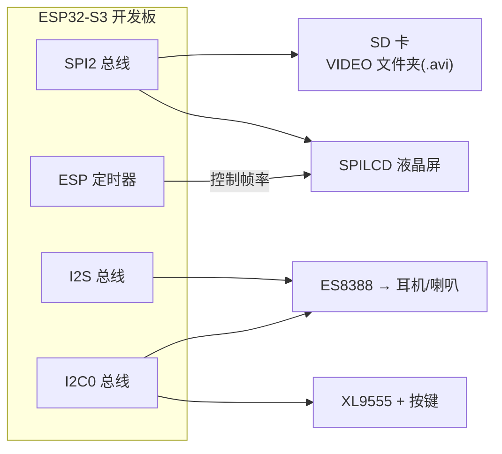
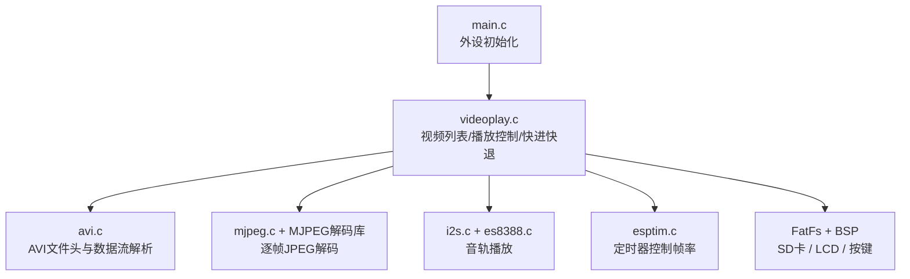
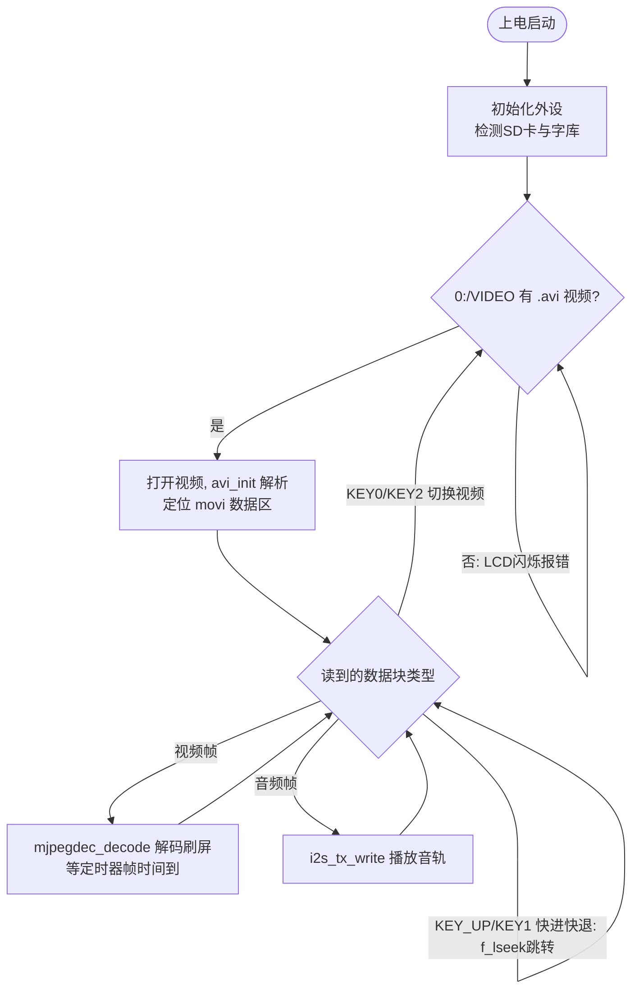

# 32 视频播放器实验

> 平台：正点原子 ESP32-S3 开发板 ｜ 框架：ESP-IDF ｜ 难度：★★★★★
>
> 一句话简介：解析 SD 卡 VIDEO 文件夹里的 **AVI（MJPEG）视频**，逐帧解码 JPEG 画面刷屏、同步用 I2S 播放音轨，实现一个能快进快退的简易视频播放器。

---

## 1. 实验简介

视频 = 「一连串图片（帧）+ 一条音轨」。本实验播放的 AVI 文件采用 **MJPEG** 方案：每一帧画面就是一张独立的 JPEG 图片。程序先解析 AVI 文件头拿到帧率、分辨率、音频采样率等信息，然后进入循环——遇到视频帧就用 JPEG 解码器解码刷屏，遇到音频帧就送 I2S 播放，并用 ESP 定时器按帧率控制节奏。

学完本实验你将掌握：

- AVI 文件格式：RIFF 头、`hdrl`（文件信息）、`movi`（音视频数据流）；
- MJPEG 逐帧解码：`avi_init()` 解析 → `mjpegdec_decode()` 解码一帧；
- 音画同步：用 ESP 定时器产生「一帧时间到」标志，配合音频采样率播放；
- 快进/快退：用 `f_lseek()` 在文件中前后跳转。

## 2. 生活类比

AVI(MJPEG) 文件就像一本**翻页动画书 + 一张伴奏磁带**：

- 书的每一页 = 一帧 JPEG 画面，快速翻动（比如每秒 15 页）眼睛就看到连续动画；
- `avi_init()` = 先看扉页说明：这本书多少页、每页多大、伴奏多快；
- 找到 `movi` 块 = 翻到正文开始的位置；
- ESP 定时器 = 一个节拍器，每响一下才允许翻一页，防止翻太快；
- 音频帧 = 书里夹着的磁带片段，每翻一页顺手放一段；
- 快进/快退 = 直接往前/往后跳过几页（`f_lseek`）。

## 3. 硬件连接

### 引脚分配

| 元件 | 开发板引脚 | 说明 |
| :--- | :--- | :--- |
| LED（板载） | IO1 | 闪烁指示程序运行 |
| KEY0（经 XL9555） | IO1_7 | 下一个视频 |
| KEY1（经 XL9555） | IO1_6 | 快退 |
| KEY2（经 XL9555） | IO1_5 | 上一个视频 |
| KEY3 / KEY_UP（经 XL9555） | IO1_4 | 快进 |
| XL9555 IIC_SCL | IO42 | IO 扩展芯片时钟线 |
| XL9555 IIC_SDA | IO41 | IO 扩展芯片数据线 |
| ES8388 | I2C0 + I2S 总线 | 播放视频音轨 |
| SPILCD（1.3/2.4 寸） | SPI2 总线 | 显示视频画面与信息 |
| SD 卡 | SPI2 总线 | 存放 VIDEO 文件夹 |

### 连接图



## 4. 程序架构



## 5. 程序流程



## 6. 核心代码讲解

### 6.1 解析 AVI 并定位数据区（`videoplay.c`）

```c
res = f_open(favi, (const TCHAR *)pname, FA_READ);                  /* 打开文件 */
res = f_read(favi, pbuf, AVI_VIDEO_BUF_SIZE, (UINT*)&nr);           /* 开始读取 */
res = avi_init(pbuf, AVI_VIDEO_BUF_SIZE);                           /* AVI解析 */

video_info_show(&g_avix);
esptim_int_init(g_avix.SecPerFrame / 1000, 1000);                   /* 按帧率启动定时器 */
offset = avi_srarch_id(pbuf, AVI_VIDEO_BUF_SIZE, "movi");           /* 寻找movi ID */
avi_get_streaminfo(pbuf + offset + 4);                              /* 获取流信息 */
f_lseek(favi, offset + 12);                                         /* 偏移到movi数据块开始 */
mjpegdec_init((lcd_self.width - g_avix.Width) / 2,
              110 + (lcd_self.height - 110 - g_avix.Height) / 2);   /* 初始化JPG解码, 画面居中 */

if (g_avix.SampleRate)                                              /* 有音频信息才初始化 */
{
    es8388_sai_cfg(0, 3);                                           /* 飞利浦标准,16位数据长度 */
    i2s_set_samplerate_bits_sample(g_avix.SampleRate, I2S_BITS_PER_SAMPLE_16BIT);
    i2s_start(I2S_NUM);
}
```

**讲解**：AVI 是 RIFF 结构，开头 `hdrl` 里记录了总帧数、每帧时长（`SecPerFrame`，微秒）、分辨率、音频采样率等，`avi_init()` 把它们解析到全局结构 `g_avix`。`esptim_int_init()` 按帧率配置 ESP 定时器——每过「一帧的时间」就把 `frameup` 标志置 1，这是控制播放速度、防止画面「一泻千里」的关键。`avi_srarch_id()` 搜索 `"movi"` 字符串找到真正的音视频数据区并 `f_lseek()` 跳过去。

### 6.2 播放主循环：视频帧解码 + 音频帧播放（`videoplay.c`）

```c
while (1)
{
    if (g_avix.StreamID == AVI_VIDS_FLAG)                       /* 视频帧 */
    {
        pbuf = framebuf;
        f_read(favi, pbuf, g_avix.StreamSize + 8, (UINT*)&nr);  /* 读取本帧+下一帧头信息 */
        res = mjpegdec_decode(pbuf, g_avix.StreamSize);         /* JPEG解码一帧并刷屏 */
        while (frameup == 0);                                   /* 等待帧时间到 */
        frameup = 0;
    }
    else                                                        /* 音频帧 */
    {
        video_time_show(favi, &g_avix);                         /* 显示当前播放时间 */
        f_read(favi, framebuf, g_avix.StreamSize + 8, &nr);
        i2s_tx_write(framebuf, g_avix.StreamSize);              /* 送I2S播放 */
    }

    key = xl9555_key_scan(0);
    if (key == KEY0_PRES || key == KEY2_PRES)                   /* 下一个/上一个视频 */
    {
        res = key;
        break;
    }
    ...
}
```

**讲解**：`movi` 数据区里视频块（ID 为 `00dc`，即 `AVI_VIDS_FLAG`）和音频块（`01wb`）交替出现。每读一块先看 `g_avix.StreamID` 判断类型：视频帧交给 `mjpegdec_decode()` 解码显示；音频帧直接写 I2S（和音乐实验完全同一条链路）。注意视频分支里的 `while (frameup == 0);`——解码可能比帧间隔快，必须等定时器「打拍子」才继续下一帧，这样播放速度才等于视频本身的帧率。

### 6.3 按键切歌与播放调度（`main.c`）

```c
while (1)
{
    video_play();
}
```

**讲解**：`main.c` 只负责把 ES8388、I2S、SD 卡、字库全部初始化好，然后把控制权完全交给 `video_play()`。它内部扫描 `0:/VIDEO` 文件夹统计 `.avi` 数量、维护当前编号，播放完或按 KEY0/KEY2 就切换上/下一个视频；快进（KEY_UP）和快退（KEY1）则通过 `f_lseek()` 在文件内前后跳转若干个数据块实现。

## 7. 实验效果

1. 上电初始化、检查字库（没有则自动更新）后，自动播放 SD 卡 `VIDEO` 文件夹里的 `.avi` 视频；
2. LCD 上半部分显示视频画面，并显示**视频名、当前编号/总数、声道数、音频采样率、帧率、播放时间/总时间**等信息；
3. **KEY0** 下一个视频、**KEY2** 上一个视频、**KEY_UP（KEY3）** 快进、**KEY1** 快退；
4. 有音轨的视频可通过耳机/喇叭听到声音；LED 闪烁指示程序运行。

## 8. 注意事项

1. 串口通讯波特率为 **115200**，建议使用 **XCOM 串口调试助手**（其他串口软件可能控制 DTR/RST 导致复位）。
2. USB 转串口连接方式：**IO4 接串口转 TTL 模块的 RXD、IO5 接 TXD**，再连电脑。
3. SD 卡需正确插入板载卡槽，根目录要有 `VIDEO` 文件夹；视频必须是 **MJPEG 编码的 AVI**（每帧一张 JPEG），分辨率不要超过屏幕，帧率建议 15fps 左右，普通 MP4/AVC 视频无法播放，需先用转换工具处理。
4. 视频解码非常消耗 CPU 和内存，播放时属正常现象：切视频、快进快退会有短暂停顿。
5. 开机时按住 KEY0 可强制重新更新字库。

## 9. 编译与烧录

```bash
idf.py set-target esp32s3
idf.py build
idf.py -p COMx flash monitor  # COMx 换成你的端口号
```

> 完整的开发环境搭建与烧录说明见 [根目录 README](../README.md)。

---

## 小结

本实验是「图片显示 + 音乐播放」两个实验的合体升级：画面复用 JPEG 解码器逐帧刷屏，声音复用 I2S+ES8388 链路，再加上 AVI 容器解析和定时器帧率控制，就构成了一台完整的视频播放器。理解「视频 = 帧序列 + 音轨 + 时间基准」这个模型，是学习一切多媒体技术的基础。

| 关键 API | 作用 |
| :--- | :--- |
| `avi_init()` | 解析 AVI 文件头（帧率、分辨率、采样率等） |
| `avi_srarch_id()` | 在缓冲区中搜索 "movi" 等块 ID |
| `avi_get_streaminfo()` | 获取当前数据块的流类型与大小 |
| `mjpegdec_init()` / `mjpegdec_decode()` | 初始化 JPEG 解码器 / 解码并显示一帧 |
| `esptim_int_init()` | 按帧率启动 ESP 定时器（frameup 节拍） |
| `i2s_tx_write()` | 播放音频帧 |
| `f_lseek()` | 定位文件读写位置（实现快进/快退） |
| `video_play()` | 视频列表管理与播放调度总入口 |
