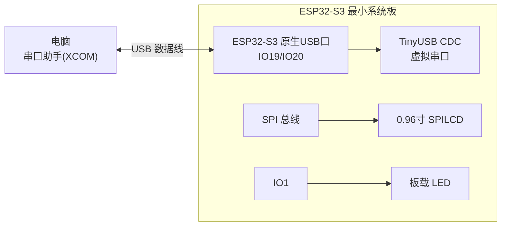
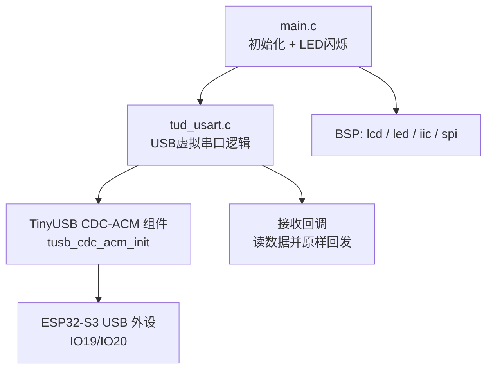
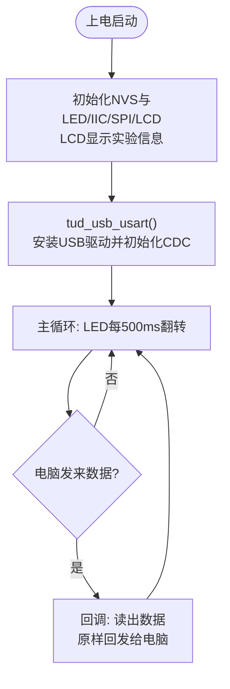

# 33 USB 虚拟串口（Slave）实验

> 平台：正点原子 ESP32-S3 最小系统板 ｜ 框架：ESP-IDF ｜ 难度：★★☆☆☆
>
> 一句话简介：利用 ESP32-S3 的**原生 USB 接口 + TinyUSB CDC**，让开发板在电脑上虚拟出一个串口，收到的数据原样回发，实现免芯片的 USB 转串口。

---

## 1. 实验简介

普通单片机想和电脑说话，必须外挂一颗 USB 转串口芯片（如 CH340）。而 ESP32-S3 内部集成了 **USB 控制器**，通过 ESP-IDF 自带的 **TinyUSB 协议栈**，可以直接把自己模拟成一个 USB 设备——本实验模拟的是 **CDC-ACM 类**设备，也就是电脑眼中的「串口」。

插上 USB 线后，电脑会多出一个 COM 口；用串口助手发什么，板子就回什么（回环测试），全程不需要任何外部芯片。

学完本实验你将掌握：

- 用 `tinyusb_driver_install()` 安装 TinyUSB 设备驱动；
- 用 `tusb_cdc_acm_init()` 把 USB 模拟成 CDC 虚拟串口；
- 注册接收回调，用 `tinyusb_cdcacm_read()` / `tinyusb_cdcacm_write_queue()` 收发数据。

## 2. 生活类比

TinyUSB CDC 就像给开发板办了一张**「虚拟电话卡」**：

- `tinyusb_driver_install()` = 先装好电话机（USB 底层驱动）；
- `tusb_cdc_acm_init()` = 到运营商开户，拿到一个电话号码（电脑上出现一个新 COM 口）；
- 接收回调 `tinyusb_cdc_rx_callback()` = 设置了「来电自动应答」：电话一响（有数据到达）就接起来；
- 回环逻辑 = 对方说什么你就复述什么——用来验证这条「电话线」完全通畅。

## 3. 硬件连接

### 引脚分配

| 元件 | 开发板引脚 | 说明 |
| :--- | :--- | :--- |
| LED（板载） | IO1 | 闪烁指示程序运行 |
| USB 口（板载） | IO19（D-）/ IO20（D+） | ESP32-S3 原生 USB，接电脑 |
| 正点原子 0.96 寸 SPILCD | SPI 总线 | 显示实验信息 |

> 用一根 USB 数据线连接开发板 USB 口和电脑即可，无需其他外接元件。

### 连接图



## 4. 程序架构



## 5. 程序流程



## 6. 核心代码讲解

### 6.1 初始化 USB 虚拟串口（`tud_usart.c`）

```c
void tud_usb_usart(void)
{
    const tinyusb_config_t tusb_cfg = {
        .device_descriptor = NULL,
        .string_descriptor = NULL,
        .external_phy = false,
        .configuration_descriptor = NULL,
    };
    /* USB设备登记 */
    ESP_ERROR_CHECK(tinyusb_driver_install(&tusb_cfg));

    tinyusb_config_cdcacm_t acm_cfg = {
        .usb_dev = TINYUSB_USBDEV_0,                /* USB设备 */
        .cdc_port = TINYUSB_CDC_ACM_0,              /* CDC端口 */
        .rx_unread_buf_sz = 64,                     /* 配置RX缓冲区大小 */
        .callback_rx = &tinyusb_cdc_rx_callback,    /* 接收回调函数 */
        .callback_rx_wanted_char = NULL,
        .callback_line_state_changed = NULL,
        .callback_line_coding_changed = NULL
    };
    /* USB CDC初始化 */
    ESP_ERROR_CHECK(tusb_cdc_acm_init(&acm_cfg));
}
```

**讲解**：分两步走——

- `tinyusb_driver_install()` 安装 TinyUSB 底层驱动，描述符全部传 `NULL` 表示使用 ESP-IDF 内置的默认描述符（电脑据此识别设备类型）；
- `tusb_cdc_acm_init()` 在 USB 上创建一个 **CDC-ACM 虚拟串口**，并把「收到数据」这个事件挂到回调函数 `tinyusb_cdc_rx_callback` 上——之后只要有数据到达，回调就会被自动调用，主循环完全不用轮询。

### 6.2 接收回调：读到什么就回发什么（`tud_usart.c`）

```c
void tinyusb_cdc_rx_callback(int itf, cdcacm_event_t *event)
{
    size_t rx_size = 0;

    /* 读取串口的数据 */
    esp_err_t ret = tinyusb_cdcacm_read(itf, buf, CONFIG_TINYUSB_CDC_RX_BUFSIZE, &rx_size);

    if (ret == ESP_OK)
    {
        ESP_LOGI(TAG, "Data from channel %d:", itf);
        ESP_LOG_BUFFER_HEXDUMP(TAG, buf, rx_size, ESP_LOG_INFO);
    }

    /* 发送数据 */
    tinyusb_cdcacm_write_queue(itf, buf, rx_size);
    tinyusb_cdcacm_write_flush(itf, 0);
}
```

**讲解**：这是本实验的灵魂——**回环（echo）**：

- `tinyusb_cdcacm_read()` 把接收缓冲区的数据读出来，`rx_size` 是实际读到的字节数；
- `tinyusb_cdcacm_write_queue()` 把这批数据放进发送队列，`tinyusb_cdcacm_write_flush()` 立刻把队列发出去；
- 一来一回，电脑串口助手上就能看到自己发的内容被原样弹回来，证明虚拟串口收发都正常。

### 6.3 主程序（`main.c`）

```c
lcd_show_string(30, 50, 200, 16, 16, "ESP32-S3", RED);
lcd_show_string(30, 70, 200, 16, 16, "USB USART TEST", RED);
lcd_show_string(30, 90, 200, 16, 16, "ATOM@ALIENTEK", RED);

tud_usb_usart();                                    /* USB初始化 */

while(1)
{
    LED_TOGGLE();
    vTaskDelay(500);
}
```

**讲解**：主循环里只做一件事——LED 每 500ms 翻转一次，证明程序活着。所有 USB 收发都在中断/回调上下文完成，这正是「事件驱动」的好处：业务代码极其干净。

## 7. 实验效果

1. 烧录后用 USB 数据线连接开发板与电脑，电脑设备管理器中出现一个新的 **USB 串行设备（COM 口）**；
2. 打开串口助手（如 XCOM）选中该 COM 口，发送任意数据，板子会**实时原样回发**，串口助手接收区显示相同内容；
3. LCD 显示 "USB USART TEST" 等信息，LED 以 500ms 间隔闪烁。

## 8. 注意事项

1. 必须使用开发板的**原生 USB 口**（IO19/IO20），不是 UART 烧录口。
2. 虚拟串口的波特率由电脑端随意设置即可，CDC 设备实际不关心波特率参数。
3. 若电脑未识别，检查 USB 线是否为**数据线**（部分充电线没有数据芯）。

## 9. 编译与烧录

```bash
idf.py set-target esp32s3
idf.py build
idf.py -p COMx flash monitor  # COMx 换成你的端口号
```

> 完整的开发环境搭建与烧录说明见 [根目录 README](../README.md)。

---

## 小结

本实验用不到百行代码，让 ESP32-S3 靠原生 USB「变身」成一个串口设备，摆脱了外部 USB 转串口芯片。CDC 回环是 TinyUSB 的入门经典，后面的「FLASH 模拟 U 盘」「SD 卡模拟 U 盘」实验都建立在同一套 `tinyusb_driver_install()` 框架上，只是设备类从 CDC 换成了 MSC。

| 关键 API | 作用 |
| :--- | :--- |
| `tinyusb_driver_install()` | 安装 TinyUSB 设备驱动（USB 底层） |
| `tusb_cdc_acm_init()` | 创建 CDC-ACM 虚拟串口 |
| `tinyusb_cdcacm_register_callback()` | 注册线路状态等事件回调 |
| `tinyusb_cdcacm_read()` | 从虚拟串口读取收到的数据 |
| `tinyusb_cdcacm_write_queue()` / `tinyusb_cdcacm_write_flush()` | 数据入发送队列 / 立即发出 |
