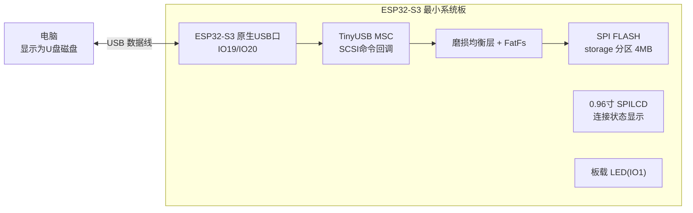
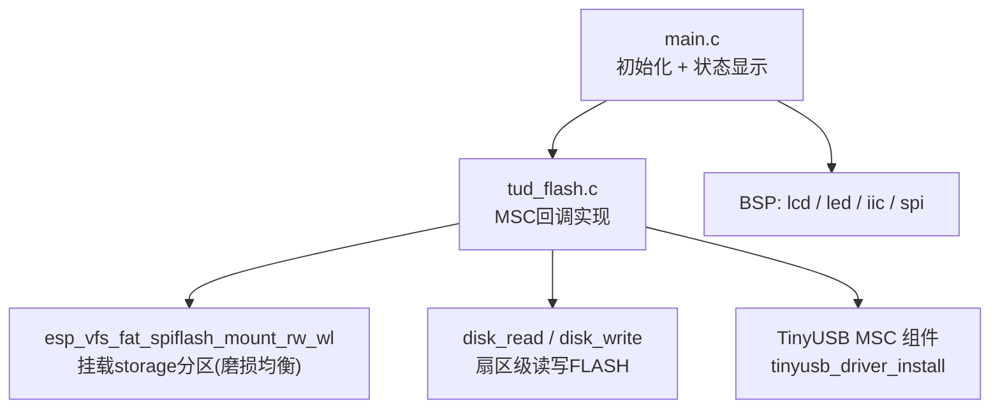
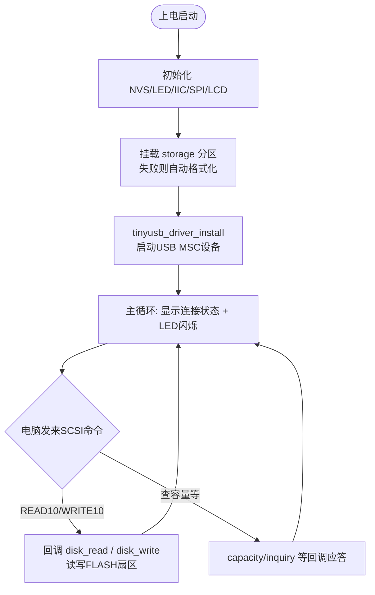

# 34 FLASH 模拟 U 盘实验

> 平台：正点原子 ESP32-S3 最小系统板 ｜ 框架：ESP-IDF ｜ 难度：★★★☆☆
>
> 一句话简介：利用 ESP32-S3 原生 USB 的 **MSC（大容量存储）设备类**，把板载 SPI FLASH 的 `storage` 分区模拟成一个 U 盘，插上电脑就是一个可读写磁盘。

---

## 1. 实验简介

上一个实验把 USB 模拟成「串口」（CDC 类），本实验模拟成「U 盘」（**MSC 类**，Mass Storage Class）。电脑把开发板当成一个普通 U 盘：弹出磁盘图标、能拷贝文件、能格式化。

磁盘的「盘体」是 SPI FLASH 中一块 4MB 的 `storage` 分区（见 `partitions-16MiB.csv`）。程序用 `esp_vfs_fat_spiflash_mount_rw_wl()` 以**读写 + 磨损均衡（Wear Leveling）**方式挂载该分区，然后实现 TinyUSB 要求的一组 MSC 回调函数（读扇区、写扇区、查容量……），把电脑的 SCSI 命令翻译成对 FLASH 的操作。

学完本实验你将掌握：

- USB MSC 设备的工作原理：电脑发 SCSI 命令，设备用回调应答；
- `tud_msc_read10_cb()` / `tud_msc_write10_cb()` 等核心回调的实现；
- 用磨损均衡层把裸 FLASH 变成可反复读写的「磁盘」。

## 2. 生活类比

MSC 设备就像开发板去电脑那儿**应聘当 U 盘**：

- `tinyusb_driver_install()` = 递交简历（USB 枚举），电脑说「好，识别为一个磁盘」；
- `tud_msc_inquiry_cb()` / `tud_msc_capacity_cb()` = 面试问答：「你叫什么牌子？」「容量多大？」——设备必须如实回答，电脑才能建立磁盘；
- `tud_msc_read10_cb()` / `tud_msc_write10_cb()` = 正式上岗：电脑说「把第 100 号柜子（扇区）的东西拿来」，设备就去 FLASH 对应位置取数据；
- 磨损均衡层 = 一个聪明的仓库管理员：FLASH 同一格不能写太多次，他会自动把货物轮换到不同格子，延长寿命。

## 3. 硬件连接

### 引脚分配

| 元件 | 开发板引脚 | 说明 |
| :--- | :--- | :--- |
| LED（板载） | IO1 | 闪烁指示程序运行 |
| USB 口（板载） | IO19（D-）/ IO20（D+） | ESP32-S3 原生 USB，接电脑 |
| SPI FLASH（板载） | 芯片内部 SPI0 | storage 分区被模拟成 U 盘 |
| 正点原子 0.96 寸 SPILCD | SPI 总线 | 显示连接状态 |

> 用一根 USB 数据线连接开发板 USB 口和电脑即可。

### 连接图



## 4. 程序架构



## 5. 程序流程



## 6. 核心代码讲解

### 6.1 挂载 FLASH 分区当磁盘（`tud_flash.c`）

```c
static esp_err_t tud_spiffs_partitions_init(const char *base_path)
{
    esp_err_t ret = ESP_FAIL;
    wl_handle_t wl_handle_1 = WL_INVALID_HANDLE;

    const esp_vfs_fat_mount_config_t mount_config = {
        .format_if_mount_failed = true,     /* 挂载失败则自动格式化 */
        .max_files = 9,
        .allocation_unit_size = CONFIG_WL_SECTOR_SIZE
    };

    /* 挂载分区 */
    ret = esp_vfs_fat_spiflash_mount_rw_wl(base_path, "storage", &mount_config, &wl_handle_1);

    if (ret != ESP_OK)
    {
        ESP_LOGE(TAG, "Failed to mount FATFS (%s)", esp_err_to_name(ret));
        return ESP_FAIL;
    }
    return ESP_OK;
}
```

**讲解**：`esp_vfs_fat_spiflash_mount_rw_wl()` 是 ESP-IDF 提供的「SPI FLASH 当 FAT 磁盘用」函数：`"storage"` 对应分区表里那块 4MB 的分区，`_rw_wl` 表示**可读写 + 带磨损均衡**。`format_if_mount_failed = true` 很关键——第一次使用时分区还是空白/乱数据，挂载失败会自动格式化成 FAT，电脑端就能看到一个干净 U 盘。

### 6.2 读写扇区回调（`tud_flash.c`）

```c
int32_t tud_msc_read10_cb(uint8_t lun, uint32_t lba, uint32_t offset, void *buffer, uint32_t bufsize)
{
    if (lun >= LOGICAL_DISK_NUM) return 0;

    const uint32_t block_count = bufsize / s_disk_block_size;
    /* 磁盘读取 */
    disk_read(s_pdrv, buffer, lba, block_count);

    return block_count * s_disk_block_size;
}

int32_t tud_msc_write10_cb(uint8_t lun, uint32_t lba, uint32_t offset, uint8_t *buffer, uint32_t bufsize)
{
    if (lun >= LOGICAL_DISK_NUM) return 0;

    const uint32_t block_count = bufsize / s_disk_block_size;
    /* 磁盘写入 */
    disk_write(s_pdrv, buffer, lba, block_count);

    return block_count * s_disk_block_size;
}
```

**讲解**：`READ10` / `WRITE10` 是 SCSI 的「读/写扇区」命令，电脑每次访问 U 盘最终都会落到这两个回调。参数 `lba` 是逻辑块地址（第几扇区），`bufsize` 是字节数，换算成扇区个数后交给 FatFs 底层的 `disk_read()` / `disk_write()`——它们经过磨损均衡层最终操作 SPI FLASH。返回值必须是实际处理的字节数，返回 0 电脑会认为磁盘故障。

### 6.3 状态回调与 USB 启动（`tud_flash.c` / `main.c`）

```c
void tud_mount_cb(void)     /* 电脑挂载U盘时调用 */
{
    for (uint8_t i = 0; i < LOGICAL_DISK_NUM; i++) ejected[i] = false;
    g_usbdev.status |= 0x01;
}

void tud_msc_capacity_cb(uint8_t lun, uint32_t *block_count, uint16_t *block_size)
{
    disk_ioctl(s_pdrv, GET_SECTOR_COUNT, block_count);   /* 总扇区数 */
    disk_ioctl(s_pdrv, GET_SECTOR_SIZE,  block_size);    /* 每扇区字节数 */
}
```

```c
tud_usb_flash();    /* USB初始化: 挂载分区 + tinyusb_driver_install */

while(1)
{
    if ((g_usbdev.status & 0x0f) == 0x01)
        lcd_show_string(110, 110, lcd_self.width, 16, 16, "connect success.....", BLUE);
    else if ((g_usbdev.status & 0x0f) == 0x00)
        lcd_show_string(110, 110, lcd_self.width, 16, 16, "connect fail........", BLUE);

    LED_TOGGLE();
    vTaskDelay(500);
}
```

**讲解**：TinyUSB 会在各个事件点自动调用 `tud_xxx_cb` 系列回调：`tud_mount_cb` 在电脑识别并挂载磁盘时触发，程序借此更新 `g_usbdev.status`，主循环再把它显示到 LCD 上（connect success / fail）。`tud_msc_capacity_cb` 回答电脑「你有多大」——容量直接问底层磁盘驱动要，所以改分区表大小，电脑里看到的 U 盘容量也会跟着变。

## 7. 实验效果

1. USB 线插入电脑后，系统把 `storage` 分区模拟成 U 盘，电脑「此电脑」中出现一个可移动磁盘（约 4MB）；
2. 可以像普通 U 盘一样往里面拷贝、删除文件，掉电重启后文件仍在（存在 FLASH 里）；
3. LCD 显示 `connect success` 表示电脑已挂载磁盘，LED 以 500ms 间隔闪烁。

## 8. 注意事项

1. 串口通讯波特率为 **115200**，建议使用 **XCOM 串口调试助手**（其他串口软件可能控制 DTR/RST 导致复位）。
2. 必须打开 menuconfig 菜单，找到 **Mass Storage Class** 选项，**开启 TinyUSB MSC feature**，并把 **MSC FIFO size 设为 4096（4K）**，否则无法编译出 MSC 功能。
3. 电脑正在读写时**不要直接拔线或断电**，可能损坏 FAT 文件系统；重新挂载失败时程序会自动格式化，磁盘内文件将丢失。
4. FLASH 模拟的 U 盘只有 storage 分区大小（本工程 4MB），拷大文件请注意容量。

## 9. 编译与烧录

```bash
idf.py set-target esp32s3
idf.py build
idf.py -p COMx flash monitor  # COMx 换成你的端口号
```

> 完整的开发环境搭建与烧录说明见 [根目录 README](../README.md)。

---

## 小结

本实验让 ESP32-S3 以 USB MSC 设备的身份「上岗」当 U 盘：电脑发 SCSI 命令，板子用 `tud_msc_xxx_cb` 回调把命令翻译成对 FLASH 分区的扇区读写。它展示了 USB 设备开发的通用套路——**实现协议栈要求的一组回调**，换个存储后端就能变成下一个实验的「SD 卡 U 盘」。

| 关键 API | 作用 |
| :--- | :--- |
| `esp_vfs_fat_spiflash_mount_rw_wl()` | 以读写+磨损均衡方式挂载 FLASH 分区 |
| `tinyusb_driver_install()` | 安装 TinyUSB 驱动，启动 USB 设备 |
| `tud_msc_read10_cb()` / `tud_msc_write10_cb()` | 响应电脑读/写扇区命令 |
| `tud_msc_capacity_cb()` / `tud_msc_inquiry_cb()` | 报告磁盘容量 / 厂商信息 |
| `tud_mount_cb()` / `tud_umount_cb()` | 电脑挂载/卸载磁盘时的通知 |
| `disk_read()` / `disk_write()` | FatFs 底层扇区读写接口 |
