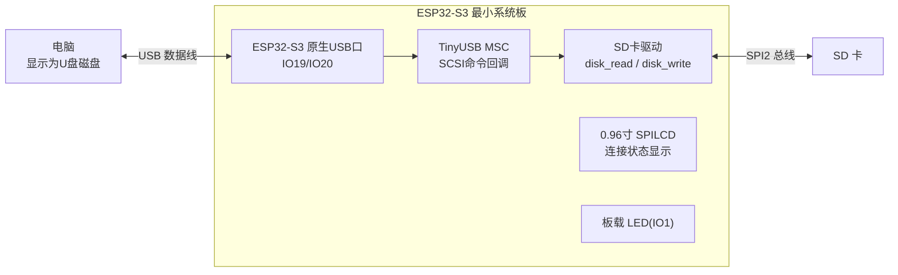
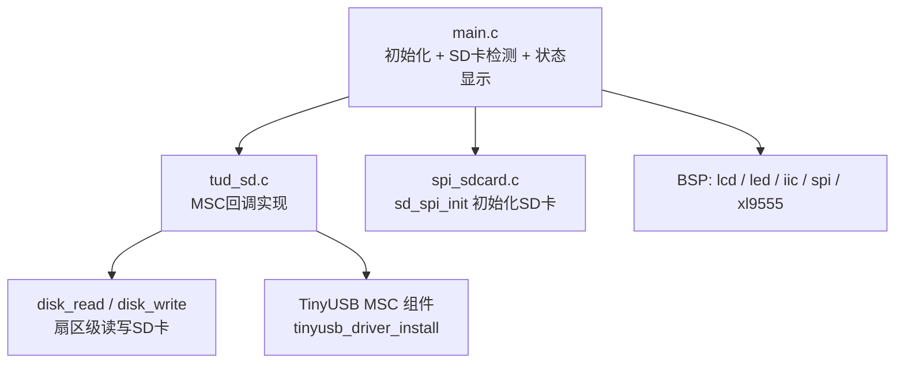
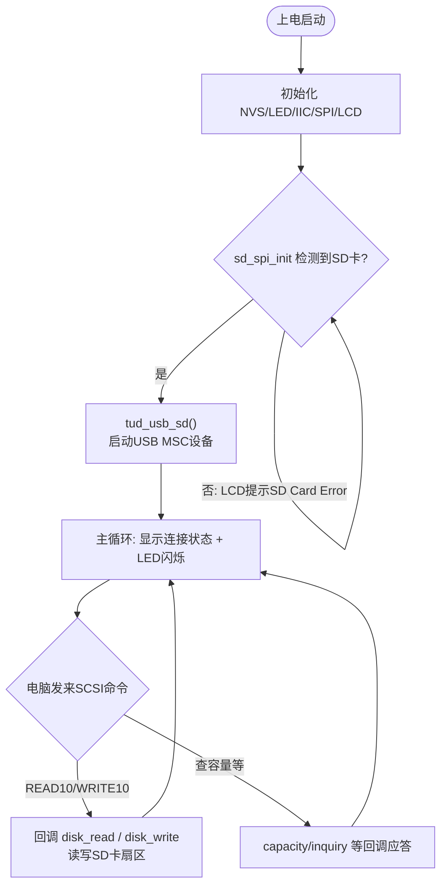

# 35 SD 卡模拟 U 盘实验

> 平台：正点原子 ESP32-S3 最小系统板 ｜ 框架：ESP-IDF ｜ 难度：★★★☆☆
>
> 一句话简介：把插在开发板上的 **SD 卡**通过 ESP32-S3 原生 USB 的 **MSC 设备类**透传给电脑——板子变成一个「SD 卡读卡器」。

---

## 1. 实验简介

上一个实验把 FLASH 分区模拟成 U 盘，但只有 4MB。本实验把存储后端换成 **SD 卡**：程序先用 SPI 方式初始化 SD 卡（`sd_spi_init()`），再启动 TinyUSB MSC 设备；电脑发来的读/写扇区命令被回调函数直接转发给 SD 卡驱动。插上 USB 线，电脑就看到一个和 SD 卡一样大的可移动磁盘——相当于开发板兼职当了一个**读卡器**。

学完本实验你将掌握：

- USB MSC 设备与存储后端解耦的思想：回调只管「转发扇区读写」，换后端就是换 U 盘；
- SD 卡（SPI 模式）初始化与 MSC 的配合；
- `tud_msc_read10_cb()` / `tud_msc_write10_cb()` 等 MSC 回调的实现。

## 2. 生活类比

开发板此时的角色是一位**酒店行李员**：

- SD 卡 = 客人寄存的大行李箱（真正的数据都在这）；
- USB MSC = 酒店前台窗口，电脑是来取行李的客人；
- `tud_msc_read10_cb()` = 客人说「给我第 100 号柜子的东西」，行李员不做任何加工，转身去仓库（SD 卡）对应格子取出来递过去；
- 和 FLASH 模拟 U 盘的实验对比：流程一模一样，只是「仓库」从板内的小柜子（4MB FLASH）换成了大行李箱（SD 卡）。

## 3. 硬件连接

### 引脚分配

| 元件 | 开发板引脚 | 说明 |
| :--- | :--- | :--- |
| LED（板载） | IO1 | 闪烁指示程序运行 |
| USB 口（板载） | IO19（D-）/ IO20（D+） | ESP32-S3 原生 USB，接电脑 |
| XL9555 IIC_SCL | IO42 | IO 扩展芯片时钟线 |
| XL9555 IIC_SDA | IO41 | IO 扩展芯片数据线 |
| SD 卡 | SPI2 总线 | 被模拟成 U 盘的存储介质 |
| 正点原子 0.96 寸 SPILCD | SPI 总线 | 显示连接状态 |

### 连接图



## 4. 程序架构



## 5. 程序流程



## 6. 核心代码讲解

### 6.1 先检测 SD 卡，再启动 MSC（`main.c`）

```c
while (sd_spi_init())                               /* 检测不到SD卡 */
{
    lcd_show_string(30, 110, 200, 16, 16, "SD Card Error!", RED);
    vTaskDelay(500);
    lcd_show_string(30, 130, 200, 16, 16, "Please Check! ", RED);
    vTaskDelay(500);
}

tud_usb_sd();                                       /* USB初始化 */
```

**讲解**：SD 卡是磁盘的「盘体」，没有它 U 盘无从谈起，所以主程序先死循环等待 `sd_spi_init()` 成功（SPI 模式初始化 SD 卡并挂到 FatFs），LCD 同步闪烁报错提示。之后 `tud_usb_sd()` 只需一行——安装 TinyUSB 驱动，MSC 功能就上线了：

```c
void tud_usb_sd(void)
{
    const tinyusb_config_t tusb_cfg = {0};
    /* USB设备登记 */
    ESP_ERROR_CHECK(tinyusb_driver_install(&tusb_cfg));
    ESP_LOGI(TAG, "USB MSC initialization DONE");
}
```

### 6.2 读写扇区回调：转发给 SD 卡（`tud_sd.c`）

```c
int32_t tud_msc_read10_cb(uint8_t lun, uint32_t lba, uint32_t offset, void *buffer, uint32_t bufsize)
{
    if (lun >= LOGICAL_DISK_NUM) return 0;

    const uint32_t block_count = bufsize / s_disk_block_size;
    /* 磁盘读取 */
    disk_read(s_pdrv, buffer, lba, block_count);

    return block_count * s_disk_block_size;
}

int32_t tud_msc_write10_cb(uint8_t lun, uint32_t lba, uint32_t offset, uint8_t *buffer, uint32_t bufsize)
{
    if (lun >= LOGICAL_DISK_NUM) return 0;

    const uint32_t block_count = bufsize / s_disk_block_size;
    /* 磁盘写入 */
    disk_write(s_pdrv, buffer, lba, block_count);

    return block_count * s_disk_block_size;
}
```

**讲解**：和 FLASH 版实验几乎一字不差——这正是 MSC 框架的美妙之处：回调只负责把「扇区号 + 扇区数 + 缓冲区」转发给 FatFs 底层的 `disk_read()` / `disk_write()`，而这两个函数在 `sd_spi_init()` 时已被注册为指向 SD 卡驱动。换存储介质，上层回调不用改。

### 6.3 挂载状态显示（`tud_sd.c` / `main.c`）

```c
void tud_mount_cb(void)     /* 电脑挂载U盘时调用 */
{
    for (uint8_t i = 0; i < LOGICAL_DISK_NUM; i++) ejected[i] = false;
    g_usbdev.status |= 0x01;
}

/* main.c 主循环 */
while(1)
{
    if ((g_usbdev.status & 0x0f) == 0x01)
    {
        lcd_show_string(110, 110, lcd_self.width, 16, 16, "connect success.....", BLUE);
    }
    else if ((g_usbdev.status & 0x0f) == 0x00)
    {
        lcd_show_string(110, 110, lcd_self.width, 16, 16, "connect fail........", BLUE);
    }

    LED_TOGGLE();
    vTaskDelay(500);
}
```

**讲解**：电脑枚举并挂载磁盘后，TinyUSB 自动调用 `tud_mount_cb()`，程序置位 `g_usbdev.status`，LCD 上就显示 `connect success`；拔线、休眠时对应的 `tud_umount_cb()` / `tud_suspend_cb()` 会清除状态。主循环同时以 500ms 翻转 LED，指示程序运行。

## 7. 实验效果

1. SD 卡插好、USB 线插入电脑后，系统把 SD 卡模拟成 U 盘，电脑「此电脑」中出现一个可移动磁盘（容量 = SD 卡容量）；
2. 可以像操作普通 U 盘 / 读卡器一样浏览、拷贝 SD 卡里的文件（包括之前实验的 PICTURE、MUSIC 文件夹）；
3. LCD 显示 `connect success` 表示电脑已挂载磁盘，LED 以 500ms 间隔闪烁。

## 8. 注意事项

1. 串口通讯波特率为 **115200**，建议使用 **XCOM 串口调试助手**（其他串口软件可能控制 DTR/RST 导致复位）。
2. 必须打开 menuconfig 菜单，找到 **Mass Storage Class** 选项，**开启 TinyUSB MSC feature**，并把 **MSC FIFO size 设为 4096（4K）**，否则无法编译出 MSC 功能。
3. SD 卡必须正确插入板载卡槽，否则 LCD 一直显示 "SD Card Error!"。
4. 电脑正在读写时不要拔卡/断电，否则可能损坏 SD 卡文件系统。

## 9. 编译与烧录

```bash
idf.py set-target esp32s3
idf.py build
idf.py -p COMx flash monitor  # COMx 换成你的端口号
```

> 完整的开发环境搭建与烧录说明见 [根目录 README](../README.md)。

---

## 小结

本实验把「FLASH 模拟 U 盘」的存储后端换成了 SD 卡，代码结构几乎不变，直观展示了 USB MSC 开发中**协议层与存储层解耦**的设计：TinyUSB 负责应付电脑的各种 SCSI 命令，`disk_read` / `disk_write` 负责落到具体介质。开发板从此多了一个实用身份——免驱动读卡器。

| 关键 API | 作用 |
| :--- | :--- |
| `sd_spi_init()` | SPI 模式初始化 SD 卡并挂载 FatFs |
| `tinyusb_driver_install()` | 安装 TinyUSB 驱动，启动 USB MSC 设备 |
| `tud_msc_read10_cb()` / `tud_msc_write10_cb()` | 响应电脑读/写扇区命令，转发给 SD 卡 |
| `tud_msc_capacity_cb()` | 报告磁盘容量（即 SD 卡容量） |
| `tud_mount_cb()` / `tud_umount_cb()` | 电脑挂载/卸载磁盘时的通知 |
| `disk_read()` / `disk_write()` | FatFs 底层扇区读写接口 |
