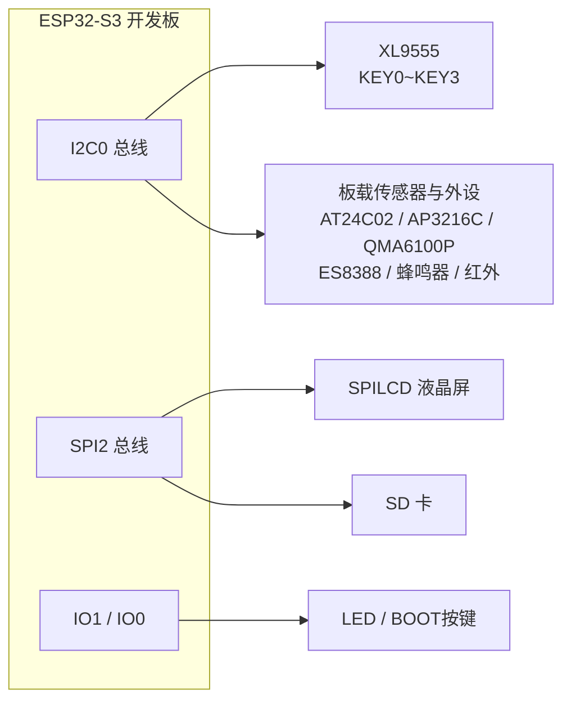
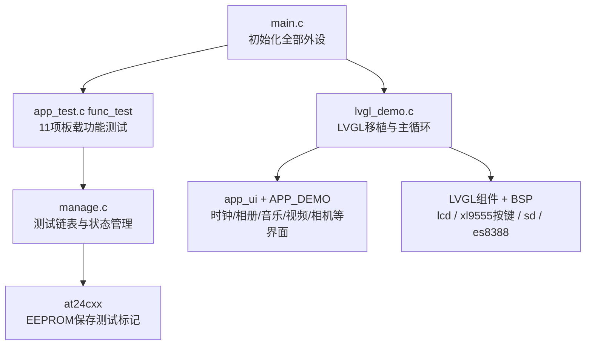
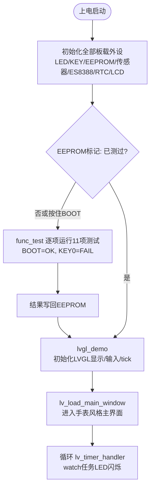

# 36 板载外设综合测试与 LVGL 演示实验

> 平台：正点原子 ESP32-S3 开发板 ｜ 框架：ESP-IDF ｜ 难度：★★★★☆
>
> 一句话简介：一个「出厂自检 + 智能手表 UI」综合工程——开机先逐项测试板载外设（LED、按键、蜂鸣器、EEPROM、传感器、SD 卡、音频、USB 等），全部通过后进入 **LVGL** 图形界面，展示时钟、相册、音乐、视频、相机等多个 demo。

---

## 1. 实验简介

> 说明：本文件夹虽名为 `36_bootloader`，但从 `main/main.c` 的实际内容看，它是正点原子的**板载外设测试实验**（出厂综合测试程序），并非 ESP-IDF 自定义 bootloader 实验，本 README 按真实内容撰写。

这个工程相当于把前面各个实验「串成一台整机」：

1. **自检阶段（`func_test()`）**：程序先读 AT24C02 里的测试标记，若板子还没测过，就依次运行 11 项板载功能测试（LED、KEY、BEEP、AT24、ADC、AP3216C、SD、QMA6100P、RMT 红外、ES8388、USB），每项由人工确认 OK/FAIL，结果记录在链表中，测完把标记写进 EEPROM，下次开机不再重复测试；
2. **演示阶段（`lvgl_demo()`）**：初始化 LVGL 图形库（显示接口 + 按键输入接口 + esp_timer 时基），加载主界面，进入一个类似**智能手表**的 UI，可浏览时钟、相册、音乐、视频、测量、相机、文件等多个 LVGL demo。

学完本实验你将掌握：

- 用「函数指针 + 链表」组织测试项目（`test_create()` / `test_handler()`）；
- 用 EEPROM 保存状态实现「只测一次」的出厂测试逻辑；
- LVGL V8 在 ESP-IDF 上的移植三要素：显示回调、输入设备、tick 时基。

## 2. 生活类比

这就像**新手机出厂前的质检 + 开机引导演示**：

- `func_test()` = 质检流水线：每个工位检查一个部件（屏幕亮点、喇叭、震动、传感器……），质检员（你）按 BOOT 键确认「这项 OK」，按 KEY0 记「FAIL」；
- AT24C02 里的标记 = 机器背面的「QC PASS」贴纸——贴过了，下次开机直接跳过质检；
- `lvgl_demo()` = 通过质检后开机进入的「手表表盘」主界面，左右切换就能玩相册、听歌、看视频。

## 3. 硬件连接

### 引脚分配（核心）

| 元件 | 开发板引脚 | 说明 |
| :--- | :--- | :--- |
| LED（板载） | IO1 | 测试项 / watch 任务闪烁指示 |
| BOOT 按键 | IO0 | 测试时确认 OK / 跳过 |
| KEY0~KEY3（经 XL9555） | IO1_7 / IO1_6 / IO1_5 / IO1_4 | 测试 FAIL 标记、UI 操作 |
| XL9555 IIC_SCL / IIC_SDA | IO42 / IO41 | IO 扩展芯片 |
| SPILCD（1.3/2.4 寸） | SPI2 总线 | 测试界面 + LVGL 显示 |
| 板载外设 | 各自总线 | AT24C02、AP3216C、QMA6100P、ES8388、蜂鸣器、红外、SD 卡、USB 等 |

### 连接图



## 4. 程序架构



## 5. 程序流程



## 6. 核心代码讲解

### 6.1 程序入口：一口气初始化所有外设（`main.c`）

```c
void app_main(void)
{
    ...
    i2c0_master = iic_init(I2C_NUM_0);  /* 初始化IIC0 */
    spi2_init();                        /* 初始化SPI */
    led_init();                         /* 初始化LED */
    key_init();                         /* 初始化KEY */
    xl9555_init(i2c0_master);           /* IO扩展芯片初始化 */
    at24cxx_init(i2c0_master);          /* 初始化24CXX */
    ap3216c_init(i2c0_master);          /* 初始化AP3216C */
    qma6100p_init(i2c0_master);         /* 初始化三轴加速度计 */
    es8388_init(i2c0_master);           /* ES8388初始化 */
    rtc_set_time(2023,12,26,11,32,00);  /* 设置RTC时间 */
    lcd_init();                         /* LCD屏初始化 */
    exfuns_init();                      /* 为fatfs相关变量申请内存 */
    func_test();                        /* 板载功能测试 */
    lvgl_demo();
}
```

**讲解**：这是全系列实验的「大集结」——LED、按键、IO 扩展、EEPROM、环境光传感器、加速度计、音频 CODEC、RTC、LCD、文件系统一次全部初始化，然后先自检（`func_test`）、后演示（`lvgl_demo`），两个函数都不返回或顺序执行。

### 6.2 用链表注册测试项目（`manage.c` / `app_test.c`）

```c
Test_Typedef *test_create(char name[], int (*pfunc)(Test_Typedef * obj))
{
    static int i = 0;
    Test_Typedef * obj = malloc(sizeof(Test_Typedef));      /* 申请测试控制块 */
    obj->label = i ++;                                      /* 赋予标号 */
    obj->Function = pfunc;                                  /* 指向测试函数 */
    obj->name_test = name;                                  /* 实验名称 */
    atk_list_add_tail(&test_list_head, &obj->test_list_node);/* 尾部插入链表 */
    return obj;
}

void func_test(void)
{
    ...
    test_create("LED",  led_test);
    test_create("KEY",  key_test);
    test_create("BEEP", beep_test);
    test_create("AT24", at24cx_test);
    test_create("ADC",  adc_test);
    test_create("AP3216C", ap3216c_test);
    test_create("SD",   sd_test);
    test_create("QMA6100P", qma6100p_test);
    test_create("RMT",  rmt_test);
    test_create("ES8388", es8388_test);
    test_create("USB",  usb_test);
    test_handler();     /* 遍历链表逐项执行, 失败项记入 test_status */
    ...
}
```

**讲解**：每个测试项被封装成一个「控制块」：名字 + 函数指针，挂到链表尾部；`test_handler()` 遍历链表逐个调用，`TEST_FAIL` 的结果按位记进 `test_status`。想增删测试项只需增删一行 `test_create()`——这是非常经典的**表驱动**设计。另外，`func_test()` 开头会比对 EEPROM 中的标记，只有「没测过」的板子（或开机按住 BOOT 强制清标记）才会真正进入测试。

### 6.3 单项测试的人机交互（`app_test.c` 以 LED 为例）

```c
int led_test(Test_Typedef * obj)
{
    uint8_t key = 0;
    uint8_t xl_key = 0;
    lcd_show_string(10, 30 + obj->label * 16, lcd_self.width, 16, 16, obj->name_test, WHITE);

    while(1)
    {
        key = key_scan(0);
        xl_key = xl9555_key_scan(0);
        LED_TOGGLE();

        if (key == BOOT_PRES)       /* BOOT键: 这项OK */
        {
            LED(1);
            vTaskDelay(500);
            printf("******OK!******\r\n");
            lcd_show_string(lcd_self.width - 95, 30 + obj->label * 16, lcd_self.width, 16, 16, "OK", WHITE);
            return TEST_OK;
        }

        if (xl_key == KEY0_PRES)    /* KEY0: 这项FAIL */
        {
            LED(1);
            printf("******FAIL!******\r\n");
            lcd_show_string(lcd_self.width - 95, 30 + obj->label * 16, lcd_self.width, 16, 16, "FAIL", RED);
            return TEST_FAIL;
        }
    }
}
```

**讲解**：LCD 按行号（`obj->label * 16`）列出所有项目名，当前项在跑演示（LED 闪烁），由人来判定：**BOOT = OK，KEY0 = FAIL**。每一项测试函数结构都类似，只是「演示动作」和「观察对象」不同。

### 6.4 LVGL 移植三要素（`lvgl_demo.c`）

```c
lv_init();              /* 初始化LVGL图形库 */
lv_port_disp_init();    /* lvgl显示接口初始化,放在lv_init()的后面 */
lv_port_indev_init();   /* lvgl输入接口初始化,放在lv_init()的后面 */

/* 为LVGL提供时基单元 */
const esp_timer_create_args_t lvgl_tick_timer_args = {
    .callback = &increase_lvgl_tick,
    .name = "lvgl_tick"
};
esp_timer_handle_t lvgl_tick_timer = NULL;
ESP_ERROR_CHECK(esp_timer_create(&lvgl_tick_timer_args, &lvgl_tick_timer));
ESP_ERROR_CHECK(esp_timer_start_periodic(lvgl_tick_timer, 1 * 1000));   /* 1ms一次tick */

lv_load_main_window();  /* 加载主界面 */

while (1)
{
    if (pdTRUE == xSemaphoreTake(xGuiSemaphore, portMAX_DELAY))
    {
        lv_timer_handler();                     /* LVGL心跳: 刷新界面/处理动画 */
        xSemaphoreGive(xGuiSemaphore);
    }
    vTaskDelay(pdMS_TO_TICKS(5));               /* 延时5毫秒 */
}
```

**讲解**：把 LVGL 跑起来只需三件事——**显示**（`lv_port_disp_init` 把刷屏函数注册给 LVGL）、**输入**（`lv_port_indev_init` 把 XL9555 按键注册为 keypad 输入设备）、**时基**（用 esp_timer 每 1ms 调一次 `increase_lvgl_tick`，LVGL 靠它计时驱动动画）。主循环里 `lv_timer_handler()` 是 LVGL 的「心跳」，用互斥量 `xGuiSemaphore` 保护，防止多任务同时操作 UI。此外还创建了一个 `watch` 任务专门闪 LED，指示系统运行。

## 7. 实验效果

1. **首次上电**（或开机按住 BOOT）：LCD 横屏进入测试界面，逐项运行 LED、KEY、BEEP、AT24、ADC、AP3216C、SD、QMA6100P、RMT、ES8388、USB 共 11 项测试，每项观察现象后按 **BOOT 记 OK / KEY0 记 FAIL**，串口同步打印测试进程与最终结果；
2. 测试标记写入 EEPROM 后，**以后开机直接跳过测试**；
3. 随后进入 LVGL 主界面（智能手表风格）：可切换查看**时钟、相册（图片）、音乐、视频、测量、相机、文件**等演示页面，LED 由 watch 任务控制以 500ms 闪烁；
4. 若 SD 卡未插或图片资源缺失，LCD 提示 "SD Card Failed!" / "image Error!" 并尝试从 SD 卡更新图片库。

## 8. 注意事项

1. 串口通讯波特率为 **115200**，建议使用 **XCOM 串口调试助手**（其他串口软件可能控制 DTR/RST 导致复位）。
2. LVGL 演示依赖 **SD 卡中的图片资源库**（时钟表盘、相册素材等），请插入存有正点原子配套资源的 SD 卡；首次运行会自动把资源更新到 Flash。
3. 想重新跑一遍出厂测试：开机时**按住 BOOT 键**，程序会清掉 EEPROM 里的测试标记再进入测试流程。
4. 工程包含 LVGL、MJPEG、esp32-camera 等大组件，编译时间较长、占用 Flash 较大，请使用 16MB Flash 分区表（`partitions-16MiB.csv`）。

## 9. 编译与烧录

```bash
idf.py set-target esp32s3
idf.py build
idf.py -p COMx flash monitor  # COMx 换成你的端口号
```

> 完整的开发环境搭建与烧录说明见 [根目录 README](../README.md)。

---

## 小结

本实验是全系列课程的「毕业汇演」：自检部分示范了**表驱动测试框架**（函数指针 + 链表 + EEPROM 标记），演示部分示范了 **LVGL 图形库的完整移植**（显示、输入、tick 三要素 + 心跳循环）。把前面各实验的外设驱动整合进一个工程协同工作，正是从「跑 demo」迈向「做产品」的关键一步。

| 关键 API | 作用 |
| :--- | :--- |
| `test_create()` / `test_handler()` | 注册测试项到链表 / 遍历执行并统计结果 |
| `at24cxx_read()` / `at24cxx_write()` | 读写 EEPROM，保存出厂测试标记 |
| `func_test()` | 板载功能测试总入口（11 项） |
| `lv_init()` | 初始化 LVGL 图形库 |
| `lv_port_disp_init()` / `lv_port_indev_init()` | 注册显示接口 / 按键输入接口 |
| `esp_timer_start_periodic()` | 周期定时器为 LVGL 提供 1ms tick |
| `lv_timer_handler()` | LVGL 心跳，驱动界面刷新与动画 |
| `lv_load_main_window()` | 加载手表风格主界面 |
