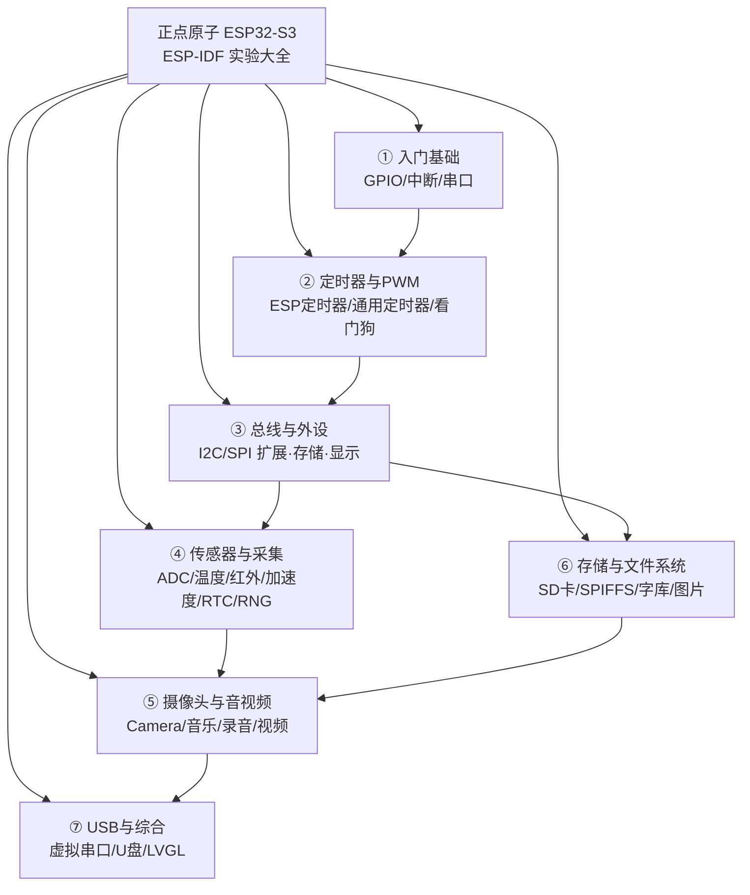
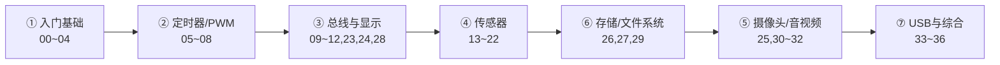

# 正点原子 ESP32-S3 开发板 · ESP-IDF 实验大全

> 基于乐鑫 **ESP-IDF** 框架的正点原子 ESP32-S3 系列例程，共 **39 个实验**，从点灯到摄像头、音视频、USB、LVGL 图形界面，循序渐进。
>
> 每个实验文件夹都配有一份**标准化 README**：包含实验简介、生活类比、硬件连接图、程序架构图、程序流程图、核心代码讲解、实验效果与注意事项，帮助初学者快速上手、高效学习。

---

## 目录

- [一、这套例程能学到什么](#一这套例程能学到什么)
- [二、知识地图](#二知识地图)
- [三、开发环境搭建](#三开发环境搭建)
- [四、如何编译与烧录一个实验](#四如何编译与烧录一个实验)
- [五、单个实验的工程结构](#五单个实验的工程结构)
- [六、实验索引（点击进入各实验 README）](#六实验索引点击进入各实验-readme)
- [七、推荐学习路径](#七推荐学习路径)
- [八、通用注意事项](#八通用注意事项)
- [九、参考资料](#九参考资料)

---

## 一、这套例程能学到什么

ESP32-S3 是一颗带 **Wi-Fi + 蓝牙 + 双核 Xtensa LX7 + 向量指令（可用于 AI）** 的高性能 MCU。本仓库用 39 个可直接编译烧录的实验，覆盖嵌入式开发的常见知识点：

- **GPIO / 中断 / 串口**：嵌入式最基础的输入输出与通信；
- **定时器 / PWM / 看门狗**：时间控制与系统可靠性；
- **I2C / SPI 总线与外设**：IO 扩展、EEPROM、OLED、LCD、RGB 屏、触摸屏；
- **各类传感器**：ADC、光环境、红外、温度、加速度计、随机数、RTC；
- **摄像头与音视频**：OV 摄像头预览/拍照、音乐播放、录音、视频播放；
- **存储与文件系统**：SD 卡、SPIFFS、字库与图片显示；
- **USB 与图形界面**：USB 虚拟串口 / U 盘、LVGL 综合演示。

## 二、知识地图

下面这张图把 39 个实验按知识领域归类，越靠上越基础，建议自上而下学习：



## 三、开发环境搭建

本仓库使用乐鑫官方 **ESP-IDF**（推荐 v5.x）。搭建步骤概览：

1. **安装 ESP-IDF**：参考乐鑫官方文档 <https://docs.espressif.com/projects/esp-idf/zh_CN/latest/esp32s3/get_started/>，Windows 可用「ESP-IDF Tools Installer」一键安装。
2. **安装 USB 驱动**：开发板通过板载 CH340（USB 转串口）或 ESP32-S3 原生 USB 与电脑通信，首次使用需安装对应驱动。
3. **打开 IDF 终端**：安装完成后，从开始菜单打开 *ESP-IDF Command Prompt*（Windows）或执行 `. $IDF_PATH/export.sh`（Linux/macOS），后续所有 `idf.py` 命令都在此终端里运行。
4. **用 VS Code 开发（可选）**：安装 *ESP-IDF* 扩展，可直接打开任意实验文件夹进行编辑、编译、烧录与调试（各实验已附带 `.vscode/` 配置）。

> 生活类比：ESP-IDF 就像一台「多功能机床」，`idf.py` 是机床的操作面板——`build` 是加工、`flash` 是把成品装到板子上、`monitor` 是实时看它运转。装好机床（IDF）+ 接好电源线（驱动），后面所有实验都共用这一套环境。

## 四、如何编译与烧录一个实验

每个实验都是**独立的 ESP-IDF 工程**，互不影响。以 `01_led` 为例：

```bash
cd 01_led                     # 进入实验目录
idf.py set-target esp32s3     # 首次编译前设置目标芯片（只需一次）
idf.py build                  # 编译，生成固件
idf.py -p COMx flash monitor  # 烧录并打开串口监视器；COMx 换成你的实际端口号
```

常用命令速查：

| 命令 | 作用 |
| :--- | :--- |
| `idf.py set-target esp32s3` | 设置目标芯片为 ESP32-S3 |
| `idf.py build` | 编译工程 |
| `idf.py -p COMx flash` | 烧录固件到开发板 |
| `idf.py -p COMx monitor` | 打开串口监视器（波特率 115200），`Ctrl+]` 退出 |
| `idf.py -p COMx flash monitor` | 烧录并立即监视（最常用） |
| `idf.py menuconfig` | 打开图形化配置菜单（分区表、组件选项等） |
| `idf.py fullclean` | 清理全部编译产物，重新来过 |

> 不知道端口号？Windows 在「设备管理器 → 端口(COM 和 LPT)」查看，Linux 下通常是 `/dev/ttyUSB0` 或 `/dev/ttyACM0`。

## 五、单个实验的工程结构

所有实验遵循统一的 ESP-IDF 工程布局，看懂一个就看懂全部：

```
01_led/
├── CMakeLists.txt          # 工程顶层构建脚本
├── sdkconfig               # menuconfig 生成的配置文件
├── partitions-16MiB.csv    # 16MB Flash 分区表
├── README.md               # 本实验的标准化说明文档
├── main/
│   ├── CMakeLists.txt      # 主组件构建脚本
│   └── main.c              # 程序入口 app_main()，业务逻辑
└── components/
    └── BSP/                # 板级支持包：各外设驱动（LED/KEY/LCD/I2C…）
        ├── LED/led.c .h
        └── ...
└── .vscode/                # VS Code / ESP-IDF 插件配置
```

- **`main/main.c`**：程序从这里开始（`app_main`），是你要重点阅读的业务逻辑；
- **`components/BSP/`**：正点原子封装好的底层驱动，`main.c` 通过调用这些驱动来操作硬件；
- **`partitions-16MiB.csv`**：Flash 分区表，音视频/字库/U 盘等实验依赖它划分 storage、vfs、spiffs 等区域。

## 六、实验索引（点击进入各实验 README）

> 难度：★☆☆☆☆ 最简单 → ★★★★★ 最综合。建议按编号顺序学习。

### ① 入门基础（GPIO / 中断 / 串口）

| # | 实验 | 难度 | 一句话简介 |
| :-- | :-- | :--: | :-- |
| 00 | [ESP32-IDF 基础工程](00_basic/README.md) | ★☆☆☆☆ | 认识 IDF 工程，串口打印芯片信息 |
| 01 | [LED 灯实验](01_led/README.md) | ★☆☆☆☆ | GPIO 输出，让 LED 闪烁 |
| 02 | [按键输入实验](02_key/README.md) | ★☆☆☆☆ | GPIO 输入，按键控制 LED |
| 03 | [外部中断实验](03_exit/README.md) | ★★☆☆☆ | 用中断代替轮询检测按键 |
| 04 | [串口通信实验](04_uart/README.md) | ★★☆☆☆ | UART 收发，与上位机对话 |

### ② 定时器与 PWM

| # | 实验 | 难度 | 一句话简介 |
| :-- | :-- | :--: | :-- |
| 05 | [高分辨率定时器(ESP定时器)](05_esp_timer/README.md) | ★★☆☆☆ | esp_timer 回调翻转 LED |
| 06 | [通用定时器实验](06_gp_timer/README.md) | ★★★☆☆ | GPTimer 周期报警事件 |
| 07 | [看门狗实验](07_wdt/README.md) | ★★☆☆☆ | 用定时器模拟看门狗喂狗/复位 |
| 08-1 | [软件改变 PWM 占空比](08-1_sw_pwm/README.md) | ★★☆☆☆ | LEDC 手动渐变呼吸灯 |
| 08-2 | [硬件改变 PWM 占空比](08-2_hw_pwm/README.md) | ★★☆☆☆ | LEDC Fade 硬件渐变呼吸灯 |

### ③ 总线与外设（I2C / SPI / 显示）

| # | 实验 | 难度 | 一句话简介 |
| :-- | :-- | :--: | :-- |
| 09 | [IO 扩展实验](09_iic_exio/README.md) | ★★★☆☆ | I2C 驱动 XL9555 扩展按键/蜂鸣器 |
| 10 | [EEPROM 实验](10_iic_eeprom/README.md) | ★★★☆☆ | I2C 驱动 24C02 读写数据 |
| 11 | [OLED 实验](11_oled/README.md) | ★★★☆☆ | 0.96 寸 OLED 显示字符 |
| 12 | [SPILCD 实验](12_spilcd/README.md) | ★★★☆☆ | SPI 彩色液晶屏显示与切底色 |
| 23 | [RGB 屏(LTDC LCD)实验](23_rgb/README.md) | ★★★☆☆ | ESP32-S3 RGB 接口驱动大屏 |
| 24 | [触摸屏实验](24_touch/README.md) | ★★★☆☆ | 电容触摸屏 5 点手写 |
| 28 | [汉字显示实验](28_chinese_display/README.md) | ★★★☆☆ | 字库存取与 LCD 汉字显示 |

### ④ 传感器与数据采集

| # | 实验 | 难度 | 一句话简介 |
| :-- | :-- | :--: | :-- |
| 13 | [RTC 实验](13_rtc/README.md) | ★★☆☆☆ | 片内 RTC 实时时钟，LCD 显示时间 |
| 14 | [ADC 实验](14_adc/README.md) | ★★☆☆☆ | 内部 ADC 采集电压 |
| 15 | [光环境传感器 AP3216C](15_ap3216c/README.md) | ★★★☆☆ | 环境光/接近/红外三合一 |
| 16 | [RMT 红外接收实验](16_infrared_reception/README.md) | ★★★☆☆ | 红外遥控信号接收解码 |
| 17 | [RMT 红外发送实验](17_infrared_transmission/README.md) | ★★★★☆ | 红外信号发送+自收自解 |
| 18 | [内部温度传感器](18_internal_Temperature/README.md) | ★★☆☆☆ | 读取芯片内部温度 |
| 19 | [DS18B20 数字温度传感器](19_ds18b20/README.md) | ★★☆☆☆ | 单总线(1-Wire)读温度 |
| 20 | [DHT11 温湿度传感器](20_dht11/README.md) | ★★☆☆☆ | 单总线读温湿度 |
| 21 | [RNG 随机数实验](21_rng/README.md) | ★☆☆☆☆ | 硬件真随机数发生器 |
| 22 | [QMA6100P 三轴加速度计](22_qma6100p/README.md) | ★★★☆☆ | 三轴加速度与俯仰/翻滚角 |

### ⑤ 摄像头与音视频

| # | 实验 | 难度 | 一句话简介 |
| :-- | :-- | :--: | :-- |
| 25-1 | [摄像头实验](25_1_camera/README.md) | ★★★★☆ | OV 摄像头画面实时预览到 LCD |
| 25-2 | [照相机实验](25_2_camera_photograph/README.md) | ★★★★☆ | 按键拍照并存入 SD 卡 |
| 30 | [音乐播放器实验](30_music/README.md) | ★★★★☆ | ES8388+I2S 播放 SD 卡 WAV |
| 31 | [录音机实验](31_recoding/README.md) | ★★★★☆ | I2S 采集录音存 WAV 并回放 |
| 32 | [视频播放器实验](32_videoplayer/README.md) | ★★★★★ | MJPEG 解码播放 AVI 视频 |

### ⑥ 存储与文件系统

| # | 实验 | 难度 | 一句话简介 |
| :-- | :-- | :--: | :-- |
| 26 | [SD 卡实验](26_sd/README.md) | ★★☆☆☆ | 挂载 SD 卡(FatFs)读容量 |
| 27 | [SPIFFS 实验](27_spiffs/README.md) | ★★☆☆☆ | 内部 Flash 文件系统读写 |
| 29 | [图片显示实验(数码相框)](29_pitures/README.md) | ★★★☆☆ | 循环播放 SD 卡图片 |

### ⑦ USB 与综合应用

| # | 实验 | 难度 | 一句话简介 |
| :-- | :-- | :--: | :-- |
| 33 | [USB 虚拟串口(Slave)](33_usb_uart/README.md) | ★★☆☆☆ | 原生 USB 模拟 CDC 串口 |
| 34 | [FLASH 模拟 U 盘](34_usb_flash_u/README.md) | ★★★☆☆ | USB MSC 把 Flash 变 U 盘 |
| 35 | [SD 卡模拟 U 盘](35_usb_sd_u/README.md) | ★★★☆☆ | USB MSC 把 SD 卡变 U 盘 |
| 36 | [板载外设综合测试 + LVGL](36_bootloader/README.md) | ★★★★☆ | 出厂自检 + LVGL 手表 UI 综合演示 |

## 七、推荐学习路径



- **零基础**：严格按 00 → 36 编号顺序，先跑通再读代码；
- **有单片机经验**：可跳过 00~04，直接从感兴趣的模块（如显示、传感器、摄像头）切入；
- **做项目**：把 `components/BSP/` 里需要的驱动复制到自己的工程，参考 36 号综合实验了解如何把多个外设整合协同。

## 八、通用注意事项

1. **串口波特率统一为 115200**，串口监视器/助手请设成一致；
2. 建议使用 **XCOM / SSCOM** 串口助手——其他助手可能自动控制 DTR/RTS 信号，导致 MCU 复位或程序不运行；
3. 部分实验（音视频、字库、图片、U 盘）依赖 **SD 卡中的配套资源**，请使用正点原子提供的资料 SD 卡，并按各实验 README 说明放置文件；
4. 涉及 **ADC** 的实验，输入电压务必在 **0 ~ 3.3V** 之间，并接好参考电压，否则可能损坏芯片；
5. 大工程（如 32 视频播放、36 综合演示）编译耗时较长、占用 Flash 较大，请使用随附的 **16MB 分区表** `partitions-16MiB.csv`；
6. 红外（16/17）等实验**仅支持 MCU 屏，不支持 RGB 屏**，接线前请核对各实验 README 的引脚表。

## 九、参考资料

- ESP-IDF 官方文档：<https://docs.espressif.com/projects/esp-idf/zh_CN/latest/esp32s3/>
- ESP32-S3 数据手册与技术参考手册：<https://www.espressif.com/zh-hans/support/documents/technical-documents>
- FreeRTOS 官方文档：<https://www.freertos.org/>
- LVGL 官方文档：<https://docs.lvgl.io/>
- 正点原子官网：<https://www.alientek.com/> ｜ 技术论坛：<https://www.openedv.com/>

---

> 本仓库文档由标准化模板生成，每个实验 README 均包含硬件连接图、程序架构图、流程图与核心代码讲解。若发现与源码不一致之处，以对应实验文件夹内的真实代码为准，欢迎指正完善。
